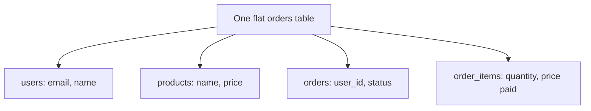

## In one line
Normalization means storing each fact in exactly one place so copies can never contradict each other; denormalization means deliberately adding a copy to make an important read faster, and taking on the job of keeping it in sync.

## The problem it solves
Imagine the shop starts with one wide table, like a spreadsheet, where each row is one line of one order:

| order_id | user_email | user_name | product_name | product_price_cents | quantity |
|---|---|---|---|---|---|
| 5001 | asha@example.com | Asha Rao | Ceramic mug | 1299 | 2 |
| 5001 | asha@example.com | Asha Rao | Node basics video course | 4900 | 1 |
| 5002 | asha@example.com | Asha Rao | Cotton T-shirt | 1999 | 1 |

Asha's email is stored three times. That causes three classic problems, called **anomalies**:

- **Update anomaly.** Asha changes her email. Code updates the rows for her latest order but misses the others. Now the database holds two different emails for the same person, and nobody knows which is right.
- **Insert anomaly.** You add a new product. It can't appear anywhere until someone orders it, because there is no row to put it in.
- **Delete anomaly.** You delete order 5002. The only record that the T-shirt exists, and what it costs, disappears with it.

Each problem comes from the same root: one fact living in many rows.

## Everyday analogy
A team keeps a client's phone number in ten different documents. When the number changes, someone updates three of them. Next week, half the team calls a dead number. The fix is one contact list that every document links to.

Where it breaks down: looking something up in the contact list costs almost nothing for a person. In a database, every link you follow is a join, and joins on large tables have a real cost. That cost is why denormalization exists.

## How it works
Two terms first:

- A **key** here means the column or columns that identify a row (the primary key).
- Column B **depends on** column A if knowing A tells you B. Knowing a product's id tells you its name, so `product_name` depends on `product_id`.

The **normal forms** are a checklist, applied in order. The first three are what interviews ask about.

1. **First normal form (1NF): one value per cell.** No lists in a column (`items = "mug x2, course x1"`) and no repeating columns (`product1`, `product2`). Every row can be identified by a key. In the flat table, the key is `(order_id, product_name)`.
2. **Second normal form (2NF): depend on the whole key.** In a table with a two-column key, every other column must depend on *both* columns. `product_price_cents` depends only on the product, and `user_email` depends only on the order. They don't belong here. Move product facts to `products` and order facts to `orders`.
3. **Third normal form (3NF): depend on nothing but the key.** No column may depend on another non-key column. If `orders` held `user_id` and `user_email`, the email would depend on `user_id`, not on the order. Move it to `users`.

The classic one-line summary: every column must depend on "the key, the whole key, and nothing but the key."


*Notice: after the split, each fact (an email, a price) lives in exactly one table, and the others point to it by id.*

The result is the schema from [Relational modeling](#/topic/relational-modeling). Asha's email now lives in one row of `users`. Changing it once changes it everywhere.

**Denormalization** goes the other way on purpose. You store a copy or a precomputed answer, so an important read skips joins or heavy calculations. Common examples:

- A **counter column**, such as `videos.view_count`, instead of counting millions of view rows on every page load.
- A **stored total**, such as `orders.total_cents`, instead of summing items each time.
- A **materialized view**: a saved query result that PostgreSQL stores like a table and refreshes when you ask it to.
- A cache in Redis, or a search index, which are also copies of the database.

Every copy needs a sync plan: update it in the same transaction, with a **trigger** (code the database runs automatically on every insert or update), or with a scheduled refresh that accepts some staleness.

> [!NOTE]
> `order_items.unit_price_cents` looks like a copy of `products.price_cents`, but it isn't denormalization. It records a different fact: the price paid on that day. It must not change when the product's price changes.

## Real example
**See the update anomaly happen** (real output from PostgreSQL 17, using the flat table above):

```sql
UPDATE orders_flat SET user_email = 'asha.rao@example.com' WHERE order_id = 5002;
SELECT DISTINCT user_name, user_email FROM orders_flat;
```

```text
 user_name |      user_email
-----------+----------------------
 Asha Rao  | asha.rao@example.com
 Asha Rao  | asha@example.com
```

One person, two emails. In the normalized schema the same change is one row in `users`, and the contradiction can't happen.

**Denormalize a slow report with a materialized view.** The admin dashboard shows best-selling products. On a test database with 2 million `order_items` rows, the live query took about 65 ms on a warm laptop:

```sql
SELECT product_id, sum(quantity) AS units_sold
FROM order_items GROUP BY product_id ORDER BY units_sold DESC LIMIT 5;
```

Fine once, but costly if many admins refresh the dashboard all day while the shop is busy. Save the answer instead:

```sql
CREATE MATERIALIZED VIEW product_sales AS
SELECT product_id,
       sum(quantity) AS units_sold,
       sum(quantity * unit_price_cents) AS revenue_cents
FROM order_items
GROUP BY product_id;

-- A unique index is required for REFRESH ... CONCURRENTLY.
CREATE UNIQUE INDEX product_sales_product_id_idx ON product_sales (product_id);

-- The dashboard reads the saved result: about 0.1 ms in the same test.
SELECT product_id, units_sold FROM product_sales ORDER BY units_sold DESC LIMIT 5;

-- Run every 10 minutes from a scheduled job. CONCURRENTLY lets reads continue.
REFRESH MATERIALIZED VIEW CONCURRENTLY product_sales;
```

The price: the dashboard can be up to 10 minutes behind. For a sales chart that's fine. For stock at checkout it would not be. The timings are from one run on a laptop; yours will differ, but the gap between "aggregate 2 million rows" and "read 1,000 saved rows" is real.

## How to say it in an interview

> [!INTERVIEW]
> **30 seconds:** "Normalization means storing each fact once, so data can't contradict itself. In practice I aim for third normal form: one value per column, and every column depends on the key, the whole key, and nothing but the key. So a user's email lives only in the users table, and orders reference the user by id. Denormalization is the deliberate opposite: I add a copy, like a counter or a materialized view, when a read is too slow, and I make sure something keeps that copy in sync."

> [!INTERVIEW]
> **2 minutes:** Start with the 30-second answer, then add:
>
> "Without normalization you get update, insert, and delete anomalies. If a customer's email is copied into every order row, changing it in one place leaves the others wrong.
>
> I start normalized because it's the safest default, and I only denormalize after measuring a real problem. For example, a video page showing a view count shouldn't run COUNT over millions of view rows on every load. I'd keep a `view_count` column, increment it in the same transaction as the view insert, or batch the increments from a queue if contention gets high. For an admin sales dashboard I'd use a materialized view refreshed every few minutes.
>
> The tradeoff is read speed versus write complexity and freshness. Every copy is a place where data can drift, so each one needs a clear owner and a sync strategy. And I'd separate true duplication from historical snapshots: the price on an order item is a different fact, not a copy."

## Follow-up questions interviewers ask

<details>
<summary>What's the difference between 2NF and 3NF in one sentence each?</summary>

- **2NF:** no column depends on only *part* of a multi-column key (product name in a table keyed by order and product).
- **3NF:** no column depends on another *non-key* column (user email in a table where it's determined by `user_id`).

In practice, a table with a single-column primary key is already in 2NF once it's in 1NF, because there is no "part" of the key to depend on.

</details>

<details>
<summary>How do you keep a denormalized counter correct?</summary>

Options, from simplest:

1. **Same transaction:** insert the view row and run `UPDATE videos SET view_count = view_count + 1 WHERE id = 301` together, so both happen or neither does.
2. **Trigger:** the database updates the counter automatically on insert. Safe, but hidden from people reading the app code.
3. **Async batching:** push events to a queue and apply increments in batches. Fastest under heavy write traffic, but the count lags.
4. **Periodic recompute:** a nightly job recalculates the true count to fix any drift.

One very hot row updated thousands of times a second becomes a bottleneck, because each update must wait for the previous one's lock. That's when batching wins.

</details>

<details>
<summary>Is a Redis cache a form of denormalization?</summary>

Yes, in spirit. It's a copy of database data kept elsewhere for faster reads, with the same core problem: keeping it in sync. See [Cache invalidation strategies](#/topic/cache-invalidation).

</details>

<details>
<summary>Why do document databases like MongoDB often store denormalized data?</summary>

Because they are designed for reading one document in one go, and joins across collections are slower or limited. So you copy the fields you need into the document (for example, the product name inside each order). You accept extra work on updates in exchange for single-read pages. See [MongoDB basics](#/topic/mongodb-basics).

</details>

## Common mistakes and misconceptions

> [!MISTAKE]
> "Normalized means slow." Joins on indexed keys are routine work for a relational database. Most slow queries come from missing indexes or fetching too much, not from normalization. Measure before denormalizing.

> [!MISTAKE]
> Denormalizing without a sync plan. If the only thing keeping `orders.total_cents` correct is "everyone remembers to update it", it will drift. Name the mechanism: transaction, trigger, or scheduled refresh.

> [!MISTAKE]
> Treating historical snapshots as duplication and "fixing" them. Pointing old orders at the product's current price changes past invoices.

> [!MISTAKE]
> Splitting tables to chase higher normal forms in every case. Splitting a user's single address into its own table, with no need for it, adds joins and no benefit. Third normal form is the practical target.

## Tradeoffs: when NOT to use it
**When NOT to normalize further:**
- Read-heavy pages that always need the same combined data, where the joins or aggregates are measurably too slow.
- Analytics and reporting databases (data warehouses), which are usually denormalized on purpose into wide tables built for scanning.
- Historical records that must not change, such as prices and addresses on past orders.

**When NOT to denormalize:**
- Before measuring. An index often fixes the slow read with no duplication.
- When the copied data changes often and must be exact, such as stock levels or account balances.
- When you can't name who keeps the copy in sync.

## Check yourself

<details>
<summary>1. A table order_items(order_id, product_id, quantity, product_name) has key (order_id, product_id). Which normal form does it break, and how do you fix it?</summary>

Second normal form: `product_name` depends only on `product_id`, which is part of the key. Move `product_name` to the `products` table and look it up with a join.

</details>

<details>
<summary>2. Name the three anomalies and give a one-line example of each.</summary>

- **Update:** an email copied into many rows is changed in only some of them.
- **Insert:** a new product can't be stored until someone orders it.
- **Delete:** deleting the last order for a product erases the product's details.

</details>

<details>
<summary>3. You add a materialized view for a dashboard. What new problem have you taken on?</summary>

Staleness. The view only changes when it's refreshed, so you must schedule `REFRESH MATERIALIZED VIEW` and accept that the dashboard can be behind by up to that interval.

</details>

## Go deeper
- [Microsoft Learn: database normalization basics](https://learn.microsoft.com/en-us/office/troubleshoot/access/database-normalization-description)
- [PostgreSQL docs: materialized views](https://www.postgresql.org/docs/current/rules-materializedviews.html)
