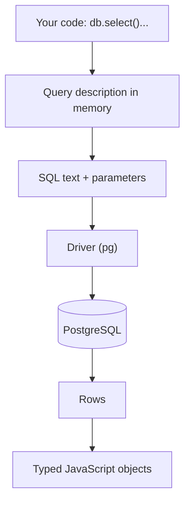

## In one line
An ORM or query builder is a library that lets you write database queries as JavaScript function calls, and turns them into SQL for you.

## The problem it solves
Your shop's backend talks to PostgreSQL in **SQL** (Structured Query Language), the text language relational databases understand. Writing it by hand inside JavaScript has real pain points:

- Queries are plain strings, so a typo or a renamed column only fails at runtime, often in production.
- Results come back with snake_case columns (`user_id`) that you keep converting to camelCase (`userId`).
- Building a query from optional filters means gluing strings together. Done carelessly, that allows **SQL injection**: an attacker sneaking their own SQL into your query through user input.

An ORM or query builder gives you functions that know your tables and columns, so your editor autocompletes them, TypeScript checks them, and the library builds safe SQL every time.

## Everyday analogy
A translator at a business meeting. You speak your language (JavaScript), the translator speaks to the other side (the database) in theirs (SQL), and passes the answers back.

Where it breaks down: a translator who paraphrases can say something clumsy or slow on your behalf. If you never check what was actually said, you won't know why the meeting went badly.

## How it works
Three levels, from closest to SQL to furthest from it:

- **Driver**: the low-level library that sends SQL text to the database and returns rows, such as `pg` for PostgreSQL. You write the SQL.
- **Query builder**: functions that mirror SQL clauses, such as `.select().from().where()`. Examples: Knex, Kysely, and Drizzle's SQL-like API. You still think in SQL, just with checked building blocks.
- **ORM** (object-relational mapper): maps each table to a **model** (a JavaScript description of the table) and lets you load related data as nested objects, such as "this order with its user and items". Examples: Prisma, Sequelize, TypeORM, and Drizzle's relational queries.

Whichever you use, a call turns into SQL the same way:

1. **Schema mapping.** You describe your tables once in code. The library now knows that the JavaScript field `userId` is the column `user_id`.
2. **Build.** Each method call adds a piece to an in-memory description of the query. Nothing is sent yet.
3. **Compile.** When you `await` it, the library turns that description into a SQL string plus a separate list of **parameters** (the values, sent as `$1`, `$2`). Because values never get pasted into the SQL text, injection is blocked by default.
4. **Execute.** The driver sends the SQL and parameters to the database over a pooled connection (see [Connection pooling](#/topic/connection-pooling)).
5. **Map back.** Rows come back. The library renames columns to fields, converts types such as dates, and, for an ORM, stitches related rows into nested objects.


*Notice: the database only ever sees plain SQL. The library is a translator on your side.*

The key interview point: the database has no idea an ORM exists. Every performance problem is still a SQL problem, so you must be able to see the SQL.

## Real example
This uses **Drizzle**, a widely used TypeScript ORM that also works in plain JavaScript and stays close to SQL.

**Setup:** Node.js 18+, `"type": "module"`, `npm install drizzle-orm pg`, and PostgreSQL with `users` and `orders` tables (`orders.user_id` references `users.id`). Tested with drizzle-orm 0.45.

**1. Describe the tables once** (`schema.js`):

```js
import { pgTable, bigint, text, timestamp } from 'drizzle-orm/pg-core';

export const users = pgTable('users', {
  id: bigint('id', { mode: 'number' }).primaryKey(),
  name: text('name').notNull(),
});

export const orders = pgTable('orders', {
  id: bigint('id', { mode: 'number' }).primaryKey(),
  userId: bigint('user_id', { mode: 'number' }).notNull(), // JS name -> column name
  status: text('status').notNull(),
  createdAt: timestamp('created_at', { withTimezone: true }).notNull(),
});
```

**2. Query, and log the SQL it generates** (`recent-orders.js`):

```js
import pg from 'pg';
import { drizzle } from 'drizzle-orm/node-postgres';
import { eq, desc } from 'drizzle-orm';
import { users, orders } from './schema.js';

const pool = new pg.Pool({ connectionString: process.env.DATABASE_URL });
const db = drizzle({ client: pool, logger: true }); // print every query it sends

export function getRecentPaidOrders() {
  return db
    .select({ id: orders.id, status: orders.status, customer: users.name })
    .from(orders)
    .innerJoin(users, eq(orders.userId, users.id))  // one query, no N+1
    .where(eq(orders.status, 'paid'))
    .orderBy(desc(orders.createdAt))
    .limit(50);
}
```

With `logger: true`, the console shows exactly what reached PostgreSQL:

```text
Query: select "orders"."id", "orders"."status", "users"."name" from "orders"
  inner join "users" on "orders"."user_id" = "users"."id"
  where "orders"."status" = $1 order by "orders"."created_at" desc limit $2
  -- params: ["paid", 50]
```

(Line breaks added for reading. The real log is one line.)

Notice `'paid'` and `50` travel as parameters, not inside the SQL text. You can also call `.toSQL()` on a query to get `{ sql, params }` without running it, and paste that SQL into `EXPLAIN` (see [Reading a slow query with EXPLAIN](#/topic/explain-analyze)).

For comparison, the same idea in **Prisma**, the other very common Node ORM, loads nested objects: `prisma.order.findMany({ where: { status: 'paid' }, include: { user: true }, take: 50 })`. Prisma logs its SQL when you create the client with `log: ['query']`.

## How to say it in an interview

> [!INTERVIEW]
> **30 seconds:** "An ORM maps database tables to objects in my code, and a query builder lets me build SQL with functions instead of strings. Both give me type safety, autocomplete, and parameterized queries, which protect against SQL injection. The catch is they hide the SQL, so I always turn on query logging in development to see what's actually sent, and I drop to raw SQL for complex reports."

> [!INTERVIEW]
> **2 minutes:** Start with the 30-second answer, then add:
>
> "The productivity win is real: when someone renames a column, TypeScript shows every query that breaks before we deploy, and the ORM can generate migrations from the schema.
>
> The tradeoff is that the database still only sees SQL, and the abstraction can generate bad SQL quietly. The classic case is N+1: looping over orders and loading each order's user separately. Another is fetching every column when the page needs two. So I log queries per request in development and check slow ones with `EXPLAIN`.
>
> For a reporting query with window functions and CTEs, I write raw SQL through the ORM's escape hatch, still with parameters, never string concatenation. ORM for everyday CRUD, SQL when the query is the hard part."

## Follow-up questions interviewers ask

<details>
<summary>Do ORMs prevent SQL injection?</summary>

Their normal query methods do, because values are sent as parameters, separate from the SQL text. Every ORM also has a raw-SQL escape hatch, and that is where injection comes back. Drizzle's `` sql`... ${userId}` `` template is still parameterized, but `sql.raw(input)` pastes text straight in. Prisma's `$queryRaw` is parameterized, while `$queryRawUnsafe` with string building is not. Never put user input into an "unsafe" or "raw" method. See [OWASP essentials](#/topic/owasp-essentials).

</details>

<details>
<summary>How do you see the SQL an ORM generates?</summary>

- Turn on the ORM's query log: `logger: true` in Drizzle, `log: ['query']` in Prisma.
- Get the SQL without running it: `.toSQL()` in Drizzle.
- On the database side, PostgreSQL can log statements slower than a threshold with the `log_min_duration_statement` setting, and `pg_stat_statements` counts each query shape.

Then run the SQL through `EXPLAIN ANALYZE`.

</details>

<details>
<summary>ORM, query builder, or raw SQL: how do you choose?</summary>

- **ORM** for typical app CRUD (create, read, update, delete) with relations: fastest to write, type-safe, easy to refactor.
- **Query builder** when you want SQL-shaped control with type checking, or the team thinks in SQL.
- **Raw SQL** for complex reports, bulk data jobs, and database features the library doesn't support.

Most real projects mix them: an ORM for most queries plus a few hand-written SQL ones.

</details>

<details>
<summary>What is the difference between Active Record and Data Mapper?</summary>

Two ORM styles:

- **Active Record**: each object knows how to save itself, as in `user.name = 'Asha'; await user.save()`. Sequelize works mostly this way.
- **Data Mapper**: objects are plain data, and a separate client or repository saves them, as in `prisma.user.update(...)`. Prisma and Drizzle work like this.

Active Record is quick to start with. Data Mapper keeps database access in one clear place, which helps in larger codebases and tests.

</details>

## Common mistakes and misconceptions

> [!MISTAKE]
> "With an ORM I don't need to know SQL." You need SQL to debug every slow query, read `EXPLAIN` output, and write the reports the ORM can't express.

> [!MISTAKE]
> Load, change, save for counters: read the product, do `product.stock - 1` in JavaScript, then save it. Two requests at once both read 10 and both save 9. Use one atomic update (`SET stock = stock - 1`) instead. See [Isolation levels and race conditions](#/topic/isolation-levels).

> [!MISTAKE]
> Loading related data inside a loop, which causes [the N+1 problem](#/topic/n-plus-one). Ask for the relation up front (`include`, `with`, or a join).

> [!MISTAKE]
> Trusting auto-generated migrations blindly. Some tools turn a column rename into "drop column, add column", which deletes the data. Always read the generated SQL before applying it. See [Migrations](#/topic/migrations).

## Tradeoffs: when NOT to use it
- **Complex analytics.** Window functions (calculations across related rows, like a running total), CTEs (named sub-queries with `WITH`), and big reports are clearer and faster as hand-written SQL.
- **Bulk data work.** Importing a million rows through model objects is slow. Use PostgreSQL's `COPY` bulk-load command or batched `INSERT` statements.
- **Tiny services or scripts.** A two-query script doesn't need a schema layer. The `pg` driver with parameters is enough.
- **Teams that won't look at the SQL.** An ORM without query logging and review hides problems until production traffic finds them.

## Check yourself

<details>
<summary>1. What is the actual difference between a query builder and an ORM?</summary>

A query builder mirrors SQL with functions (`select`, `from`, `where`) and returns rows. An ORM adds models for each table and loads related data as nested objects (an order with its user and items). Many libraries, Drizzle included, offer both styles.

</details>

<details>
<summary>2. Your ORM call is slow. What are your first two steps?</summary>

Turn on query logging (or use `.toSQL()`) to see the exact SQL and how many queries run. Then run that SQL with `EXPLAIN ANALYZE` to see whether it is missing an index, fetching too much, or repeating in a loop.

</details>

<details>
<summary>3. Is db.execute(sql.raw(`SELECT * FROM users WHERE email = '${email}'`)) safe?</summary>

No. `sql.raw` pastes the text into the query without parameters, so an attacker-controlled `email` can change the SQL. Use the parameterized form: `` sql`SELECT * FROM users WHERE email = ${email}` ``.

</details>

## Go deeper
- [Drizzle docs: getting started with PostgreSQL](https://orm.drizzle.team/docs/get-started-postgresql)
- [Prisma docs: logging the SQL queries Prisma Client sends](https://www.prisma.io/docs/orm/prisma-client/observability-and-logging/logging)
- [OWASP: SQL injection prevention cheat sheet](https://cheatsheetseries.owasp.org/cheatsheets/SQL_Injection_Prevention_Cheat_Sheet.html)
