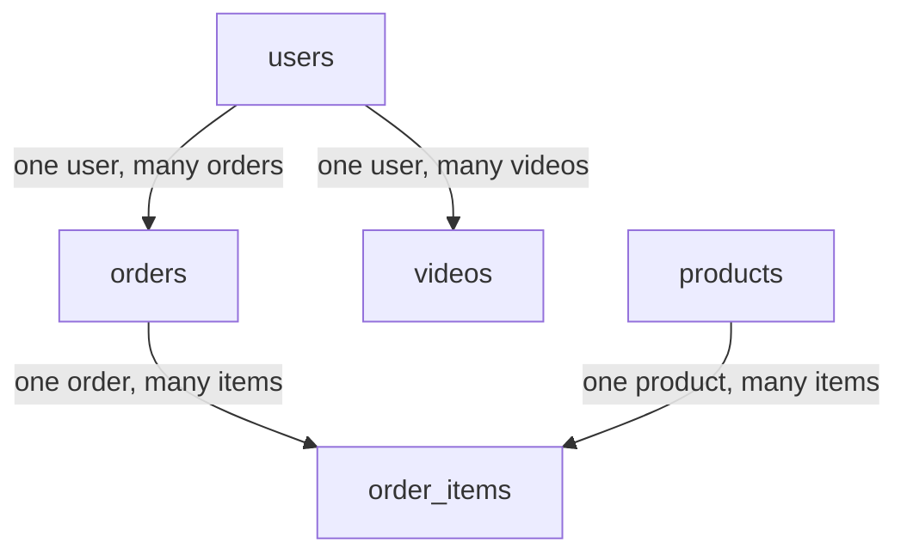

## In one line
Relational modeling means turning the things in your app into tables, giving every row a unique id, and linking tables through those ids so the database itself keeps the links correct.

## The problem it solves
Your shop has users, products, orders, and videos. A first attempt often stores each order as one big blob: the customer's name and email, plus a list of product names and prices, all copied in.

Then real questions arrive:

- A customer changes their email. Which of their 40 orders still show the old one?
- Someone deletes a user. Their orders now point at nobody.
- A bug inserts an order for user 999999, who doesn't exist. Nothing stops it.
- Finance asks "how many mugs did we sell last month?" You have to parse every blob.

Relational modeling fixes this by storing each fact once, in the right table, and letting the database refuse data that breaks the rules.

## Everyday analogy
A school office. Each student has a record card with a unique roll number. Class registers don't copy the student's address. They list roll numbers. To find a student's address, you look up their roll number in the card file.

Where it breaks down: in the office, nothing stops a teacher writing a roll number that doesn't exist. A database with foreign keys rejects it on the spot.

## How it works
A few terms first:

- A **table** holds one kind of thing, such as `orders`. Each **row** is one item, and each **column** is one property with a fixed **data type** (number, text, timestamp).
- A **primary key** (PK) is the column that uniquely identifies each row. It can never be empty or repeated. Usually it's a number the database generates, like `id`.
- A **foreign key** (FK) is a column that holds another table's primary key, such as `orders.user_id`. The database checks that the referenced row exists.
- A **constraint** is a rule the database enforces on every write: `NOT NULL` (must have a value), `UNIQUE` (no duplicates), `CHECK` (a condition, such as `price_cents >= 0`).

**The modeling steps:**

1. **List the nouns.** Users, products, orders, videos. Each becomes a table.
2. **Give each table a primary key.** Use a generated id rather than something that can change, like an email.
3. **Choose columns and types.** Store money as integer cents (`1299`), not a decimal float that can round wrongly. Store times as `timestamptz` (a timestamp with time zone).
4. **Link one-to-many with a foreign key on the "many" side.** One user has many orders, so `orders` gets `user_id`. You never put a list of order ids inside `users`.
5. **Link many-to-many with a junction table.** An order contains many products, and a product appears in many orders. Neither table can hold the link, so a third table, `order_items`, holds one row per (order, product) pair. It is also the natural home for facts about the pair: quantity and the price paid.
6. **Link one-to-one with a unique foreign key.** For example, a `user_profiles` table whose `user_id` is both a foreign key and `UNIQUE`.
7. **Decide what happens on delete.** By default PostgreSQL refuses to delete a user who still has orders. `ON DELETE CASCADE` deletes the children too. Use it only when the children mean nothing alone, like items of a deleted order.


*Notice: `order_items` sits between orders and products. That junction table is what turns two one-to-many links into a many-to-many relationship.*

**What the database does for you.** When you insert an order, PostgreSQL looks up `user_id` in the `users` primary key and rejects the insert if it isn't there. Every primary key and `UNIQUE` constraint automatically gets an **index**: a sorted lookup structure that makes those checks fast. Foreign key columns do **not** get one automatically in PostgreSQL, so you add it yourself (MySQL's InnoDB engine does create one). See [Indexes](#/topic/indexes).

## Real example
This is the schema used across the database topics. Run it in `psql`, PostgreSQL's command-line client (for example inside `docker run -e POSTGRES_PASSWORD=dev postgres:17`).

```sql
CREATE TABLE users (
  id          bigint GENERATED ALWAYS AS IDENTITY PRIMARY KEY, -- auto-numbered PK
  email       text NOT NULL UNIQUE,
  name        text NOT NULL,
  created_at  timestamptz NOT NULL DEFAULT now()
);

CREATE TABLE products (
  id           bigint GENERATED ALWAYS AS IDENTITY PRIMARY KEY,
  name         text NOT NULL,
  price_cents  integer NOT NULL CHECK (price_cents >= 0), -- money as whole cents
  stock        integer NOT NULL DEFAULT 0 CHECK (stock >= 0)
);

CREATE TABLE orders (
  id          bigint GENERATED ALWAYS AS IDENTITY PRIMARY KEY,
  user_id     bigint NOT NULL REFERENCES users (id),  -- FK: one user, many orders
  status      text NOT NULL DEFAULT 'pending',
  created_at  timestamptz NOT NULL DEFAULT now()
);
```

```sql
CREATE TABLE order_items (                       -- junction table: orders <-> products
  order_id          bigint NOT NULL REFERENCES orders (id) ON DELETE CASCADE,
  product_id        bigint NOT NULL REFERENCES products (id),
  quantity          integer NOT NULL CHECK (quantity > 0),
  unit_price_cents  integer NOT NULL,            -- price paid at purchase time
  PRIMARY KEY (order_id, product_id)             -- one row per product per order
);

CREATE TABLE videos (
  id          bigint GENERATED ALWAYS AS IDENTITY PRIMARY KEY,
  user_id     bigint NOT NULL REFERENCES users (id),
  title       text NOT NULL,
  status      text NOT NULL DEFAULT 'processing',
  created_at  timestamptz NOT NULL DEFAULT now()
);

CREATE INDEX orders_user_id_idx ON orders (user_id);  -- FKs are not indexed for you
```

**Put the order back together with joins** (with a few sample rows loaded):

```sql
SELECT o.id AS order_id, o.status, p.name, oi.quantity, oi.unit_price_cents
FROM orders o
JOIN order_items oi ON oi.order_id = o.id
JOIN products p     ON p.id = oi.product_id
WHERE o.user_id = 981
ORDER BY o.id;
```

```text
 order_id | status  |           name           | quantity | unit_price_cents
----------+---------+--------------------------+----------+------------------
     5001 | paid    | Ceramic mug              |        2 |             1299
     5001 | paid    | Node basics video course |        1 |             4900
     5002 | pending | Cotton T-shirt           |        1 |             1999
```

**Watch the constraints protect you.** These are real errors from that database:

```text
INSERT INTO orders (user_id) VALUES (999999);
ERROR:  insert or update on table "orders" violates foreign key constraint "orders_user_id_fkey"
DETAIL:  Key (user_id)=(999999) is not present in table "users".

DELETE FROM users WHERE id = 982;
ERROR:  update or delete on table "users" violates foreign key constraint "orders_user_id_fkey" on table "orders"
DETAIL:  Key (id)=(982) is still referenced from table "orders".

INSERT INTO users (email, name) VALUES ('asha@example.com', 'Someone Else');
ERROR:  duplicate key value violates unique constraint "users_email_key"
```

Each of these would be a silent data bug if the rules lived only in your Node.js code.

## How to say it in an interview

> [!INTERVIEW]
> **30 seconds:** "I start from the entities, like users, products, and orders, and make each one a table with a generated primary key. One-to-many relationships get a foreign key on the many side, so orders have a user_id. Many-to-many relationships get a junction table, like order_items between orders and products, which also stores quantity and the price paid. I add NOT NULL, UNIQUE, and CHECK constraints so the database rejects bad data, and I index the foreign keys I query by."

> [!INTERVIEW]
> **2 minutes:** Start with the 30-second answer, then add:
>
> "For an e-commerce app, `order_items` has a composite primary key of order_id and product_id. It stores `unit_price_cents`, because the price on the order must not change when the product's price changes later. That's a historical fact, not duplication.
>
> I'm deliberate about deletes. Deleting an order cascades to its items, because items mean nothing alone. But deleting a user with orders is blocked, because finance needs those records. In practice I'd mark the user as deleted or anonymise them instead.
>
> The tradeoff is rigidity versus safety. Constraints and foreign keys catch bugs at write time and keep data consistent no matter which service writes it. The cost is that every schema change needs a migration script, and foreign keys can't span separate databases. In a microservices setup, those links have to be checked by the application instead."

## Follow-up questions interviewers ask

<details>
<summary>Why store unit_price_cents on order_items when products already has a price?</summary>

Because they are two different facts. `products.price_cents` is today's price. `order_items.unit_price_cents` is what this customer paid on that day. If you only stored the product's price, raising the mug to $14.99 would silently change every old invoice. The same applies to shipping addresses on orders.

</details>

<details>
<summary>Auto-increment ids or UUIDs?</summary>

- **Sequential ids** (`bigint` identity): 8 bytes, small fast indexes, readable. But they reveal volume (order 5001 tells a competitor roughly how many orders you have) and are guessable, so never rely on them being secret.
- **UUIDs**: 16 bytes, can be generated anywhere without asking the database, and hard to guess. Random UUIDs (version 4) scatter inserts across the index, which can slow writes on large tables. Time-ordered UUIDs (version 7) avoid most of that; PostgreSQL 18 added a `uuidv7()` function.

A common middle ground: a `bigint` primary key internally, plus a random public id in URLs.

</details>

<details>
<summary>Natural key or surrogate key?</summary>

A **natural key** is a real-world value that is already unique, like an email or an ISBN. A **surrogate key** is a generated id with no meaning. Prefer surrogate keys for the primary key, because real-world values change (people change emails) and every foreign key would have to change with them. Still put a `UNIQUE` constraint on the natural key.

</details>

<details>
<summary>How would you add product categories, where a product can be in several categories?</summary>

That's many-to-many, so add a `categories` table and a junction table:

```sql
CREATE TABLE categories (
  id    bigint GENERATED ALWAYS AS IDENTITY PRIMARY KEY,
  name  text NOT NULL UNIQUE
);
CREATE TABLE product_categories (
  product_id   bigint NOT NULL REFERENCES products (id) ON DELETE CASCADE,
  category_id  bigint NOT NULL REFERENCES categories (id) ON DELETE CASCADE,
  PRIMARY KEY (product_id, category_id)
);
```

Not a `category_ids` text column with `"3,7,12"` in it: the database can't check those ids, index them well, or join on them easily.

</details>

<details>
<summary>Should every foreign key have an index?</summary>

Usually yes, if you query by it (`WHERE user_id = 981`) or delete parent rows. Without an index on `orders.user_id`, deleting a user forces PostgreSQL to scan all of `orders` to check for references. The exception is a small table, or a foreign key you never filter or join on. Note that a composite primary key `(order_id, product_id)` already covers lookups by `order_id`, but not by `product_id` alone. See [Indexes](#/topic/indexes).

</details>

## Common mistakes and misconceptions

> [!MISTAKE]
> "We check the relationships in the app, so we don't need foreign keys." Every bug, script, and second service that touches the database bypasses that check. Foreign keys make orphaned rows impossible instead of unlikely.

> [!MISTAKE]
> Storing lists in a column (`product_ids = '42,7,15'`) or numbered columns (`product1`, `product2`). Both break as soon as an order has one more item. Use a child table.

> [!MISTAKE]
> Storing money as a floating-point number. `0.1 + 0.2` is `0.30000000000000004` in JavaScript, and float columns have the same rounding problem. Use integer cents or PostgreSQL's exact `numeric` type.

> [!MISTAKE]
> Using `ON DELETE CASCADE` everywhere. Cascading from `users` to `orders` means one mistaken delete wipes years of financial records. Cascade only to rows that are truly part of the parent.

## Tradeoffs: when NOT to use it
Strict relational modeling is the right default, but it has limits:

- **Data whose shape varies per row**, like product attributes that differ for mugs and T-shirts. Dozens of mostly empty columns or a generic key-value table get messy. A `jsonb` column is often cleaner. See [SQL vs NoSQL](#/topic/sql-vs-nosql).
- **Across service or database boundaries.** Foreign keys only work inside one database. If orders and users live in different services, the link is checked in code and kept eventually consistent.
- **Huge append-only logs**, like video view events. Foreign key checks on every insert cost time, and the events are rarely joined. Many teams skip the constraint there on purpose.
- **Very early prototypes**, when you don't yet know the entities. Even then, add constraints before real users arrive.

## Check yourself

<details>
<summary>1. A video can have many tags, and a tag can be on many videos. How do you model it?</summary>

A `tags` table, plus a junction table `video_tags (video_id, tag_id)` with a foreign key to each side and a composite primary key on both columns, so the same tag can't be added to the same video twice.

</details>

<details>
<summary>2. Where does the foreign key go in a one-to-many relationship between users and videos, and why?</summary>

On `videos`, as `videos.user_id`. Each video has exactly one owner, so one column holds it. The user side would need a list, which a single column can't hold properly.

</details>

<details>
<summary>3. What happens if you try to delete a user who still has orders, with the schema above?</summary>

PostgreSQL refuses with a foreign key error, because `orders.user_id` has no `ON DELETE` rule, so the default (`NO ACTION`) blocks it. You'd first delete or reassign the orders, or more realistically, soft-delete or anonymise the user instead.

</details>

## Go deeper
- [PostgreSQL docs: constraints (primary, foreign, unique, check)](https://www.postgresql.org/docs/current/ddl-constraints.html)
- [PostgreSQL tutorial: foreign keys](https://www.postgresql.org/docs/current/tutorial-fk.html)
