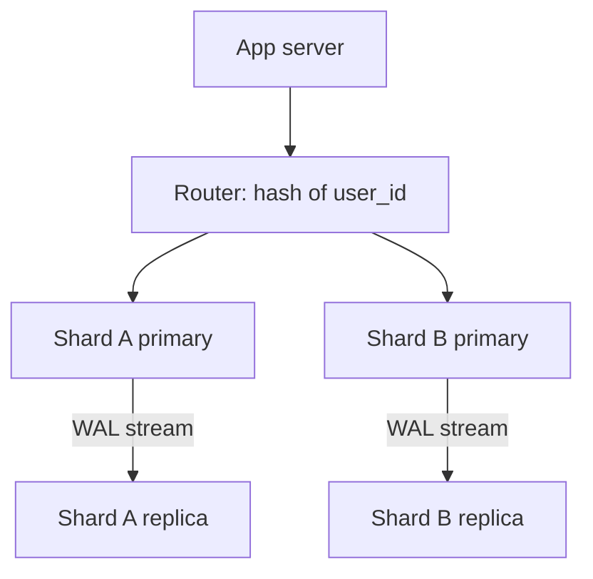

## In one line
Replication keeps full copies of the same database on several machines so you can read faster and survive a crash, while sharding splits the data into pieces stored on different machines so you can hold and write more than one machine can handle.

## The problem it solves
Your video and shop app runs on one PostgreSQL server. As it grows, three different things go wrong:

- **Too many reads.** Product pages, video listings, and search hit the database thousands of times a second. The CPU is maxed out, mostly by `SELECT`s.
- **One machine is a single point of failure.** If that server's disk dies, the whole site is down, and recent data may be lost.
- **Too much data or too many writes.** Billions of view events or orders no longer fit comfortably on one machine, or the write rate exceeds what one server can do.

Replication solves the first two. Sharding solves the third. They are different tools, and interviewers check that you know which is which.

## Everyday analogy
**Replication** is a library that buys several copies of the same popular book. More people can read at once, and losing one copy loses nothing. But when the author publishes a correction, every copy must be updated, and for a while some copies are outdated.

**Sharding** is splitting an encyclopedia into volumes A–F, G–M, and so on, kept on different shelves. Each shelf holds less, but to find something you must first know which volume it is in, and a question that spans every volume means visiting every shelf.

Where it breaks down: books don't change after printing. Databases change constantly, which is what makes keeping copies in sync and moving data between shards hard.

## How it works

### Replication
- The **primary** is the one server that accepts writes.
- A **replica** (also called a standby or read replica) is a copy that receives every change from the primary and serves reads only.

PostgreSQL replicates using its **WAL** (write-ahead log), the file where it records every change before applying it to its tables. **Streaming replication** works like this:

1. Your app sends `UPDATE products SET price_cents = 1499 WHERE id = 42` to the primary.
2. The primary writes the change to its WAL, applies it, and confirms the commit to your app.
3. Each replica keeps a connection open to the primary, which streams the new WAL records to it.
4. The replica replays those records, so its data becomes identical to the primary's.
5. Reads sent to the replica now see the new price.

By default this is **asynchronous**: step 2 confirms before any replica has the change. The delay until a replica catches up is **replica lag**. On a healthy network it is usually milliseconds, but heavy writes, long-running queries on the replica, or network trouble can push it to seconds or more. During lag, a replica returns old data.

**Synchronous replication** makes the primary wait for at least one replica to confirm before reporting the commit. No confirmed write is lost if the primary dies, but every write is slower, and writes stall if that replica is down.

If the primary fails, **failover** promotes a replica to be the new primary. Managed services such as AWS RDS do this automatically. Self-hosted setups use tools such as Patroni.

### Sharding
- A **shard** is one independent database holding a subset of the rows, with the same tables as the others.
- The **shard key** is the column that decides which shard a row lives on, for example `user_id`.
- The **router** is the code or proxy that looks at the shard key and sends the query to the right shard.

Common ways the router picks a shard:

- **Hash:** compute a hash of the key and take it modulo the number of shards. It spreads keys evenly, but adding a shard changes where most keys belong, so real systems use many small virtual shards or consistent hashing to move only a fraction of the data.
- **Range:** users 1 to 1,000,000 on shard A, the next million on B. Range queries are easy, but new users all land on the newest shard, making it a **hot shard** (one shard doing most of the work).
- **Directory:** a lookup table records which shard each key or tenant lives on. Flexible, but the directory itself must be fast and reliable.

A good shard key has many distinct values, spreads load evenly, and matches your most common queries. With `user_id`, "show my orders" touches one shard. "Total sales across all users" must query every shard and combine the results, which is called **scatter-gather**.


*Notice: sharding splits users between A and B, and replication then copies each shard. Large systems use both.*

## Real example
**Setup:** Node.js 18+, `"type": "module"`, `npm install pg`. A PostgreSQL primary with one streaming replica. `PRIMARY_URL` and `REPLICA_URL` point at them.

**Check replication on the primary**, in `psql`:

```sql
SELECT client_addr, state, sync_state, replay_lag FROM pg_stat_replication;
--  client_addr |   state   | sync_state |   replay_lag
--  172.19.0.3  | streaming | async      | 00:00:00.000036
```

On a replica, `SELECT pg_is_in_recovery();` returns `t` (true), and any write fails with `cannot execute UPDATE in a read-only transaction`.

**Route reads and writes in the app:**

```js
import pg from 'pg';

const primary = new pg.Pool({ connectionString: process.env.PRIMARY_URL });
const replica = new pg.Pool({ connectionString: process.env.REPLICA_URL });

export async function updatePrice(productId, priceCents) {
  await primary.query('UPDATE products SET price_cents = $1 WHERE id = $2', [priceCents, productId]);
}

export async function getProductForListing(productId) {
  // Catalogue page: a second behind is fine, so use the replica
  const { rows } = await replica.query('SELECT * FROM products WHERE id = $1', [productId]);
  return rows[0];
}

export async function getProductForCheckout(productId) {
  // Checkout: the price must be exact, so read from the primary
  const { rows } = await primary.query('SELECT * FROM products WHERE id = $1', [productId]);
  return rows[0];
}
```

**A minimal hash router for sharding by user:**

```js
import pg from 'pg';
import { createHash } from 'node:crypto';

const shards = [
  new pg.Pool({ connectionString: process.env.SHARD_0_URL }),
  new pg.Pool({ connectionString: process.env.SHARD_1_URL }),
];

export function shardFor(userId) {
  const hash = createHash('md5').update(String(userId)).digest(); // spreads ids evenly
  return shards[hash.readUInt32BE(0) % shards.length];
}

export async function getOrdersForUser(userId) {
  // All of one user's orders live on one shard: one database, one query
  const { rows } = await shardFor(userId).query(
    'SELECT id, status, created_at FROM orders WHERE user_id = $1', [userId]);
  return rows;
}
```

With 10,000 test user ids, this split them almost exactly in half (5,007 and 4,993). In production you rarely hand-roll this: Citus (for PostgreSQL), Vitess (for MySQL), and MongoDB's built-in sharding provide the router.

## How to say it in an interview

> [!INTERVIEW]
> **30 seconds:** "Replication copies the whole database to other servers. The primary takes writes and streams its changes to read replicas, which gives me more read capacity and a standby for failover. Sharding splits the data by a shard key, like user ID, across separate databases, so each holds and writes only part of it. Replication scales reads; sharding scales writes and storage, at the cost of a lot more complexity."

> [!INTERVIEW]
> **2 minutes:** Start with the 30-second answer, then add:
>
> "In PostgreSQL, replicas follow the primary by streaming the write-ahead log. It's asynchronous by default, so there's replica lag. The classic bug is read-your-own-writes: a user changes their display name, the next page reads from a replica, and they see the old name. I handle that by reading from the primary for that user right after a write, and for anything that must be exact, like checkout.
>
> I'd only shard after exhausting simpler options, because cross-shard joins, transactions, and reports get hard. If I had to, for orders I'd shard by `user_id`, since nearly every query is 'this user's orders', and I'd use a tool like Citus rather than my own router."

## Follow-up questions interviewers ask

<details>
<summary>How do you handle replica lag in the app?</summary>

- Send reads that must be fresh (checkout, balances, the page right after a user's own update) to the primary.
- After a user writes, pin their reads to the primary for a few seconds.
- Monitor lag (`replay_lag` in `pg_stat_replication`) and stop routing reads to a replica that falls too far behind.

</details>

<details>
<summary>How do you choose a shard key?</summary>

It should have many distinct values, spread traffic evenly, and appear in most queries so each query hits one shard. `user_id` or a tenant id usually works for a user-centric app. Bad choices: `country` (a few huge shards), `created_at` (all new writes land on one shard), or a key your main queries don't filter on (every query becomes scatter-gather). Changing the shard key later means moving all the data, so choose carefully.

</details>

<details>
<summary>Why not just use hash(key) % N and add servers when needed?</summary>

Going from N to N+1 changes the result of `% N` for most keys, so most rows must move to a different shard at once. Systems avoid this with **consistent hashing** (a scheme where adding a server moves only a small share of keys), or by creating many more logical shards than servers (say 256) and moving whole logical shards between servers as you grow.

</details>

<details>
<summary>Is a read replica a backup?</summary>

No. Replication copies every change immediately, including mistakes. A `DELETE FROM orders` without a `WHERE` reaches the replica within milliseconds. You still need real backups that let you go back in time. See [Backups and restore](#/topic/backups).

</details>

<details>
<summary>What is the difference between partitioning and sharding?</summary>

**Partitioning** splits one big table into smaller pieces **on the same server**, for example orders by month, which keeps indexes small and makes dropping old data fast. **Sharding** puts the pieces on **different servers**. Partitioning is much simpler and is often enough.

</details>

## Common mistakes and misconceptions

> [!MISTAKE]
> "Replicas make writes faster." They don't. Every write still goes to the primary, and the primary also has to stream it to every replica.

> [!MISTAKE]
> Sharding too early. It turns joins, unique constraints, and transactions across users into distributed-systems problems. One well-tuned PostgreSQL server with replicas handles a lot.

> [!MISTAKE]
> Picking a shard key with few values or one that grows in order (like a timestamp). All the load lands on one hot shard and the others sit idle.

## Tradeoffs: when NOT to use it
- **Read replicas when reads aren't the bottleneck.** If the slow part is writes, or one missing index, replicas add cost and lag for nothing. Measure first.
- **Sharding before simpler fixes.** Indexes, caching, a bigger machine, partitioning, and archiving old data are far cheaper.
- **Sharding when queries cut across the key.** If most queries need data from every user, every query becomes scatter-gather and gets slower, not faster.

## Check yourself

<details>
<summary>1. A user edits their profile and the next page shows the old version. A second later it's fine. What happened?</summary>

The write went to the primary, but the next read went to a replica that hadn't replayed the change yet (replica lag). Route that user's reads to the primary right after they write.

</details>

<details>
<summary>2. Your database is at 90% CPU, mostly from SELECT queries on product pages. Replication or sharding?</summary>

Replication (read replicas), plus caching. The load is reads, which replicas can share. Sharding is for write volume or data size that one primary can't handle.

</details>

<details>
<summary>3. Orders are sharded by user_id. Why is "total revenue yesterday" slow?</summary>

Yesterday's orders are spread across every shard, so the query must run on all of them and combine the results (scatter-gather). Such reports usually run on a separate analytics copy of the data instead.

</details>

## Go deeper
- [PostgreSQL docs: log-shipping standby servers and streaming replication](https://www.postgresql.org/docs/current/warm-standby.html)
- [PostgreSQL docs: monitoring replication with pg_stat_replication](https://www.postgresql.org/docs/current/monitoring-stats.html#MONITORING-PG-STAT-REPLICATION-VIEW)
- [MongoDB docs: sharding and shard keys](https://www.mongodb.com/docs/manual/sharding/)
