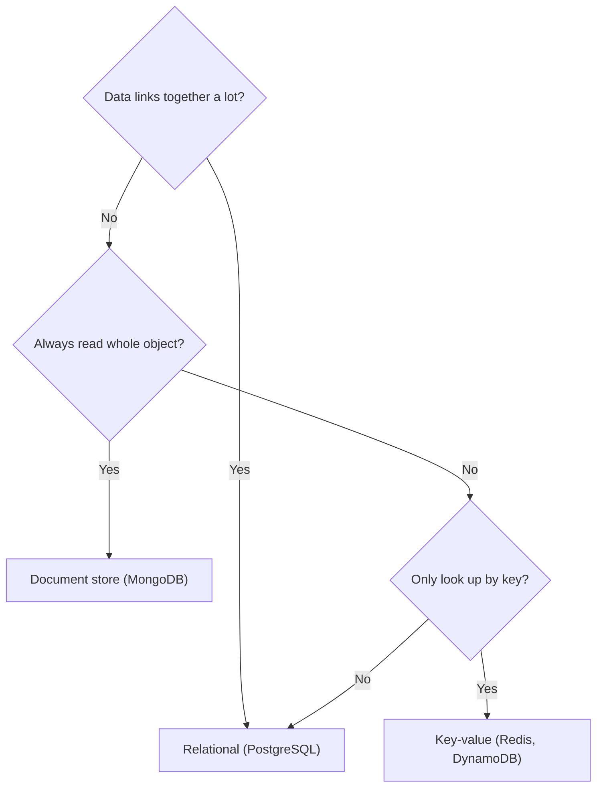

## In one line
Choose a database by the shape of your data and the questions you will ask it: relational (SQL) databases for connected data and flexible questions, NoSQL databases for data you always read and write in one predictable way.

## The problem it solves
Your video and shop app needs to store users, products, orders, videos, and watch history. You open a new project and must pick a **database**: the program that stores data safely on disk and answers questions about it.

The choice is hard to undo. Six months later you have millions of rows and queries spread through the code. Pick badly and you feel it daily: connected data (users, orders, products) in a store that can't combine it well means writing join logic by hand in Node.js. A firehose of tiny events (a "watched 10 more seconds" ping from every viewer) in a store built for careful bookkeeping means paying for guarantees you don't need.

Interviewers ask "SQL or NoSQL?" to see whether you choose from requirements or from habit.

## Everyday analogy
A relational database is a **filing cabinet with cross-references**. Customers in one drawer, orders in another, and each order slip says "customer 981". You can answer almost any question by following the references.

A document database is a **box per order**. Everything about order 5001 sits in one box: items, prices, a copy of the address. Grabbing one order is instant. "Which customers bought mugs?" means opening many boxes.

Where it breaks down: modern databases borrow from each other. PostgreSQL can store boxes (JSON), and MongoDB can follow references. The labels describe default strengths, not hard limits.

## How it works
**Relational databases** (PostgreSQL, MySQL, SQL Server) store data in **tables**.

- A **table** is like a spreadsheet for one kind of thing: `users`, `orders`.
- A **row** is one item (one user). A **column** is one property (their email).
- The **schema** is the declared structure: which tables exist, their columns, and the type of each column. The database rejects data that doesn't fit. This is called **schema-on-write**.
- **SQL** (Structured Query Language) is the language you use to ask questions: `SELECT name FROM users WHERE id = 981`.
- A **join** combines rows from several tables in one query, by matching ids. "Orders with their user's email" is one join.
- A **transaction** groups several changes so they all succeed or all fail. See [Transactions and ACID](#/topic/transactions-acid).

**NoSQL** ("not only SQL") is a loose label for every database that is *not* table-and-join based. The four main families:

| Family | Stores data as | Examples | Good at |
|---|---|---|---|
| **Document** | JSON-like documents, nested | MongoDB, Firestore | Reading and writing one whole object |
| **Key-value** | A value saved under a key | Redis, DynamoDB | Very fast lookup by exact key |
| **Wide-column** | Rows grouped by a partition key | Cassandra, ScyllaDB | Huge write volumes, spread over many machines |
| **Graph** | Nodes and the links between them | Neo4j | "Friends of friends" style questions |

Most NoSQL stores are **schema-on-read**: the database accepts any shape, and your code interprets the fields when it reads them. The schema still exists; it lives in your code.

Many NoSQL systems were built from day one to spread data across many machines, called **sharding**. The price: joins and transactions across machines are limited, so you shape the data around queries you already know. See [Replication and sharding](#/topic/replication-sharding).

**How to choose, step by step:**

1. **List the questions** the app will ask: "user 981's last 20 orders", "top sellers this week". These are your **access patterns**.
2. **Look at the relationships.** Do users, orders, and products point at each other, and will you combine them in new ways later? That favours relational.
3. **Check correctness needs.** Money and stock, where several changes must happen together, favour strong transactions.
4. **Check the scale honestly.** Billions of small events per day, or thousands of orders?
5. **Default to PostgreSQL** unless a specific need points elsewhere. It also stores JSON.


*Notice: two of the four outcomes are a relational database. NoSQL wins when the access pattern is narrow and known in advance.*

## Real example
The same order from the shop, stored both ways.

**Relational (PostgreSQL).** Order 5001 is spread over three tables: `orders`, `order_items`, and `products`. A join puts it back together:

```sql
SELECT o.id AS order_id, o.status, p.name, oi.quantity, oi.unit_price_cents
FROM orders o
JOIN order_items oi ON oi.order_id = o.id   -- items that belong to each order
JOIN products p     ON p.id = oi.product_id -- the product each item refers to
WHERE o.user_id = 981
ORDER BY o.id;
```

```text
 order_id | status  |           name           | quantity | unit_price_cents
----------+---------+--------------------------+----------+------------------
     5001 | paid    | Ceramic mug              |        2 |             1299
     5001 | paid    | Node basics video course |        1 |             4900
     5002 | pending | Cotton T-shirt           |        1 |             1999
```

The payoff is flexibility. A question nobody planned for, such as "units sold per product", is just another query over the same tables (`GROUP BY` product, `sum` the quantities).

**Document (MongoDB, in `mongosh`, its shell).** The whole order is one document, with the items nested inside:

```js
db.orders.insertOne({
  _id: 5001,
  userId: 981,
  status: "paid",
  createdAt: new Date("2026-10-20T09:15:00Z"),
  items: [ // nested: no join needed to read the order
    { productId: 42, name: "Ceramic mug", quantity: 2, unitPriceCents: 1299 },
    { productId: 7, name: "Node basics video course", quantity: 1, unitPriceCents: 4900 }
  ]
});

db.orders.find({ userId: 981 }).sort({ createdAt: -1 }); // one read returns everything
```

One lookup, no join. The cost: the product name is copied into every order, so renaming a product leaves old orders with the old name. For an order that is usually right (it's what the customer bought). For a user's email it would be a bug.

**PostgreSQL can do both.** A `jsonb` column stores JSON inside a table, which suits product attributes that differ per category (a mug has a capacity, a T-shirt has a size):

```sql
ALTER TABLE products ADD COLUMN attributes jsonb NOT NULL DEFAULT '{}';
UPDATE products SET attributes = '{"color": "blue", "capacity_ml": 350}' WHERE id = 42;
SELECT id, name FROM products WHERE attributes @> '{"color": "blue"}'; -- "contains" match
```

## How to say it in an interview

> [!INTERVIEW]
> **30 seconds:** "I choose based on the data's shape and the queries I need. Relational databases like PostgreSQL store data in tables with a fixed schema, support joins, and have strong transactions, so they suit connected data like users, orders, and payments. NoSQL databases, like MongoDB or DynamoDB, are better when I always read and write data in one known pattern, or need to spread huge volumes across many machines. My default is PostgreSQL, and I add a NoSQL store when a specific need justifies it."

> [!INTERVIEW]
> **2 minutes:** Start with the 30-second answer, then add:
>
> "For an e-commerce and video app, I'd put users, products, orders, and payments in PostgreSQL. Those entities reference each other, I need transactions when an order reduces stock, and the business will keep asking new reporting questions that joins answer easily.
>
> I'd use Redis next to it for caching and sessions, where I only look things up by key. If we recorded a watch-progress event every few seconds per viewer, I'd consider a write-heavy store like DynamoDB or Cassandra, keyed by user and video.
>
> The tradeoff with NoSQL is that you model around today's queries. A document per order makes 'show this order' fast, but a new question like 'who bought mugs and T-shirts' is harder, and duplicated data must be kept in sync by my code. With relational, the cost is a schema that needs migrations, and spreading writes over many machines takes more work. Most apps never reach that point, so I start relational."

## Follow-up questions interviewers ask

<details>
<summary>When would you actually choose MongoDB over PostgreSQL?</summary>

When the data is a self-contained document you read and write as a whole, and its shape varies: content-management pages built from different blocks, catalogs with very different attributes per category, event payloads from many sources.

Be honest that PostgreSQL's `jsonb` covers many of these cases too, so the deciding factor is often the team's experience.

</details>

<details>
<summary>"SQL databases don't scale." Is that true?</summary>

No. A single PostgreSQL server on modern hardware can handle a lot of traffic, and you can add:

- **Read replicas:** copies that serve read queries.
- **Partitioning:** splitting a big table into smaller pieces by date or id.
- **Sharding tools** such as Citus, or databases like CockroachDB that speak SQL across many machines.

What is true: spreading *writes* across many machines is easier in databases designed for it from the start, such as Cassandra or DynamoDB. See [Vertical vs horizontal scaling](#/topic/vertical-horizontal-scaling).

</details>

<details>
<summary>Do NoSQL databases support joins and transactions?</summary>

Many do now, with limits. MongoDB has `$lookup` for joins and has supported multi-document transactions since version 4.0; a change to a single document is always atomic. DynamoDB offers transactions over a limited number of items. Many wide-column and key-value stores only guarantee atomic changes within one key or partition.

The document-database habit is to keep data that changes together in one document, so you rarely need those features.

</details>

<details>
<summary>Can you use more than one database in the same app?</summary>

Yes, and most production apps do. This is called **polyglot persistence**. A typical setup: PostgreSQL as the **source of truth** (the copy that counts when others disagree), Redis for cache and sessions, a search engine like OpenSearch for product search, and object storage like S3 for video files.

The cost is operational: every extra database must be run, backed up, monitored, and kept in sync.

</details>

## Common mistakes and misconceptions

> [!MISTAKE]
> "NoSQL is faster." Speed comes from matching the storage layout to the query, plus good indexes. A key lookup in DynamoDB and a primary-key lookup in PostgreSQL are both fast. A query that doesn't fit a document model can be much slower in MongoDB than a join in PostgreSQL.

> [!MISTAKE]
> "NoSQL means no schema." The schema moves into your code. If half your documents say `userId` and the other half say `user_id`, every reader must handle both. MongoDB even supports schema validation rules for this reason.

> [!MISTAKE]
> Choosing for scale you don't have. "We might have a billion users" is not a requirement. Design for the next 10x, and pick what makes correct code easiest today.

## Tradeoffs: when NOT to use it
**When NOT to use a NoSQL store as your main database:**
- Data with many relationships that you query in changing ways (orders, users, products, payments).
- Money and stock, where several rows must change together correctly.
- Early products where you don't yet know the questions you'll ask.

**When NOT to use a relational database:**
- Simple, very high-volume writes keyed one way, like telemetry or watch-progress pings.
- Pure key lookups that need sub-millisecond answers, like caches and sessions (use Redis).
- Full-text search with ranking and typo tolerance (use a search engine alongside it).

## Check yourself

<details>
<summary>1. What does "schema-on-write" vs "schema-on-read" mean?</summary>

Schema-on-write: the database checks the data's structure when you save it, and rejects data that doesn't fit (relational databases). Schema-on-read: the database stores whatever you give it, and your code interprets the structure when reading (most document stores).

</details>

<details>
<summary>2. You store each order as a MongoDB document with the product name copied inside. The product is renamed. What happens, and is it a problem?</summary>

Existing orders keep the old name, because it was copied. For orders this is usually correct, since it records what the customer actually bought. If you needed the new name everywhere, you'd have to update every copy, or store only the `productId` and look it up.

</details>

<details>
<summary>3. Name a part of the video app where a non-relational store is a good fit, and why.</summary>

Examples: sessions or a product cache in Redis (lookup by key only, needs to be very fast). Watch-progress events in a wide-column store or DynamoDB (huge write volume, always read by user and video). The orders themselves stay in PostgreSQL.

</details>

## Go deeper
- [PostgreSQL docs: JSON types (json and jsonb)](https://www.postgresql.org/docs/current/datatype-json.html)
- [MongoDB docs: data modeling](https://www.mongodb.com/docs/manual/data-modeling/)
- [AWS: What is NoSQL?](https://aws.amazon.com/nosql/)
