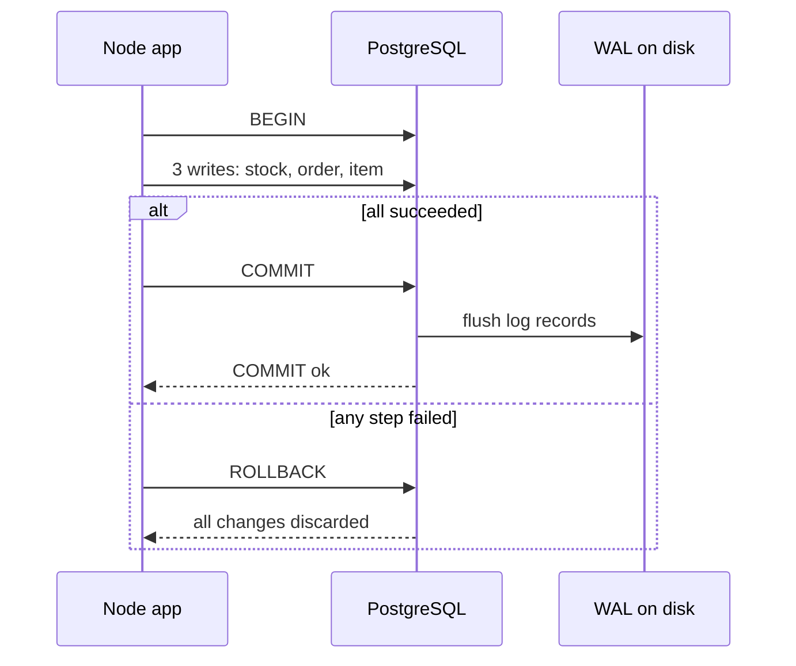

## In one line
A transaction groups several database changes into one unit that either happens completely or not at all, and ACID names the four guarantees (atomicity, consistency, isolation, durability) that make that unit trustworthy.

## The problem it solves
Placing an order in the shop takes three writes:

1. Reduce the mug's stock by 2.
2. Insert a row into `orders`.
3. Insert a row into `order_items`.

Now imagine the Node.js process crashes, or step 3 fails, right after step 1. Stock went down, but no order exists. The mugs are "sold" to nobody. Or step 2 succeeds and step 3 fails: the customer sees an empty order. Run that code thousands of times a day and these half-finished states pile up, and someone has to find and fix them by hand.

You need a way to say: "these three changes belong together. All or nothing."

## Everyday analogy
Paying at a shop till. The cashier scans your items, you tap your card, and the sale completes: you leave with the goods and the shop has the money. If your card is declined, the cashier voids the whole sale. Nobody walks out with half the items paid for.

Where it breaks down: a database runs thousands of these "tills" at once on the same products, and it must keep finished sales safe even if the power fails a millisecond after the receipt prints. That's what the I and the D in ACID add.

## How it works
A **transaction** starts with `BEGIN` and ends with either:

- `COMMIT`: make every change permanent and visible to others, all at once.
- `ROLLBACK`: throw every change away, as if nothing happened.

If you don't write `BEGIN`, PostgreSQL runs each statement as its own tiny transaction. This is called **autocommit**. So a single `UPDATE` is already all-or-nothing; you need `BEGIN` when *several* statements must succeed together.

**ACID**, letter by letter, with how PostgreSQL delivers each one:

1. **Atomicity: all or nothing.** If any statement fails, or the server crashes before `COMMIT`, none of the transaction's changes count. *How:* every row PostgreSQL writes is tagged with the id of the transaction that wrote it. A separate commit log records whether each transaction committed or aborted. Rows from a transaction that never committed are simply never shown to anyone, and a background cleanup process called **VACUUM** removes them later.
2. **Consistency: rules always hold.** A transaction moves the database from one valid state to another. *How:* the database checks your **constraints**, rules declared in the schema like `CHECK (stock >= 0)`, foreign keys, and `UNIQUE`. If a change breaks one, the transaction fails. Business rules that aren't written as constraints ("an order needs at least one item") are your code's job.
3. **Isolation: concurrent transactions don't trip over each other.** Others never see your half-finished work. *How:* **MVCC** (multi-version concurrency control). An update doesn't overwrite a row in place. It writes a new version of the row, and each transaction reads from a **snapshot**, a consistent view of which versions were committed when it looked. Readers don't block writers, and writers don't block readers. How strict the isolation is depends on the isolation level. See [Isolation levels and race conditions](#/topic/isolation-levels).
4. **Durability: committed means saved.** Once `COMMIT` returns, the change survives a crash or power cut. *How:* the **WAL** (write-ahead log). Before changing the main data files, PostgreSQL appends a record of the change to a log file, and at `COMMIT` it forces that log onto disk. The data files are updated later, in the background. After a crash, PostgreSQL replays the WAL to restore every committed change.


*Notice: "COMMIT ok" only comes back after the log is safely on disk. That moment is what makes the order durable.*

## Real example
**Setup:** the schema from [Relational modeling](#/topic/relational-modeling), with product 42 (Ceramic mug) at `stock = 3`. Real output from PostgreSQL 17.

**1. Watch atomicity in `psql`.** Try to sell 5 mugs when only 3 are in stock:

```text
BEGIN;
INSERT INTO orders (user_id) VALUES (981) RETURNING id;
  id
------
 6001

UPDATE products SET stock = stock - 5 WHERE id = 42;
ERROR:  new row for relation "products" violates check constraint "products_stock_check"
DETAIL:  Failing row contains (42, Ceramic mug, 1299, -2).

SELECT count(*) FROM orders;
ERROR:  current transaction is aborted, commands ignored until end of transaction block

ROLLBACK;
```

The `CHECK` constraint (consistency) stopped the stock going negative. The failure poisoned the whole transaction, so PostgreSQL refused every further command until `ROLLBACK`. Afterwards, order 6001 doesn't exist and stock is still 3. (The id 6001 is used up anyway; id sequences skip numbers on rollback, so gaps in ids are normal.)

**2. The same thing from Node.js** (`orders.js`). Setup: `npm install pg`, `"type": "module"` in `package.json`, and `DATABASE_URL` set.

```js
import pg from 'pg';
export const pool = new pg.Pool({ connectionString: process.env.DATABASE_URL });

export async function placeOrder(userId, productId, quantity) {
  const client = await pool.connect(); // one connection for the whole transaction
  try {
    await client.query('BEGIN');
    const stock = await client.query(
      `UPDATE products SET stock = stock - $2
       WHERE id = $1 AND stock >= $2
       RETURNING price_cents`, [productId, quantity]);
    if (stock.rowCount === 0) throw new Error('Out of stock'); // jumps to ROLLBACK

    const order = await client.query(
      'INSERT INTO orders (user_id) VALUES ($1) RETURNING id', [userId]);
    await client.query(
      `INSERT INTO order_items (order_id, product_id, quantity, unit_price_cents)
       VALUES ($1, $2, $3, $4)`,
      [order.rows[0].id, productId, quantity, stock.rows[0].price_cents]);

    await client.query('COMMIT'); // all three changes become visible together
    return order.rows[0].id;
  } catch (err) {
    await client.query('ROLLBACK'); // undo everything since BEGIN
    throw err;
  } finally {
    client.release(); // give the connection back to the pool
  }
}
```

Three real calls against the test database:

- `placeOrder(981, 42, 2)` returned a new order id. Mug stock went from 3 to 1.
- `placeOrder(981, 42, 5)` threw `Out of stock`. Nothing changed.
- `placeOrder(999999, 15, 1)` reduced the T-shirt's stock, then failed on the foreign key because user 999999 doesn't exist. After the rollback, T-shirt stock was still 40. That is atomicity: the first step was undone because a later one failed.

`WHERE id = $1 AND stock >= $2` checks and reduces stock in one statement, so two buyers can't both take the last mug. Why that matters is in [Isolation levels](#/topic/isolation-levels).

## How to say it in an interview

> [!INTERVIEW]
> **30 seconds:** "A transaction groups several writes so they all succeed or all fail. ACID describes the guarantees: atomicity means all or nothing; consistency means constraints like foreign keys and check rules always hold; isolation means concurrent transactions don't see each other's half-done work; durability means once COMMIT returns, the data survives a crash. For example, placing an order reduces stock, inserts the order, and inserts its items in one transaction, so a failure halfway leaves nothing behind."

> [!INTERVIEW]
> **2 minutes:** Start with the 30-second answer, then add:
>
> "Under the hood, PostgreSQL gets durability from the write-ahead log: changes are written to a log and flushed to disk at commit, and replayed after a crash. Isolation comes from MVCC: updates create new row versions, and each transaction reads a consistent snapshot, so readers don't block writers.
>
> In Node with the pg library, a transaction must run on one client from the pool. I call pool.connect, run BEGIN, the queries, and COMMIT on that client, ROLLBACK in the catch, and release it in finally.
>
> The tradeoff is that transactions hold locks on the rows they change until they finish, so I keep them short. I never call a payment API or send an email inside one. A slow external call would hold those locks, and a rollback can't un-send an email. I'd commit the order first, then do the external work, made safe to retry with an idempotency key."

## Follow-up questions interviewers ask

<details>
<summary>What happens if the server crashes in the middle of a transaction? And just after COMMIT?</summary>

- **Before COMMIT returns:** the transaction never committed, so on restart its changes are treated as aborted and never become visible. The app sees a lost connection and should treat the outcome as unknown, then check before retrying.
- **After COMMIT returns:** the WAL is already on disk, so PostgreSQL replays it during recovery and the change is there.

</details>

<details>
<summary>Is the C in ACID the same as the C in the CAP theorem?</summary>

No. ACID consistency means the data obeys your rules (constraints) after every transaction. CAP consistency means every copy of the data on different machines returns the same, latest value. Same word, different ideas. See [CAP theorem](#/topic/cap-theorem).

</details>

<details>
<summary>Why can't you use pool.query('BEGIN') in node-postgres?</summary>

`pool.query` borrows *any* free connection for each call. `BEGIN` might run on connection A, the `INSERT` on connection B, and `COMMIT` on connection C. B's insert then commits on its own, and connection A is left with a transaction open. A transaction belongs to one connection, so check out one client with `pool.connect()` and use it for every statement. See [Connection pooling](#/topic/connection-pooling).

</details>

<details>
<summary>How do you handle a transaction across two services or two databases?</summary>

A normal transaction can't span them. Options:

- **Avoid it:** keep data that must change together in one database.
- **Saga:** a sequence of local transactions, each with a "compensating" undo step (cancel the order if payment fails).
- **Transactional outbox:** in the same transaction as the order, insert an event row into an `outbox` table. A worker later publishes it to the other service, retrying until it succeeds.

Two-phase commit exists, but it's slow and fragile, and rarely used in web apps. See [Event-driven architecture](#/topic/event-driven).

</details>

<details>
<summary>What is a savepoint?</summary>

A named checkpoint inside a transaction. `SAVEPOINT before_coupon;` then, if applying a coupon fails, `ROLLBACK TO SAVEPOINT before_coupon;` undoes only the work after it, and the rest of the transaction continues. ORMs use savepoints to implement nested transactions.

</details>

## Common mistakes and misconceptions

> [!MISTAKE]
> Calling external services inside a transaction: charging a card, sending an email, calling another API. The transaction holds its **row locks** (which make other transactions wait before changing those rows) for the whole slow call, and a rollback can't undo the email. Commit first, then do the side effect, made safe to retry. See [Idempotency](#/topic/idempotency).

> [!MISTAKE]
> Forgetting `ROLLBACK` after an error. The connection goes back to the pool still inside a failed transaction, and the next request that borrows it gets "current transaction is aborted" on every query.

> [!MISTAKE]
> "Consistency means all my replicas agree." That's CAP's consistency. ACID's C is about constraints and rules holding.

> [!MISTAKE]
> "Wrapping it in a transaction prevents race conditions." Not by itself. At PostgreSQL's default isolation level, two transactions can both read stock = 1 and both sell it. You still need an atomic `UPDATE ... WHERE stock >= 1`, a lock, or a stricter isolation level.

## Tradeoffs: when NOT to use it
- **Single statements.** One `INSERT` or `UPDATE` is already atomic. Wrapping it in `BEGIN`/`COMMIT` adds round trips for nothing.
- **Long batch jobs.** Updating 10 million rows in one transaction holds locks for a long time, blocks cleanup of old row versions, and makes a late failure undo everything. Process in batches of, say, a few thousand rows, each its own transaction.
- **Work that spans services.** Use a saga or an outbox instead of trying to stretch a transaction.
- **Throughput-critical, loss-tolerant writes**, like analytics pings. PostgreSQL's `synchronous_commit = off` setting returns before the WAL reaches disk. It's faster, but a crash can lose the last fraction of a second of commits. Never use it for orders or payments.

## Check yourself

<details>
<summary>1. Which ACID property stops an order from existing without its items after a crash?</summary>

Atomicity. The order insert and item insert are in one transaction, so if the crash happens before `COMMIT`, neither counts.

</details>

<details>
<summary>2. COMMIT returned successfully, and one second later the server lost power. Is the order safe? Why?</summary>

Yes. Durability: at `COMMIT`, PostgreSQL forced the WAL record to disk before replying. On restart, it replays the WAL and the order is there.

</details>

<details>
<summary>3. In Node.js, why must BEGIN, the queries, and COMMIT all use the same client object?</summary>

A transaction lives on one database connection. Using `pool.query` for each statement can send them over different connections, so they wouldn't be in the same transaction at all.

</details>

## Go deeper
- [PostgreSQL tutorial: transactions](https://www.postgresql.org/docs/current/tutorial-transactions.html)
- [PostgreSQL docs: write-ahead logging (WAL)](https://www.postgresql.org/docs/current/wal-intro.html)
- [node-postgres docs: transactions](https://node-postgres.com/features/transactions)
