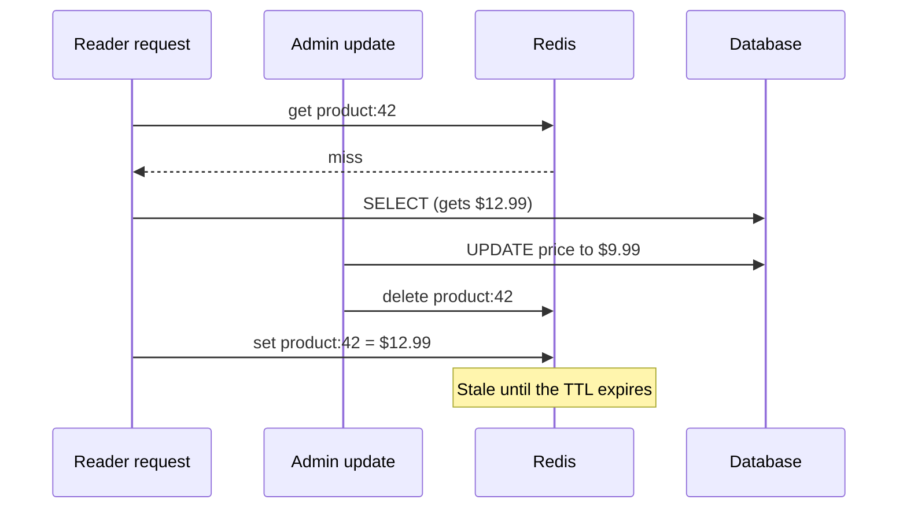

## In one line
Cache invalidation means removing or replacing cached copies when the real data changes, so users stop seeing the old version.

## The problem it solves
During a flash sale, an admin drops the price of product 42 from $12.99 to $9.99. The database now holds the new price. But copies of the old price are sitting in several places:

- the Redis key `product:42`
- the cached first page of the "Kitchen" category, which lists product 42
- the homepage "Deals" list
- the CDN's copy of `/api/products/42`
- the browsers of everyone who just viewed it

Miss one, and some customers see $12.99 while checkout charges $9.99, or the reverse. **Invalidating** a cached copy means marking it as no longer valid, usually by deleting it, so the next read fetches the truth.

Engineer Phil Karlton famously joked that there are only two hard things in computer science: cache invalidation and naming things. It is hard for three reasons:

1. **Copies are spread out.** One row in the database can appear in many keys, layers, and servers.
2. **The cache doesn't watch the database.** Redis has no idea a row changed. Something must tell it.
3. **Timing.** Reads and writes happen at the same moment, and the order they finish in can leave old data behind.

## Everyday analogy
A company prints price lists and hands copies to its sales staff. When prices change, it has three options: print "valid until the 30th" on each sheet (expiry), call everyone and tell them to shred the old sheet (explicit delete), or print an edition number and have staff check the current edition before quoting (versioning).

Where it breaks down: the company knows who holds paper copies. A web app often doesn't, especially copies in users' browsers.

## How it works
There are a handful of strategies. Real systems combine them.

**1. Expire by time (TTL).** Every copy gets a **TTL** (time to live), after which it is deleted automatically. No code runs on writes. Staleness is bounded: never older than the TTL. This is the safety net under every other strategy.

**2. Delete on write.** When your code updates the database, it deletes the matching cache key. The next read misses and loads fresh data. This is the standard partner to the cache-aside pattern; see [Redis caching](#/topic/redis-caching).

**3. Update on write (write-through).** Instead of deleting, write the new value into the cache. Reads stay fast right after the change. The risk: if two updates race, the older value can land last and stay there.

**4. Versioned keys.** Put a version number in the key, like `category:7:v12:page:1`. Store the current version in its own small key. To invalidate every page of category 7 at once, increment the version to 13. Readers now build `v13` keys and miss. The old `v12` keys are never read again and expire through their TTL. You don't need to find them.

**5. Versioned URLs for files.** Built JavaScript and images get a content hash in their filename (`app.3f9a1c.js`). A new version means a new URL, so browsers and CDNs never need to be told anything.

**6. Broadcast.** When copies live on many machines (each server's in-process memory, or a CDN), you send a message: "product 42 changed". Each server deletes its local copy. For a CDN, you call its **purge** API to delete specific URLs.

Even delete-on-write has a gap. Here is the classic race:


*Notice: the delete happened, but a slow read that started earlier wrote the old price back afterwards.*

This window is small, typically milliseconds, but on a busy key it does happen. Common defences:

- **Keep a TTL** so the stale copy lives at most that long.
- **Delayed double delete:** delete the key, then delete it again a second or so later, after any in-flight reads have finished.
- **Short TTLs on the hottest, most sensitive keys.**

## Real example
**Problem:** a price change must clear the product itself *and* every cached category page that lists it. A category can have dozens of pages, and you don't know which are cached. Versioned keys solve this.

**Setup:** the `db` and `redis` clients from [Redis caching](#/topic/redis-caching). A `products` table with `id`, `name`, `price_cents`, and `category_id`. Error handling is trimmed to keep it short.

```js
import { db, redis } from './clients.js';

export async function getCategoryPage(categoryId, page) {
  const ver = (await redis.get(`category:${categoryId}:ver`)) ?? '0'; // current version
  const key = `category:${categoryId}:v${ver}:page:${page}`;
  const cached = await redis.get(key);
  if (cached) return JSON.parse(cached);

  const { rows } = await db.query(
    'SELECT id, name, price_cents FROM products WHERE category_id = $1 ORDER BY id LIMIT 20 OFFSET $2',
    [categoryId, (page - 1) * 20]);
  await redis.set(key, JSON.stringify(rows), { expiration: { type: 'EX', value: 600 } }); // old versions expire
  return rows;
}

export async function updateProductPrice(id, priceCents) {
  const { rows } = await db.query(
    'UPDATE products SET price_cents = $1 WHERE id = $2 RETURNING category_id', [priceCents, id]);
  if (!rows[0]) return;
  await redis.del(`product:${id}`);                         // the single product
  await redis.incr(`category:${rows[0].category_id}:ver`);  // every page of its category at once
}
```

Watch it in `redis-cli`:

```bash
redis-cli KEYS 'category:7:*'     # only on a dev machine; see the mistakes below
# 1) "category:7:v0:page:1"
# 2) "category:7:v0:page:2"
# ...admin changes the price of product 42...
redis-cli GET category:7:ver
# "1"   -> readers now build v1 keys, so every v0 page is a miss
```

`INCR` is **atomic**: Redis runs it as one indivisible step, so two admins saving at once both get counted.

## How to say it in an interview

> [!INTERVIEW]
> **30 seconds:** "Cache invalidation is making sure cached copies don't outlive the data they copy. My default is cache-aside with a TTL on every key, plus deleting the key right after the database write. For groups of keys, like every page of a category, I use a version number in the key and bump it, instead of hunting for keys. For static files I use hashed filenames so nothing needs invalidating. It's hard because copies live in many places and reads and writes can race."

> [!INTERVIEW]
> **2 minutes:** Start with the 30-second answer, then add:
>
> "The race is the subtle part. A read can miss, load the old row, and then write it into the cache just after an update deleted the key. So the stale value comes back. That's why I never rely on deletes alone: the TTL bounds how long that can last, and for hot keys I sometimes do a second delete about a second later.
>
> The other hard part is knowing what to invalidate. A product's price shows up on its own page, in category lists, in search, and at the CDN. I make that list explicit in the update path, and I set the TTL of each copy to the staleness the business can accept. For example, five minutes on a description is fine, but not on stock. Stock and checkout prices I don't cache at all. That's the tradeoff: every explicit invalidation is code you can forget, and every TTL is staleness you accept."

## Follow-up questions interviewers ask

<details>
<summary>How do you invalidate an in-process cache on 10 servers?</summary>

One server can't reach into the others' memory. Broadcast the change: after the update, publish a message such as `product-changed 42` on a Redis pub/sub channel. Every server subscribes and deletes its local copy when the message arrives. Pub/sub doesn't store messages, so a server that was briefly disconnected misses it. Keep a short TTL on in-process entries as the backstop. See [Redis beyond caching](#/topic/redis-beyond-caching).

</details>

<details>
<summary>What if data changes outside your app, such as a manual SQL fix or another service?</summary>

Your delete code never runs, so only the TTL saves you. If that is common, use **change data capture** (CDC): a tool reads the database's own change log (in PostgreSQL, via logical replication) and emits an event for every changed row. A small consumer turns those events into cache deletes, so every write path is covered.

</details>

<details>
<summary>How do you invalidate a CDN?</summary>

Three ways: let the short `s-maxage` expire, call the CDN's purge API for specific URLs (or for a tag, if your CDN supports tagging responses), or change the URL with a version or hash. Purges usually take effect within seconds, not instantly, across all edge locations. See [CDNs and cache headers](#/topic/cdn).

</details>

<details>
<summary>Why not just use a very short TTL everywhere?</summary>

Because the hit rate collapses. With a 1-second TTL on a product read 20 times a minute, almost every read is a miss, and you pay for Redis without much benefit. TTLs should match how stale each piece of data may be, not be as short as possible.

</details>

<details>
<summary>Delete the key, or write the new value?</summary>

Deleting is safer by default. If two updates race, writing values can leave the older one in the cache. Deleting just forces the next read to load whatever the database holds. Write the new value only when a miss right after an update would be very expensive.

</details>

## Common mistakes and misconceptions

> [!MISTAKE]
> Using `KEYS category:7:*` in production to find keys to delete. `KEYS` walks the entire keyspace, and while it runs Redis can't serve anything else. With millions of keys, that stalls every request. Use versioned keys, or `SCAN`, which walks the keys in small batches.

> [!MISTAKE]
> Invalidating only the obvious key. Deleting `product:42` but not the category pages, search results, or CDN copy that include it. List every place a piece of data is copied.

> [!MISTAKE]
> Explicit deletes with no TTL. A failed delete, a race, or a new code path that forgets to delete then leaves stale data forever.

> [!MISTAKE]
> "I can push an update to users' browser caches." You can't. Browsers don't ask until their copy expires. Use short cache times for HTML and API responses, and versioned URLs for files.

## Tradeoffs: when NOT to use it
- **When a TTL alone is good enough.** If users can tolerate five minutes of staleness on view counts or recommendations, skip explicit invalidation. It's code you must maintain on every write path.
- **When you'd need to invalidate on almost every write.** If data changes more often than it's read, the cache is mostly cleared before anyone benefits. Don't cache it.
- **Versioned keys for single items.** One key per item is easier to just delete. Versioning shines for groups of keys.
- **Write-through for rarely read data.** You do extra work on every write to keep copies nobody reads.

## Check yourself

<details>
<summary>1. Why does every key need a TTL even if you delete on every write?</summary>

Deletes can fail, be forgotten in a new code path, or lose a race with a slow read that writes old data back. The TTL guarantees that any stale copy disappears after a known time.

</details>

<details>
<summary>2. You bump category:7:ver from 4 to 5. What happens to the keys with v4 in their name?</summary>

Nothing touches them directly. Readers now build `v5` keys, so the `v4` keys are never read again, and Redis deletes them when their TTL expires.

</details>

<details>
<summary>3. Describe the race that can put a stale value back in the cache after a delete.</summary>

A read misses and fetches the old row from the database. Before it writes to the cache, an update changes the row and deletes the key. The read then stores the old value it fetched earlier, and it stays until the TTL expires or another delete happens.

</details>

## Go deeper
- [Martin Fowler: Two Hard Things](https://martinfowler.com/bliki/TwoHardThings.html)
- [Redis docs: KEYS (and why to avoid it in production)](https://redis.io/docs/latest/commands/keys/)
- [Redis docs: client-side caching and invalidation messages](https://redis.io/docs/latest/develop/reference/client-side-caching/)
