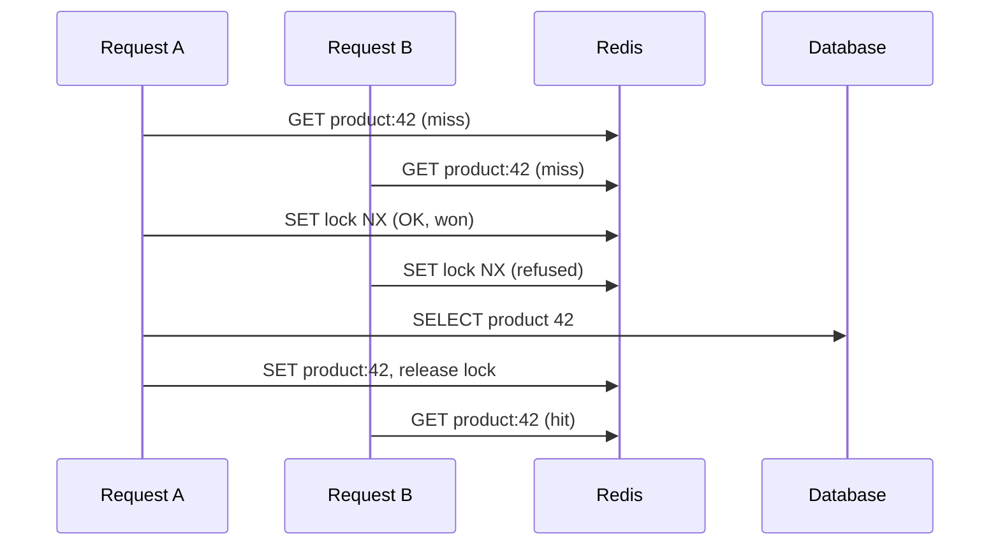

## In one line
A cache stampede happens when a popular cached value expires and hundreds of requests all miss at once, so they all hit the database for the same data at the same moment.

## The problem it solves
Product 42 is on the homepage during a sale, and its page gets 500 requests a second. It is cached in Redis with a 10-minute TTL, so the database barely notices it.

Then the TTL runs out. The key disappears. Rebuilding it takes a 200 ms database query. During those 200 ms, roughly 100 more requests arrive, each checks Redis, each sees a **cache miss**, and each runs the same query. The database, which was sized for a trickle of misses, suddenly gets a burst of identical queries. They slow each other down, so the rebuild takes even longer, so even more requests pile in.

This is also called **thundering herd** or **dog-piling**, and it usually shows up as a database CPU spike in step with a TTL. The basic cache-aside pattern from [Redis caching](#/topic/redis-caching) has this weakness built in.

## Everyday analogy
A coffee shop's only pot of filter coffee runs out at 8:30. Ten customers in line each tell the barista "I'll make a fresh pot", and ten pots start brewing. Obviously you want one person to brew while everyone else waits a minute.

Where it breaks down: in a shop, people can see the pot being brewed. Servers can't, so they need an explicit signal, a **lock**, to agree that one of them is already brewing.

## How it works
There are four common defences. Most systems use two or three together.

**1. Request coalescing (one load per process).** Inside one Node.js process, keep a `Map` of loads that are in progress. The first request for `product:42` starts the database query and stores its **promise** (the JavaScript object representing a result that will arrive later). Every later request for the same key gets that same promise. One process, one query, no matter how many requests.

**2. A distributed lock (one load across all servers).** Coalescing doesn't help when you have 10 servers: that's still 10 queries. So, on a miss, each server tries to take a lock in Redis:

- `SET lock:product:42 <random token> NX PX 5000`
- `NX` means "only set it if it doesn't exist", so exactly one server wins.
- `PX 5000` means the lock deletes itself after 5 seconds, so a crashed winner can't block everyone forever.
- The winner queries the database, fills the cache, and releases the lock.
- Losers wait briefly and read the cache again.

A **distributed lock** is simply a lock that several machines respect because it lives in a shared place.


*Notice: two requests missed, but only the lock winner touched the database.*

**3. Serve stale while refreshing.** Store the value with two times: a **soft expiry** (say 10 minutes) and a longer real TTL (say 15 minutes). After the soft expiry, one request refreshes the value in the background, while everyone, including that request, keeps getting the slightly old copy. Users never wait on a miss. HTTP caches support the same idea with `stale-while-revalidate`; see [CDNs and cache headers](#/topic/cdn).

**4. Spread out expiries (jitter).** If you warm 10,000 product keys at the same moment, all with `EX 600`, they all expire together 10 minutes later. Add a small random amount, called **jitter**, to each TTL, for example 600 plus 0 to 60 seconds. Expiries then spread across a minute instead of one instant.

A related idea is **probabilistic early refresh**: each request has a small chance of refreshing a key before it expires, and that chance rises as expiry gets closer. One request almost always refreshes it before the cliff.

## Real example
**Setup:** the `redis` client from [Redis caching](#/topic/redis-caching), node-redis v5 or later.

**1. Coalescing inside one process** (`load-once.js`):

```js
const inFlight = new Map(); // cache key -> promise of the value being loaded

// All callers asking for the same key at the same time share ONE load.
export function loadOnce(key, load) {
  if (inFlight.has(key)) return inFlight.get(key);   // join the load already running
  const promise = load().finally(() => inFlight.delete(key));
  inFlight.set(key, promise);
  return promise;
}
```

**2. A Redis lock across servers** (`rebuild-with-lock.js`):

```js
import { randomUUID } from 'node:crypto';
import { redis } from './clients.js';

// Delete the lock only if it still holds OUR token (atomic, as a Lua script).
const RELEASE = `if redis.call('GET', KEYS[1]) == ARGV[1] then
  return redis.call('DEL', KEYS[1]) end return 0`;
const sleep = (ms) => new Promise((resolve) => setTimeout(resolve, ms));

export async function rebuildWithLock(key, ttlSeconds, loadFromDb) {
  const lockKey = `lock:${key}`;
  const token = randomUUID();
  const gotLock = await redis.set(lockKey, token,   // SET ... NX PX 5000
    { condition: 'NX', expiration: { type: 'PX', value: 5000 } });

  if (!gotLock) {                                   // someone else is rebuilding
    for (let i = 0; i < 30; i++) {                  // poll for up to ~3 s
      await sleep(100);
      const value = await redis.get(key);
      if (value) return JSON.parse(value);
    }
    return loadFromDb();                            // holder seems stuck: fall back
  }
  try {
    const value = await loadFromDb();               // only the lock holder gets here
    await redis.set(key, JSON.stringify(value), { expiration: { type: 'EX', value: ttlSeconds } });
    return value;
  } finally {
    await redis.eval(RELEASE, { keys: [lockKey], arguments: [token] });
  }
}
```

**3. Use both on a miss** (`products.js`):

```js
import { redis } from './clients.js';
import { loadOnce } from './load-once.js';
import { rebuildWithLock } from './rebuild-with-lock.js';
// loadProductFromDb(id) is your SELECT query, as in the Redis caching topic.

export async function getProductById(id) {
  const key = `product:${id}`;
  const cached = await redis.get(key);
  if (cached) return JSON.parse(cached);                  // normal hit
  return loadOnce(key, () => rebuildWithLock(key, 600, () => loadProductFromDb(id)));
}
```

In a test with 3 Node.js processes each firing 200 simultaneous requests for an empty key, and a 200 ms fake database query, the plain cache-aside version made 600 database calls. This version made 1.

## How to say it in an interview

> [!INTERVIEW]
> **30 seconds:** "A cache stampede is when a hot key expires and every request misses at the same time, so they all query the database for the same thing. I prevent it in layers: inside each process, concurrent requests for the same key share one promise; across servers, a Redis lock with SET NX and an expiry lets one request rebuild while the others wait and re-read the cache. For very hot keys I serve the stale value while one request refreshes it, and I add jitter to TTLs so keys don't all expire together."

> [!INTERVIEW]
> **2 minutes:** Start with the 30-second answer, then add:
>
> "The lock has details that matter. It needs an expiry so a crashed holder doesn't block everyone, and a random token so a slow holder whose lock already expired doesn't delete someone else's lock. The release is a small Lua script that checks the token and deletes in one atomic step.
>
> The tradeoff is latency versus freshness. With a lock, waiting requests are slower for a moment. With serve-stale, nobody waits, but users can see data a little past its TTL. For a product page I'd pick serve-stale. For something like a permission check I wouldn't cache in the first place."

## Follow-up questions interviewers ask

<details>
<summary>Why does the lock need a random token?</summary>

Say server A takes the lock with a 5-second expiry, but its query takes 7 seconds. At 5 seconds the lock expires, and server B takes it. If A then ran a plain `DEL`, it would delete **B's** lock. The token lets A delete only a lock it still owns. Checking and deleting must be one atomic step, which is why it's a Lua script that Redis runs in one go.

</details>

<details>
<summary>What if Redis itself restarts and the whole cache is empty?</summary>

That's a **cold cache**: every key misses at once, a stampede across the whole site. Defences: run a Redis replica so failover keeps the data, warm the most popular keys before sending traffic, and rate-limit how fast misses can reach the database. The per-key lock still helps, because each key is only rebuilt once.

</details>

<details>
<summary>Is the Redis lock safe enough for money or inventory?</summary>

No. A single-instance Redis lock can be lost in a failover, and an expiry can run out while the holder is still working. That's fine for caching, where the worst case is a few extra queries. For correctness, such as never overselling stock, use database transactions and row locks. See [Transactions and ACID](#/topic/transactions-acid).

</details>

<details>
<summary>Why not just never expire hot keys?</summary>

You can, if you refresh them on a schedule or on every write. But a key with no TTL never heals itself if an update is missed. Serving stale with a soft expiry gives the same "never a hard miss" benefit while keeping a safety net.

</details>

## Common mistakes and misconceptions

> [!MISTAKE]
> A lock with no expiry. If the holder crashes, the lock stays forever and every later request waits or falls through to the database.

> [!MISTAKE]
> Releasing the lock with a plain `DEL`. It can delete another server's lock after yours expired. Compare the token first, atomically.

> [!MISTAKE]
> "Coalescing in memory is enough." It stops duplicates within one process only. Ten servers still send ten queries, and more servers make it worse.

> [!MISTAKE]
> Giving every key exactly the same TTL after a bulk load or deploy. They all expire in the same second. Add jitter.

## Tradeoffs: when NOT to use it
- **Low-traffic keys.** If a key is requested a few times a minute, a miss costs one query. Locks and polling only add complexity.
- **Cheap queries.** If the rebuild is a 2 ms indexed lookup, a burst of identical queries may be harmless. Measure before adding protection.
- **Data that must be fresh.** Serve-stale deliberately returns old data. Don't use it for stock, balances, or permissions.
- **Very slow rebuilds.** If rebuilding takes 30 seconds, waiting requests time out. Precompute the value with a background job instead, and never let a user request trigger it. See [Why background jobs exist](#/topic/background-jobs).

## Check yourself

<details>
<summary>1. What does NX do in SET lock:product:42 token NX PX 5000, and why is it essential?</summary>

`NX` sets the key only if it doesn't already exist. When many servers try at once, exactly one succeeds, which makes it a lock. `PX 5000` makes the lock delete itself after 5 seconds if the holder never releases it.

</details>

<details>
<summary>2. You run 8 servers with in-process coalescing but no Redis lock. A hot key expires. Roughly how many database queries happen?</summary>

Up to 8, one per server, since each process coalesces its own requests but doesn't know about the others. That's far better than hundreds, and for many apps it's enough.

</details>

<details>
<summary>3. Your database spikes every 10 minutes exactly. What do you suspect?</summary>

Many hot keys sharing the same 10-minute TTL, set at the same time, expiring together and stampeding. Add jitter to TTLs, and protect the hottest keys with a lock or serve-stale.

</details>

## Go deeper
- [Redis docs: SET command (NX and PX options)](https://redis.io/docs/latest/commands/set/)
- [Redis docs: distributed locks with Redis](https://redis.io/docs/latest/develop/clients/patterns/distributed-locks/)
- [MDN: Cache-Control stale-while-revalidate](https://developer.mozilla.org/en-US/docs/Web/HTTP/Reference/Headers/Cache-Control#stale-while-revalidate)
