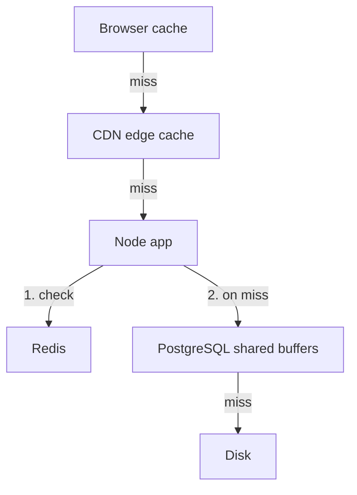

## In one line
A response can be saved at several stops between the database and the user (browser, CDN, app, and database), and every stop that answers early skips all the work behind it.

## The problem it solves
A shopper opens the page for product 42 on `shop.example.com`. Without any caching, every visit makes the full trip:

1. The browser downloads the page, the JavaScript, and the product photo again.
2. The request crosses the internet to your server, maybe 150 ms away.
3. Node.js runs your code.
4. PostgreSQL reads the product from disk.

Most of that work produces the same answer as last time. A **cache** is a place that keeps a copy of an answer so it can be reused. The question is not "should I cache?" but "**where** should each piece of data be cached?" The answer is different for a logo, a product price, and a shopping cart. Picking the wrong place gives you either slow pages or users seeing stale, or even someone else's, data.

## Everyday analogy
Finding a book. First you check your own shelf at home. If it's not there, you try the local library branch down the road. If they don't have it, they request it from the city's central library. The central library itself keeps popular books on a cart near the desk, so it rarely has to go down to the basement archive.

Each stop is a cache layer: your shelf is the browser, the branch is the CDN, the central desk is Redis, and the archive is the database.

Where it breaks down: library books are clearly labelled editions. Cached web data has no label saying it's out of date, so each layer needs a rule for how long its copy can be trusted.

## How it works
A request passes four main layers on the way in. Each one can answer without asking the next.

**1. Browser cache (private).** The browser stores responses on the user's own device. It is a **private cache**: it holds data for one user only. Your server controls it with the **`Cache-Control` header**, an HTTP response header that says who may store a response and for how long. You cannot delete something from a user's browser cache remotely. You can only wait for it to expire, or change the URL.

**2. CDN cache (shared).** A **CDN** (content delivery network) is a set of servers around the world. Each one is called an **edge server**, and it keeps copies close to users. It is a **shared cache**: one stored copy is served to many users. That makes it powerful for public data and dangerous for personal data. You can **purge** (delete) entries through the CDN's API. A reverse proxy like Nginx can play the same shared-cache role inside your own data centre. See [CDNs and cache headers](#/topic/cdn).

**3. Application cache.** This lives in your backend, and your code fully controls it. There are two kinds:

- **In-process cache:** a `Map` or LRU (least recently used) structure inside one Node.js **process**, the running copy of your app. Reading it costs no network trip at all, but each server has its own copy.
- **Distributed cache:** Redis, shared by every app server. One network hop, typically under a millisecond, and one copy for everyone. See [Redis caching](#/topic/redis-caching).

**4. Database cache.** PostgreSQL keeps recently used **pages** of data in memory, in an area called **shared buffers**, and the operating system keeps more in its **page cache** (free RAM used to hold recently read file data). This happens automatically. PostgreSQL does not cache query *results*, though. It still runs the query each time; it just avoids reading the disk.


*Notice: the higher a layer answers, the more work it skips, but the less control you have over its copy.*

That last point is the key tradeoff:

| Layer | Who shares a copy | How fast | Can you delete a copy? |
|---|---|---|---|
| Browser | One user | Instant, no network | No, only wait or change the URL |
| CDN | Everyone near that edge | Nearby, a few ms to tens of ms | Yes, by purge API, takes seconds |
| Redis | All app servers | Typically under 1 ms in-network | Yes, instantly, from your code |
| Database buffers | All queries | Avoids disk | Automatic, nothing to manage |

So you place data according to how public it is and how fresh it must be:

- **Static files with a hash in the name** (`app.3f9a1c.js`): browser and CDN, for a year. A new version gets a new name, so nothing needs deleting.
- **Public, slow-changing data** (product details): CDN for a few minutes, browser for less, Redis behind it.
- **Personal data** (cart, orders): never the CDN. Maybe Redis, under a key that includes the user ID.
- **Must-be-exact data** (stock at checkout, balances): no cache. Read the database.

## Real example
**Setup:** Node.js 18+, `npm install express`, `"type": "module"` in `package.json`. `getProductById` is the cache-aside function from [Redis caching](#/topic/redis-caching). `requireLogin` and `getCartForUser` stand for your own auth middleware and cart query.

```js
import express from 'express';
const app = express();

// Built files have a content hash in their name (app.3f9a1c.js),
// so browsers and the CDN may keep them for a year without asking again.
app.use('/assets', express.static('public/assets', { maxAge: '1y', immutable: true }));

app.get('/api/products/:id', async (req, res) => {
  const product = await getProductById(Number(req.params.id)); // Redis, then PostgreSQL
  if (!product) return res.status(404).json({ error: 'Product not found' });
  // Browsers: 60 s. Shared caches like the CDN: 300 s (s-maxage).
  res.set('Cache-Control', 'public, max-age=60, s-maxage=300');
  res.json(product);
});

app.get('/api/cart', requireLogin, async (req, res) => {
  res.set('Cache-Control', 'no-store'); // personal: no cache anywhere may keep it
  res.json(await getCartForUser(req.user.id));
});

app.listen(3000);
```

Check what each layer is being told, with `curl -I` (show only response headers):

```bash
curl -sI localhost:3000/assets/app.3f9a1c.js | grep -i cache-control
# Cache-Control: public, max-age=31536000, immutable
curl -sI localhost:3000/api/products/42 | grep -i cache-control
# Cache-Control: public, max-age=60, s-maxage=300
curl -sI localhost:3000/api/cart | grep -i cache-control
# Cache-Control: no-store
```

In Chrome DevTools, the Network tab's Size column shows "(memory cache)" or "(disk cache)" when the browser answered by itself and no request left the device.

## How to say it in an interview

> [!INTERVIEW]
> **30 seconds:** "There are several places to cache a response. The browser cache is private to one user. A CDN is a shared cache near users. Then there's the application cache, either in-process memory or Redis shared by all servers. And the database keeps hot data pages in memory. The closer to the user, the more work you skip, but the less control you have. So I put static hashed files in the browser and CDN for a long time, public data in the CDN briefly, and personal data only in Redis or nowhere."

> [!INTERVIEW]
> **2 minutes:** Start with the 30-second answer, then add:
>
> "For a shop, I'd split it like this. JavaScript and images have a content hash in the filename, so they get `max-age` of a year and `immutable`. A deploy changes the filename, so there is nothing to invalidate. Product details get `s-maxage=300` so the CDN absorbs most traffic, plus a Redis cache-aside layer behind it with explicit deletes on update. Carts and orders get `no-store`, because a shared cache serving one user's cart to another is a serious data leak.
>
> The tradeoff is that layers stack. If Redis can hold a product for 10 minutes and the CDN then caches what the app returned for 5 more, a price change can take up to 15 minutes to reach users unless I invalidate both. So for each kind of data I decide the maximum acceptable staleness first, then choose layers and TTLs that fit inside it."

## Follow-up questions interviewers ask

<details>
<summary>What is the difference between a private cache and a shared cache?</summary>

A private cache (the browser) stores a response for one user. A shared cache (CDN, Nginx proxy cache) stores one copy and serves it to many users. `Cache-Control: private` allows only private caches to store the response. `public` allows shared caches too. Anything personal must never be stored in a shared cache.

</details>

<details>
<summary>Can staleness add up across layers?</summary>

Yes, when layers are independent. The app might serve a Redis copy that is already 9 minutes old, and the CDN then keeps that response for 5 more minutes. Between HTTP caches it is better: a CDN sends an `Age` header, and the browser subtracts it from `max-age`. Plan each data type's worst case across all layers, and invalidate every layer when it matters.

</details>

<details>
<summary>Doesn't PostgreSQL cache query results?</summary>

No. It caches data **pages** in shared buffers and benefits from the operating system's page cache, so repeated reads avoid the disk. It still parses, plans, and runs the query every time. That is why an application cache can still help even when the database has plenty of memory.

</details>

<details>
<summary>In-process cache or Redis?</summary>

In-process is faster (no network) and simpler, but each of your servers holds its own copy. Deleting a key on one server does not clear the others, and the copy is lost on restart. Use it for small, rarely changing data, like a list of countries. Use Redis when all servers must agree on one copy.

</details>

<details>
<summary>How do you update a file that browsers have cached for a year?</summary>

You don't. You change its name. Build tools put a hash of the file's contents into the filename. A new version produces a new name, the HTML points to the new name, and the old cached file is simply never requested again. This is called **cache busting**. The HTML page itself gets a short cache time or `no-cache` so it always points to the latest files.

</details>

## Common mistakes and misconceptions

> [!MISTAKE]
> Letting a CDN cache personal responses. If `/api/cart` is cached by a shared cache, the next user can receive someone else's cart. Personal responses need `private` or `no-store`.

> [!MISTAKE]
> "More layers is always faster." Each layer adds another copy that can be stale, another place to debug, and another invalidation step. Add a layer only where measurements show it helps.

> [!MISTAKE]
> Giving the HTML page a long `max-age`. Users then keep an old page that points to old JavaScript files, and a deploy doesn't reach them. Cache hashed assets for a long time, but keep the HTML short or revalidated.

> [!MISTAKE]
> "The database caches results, so I don't need an app cache." PostgreSQL caches pages, not results. A slow query that scans a lot of data is still slow even when all of it is in memory.

## Tradeoffs: when NOT to use it
- **Don't stack layers for data that must be exact.** Prices at checkout, stock, permissions, and balances should come from the database.
- **Don't use a shared cache for anything user-specific** unless you are sure the cache key includes the user, and even then prefer Redis, which you fully control.
- **Don't use an in-process cache when you run many servers and data changes**, because the copies drift apart.
- **Don't cache before measuring.** A fast, indexed query under light load may not need any cache. Every layer is something to run, monitor, and invalidate. See [Finding performance bottlenecks](#/topic/performance-bottlenecks).

## Check yourself

<details>
<summary>1. Which layer would you use for the site logo, a product description, and a user's order history?</summary>

Logo: browser and CDN with a long `max-age` and a hashed filename. Product description: CDN for a few minutes plus Redis behind the app. Order history: no shared cache. Either no cache or Redis keyed by user ID.

</details>

<details>
<summary>2. Why can't you fix a stale file in a user's browser cache from your server?</summary>

The browser answers from its own copy without contacting your server until the copy expires, so there's no request to respond to. The fix is to change the URL (cache busting) so the browser fetches a new file.

</details>

<details>
<summary>3. Redis caches a product for 10 minutes and the CDN caches the product API for 5 minutes. What's the worst-case staleness after a price change, if nobody invalidates anything?</summary>

Roughly 15 minutes: the app can serve a Redis copy that is nearly 10 minutes old, and the CDN can then keep that response for up to 5 more minutes.

</details>

## Go deeper
- [MDN: HTTP caching](https://developer.mozilla.org/en-US/docs/Web/HTTP/Guides/Caching)
- [web.dev: Prevent unnecessary network requests with the HTTP Cache](https://web.dev/articles/http-cache)
- [PostgreSQL docs: resource consumption (shared_buffers)](https://www.postgresql.org/docs/current/runtime-config-resource.html)
