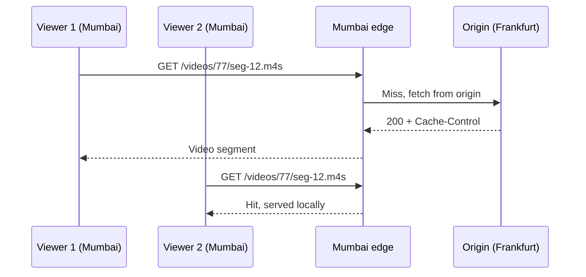

## In one line
A CDN is a network of servers around the world that keep copies of your files close to users, and `Cache-Control` headers are how you tell it, and the browser, how long each copy may be used.

## The problem it solves
Your video app's server is in Frankfurt. A viewer in Mumbai opens a product video. Every request crosses more than 6,000 km. Each **round trip** (a message there and the reply back) typically takes over 100 ms, and opening a new HTTPS connection alone needs a couple of them before any data flows. A video is made of hundreds of small files, so the delay adds up and the video stutters.

Meanwhile your one server sends every byte of every video to every viewer. When a stream goes viral, its network link and CPU are the limit, and your cloud bill for **egress** (data sent out of the data centre) climbs.

A **CDN** (content delivery network) fixes both. It answers from a server near the viewer, and most requests never reach you.

## Everyday analogy
A publisher prints books in one city but ships copies to bookshops in every town. Readers buy from their local shop. The shop reorders from the publisher only when it runs out or the edition changes.

Where it breaks down: a bookshop knows when a new edition is out. A CDN doesn't. It keeps its copy until the expiry time you gave it, unless you explicitly **purge** (delete) it.

## How it works
Some terms first:

- **Origin:** your own server, where the real files and API live.
- **Edge server:** a CDN server in a city near users. CDNs group them into **points of presence** (PoPs), which are data centres in many cities.
- **Cache key:** what the CDN uses to decide "is this the same request?" By default it's the URL: host, path, and query string.

**Reaching the nearest edge.** You point your domain at the CDN, usually with a DNS **CNAME** record (an alias to the CDN's hostname). The CDN then routes each user to a nearby edge, either by answering DNS with a nearby edge's address, or with **anycast**: the same IP address is announced from many locations, and internet routing delivers each user to the closest one.

**Serving a request:**

1. The user's request arrives at the nearest edge.
2. The edge looks up the cache key.
3. **Hit and still fresh:** it answers immediately. Your origin never knows.
4. **Miss:** it fetches from the origin, stores the response if the headers allow, and answers.
5. **Hit but stale:** it asks the origin "has this changed?" (more on this below).


*Notice: only the first viewer's request travels to Frankfurt. Everyone after is served in Mumbai.*

**Cache-Control: the instructions.** The `Cache-Control` response header tells every cache what it may do. These are the directives interviewers ask about:

| Directive | Meaning |
|---|---|
| `max-age=60` | Any cache may reuse this for 60 seconds without asking. |
| `s-maxage=300` | Shared caches (CDNs, proxies) use 300 s instead of `max-age`. Browsers ignore it. |
| `public` | Shared caches may store it. |
| `private` | Only the user's browser may store it. Never a CDN. |
| `no-cache` | May be stored, but must be **revalidated** with the origin before every reuse. |
| `no-store` | Must not be stored anywhere. |
| `immutable` | Will never change while fresh. Don't even revalidate on reload. |
| `stale-while-revalidate=60` | After expiry, may serve the old copy for up to 60 s while fetching a new one in the background. |

**Fresh vs stale, and the 304.** A cached response is **fresh** until its `max-age` runs out, then **stale**. A stale copy isn't thrown away. The cache revalidates it with a **conditional request**:

1. The original response included an **ETag**, a short fingerprint of the content, like `W/"31-bDD2uV..."`.
2. When stale, the cache sends `If-None-Match: <that ETag>`.
3. If the content hasn't changed, the origin replies **`304 Not Modified`** with no body. The cache marks its copy fresh again.
4. If it has changed, the origin sends `200` with the new body and a new ETag.

`Last-Modified` and `If-Modified-Since` do the same with a timestamp instead of a fingerprint. Caches also add an `Age` header, the seconds since the copy was fetched from the origin, so the browser can subtract it from `max-age`.

**Video.** Streaming formats like **HLS** (HTTP Live Streaming) cut a video into small segment files a few seconds long, plus a **playlist** file (`.m3u8`) listing them. Segments never change, so they can be cached for a long time. A live stream's playlist changes every few seconds, so it gets a `max-age` of a second or two. That's how a CDN can serve live video to a huge audience.

## Real example
**Setup:** Node.js 18+, `npm install express`. `getProductById` is from [Redis caching](#/topic/redis-caching).

```js
import express from 'express';
import { getProductById } from './products.js';

const app = express();

app.get('/api/products/:id', async (req, res) => {
  const product = await getProductById(Number(req.params.id));
  if (!product) return res.status(404).json({ error: 'Product not found' });
  // Browser: fresh for 60 s. CDN: fresh for 300 s, then may serve the
  // stale copy for 60 s more while it refetches in the background.
  res.set('Cache-Control', 'public, max-age=60, s-maxage=300, stale-while-revalidate=60');
  res.json(product); // Express adds an ETag: a short fingerprint of this body
});

app.listen(3000);
```

**Revalidation in action**, using `curl -i` to show headers:

```bash
curl -i localhost:3000/api/products/42
# HTTP/1.1 200 OK
# Cache-Control: public, max-age=60, s-maxage=300, stale-while-revalidate=60
# ETag: W/"31-bDD2uVbRSR6pg4OY5ciEqD8dDv0"
# {"id":42,"name":"Ceramic mug","price_cents":1299}

curl -i -H 'If-None-Match: W/"31-bDD2uVbRSR6pg4OY5ciEqD8dDv0"' localhost:3000/api/products/42
# HTTP/1.1 304 Not Modified       <- same content: no body sent
```

**Headers per kind of file** in the video shop:

| Content | `Cache-Control` |
|---|---|
| `app.3f9a1c.js`, product photos with hashed names | `public, max-age=31536000, immutable` |
| HTML pages | `no-cache` (always revalidate, cheap with a 304) |
| Product API | `public, max-age=60, s-maxage=300` |
| Cart, orders, account | `private, no-store` |
| Video segments | `public, max-age=31536000, immutable` |
| Live playlist `.m3u8` | `public, max-age=2` |

Behind a CDN, response headers show what happened. CloudFront adds `X-Cache: Hit from cloudfront` or `Miss from cloudfront`. Cloudflare adds `cf-cache-status: HIT` or `MISS`. A growing `Age` value means you're getting a cached copy.

## How to say it in an interview

> [!INTERVIEW]
> **30 seconds:** "A CDN is a set of edge servers around the world that cache my content close to users. DNS or anycast sends each user to a nearby edge. On a hit, the edge answers directly. On a miss, it fetches from my origin and caches it according to the Cache-Control header. That cuts latency for users and load and bandwidth on my servers. I give hashed static files a one-year max-age with immutable, short s-maxage for public API responses, and private or no-store for anything personal."

> [!INTERVIEW]
> **2 minutes:** Start with the 30-second answer, then add:
>
> "For video, the CDN does most of the work. Videos are split into small HLS segments that never change, so they're cached for a year, while a live stream's playlist gets a max-age of about two seconds. Thousands of viewers then cost the origin roughly one request per segment per edge.
>
> When a cached copy goes stale, the CDN doesn't have to download it again. It sends If-None-Match with the ETag, and if nothing changed the origin answers 304 with no body.
>
> The tradeoff is freshness and control. Once the CDN has a copy, I can't change it instantly. I either wait for s-maxage, call a purge API, or change the URL. And the biggest risk is caching something personal in a shared cache and showing one user's data to another. So the safe default for authenticated responses is private or no-store."

## Follow-up questions interviewers ask

<details>
<summary>no-cache vs no-store?</summary>

`no-cache` allows storing, but every reuse must first be revalidated with the origin, usually answered cheaply with a 304. `no-store` forbids storing at all. Use `no-cache` for HTML that must always be current, and `no-store` for sensitive data like account pages.

</details>

<details>
<summary>Does an ETag make my server do less work?</summary>

It saves **bandwidth**, not necessarily work. In the Express example, the server still loads the product and builds the JSON, then compares fingerprints and skips sending the body. To save work too, the app must check the ETag or a version number before doing the expensive part.

</details>

<details>
<summary>What does the Vary header do?</summary>

It adds request headers to the cache key. `Vary: Accept-Encoding` keeps separate copies for compressed and uncompressed versions. `Vary: Accept-Language` keeps one per language. Varying on something with many values, like `Cookie` or `User-Agent`, splits the cache into tiny pieces and kills the hit rate.

</details>

<details>
<summary>How do you update content that a CDN has cached?</summary>

Change the URL (hashed filenames, the best option for files), call the CDN's purge API for specific URLs or tags, or wait for `s-maxage` to expire. Purges take seconds to reach every edge. Browsers aren't affected by a CDN purge, which is why personal and HTML responses use short browser caching.

</details>

<details>
<summary>Can a CDN help with API responses and not just files?</summary>

Yes, for public, read-heavy responses like product details. It also helps uncached requests: the TLS handshake happens with the nearby edge, and the edge typically keeps a warm, reused connection to your origin. It doesn't help personalised or write requests, which pass through to the origin.

</details>

<details>
<summary>What is an origin shield?</summary>

An extra cache layer between the edges and your origin. When 50 edges miss on the same file, they ask the shield instead of your server, so the origin gets roughly one request instead of 50.

</details>

## Common mistakes and misconceptions

> [!MISTAKE]
> "`no-cache` means don't cache." It means "cache, but check with the origin before each reuse". The directive that forbids storage is `no-store`.

> [!MISTAKE]
> Caching authenticated API responses with `public`. One user's cart or order history can be served to strangers. Personal responses need `private` or `no-store`, and the CDN should bypass cache for requests with session cookies.

> [!MISTAKE]
> Setting a long `max-age` on `index.html`. Users keep the old HTML, which points to old JavaScript, so deploys don't reach them. Long cache times are for files whose name changes when their content changes.

> [!MISTAKE]
> Tracking parameters in URLs, like `?utm_source=...`, creating thousands of separate cache entries for the same file. Configure the CDN to ignore query strings that don't change the response.

## Tradeoffs: when NOT to use it
- **Personalised or real-time data:** carts, balances, permissions. A CDN can't safely cache them, so it only adds a hop.
- **Users all near your server.** A local business app with users in one city may gain little latency. You may still want a CDN for bandwidth and DDoS protection, but measure first.
- **Content that must change instantly everywhere.** Legal takedowns or price errors need a purge workflow you've tested, or no CDN caching on that path.
- **Cost and complexity at small scale.** Another vendor, another set of headers to get right, and another layer to debug when users see old content.

## Check yourself

<details>
<summary>1. A response has Cache-Control: public, max-age=60, s-maxage=600. How long may the browser and the CDN treat it as fresh?</summary>

The browser: 60 seconds. The CDN: 600 seconds, because `s-maxage` overrides `max-age` for shared caches only.

</details>

<details>
<summary>2. A browser has a stale copy with an ETag. What does it send, and what are the two possible replies?</summary>

It sends the request with `If-None-Match: <etag>`. If unchanged, the server replies `304 Not Modified` with no body, and the copy becomes fresh again. If changed, it replies `200` with the new body and a new ETag.

</details>

<details>
<summary>3. Why can video segments be cached for a year, but a live playlist only for a second or two?</summary>

A segment's content never changes once created, so any copy stays correct. The live playlist is rewritten every few seconds to list new segments, so a long cache would freeze viewers on an old list.

</details>

## Go deeper
- [MDN: Cache-Control header reference](https://developer.mozilla.org/en-US/docs/Web/HTTP/Reference/Headers/Cache-Control)
- [MDN: HTTP conditional requests](https://developer.mozilla.org/en-US/docs/Web/HTTP/Guides/Conditional_requests)
- [RFC 9111: HTTP Caching](https://www.rfc-editor.org/rfc/rfc9111.html)
