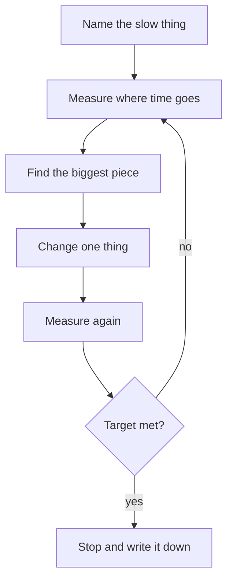

## In one line
Finding a performance bottleneck means measuring where the time actually goes before changing anything, then fixing the single biggest cause, and measuring again.

## The problem it solves
Customers say "the product page is slow". A developer guesses it's the database and adds Redis. A week later the page is still slow, because the real cause was a call to the reviews service that sometimes takes 600 ms. The cache made the system more complex and fixed nothing.

A **bottleneck** is the one part of a system that limits everything else, like the narrow neck of a bottle that limits how fast water pours out. Speeding up any other part doesn't help. Guessing where it is wastes days. Measuring usually finds it in minutes.

Two words you need:

- **Latency:** how long one request takes, for example 180 ms.
- **Throughput:** how many requests the system finishes per second, for example 400 requests per second.

They are related but different. A system can have low latency at light load and still have low maximum throughput.

## Everyday analogy
A supermarket with long queues. You could hire more shelf stackers, but if the problem is that only two checkouts are open, nothing improves. First you watch: where do people wait? Then you open more checkouts.

Where it breaks down: in a shop you can see the queue. In software the queues are invisible (waiting for a database connection, a lock, or the CPU), so you must add measurements to see them.

## How it works
**1. State the symptom with numbers.** Not "it's slow", but "`GET /products/:id` has p95 latency of 900 ms; the target is 300 ms".

**2. Use percentiles, not averages.** A **percentile** tells you how slow most requests are. **p50** (the median) is the time that half of requests beat. **p95** means 95% of requests were faster than this. **p99** is the slowest 1%. Averages hide pain: if 98 requests take 20 ms and 2 take 2,000 ms, the average is 59.6 ms, which looks fine, but p99 is 2,000 ms. Those slow requests are real users. They also add up: a page that makes 10 backend calls, each with a 1% chance of being slow, is slow about 10% of the time (1 − 0.99¹⁰ ≈ 9.6%).

**3. Break the time down.** One request's time is spent in a few places:

- the network between user and server
- your Node.js code running on the CPU
- waiting for the database, Redis, or another service
- waiting in a queue for a free resource, such as a database connection from the **connection pool** (the fixed set of reused connections)

Time each step. Request logs with durations, the `Server-Timing` header, `EXPLAIN ANALYZE` for queries, and a **profiler** (a tool that samples what code the CPU is running) each show a different slice.

**4. Check each resource.** A useful checklist is Brendan Gregg's **USE method**. For every resource (CPU, memory, disk, network, connection pools), check its **U**tilization (how busy it is), **S**aturation (how much work is waiting for it), and **E**rrors.

**5. Fix the biggest piece, one change at a time.** If the database is 70% of the time, a faster JSON library won't matter.

**6. Measure again** under the same conditions, and compare.


*Notice: every fix starts and ends with a measurement. Without one, you can't tell whether it helped.*

**Why latency spikes cascade.** **Little's Law** links the three numbers: requests in progress = throughput × latency. At 200 requests per second and 50 ms each, about 10 requests are in progress at once. If a slow query raises latency to 500 ms, 100 are in progress. With a pool of 20 database connections, 80 requests now wait for a connection, so latency rises further for every route that uses the database, not just the slow one.

**Two Node.js specifics.** Node.js runs your JavaScript on one main thread, called the **event loop**. CPU-heavy work, such as hashing a big file or `JSON.parse` of a 50 MB string, blocks every other request while it runs. Measure **event loop delay**: how late timers fire compared to when they should. If it's high, the CPU work is the bottleneck, not the database. See [The Node.js event loop](#/topic/event-loop).

## Real example
**Setup:** Node.js 18+, `npm install express`. `getProductById` and `getReviewSummary` stand for your own data functions.

**1. Measure every request, and the event loop** (top of `server.js`):

```js
import express from 'express';
import { monitorEventLoopDelay } from 'node:perf_hooks';

const app = express();

// One log line per request: which route, which status, how many ms.
app.use((req, res, next) => {
  const start = process.hrtime.bigint();
  res.on('finish', () => {
    const ms = Number(process.hrtime.bigint() - start) / 1e6;
    console.log(JSON.stringify({ route: req.route?.path ?? req.path, status: res.statusCode, ms: Math.round(ms) }));
  });
  next();
});

// Is the event loop blocked? Report its worst delays every 10 s.
const loopDelay = monitorEventLoopDelay({ resolution: 20 });
loopDelay.enable();
setInterval(() => {
  console.log(`event loop delay p99: ${(loopDelay.percentile(99) / 1e6).toFixed(1)} ms`);
  loopDelay.reset();
}, 10_000).unref();
```

**2. Split a slow route into named steps:**

```js
app.get('/products/:id', async (req, res) => {
  const t0 = performance.now();
  const product = await getProductById(Number(req.params.id));
  const t1 = performance.now();
  const reviews = await getReviewSummary(product.id);
  const t2 = performance.now();
  // Shows up in Chrome DevTools: Network tab > the request > Timing.
  res.set('Server-Timing', `product;dur=${(t1 - t0).toFixed(1)}, reviews;dur=${(t2 - t1).toFixed(1)}`);
  res.json({ ...product, reviews });
});

app.listen(3000);
```

**3. Put it under load** with autocannon, a load-testing tool for HTTP. Here 50 connections send requests for 20 seconds:

```bash
npx autocannon -c 50 -d 20 http://localhost:3000/products/42
```

Output from a demo run (your numbers will differ):

```text
┌─────────┬───────┬───────┬────────┬────────┬──────────┬──────────┬────────┐
│ Stat    │ 2.5%  │ 50%   │ 97.5%  │ 99%    │ Avg      │ Stdev    │ Max    │
├─────────┼───────┼───────┼────────┼────────┼──────────┼──────────┼────────┤
│ Latency │ 32 ms │ 37 ms │ 603 ms │ 605 ms │ 53.65 ms │ 96.42 ms │ 619 ms │
└─────────┴───────┴───────┴────────┴────────┴──────────┴──────────┴────────┘
18k requests in 20.03s, 6.76 MB read
```

Read it like this: the median (50%) is 37 ms and the average looks fine at 54 ms, but the slowest few percent take over 600 ms, about 16 times the median. Throughput was roughly 900 requests per second. Now check the breakdown:

```bash
curl -sI localhost:3000/products/42 | grep -i server-timing
# Server-Timing: product;dur=2.3, reviews;dur=31.3     <- a normal request
# Server-Timing: product;dur=2.4, reviews;dur=600.6    <- a slow one
```

Repeat it a few times and the slow ones are always slow in `reviews`, never in `product`. So caching products in Redis would have done nothing for this tail. The fix belongs in the reviews call: a timeout, a cache of the review summary, or fixing the slow query behind it with [EXPLAIN ANALYZE](#/topic/explain-analyze).

> [!TIP]
> Load-test a copy of production, never production itself, and give it production-like data. A query that's instant on 100 test rows can take seconds on 10 million.

## How to say it in an interview

> [!INTERVIEW]
> **30 seconds:** "I measure before I fix. First I define the problem with numbers, like p95 latency on a specific endpoint, because averages hide the slow requests. Then I break down where the time goes: request timing logs, per-step timings, slow-query logs and EXPLAIN ANALYZE for the database, and event loop delay in Node. I fix the biggest piece, one change at a time, and measure again under the same load."

> [!INTERVIEW]
> **2 minutes:** Start with the 30-second answer, then add:
>
> "I keep latency and throughput separate. Latency is how long one request takes. Throughput is how many we finish per second. Little's Law ties them: requests in flight equal throughput times latency. That's why one slow query can hurt the whole app. If latency goes from 50 to 500 ms at the same traffic, ten times as many requests are in flight, the connection pool runs out, and every database route starts queuing.
>
> For example, say a product page has a fine median but a bad p99. If Server-Timing shows the slow requests are all spent in a reviews call, caching products won't help at all. A timeout plus a cached review summary fixes the tail.
>
> The tradeoff is cost: measuring takes time, and some instrumentation adds overhead. So I keep cheap measurements always on, like request durations and percentiles, and use profilers only while investigating."

## Follow-up questions interviewers ask

<details>
<summary>What's the difference between latency and throughput? Can you improve one and hurt the other?</summary>

Latency is time per request. Throughput is requests completed per second. Yes, they can trade off. Batching database writes raises throughput (fewer round trips) but makes each write wait for its batch, which raises latency. Adding servers raises throughput but doesn't make a single slow query faster.

</details>

<details>
<summary>Why look at p99 and not just the average?</summary>

The average blends a few very slow requests into many fast ones, so it looks healthy while real users wait seconds. The slow 1% often includes your heaviest users, such as people with big carts, and when a page makes many backend calls, a rare slow call becomes a common slow page.

</details>

<details>
<summary>The database CPU is at 100%. What do you do?</summary>

Find which queries use the most total time. In PostgreSQL, the `pg_stat_statements` extension records total and average time per query. Take the top one, run `EXPLAIN ANALYZE`, and look for missing indexes or huge scans. Often one query, run very often, is most of the load. Fixing it, or caching its result, beats buying a bigger database.

</details>

<details>
<summary>How do you find CPU-heavy code in Node.js?</summary>

High event loop delay is the first sign. Then profile: run Node with `--cpu-prof` to write a CPU profile you can open in Chrome DevTools, or attach DevTools with `--inspect`. The profile shows which functions use the most CPU, often displayed as a **flame graph** (wider bars mean more time).

</details>

<details>
<summary>Your load test looks great, but production is slow. Why?</summary>

Usually the test doesn't match reality: test data is small, every request hits the same cached product, there are no slow third-party calls, or the test runs on the same machine as the server. Production also has other traffic sharing the database. Make the test realistic, and measure in production with request timing and metrics. See [Metrics, monitoring, and alerts](#/topic/metrics-alerts).

</details>

## Common mistakes and misconceptions

> [!MISTAKE]
> Optimising before measuring. Adding a cache, rewriting a function, or switching frameworks based on a guess. Measure first; the slow part is often somewhere unexpected.

> [!MISTAKE]
> Reporting only averages. "Average 60 ms" can hide a p99 of two seconds.

> [!MISTAKE]
> Changing several things at once. If latency improves, you don't know which change helped, and one of them may have made things worse.

> [!MISTAKE]
> "More servers will fix it." If every server waits on the same database, more servers send more queries to it and make the bottleneck worse.

## Tradeoffs: when NOT to use it
- **When it's already fast enough.** If p95 meets the target users care about, further tuning costs time and adds complexity for no visible gain.
- **Micro-optimising code that isn't on the hot path.** Shaving 1 ms off a function that's 1% of request time is wasted effort.
- **Heavy profiling in production.** Profilers and very detailed tracing add overhead. Use them briefly and deliberately, not always on.
- **Load testing production directly.** You can take your own site down. Use a production-like copy.

## Check yourself

<details>
<summary>1. 98 requests take 20 ms and 2 take 2,000 ms. What are the average and the p99?</summary>

Average: (98 × 20 + 2 × 2,000) / 100 = 59.6 ms. p99: 2,000 ms. The average looks fine; the p99 shows real users waiting two seconds.

</details>

<details>
<summary>2. Using Little's Law: 300 requests per second at 100 ms each. How many are in progress at once?</summary>

300 × 0.1 s = 30 requests in progress. If latency doubles to 200 ms at the same traffic, that becomes 60.

</details>

<details>
<summary>3. Event loop delay p99 is 250 ms, and database queries are all under 5 ms. Where is the bottleneck?</summary>

In your Node.js process: synchronous CPU work is blocking the event loop, so every request waits behind it. Profile the CPU to find the function, then make it faster, split it up, or move it to a worker thread or a background job.

</details>

## Go deeper
- [Node.js docs: perf_hooks (monitorEventLoopDelay)](https://nodejs.org/api/perf_hooks.html)
- [MDN: Server-Timing header](https://developer.mozilla.org/en-US/docs/Web/HTTP/Reference/Headers/Server-Timing)
- [PostgreSQL docs: pg_stat_statements](https://www.postgresql.org/docs/current/pgstatstatements.html)
