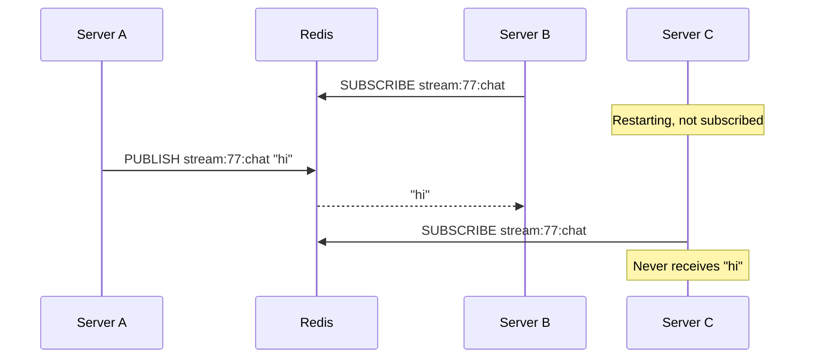

## In one line
Redis stores data structures (counters, sorted lists, sets, queues), not just cached values, so one fast shared server can also handle sessions, rate limits, leaderboards, live messages, and simple job queues.

## The problem it solves
The video app now runs on three servers behind a **load balancer**, the component that spreads incoming requests across them. Suddenly a lot of small jobs need state that all three servers share:

- A user logs in on server A, and the next request lands on server B. B must know they are logged in.
- Login attempts must be capped at 5 per minute per IP address, counted across all servers.
- A live stream shows its top 10 gift senders, updated as gifts arrive.
- A chat message typed by a viewer connected to server A must reach viewers connected to B and C.
- Video thumbnails should be generated in the background.

Keeping any of this in one server's memory breaks as soon as there is a second server. A database could do it, but these are tiny, very frequent operations. Redis already sits next to your app as a cache, and it has a built-in structure for each of these jobs.

## Everyday analogy
The front desk of a busy office. It has a tally counter for visitors, a scoreboard that keeps names in ranked order, a loudspeaker for announcements, and an in-tray of tasks. Everyone in the building uses the same desk, so they all see the same numbers.

Where it breaks down: an announcement on the loudspeaker is heard only by people in the building at that moment. Nobody keeps a recording. Redis pub/sub works exactly like that, and people often expect otherwise.

## How it works
Two facts explain why Redis is good at this:

1. **Values have types.** A key can hold a string, a counter, a hash (a small object of fields), a list, a set, a **sorted set**, or a **stream**. Each type has its own commands.
2. **Each command is atomic.** Redis executes commands one at a time, so a command like `INCR` (add one) runs completely before the next command starts. Two servers incrementing the same counter at once can't both read 4 and both write 5. No locks needed.

| Job | Redis structure | Key commands |
|---|---|---|
| Sessions | String or hash with a TTL | `SET ... EX`, `GET`, `EXPIRE`, `DEL` |
| Rate limiting | Counter with a TTL | `INCR`, `EXPIRE` |
| Leaderboard | Sorted set | `ZINCRBY`, `ZRANGE ... REV`, `ZREVRANK` |
| Live broadcast | Pub/sub channel | `PUBLISH`, `SUBSCRIBE` |
| Job queue | List or stream | `LPUSH`/`BRPOP`, `XADD`/`XREADGROUP`/`XACK` |

**Sessions.** A **session** is the server's memory of a logged-in user. The cookie holds only a random session ID. Redis holds `session:<id>` with `{ "userId": 981 }` and a TTL, for example 30 minutes, refreshed on each request. Logout is a `DEL`, so it takes effect instantly. See [Cookies, sessions, and local storage](#/topic/cookies-sessions-storage).

**Rate limiting.** Count requests per client per time window. The key includes the window, like `ratelimit:login:198.51.100.7:<minute>`. `INCR` returns the new count, and the key expires when the window ends. See [Rate limiting](#/topic/rate-limiting).

**Leaderboards.** A sorted set holds unique members, each with a numeric score, and keeps them ordered by score at all times. Internally it combines a **skip list** (a layered linked list that allows fast ordered search) with a hash table (for direct lookup by member). Adding or updating a score takes O(log N) time: the cost grows very slowly as the set grows. Reading the top 10 needs no sorting, because the set is already in order.

**Pub/sub.** Publishers send a message to a named **channel**. Redis immediately pushes it to every connection subscribed to that channel at that moment, then forgets it. Nothing is stored. A subscriber that is disconnected, even for a second, misses the message for good. This is called **at-most-once delivery**: each message arrives once or not at all.


*Notice: Redis delivers only to subscribers connected right now, and keeps no copy for anyone else.*

**Queues.** A list works as a simple queue: producers `LPUSH` onto one end, and workers wait with `BRPOP` (a blocking pop) on the other. The weakness: once a worker pops a job, Redis forgets it. If the worker crashes mid-job, the job is lost. **Redis Streams** fix this: an append-only log where consumers must **acknowledge** each message with `XACK`, and unacknowledged messages can be claimed by another worker. In Node.js, the BullMQ library builds a full job queue on top of Redis. See [Message queues](#/topic/message-queues).

## Real example
**Setup:** the `redis` client from [Redis caching](#/topic/redis-caching) (`clients.js`), node-redis v5 or later, Redis 7 or later.

**A live-stream gift leaderboard** (`leaderboard.js`):

```js
import { redis } from './clients.js';

const boardKey = (streamId) => `stream:${streamId}:top-gifters`;

// A viewer sends a gift worth `coins`. ZINCRBY adds to their score,
// creating the member if it's new. The set stays sorted as it changes.
export async function recordGift(streamId, userId, coins) {
  await redis.zIncrBy(boardKey(streamId), coins, `user:${userId}`);
}

// Top 10, highest score first. No sorting happens here: it's already sorted.
export async function topGifters(streamId) {
  return redis.zRangeWithScores(boardKey(streamId), 0, 9, { REV: true });
}

// 0 means first place. null means this user hasn't sent a gift.
export async function rankOf(streamId, userId) {
  return redis.zRevRank(boardKey(streamId), `user:${userId}`);
}
```

After gifts of 50 and 100 from user 981, 120 from user 412, and 20 from user 305, `topGifters(77)` returns:

```js
[ { value: 'user:981', score: 150 },
  { value: 'user:412', score: 120 },
  { value: 'user:305', score: 20 } ]
```

**A login rate limiter** (`rate-limit.js`):

```js
import { redis } from './clients.js';

// Allow 5 login attempts per IP address per minute (a "fixed window").
export async function allowLoginAttempt(ip) {
  const minute = Math.floor(Date.now() / 60_000);   // changes once a minute
  const key = `ratelimit:login:${ip}:${minute}`;
  const [count] = await redis.multi()               // MULTI: run both as one unit
    .incr(key)                                      // +1, returns the new count
    .expire(key, 60, 'NX')                          // set expiry only if it has none
    .exec();
  return count <= 5;
}
```

Seven quick attempts return `true` five times, then `false`. Sending `INCR` and `EXPIRE` together in a `MULTI` transaction matters: if the server crashed between two separate calls, the key could be left with no expiry and that IP would stay blocked.

**Pub/sub in two terminals:**

```bash
# Terminal 1: subscribe (this connection now only listens)
redis-cli SUBSCRIBE stream:77:chat
# 1) "message"  2) "stream:77:chat"  3) "user:981: great goal!"

# Terminal 2: publish. The reply is how many subscribers received it.
redis-cli PUBLISH stream:77:chat "user:981: great goal!"   # (integer) 1
redis-cli PUBLISH stream:78:chat "hello"                   # (integer) 0: nobody got it
```

## How to say it in an interview

> [!INTERVIEW]
> **30 seconds:** "Redis is an in-memory data structure server, so beyond caching I use it for shared state across app servers. Sessions are keys with a TTL. Rate limits are counters using INCR plus EXPIRE, which are atomic, so no race conditions. Leaderboards use sorted sets, which stay ordered, so reading the top 10 is cheap. Pub/sub broadcasts live messages across servers, and lists or streams can back a simple job queue."

> [!INTERVIEW]
> **2 minutes:** Start with the 30-second answer, then add:
>
> "The important change is that this data isn't a disposable cache anymore. If Redis restarts and loses sessions, everyone is logged out. If it loses queued jobs, work silently disappears. So I'd turn on persistence, run a replica, and set the eviction policy to `noeviction` on the instance holding queues, so Redis refuses writes instead of quietly deleting jobs when memory is full. Often that means a separate Redis instance from the cache.
>
> I'd also pick the right delivery guarantee. For live chat across WebSocket servers, pub/sub is fine: if a server misses a message during a restart, nothing important is lost. For anything that must not be lost, like 'transcode this upload', I'd use Streams or BullMQ, where messages are stored and acknowledged. And past a certain scale, a dedicated broker like Kafka or RabbitMQ is the better tool."

## Follow-up questions interviewers ask

<details>
<summary>Why is INCR safe when several servers call it at the same time?</summary>

Redis runs commands one after another, so each `INCR` reads and writes the counter as a single step. With a database you'd do `SELECT`, add one in your code, then `UPDATE`, and two servers could both read 4 and write 5. That's called a **lost update**.

</details>

<details>
<summary>What is the weakness of the fixed-window rate limiter?</summary>

Bursts at the boundary. A client can send 5 requests at 12:00:59 and 5 more at 12:01:00, which is 10 in two seconds. A **sliding window** fixes this: store each request's timestamp in a sorted set, remove entries older than 60 seconds with `ZREMRANGEBYSCORE`, and count what remains. It is more accurate but uses more memory per client.

</details>

<details>
<summary>Pub/sub vs Streams: when do you use which?</summary>

Pub/sub is fire-and-forget: instant fan-out to whoever is listening, with no storage and no acknowledgments. Use it for live updates where missing one is harmless. Streams store messages, support consumer groups that share work, and require acknowledgments, so nothing is lost if a consumer crashes. Use Streams for work that must happen.

</details>

<details>
<summary>Why does a subscribed connection need to be separate?</summary>

Once a connection runs `SUBSCRIBE`, it enters subscriber mode and (with the default RESP2 protocol) can only run subscription commands such as `SUBSCRIBE`, `UNSUBSCRIBE`, and `PING`. In node-redis you create a second client, usually with `redis.duplicate()`, for subscribing, and keep the first for normal commands.

</details>

<details>
<summary>Should you store sessions in Redis or use JWTs?</summary>

Redis sessions can be revoked instantly with a `DEL`, but every request needs a Redis lookup. JWTs need no lookup, but they are hard to revoke before they expire. See [Sessions vs JWT](#/topic/sessions-vs-jwt).

</details>

## Common mistakes and misconceptions

> [!MISTAKE]
> "Pub/sub is a message queue." It isn't. Nothing is stored. If no one is subscribed, or a subscriber is reconnecting, the message is simply gone. Use Streams or a real queue when delivery matters.

> [!MISTAKE]
> Putting sessions and queues on a Redis instance configured as a cache, with an eviction policy like `allkeys-lru`. Under memory pressure, Redis will quietly delete sessions or jobs to make room.

> [!MISTAKE]
> `INCR` and `EXPIRE` as two separate calls with no safeguard. A crash in between leaves a counter that never expires. Use `MULTI`, or `EXPIRE` with `NX`, as in the example.

> [!MISTAKE]
> Fetching a whole leaderboard and sorting it in Node.js. The sorted set is already ordered. Ask Redis for just the range you need.

## Tradeoffs: when NOT to use it
- **Data you can't afford to lose and can't rebuild**, like orders or payments. That belongs in PostgreSQL, which writes to disk and supports transactions.
- **Durable, high-volume event streams** that many teams consume and replay. Kafka is built for that.
- **Complex routing** of messages to many queues by rules. RabbitMQ is built for that. See [BullMQ vs RabbitMQ vs Kafka](#/topic/bullmq-rabbitmq-kafka).
- **Data larger than memory.** Redis keeps everything in RAM, so a huge dataset gets expensive fast.
- **A single server.** With only one app instance, an in-process counter or `Map` may be enough for now.

## Check yourself

<details>
<summary>1. Which Redis structure would you use for "top 10 products by sales today", and why?</summary>

A sorted set, with product IDs as members and sales as scores. `ZINCRBY` updates a score in O(log N), and `ZRANGE key 0 9 REV WITHSCORES` reads the top 10 without any sorting, because the set is always kept in order.

</details>

<details>
<summary>2. A server restarts for 5 seconds. Which pub/sub messages does it receive afterwards?</summary>

Only those published after it subscribes again. Messages published during the restart are lost, because Redis pub/sub stores nothing.

</details>

<details>
<summary>3. Why is a Redis list with BRPOP risky as a job queue?</summary>

The pop removes the job from Redis immediately. If the worker crashes before finishing, the job is gone and nobody retries it. Streams with acknowledgments, or a library like BullMQ, keep the job until the worker confirms it is done.

</details>

## Go deeper
- [Redis docs: data types overview](https://redis.io/docs/latest/develop/data-types/)
- [Redis docs: sorted sets](https://redis.io/docs/latest/develop/data-types/sorted-sets/)
- [Redis docs: pub/sub](https://redis.io/docs/latest/develop/pubsub/)
