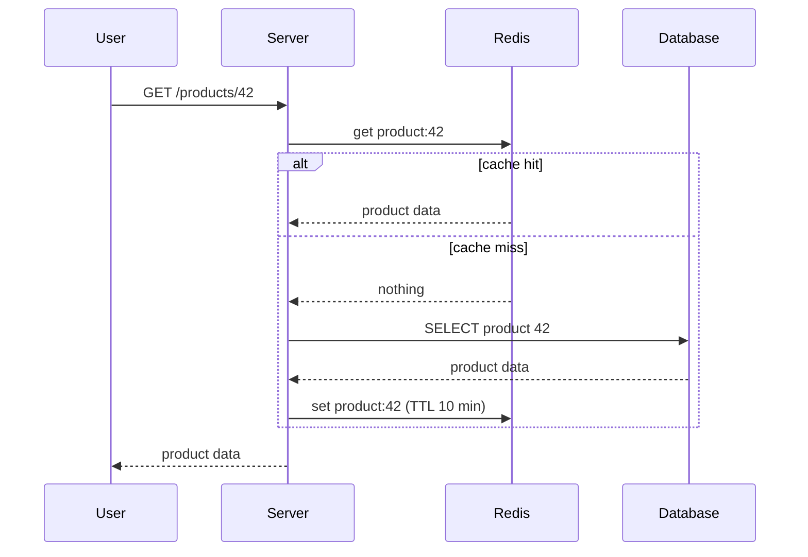

## In one line
Redis caching means keeping a copy of frequently requested data in fast memory, so most requests never have to touch the slower database.

## The problem it solves
Your product page is opened 5,000 times a minute. Each visit runs the same **database** **query** for the same product.

- A database is a program, such as PostgreSQL, that stores data safely on disk and answers questions about it.
- A query is one of those questions, for example "give me product 42".

The database does identical work thousands of times, gets slower under load, and every user waits for it, even though the answer almost never changes.

Put numbers on it. Say the query takes 80 ms. 5,000 a minute is about 83 per second, which adds up to roughly 6.6 seconds of database work **every second**. So about seven queries are always running at once, just for this one page. During a sale, or when a video goes viral, traffic jumps. Queries start queuing, **latency** (how long one request takes) climbs for every page on the site, not just this one, and the database becomes the bottleneck.

## Everyday analogy
A shopkeeper keeps the best-selling items on the counter instead of walking to the storeroom every time. The counter is Redis. The storeroom is the database.

Where it breaks down: the counter is small (memory is limited), and if the storeroom stock changes, the counter can show an outdated item until someone updates it.

## How it works
Some terms first:

- **Redis** is a data store that keeps everything in **memory** (RAM). Reading from memory is much faster than reading from disk, but memory is smaller and more expensive. Within the same network, a simple Redis read typically takes well under a millisecond.
- Redis is a **key-value store**: you save a value under a name, called the key, and get it back by that name. It works like a giant JavaScript object shared by all your servers.
- A **cache hit** means the data was found in the cache. A **cache miss** means it wasn't, so you go to the slower source.
- A **TTL** (time to live) is how long a cached copy may be used before Redis deletes it automatically.

The most common pattern is called **cache-aside**, because the cache sits beside the database and your code manages it:

1. A request asks for product 42.
2. The server checks Redis for the key `product:42`.
3. **Cache hit:** the data is there. Return it immediately. The database is not touched.
4. **Cache miss:** the data isn't there. Query the database.
5. Save the result in Redis with a TTL, for example 10 minutes.
6. Return the result. The next request for product 42 will be a hit.


*Notice: on a hit, the database is never contacted.*

**Keeping it fresh.** When an admin changes the price of product 42, the app updates the database first, then **deletes** `product:42` from Redis. The next request is a miss, so it loads the new price and caches that. The TTL is a safety net: even if a delete is ever missed, a stale copy lives for at most 10 minutes. See [Cache invalidation strategies](#/topic/cache-invalidation).

## Real example
**Setup:**
- Node.js 18 or later, with `"type": "module"` in `package.json`.
- `npm install express redis pg`.
- Redis running locally, for example with `docker run -d -p 6379:6379 redis:7`.
- PostgreSQL with a `products` table. `DATABASE_URL` and `REDIS_URL` are set as environment variables.

**1. Connect to both stores** (`clients.js`):

```js
import { createClient } from 'redis';
import pg from 'pg';

// A pool keeps a few database connections open and reuses them.
export const db = new pg.Pool({ connectionString: process.env.DATABASE_URL });

export const redis = createClient({
  url: process.env.REDIS_URL,      // e.g. redis://localhost:6379
  disableOfflineQueue: true,       // if Redis is down, fail fast instead of waiting
});
// Required: without an 'error' listener, a Redis error crashes the process.
redis.on('error', (err) => console.error('Redis error:', err.message));
await redis.connect();
```

**2. Cache-aside read, and delete on write** (`products.js`):

```js
import { db, redis } from './clients.js';

const TTL_SECONDS = 600; // 10 minutes

export async function getProductById(id) {
  const key = `product:${id}`;
  try {
    const cached = await redis.get(key);
    if (cached) return JSON.parse(cached);                 // hit: skip the database
  } catch (err) {
    console.warn('Cache read failed, using DB:', err.message); // Redis down? Still answer.
  }

  const { rows } = await db.query('SELECT id, name, price_cents FROM products WHERE id = $1', [id]);
  const product = rows[0] ?? null;
  if (product) {
    redis.set(key, JSON.stringify(product), { EX: TTL_SECONDS }) // store with a TTL
      .catch((err) => console.warn('Cache write failed:', err.message)); // don't make the user wait
  }
  return product;
}

export async function updateProductPrice(id, priceCents) {
  await db.query('UPDATE products SET price_cents = $1 WHERE id = $2', [priceCents, id]);
  await redis.del(`product:${id}`).catch(() => {}); // invalidate; the TTL covers a failed delete
}
```

**3. Use it in a route** (`server.js`):

```js
import express from 'express';
import { getProductById } from './products.js';

const app = express();

app.get('/products/:id', async (req, res, next) => {
  try {
    const product = await getProductById(Number(req.params.id));
    if (!product) return res.status(404).json({ error: 'Product not found' });
    res.json(product);
  } catch (err) {
    next(err); // hand off to Express's error handler
  }
});

app.listen(3000);
```

**Watch it happen.** `redis-cli` is Redis's command-line tool:

```bash
redis-cli GET product:42        # (nil): nothing cached yet
curl localhost:3000/products/42 # miss: reads the database, then caches the result
redis-cli GET product:42        # "{\"id\":42,\"name\":\"Ceramic mug\",\"price_cents\":1299}"
redis-cli TTL product:42        # (integer) 594: seconds left before Redis deletes it
```

**Is it working?** Redis counts hits and misses for you:

```bash
redis-cli INFO stats | grep -E 'keyspace_(hits|misses)'
```

The **hit rate** is hits divided by (hits plus misses). If it is low, the cache is mostly adding work instead of saving it.

## How to say it in an interview

> [!INTERVIEW]
> **30 seconds:** "I use Redis as a cache in front of the database with the cache-aside pattern. The app checks Redis first; on a miss it reads from the database and stores the result with a TTL. This cuts database load and response time for read-heavy data. The main challenge is keeping the cache fresh, so I set TTLs and delete the key whenever the underlying data is updated."

> [!INTERVIEW]
> **2 minutes:** Start with the 30-second answer, then add:
>
> "For example, on a product page that is read thousands of times a minute but changes rarely, I'd cache each product under a key like `product:42` with a 10-minute TTL. When the price changes, I update the database first and then delete the key, so the next read loads fresh data. The TTL is a safety net in case an invalidation is ever missed.
>
> The tradeoff is freshness versus speed. A cached value can be slightly stale, so I don't cache things that must be exact at that moment, like stock levels during checkout or an account balance. Those always come from the database.
>
> I also treat Redis as optional. If it's down, the app falls back to the database instead of failing. But that means the database suddenly gets all the traffic, so I'd watch for that. Finally, I'd check that it's actually paying off by tracking the hit rate from Redis's `keyspace_hits` and `keyspace_misses` stats."

## Follow-up questions interviewers ask

<details>
<summary>How do you choose the TTL?</summary>

Ask: "How stale can this data be before it hurts someone?"

- A product description can be minutes old.
- A price shown in search results might tolerate a minute.
- A stock count at checkout can't be stale at all, so don't cache it.

Longer TTLs give a better hit rate but more staleness. Pair the TTL with explicit deletes on update, so the TTL only matters when something goes wrong.

</details>

<details>
<summary>Why delete the key on update instead of writing the new value into the cache?</summary>

Deleting is simpler and safer. If two updates happen close together, writing values into the cache can leave the **older** one in place when the writes arrive out of order. Deleting avoids that, because the next read always loads whatever the database holds.

There is still a small race: a slow read can load the old value just before the update and write it back just after the delete. That is one more reason to always keep a TTL.

</details>

<details>
<summary>What happens if Redis goes down?</summary>

With code like the example above, every request becomes a cache miss and goes to the database. The site keeps working, just slower. The danger is the database suddenly receiving all the traffic Redis was absorbing.

Protect it with timeouts, `disableOfflineQueue` so Redis calls fail fast, connection limits, and rate limiting (capping how many requests each client can make). For important caches, run Redis with a **replica**, a live copy on another machine, so a failure is brief.

</details>

<details>
<summary>What happens when Redis runs out of memory?</summary>

That depends on two settings: `maxmemory` (the memory limit) and `maxmemory-policy`. With the default policy, `noeviction`, Redis rejects new writes once the limit is reached. For a pure cache, set a policy such as `allkeys-lru`. It **evicts** (automatically deletes) the least recently used keys to make room. Managed services like AWS ElastiCache may use different defaults, so check yours.

</details>

<details>
<summary>What is a cache stampede?</summary>

A popular key expires, and hundreds of requests miss at the same moment. They all query the database for the same thing at once, and the database gets hammered.

Fixes:
- Let only one request rebuild the value while the others wait or get the old copy (a lock).
- Refresh the key shortly before it expires.
- Add small random variation to TTLs, so many keys don't expire together.

See [Cache stampede](#/topic/cache-stampede).

</details>

<details>
<summary>Cache-aside vs write-through: what's the difference?</summary>

- **Cache-aside:** the app reads the cache first and fills it only on a miss. The cache holds only what's actually requested.
- **Write-through:** every write goes to the cache and the database together. Reads are almost always hits, but you also cache data nobody reads, and every write does extra work.
- **Write-behind:** writes go to the cache first and reach the database later. It is fast, but data can be lost if the cache fails before saving.

Cache-aside is the usual default for read-heavy web apps.

</details>

<details>
<summary>Why not just cache in the Node.js process memory with a Map?</summary>

For tiny, rarely changing data, like a list of countries, an in-process cache is fine and even faster. But each server instance gets its own copy. When you run three servers behind a load balancer, they disagree, and deleting a key on one doesn't clear the others. The cache is also lost on every restart, and it uses the app's own memory.

Redis is one shared cache for all instances.

</details>

## Common mistakes and misconceptions

> [!MISTAKE]
> "Redis replaces the database." No. In this setup Redis holds a **copy**. The database remains the source of truth. Redis can save data to disk, but a cache should be safe to lose at any moment.

> [!MISTAKE]
> Caching without a TTL. Keys then live forever: stale data never fixes itself, and memory keeps growing until Redis hits its limit.

> [!MISTAKE]
> Deleting the cache key **before** the database update is committed. A request that arrives in between reloads the old value and caches it again. Update the database first, then delete the key.

> [!MISTAKE]
> Letting a Redis error fail the request. The cache is an optimisation. If it's unavailable, fall back to the database and log the problem.

> [!MISTAKE]
> Vague or shared keys for user-specific data, such as caching `cart` instead of `cart:user:981`. One user can then see another user's data. Always put every value that makes the data unique into the key.

## Tradeoffs: when NOT to use it
- **Data that must be exact right now.** Stock during checkout, account balances, permissions that were just revoked. A stale value here causes real harm, so read from the database.
- **Data that changes more often than it is read.** Each update deletes the key before anyone reads it, so the hit rate stays low and you pay for the extra work without the benefit.
- **Data that is already fast enough.** A primary-key lookup on a well-indexed table under light load may already be quick. Redis adds another service to run, secure, monitor, and pay for. Measure first. See [Finding performance bottlenecks](#/topic/performance-bottlenecks).
- **Data with little reuse.** Search results for millions of different queries are each read rarely, so most lookups are misses.
- **Very large values.** Memory is expensive. Caching multi-megabyte objects can fill Redis quickly and evict more useful keys.

## Check yourself

<details>
<summary>1. A request asks for product 7, and the key product:7 is not in Redis. What happens, step by step?</summary>

It is a cache miss. The server queries the database for product 7, stores the result in Redis under `product:7` with a TTL, and returns it to the user. The next request for product 7 is a hit and skips the database.

</details>

<details>
<summary>2. Why keep a TTL even if you delete keys on every update?</summary>

It is a safety net. A delete can fail (Redis briefly down), be forgotten (a new code path that updates the database directly), or lose a race with a slow read. The TTL guarantees that a stale value disappears after a known, limited time.

</details>

<details>
<summary>3. An admin changes a price, but customers keep seeing the old price for up to 10 minutes. What is the likely bug?</summary>

The code that updates the price does not delete `product:<id>` from Redis, or it deletes it before the database update is committed. Either way, the old value stays cached until the 10-minute TTL expires.

</details>

## Go deeper
- [Redis docs: Node.js client (node-redis)](https://redis.io/docs/latest/develop/clients/nodejs/)
- [AWS whitepaper: caching patterns (cache-aside, write-through)](https://docs.aws.amazon.com/whitepapers/latest/database-caching-strategies-using-redis/caching-patterns.html)
- [Redis docs: key eviction](https://redis.io/docs/latest/develop/reference/eviction/)
