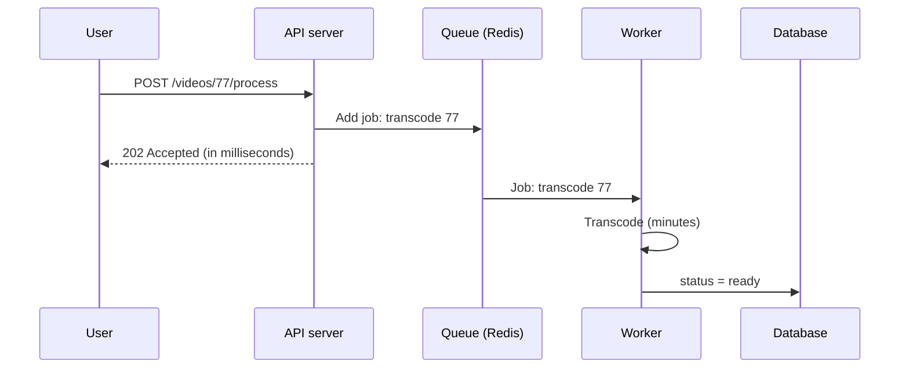

## In one line
A background job is work your server does after it has already replied to the user, so slow or unreliable tasks like sending emails or processing videos never make the user wait.

## The problem it solves
A creator uploads a 2 GB video to your app. Before viewers can watch it, it must be **transcoded**: converted into several sizes and formats (1080p, 720p, 480p) so it plays smoothly on any device. That can take many minutes of heavy CPU work.

If your Express route does the transcoding before responding:

- **The request times out.** Browsers, load balancers, and Nginx give up on slow responses. Nginx, for example, waits 60 seconds by default for your app to reply.
- **The server chokes.** While it transcodes, the CPU is busy, and every other user's requests slow down.
- **A crash loses the work.** If the server restarts during a deploy, the half-finished video is gone and nobody retries it.

Smaller tasks have the same shape. Sending a welcome email through an email provider might take a second, and if the provider is down, should signup fail? No. The user signed up. The email can go out a minute later.

## Everyday analogy
A restaurant. The waiter takes your order, hands a ticket to the kitchen, and comes straight back to say "your food is on its way". The waiter doesn't stand at the stove for 20 minutes. The kitchen works through the tickets in order, and if a cook gets sick, another cook picks up the ticket.

Where it breaks down: you can see your food arrive. A web user can't see the kitchen, so the app must tell them when the job is done.

## How it works
A few terms first:

- A **job** is a small record describing work to do, like `{ "name": "transcode", "videoId": 77 }`. It holds IDs, not the video itself.
- A **queue** is an ordered list of jobs waiting to be done. It lives in a shared store such as Redis, so it survives restarts of your app.
- A **worker** is a separate process whose only task is to take jobs from the queue and do them.
- **Asynchronous** means the work happens later, not while the caller waits.

The flow:

1. The user's request arrives: "video 77 finished uploading".
2. The API saves a status (`processing`) in the database.
3. It adds a job to the queue. This takes a few milliseconds.
4. It replies immediately with **`202 Accepted`**, the HTTP status code that means "I've accepted this, but it isn't done yet".
5. A worker picks up the job and does the slow part.
6. The worker records the result (`ready`) in the database.
7. The user finds out, by the app checking the status, a push notification, or an email.


*Notice: the user's request ends at the 202. All the slow work happens after it, in a different process.*

Because the queue stores the job, you also get things a plain function call can't give you: **retries** if the worker fails, a limit on how many jobs run at once, and the ability to add more workers when the queue gets long.

## Real example
**Setup:** Node.js 18+, `npm install express pg bullmq ioredis`, `"type": "module"` in `package.json`. Redis and PostgreSQL running, with `REDIS_URL` and `DATABASE_URL` set. A `video_uploads` table with `id` and `status` columns. **BullMQ** is a popular Node.js job-queue library that stores its queues in Redis. `transcodeVideo` stands for your own function, for example one that runs the `ffmpeg` video tool.

**1. The queue, shared by both processes** (`queue.js`):

```js
import { Queue } from 'bullmq';
import IORedis from 'ioredis';

// BullMQ needs maxRetriesPerRequest: null so workers wait out Redis hiccups.
export const connection = new IORedis(process.env.REDIS_URL, { maxRetriesPerRequest: null });

export const videoQueue = new Queue('video-processing', { connection });
```

**2. The API adds a job and replies at once** (`server.js`):

```js
import express from 'express';
import pg from 'pg';
import { videoQueue } from './queue.js';

const db = new pg.Pool({ connectionString: process.env.DATABASE_URL });
const app = express();

// Called by the browser once the video file has finished uploading.
app.post('/videos/:id/process', async (req, res) => {
  const videoId = Number(req.params.id);
  await db.query("UPDATE video_uploads SET status = 'processing' WHERE id = $1", [videoId]);

  const job = await videoQueue.add('transcode', { videoId }, {   // a small JSON description of the work
    attempts: 3,                                     // try up to 3 times in total
    backoff: { type: 'exponential', delay: 5000 },   // wait 5 s, then 10 s, between tries
    removeOnComplete: 1000,                          // keep only the last 1,000 finished jobs
  });
  res.status(202).json({ videoId, jobId: job.id, status: 'processing' }); // 202: accepted, not done
});

app.listen(3000);
```

**3. The worker, run as its own process** (`node worker.js`):

```js
import { Worker } from 'bullmq';
import pg from 'pg';
import { connection } from './queue.js';
import { transcodeVideo } from './transcode.js';

const db = new pg.Pool({ connectionString: process.env.DATABASE_URL });

const worker = new Worker('video-processing', async (job) => {
  const { videoId } = job.data;
  await transcodeVideo(videoId);                 // the slow part: minutes of CPU work
  await db.query("UPDATE video_uploads SET status = 'ready' WHERE id = $1", [videoId]);
}, { connection, concurrency: 2 });              // at most 2 videos at a time per process

worker.on('completed', (job) => console.log(`job ${job.id} done: video ${job.data.videoId}`));
worker.on('failed', (job, err) => console.error(`job ${job?.id} failed: ${err.message}`));

// On deploy/shutdown, finish the jobs in progress before exiting.
process.on('SIGTERM', async () => { await worker.close(); process.exit(0); });
```

**What happens:**

```bash
curl -X POST localhost:3000/videos/77/process
# {"videoId":77,"jobId":"1","status":"processing"}   <- returned in about 50 ms
# ...the worker log, once transcoding finishes:
# job 1 done: video 77
```

## How to say it in an interview

> [!INTERVIEW]
> **30 seconds:** "Background jobs move slow or unreliable work out of the request. The API saves what it needs, puts a small job on a queue, and replies right away, often with 202 Accepted. Separate worker processes pull jobs from the queue and do the work, like transcoding a video or sending an email. That keeps responses fast, isolates heavy CPU work from user traffic, and lets failed jobs be retried."

> [!INTERVIEW]
> **2 minutes:** Start with the 30-second answer, then add:
>
> "In Node I'd use BullMQ on Redis. For a video upload, the route marks the video as processing, enqueues a transcode job with the video ID, and returns 202. Workers run as a separate deployment, so I can scale them on queue length without touching the API, and a CPU-heavy transcode never blocks the event loop that's serving requests.
>
> The tradeoffs: the system is now eventually consistent. The user sees 'processing' for a while, so the UI needs a status and a way to learn it's done, like polling or a WebSocket. Jobs can run more than once after a crash or retry, so the handler must be idempotent, meaning running it twice has the same effect as once. And I need to monitor the queue: if it's growing faster than workers drain it, users wait longer and longer."

## Follow-up questions interviewers ask

<details>
<summary>Why not just call the function without await, or use setTimeout?</summary>

That runs the work later, but in the same process. If the server restarts during a deploy, the work is silently lost. There are no retries, no record that it ever existed, and CPU-heavy work still blocks the event loop that serves requests. A queue stores the job outside your process, so it survives restarts and can be retried.

</details>

<details>
<summary>How does the user find out the job is done?</summary>

Three common ways. **Polling:** the page calls `GET /videos/77` every few seconds and reads `status`. **Push:** the server sends an update over a WebSocket or Server-Sent Events connection; see [WebSockets vs SSE vs polling](#/topic/realtime). **Out of band:** an email or push notification. The database status is the source of truth in all three.

</details>

<details>
<summary>What if the worker crashes halfway through a job?</summary>

The job isn't marked complete. BullMQ notices the worker stopped renewing its lock on the job (it's **stalled**) and puts the job back to be retried. So a job can run more than once, and the handler must be **idempotent**: transcoding video 77 twice should overwrite the same output files, not create duplicates. See [Idempotency](#/topic/idempotency) and [Retries, backoff, and dead-letter queues](#/topic/retries-backoff-dlq).

</details>

<details>
<summary>What if the database update succeeds but adding the job fails?</summary>

Then the video says "processing" forever. Writing to two systems (database and queue) can't be made fully atomic. Common fixes: a periodic check that re-enqueues videos stuck in `processing`, or the **outbox pattern**, where the job is first written to a database table in the same transaction and a separate process moves it to the queue. See [Event-driven architecture](#/topic/event-driven).

</details>

<details>
<summary>Which tasks should become background jobs?</summary>

Anything slow (over a second or so), CPU-heavy, dependent on an unreliable outside service, or that the user doesn't need to see the result of right now: emails, video and image processing, report generation, webhooks to other systems, and syncing data to search.

</details>

## Common mistakes and misconceptions

> [!MISTAKE]
> Putting large data in the job, like the whole video or a big file buffer. Jobs should carry IDs. The worker loads the data from the database or object storage.

> [!MISTAKE]
> Running the worker inside the web server process. Heavy jobs then compete with requests for the same CPU and event loop. Run workers as separate processes or containers.

> [!MISTAKE]
> Assuming each job runs exactly once. Crashes and retries mean a job can run twice. Make handlers idempotent.

> [!MISTAKE]
> No monitoring of the queue. If workers are down, jobs pile up silently and users just see "processing" forever. Alert on queue length and failed jobs.

## Tradeoffs: when NOT to use it
- **The user needs the answer now.** Login, checkout totals, and search results must be computed in the request.
- **The work is fast and reliable.** A 5 ms database insert doesn't need a queue. Each queue adds Redis, workers, and monitoring to run.
- **Strict ordering across everything.** Queues with many workers process jobs in parallel, so job 2 may finish before job 1. If order matters, you need extra design.
- **Very early projects.** A single small app can start with work in the request and move it to a queue once it's measurably slow.

## Check yourself

<details>
<summary>1. Why does the API reply with 202 instead of 200?</summary>

`202 Accepted` tells the client the request was received and the work has started, but isn't finished. `200 OK` would suggest the result is ready.

</details>

<details>
<summary>2. The server restarts while a transcode job is running. With a queue, what happens? Without one?</summary>

With a queue, the job is still stored in Redis. It is detected as stalled and retried by a worker. Without a queue, the work lived only in the crashed process's memory, so it's lost and the video stays stuck.

</details>

<details>
<summary>3. Why should a job contain { videoId: 77 } and not the video file itself?</summary>

Queues are meant to hold small messages. Large payloads waste Redis memory and slow everything down. The file belongs in object storage, and the worker fetches it using the ID.

</details>

## Go deeper
- [BullMQ docs: What is BullMQ](https://docs.bullmq.io/)
- [MDN: 202 Accepted](https://developer.mozilla.org/en-US/docs/Web/HTTP/Reference/Status/202)
- [Nginx docs: proxy_read_timeout](https://nginx.org/en/docs/http/ngx_http_proxy_module.html#proxy_read_timeout)
