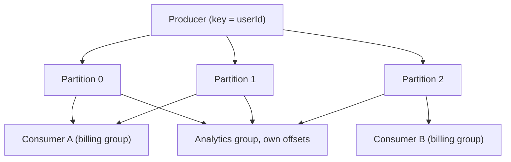

## In one line
BullMQ is a job queue library for Node.js built on Redis, RabbitMQ is a message broker that routes messages to queues and deletes them once handled, and Kafka is a distributed log that keeps every event so many readers can process and replay it.

## The problem it solves
The video app has three kinds of messaging work:

1. **Jobs:** "transcode video 77", "send password reset email to user 981". Each must be done once, retried on failure, sometimes delayed or scheduled.
2. **Messages between services:** "order 5001 placed" must reach the email service, and EU orders must also reach the EU warehouse service.
3. **Event streams:** every video play, pause, and seek from every viewer, millions a day. Analytics, recommendations, and billing all read the same stream, and a new recommendations model may need to re-read last week's events.

Each tool was designed around one of these shapes. Interviewers ask "which would you choose?" to see whether you understand the shapes, not the brand names.

## Everyday analogy
- **BullMQ** is a to-do app your team shares: tasks with due dates, retries, and priorities.
- **RabbitMQ** is a post office: letters arrive at a sorting office (the exchange), get sorted into mailboxes (queues) by address rules, and are removed once collected.
- **Kafka** is a newspaper archive: every edition is kept on the shelf in order, and each reader keeps their own bookmark. A new reader can start from last month.

Where it breaks down: each tool can be stretched into the others' roles. These are strengths, not hard limits.

## How it works

**BullMQ (job queue on Redis).** A library, not a server: your Node.js app and workers use it, and Redis stores everything.

- Each job is a Redis **hash** (a small object) with its data, options, attempt count, and result.
- Job IDs move between per-state structures: a `wait` list, an `active` list, a `delayed` sorted set ordered by run time, and `completed` and `failed` sets.
- A worker atomically moves a job from `wait` to `active` and holds a **lock** on it that it keeps renewing. If the worker dies, the lock expires, the job is detected as **stalled**, and it goes back to `wait`.
- Built in: retries with backoff, delayed jobs, priorities, rate limits, cron-style schedules, and parent/child job flows.
- Redis must use `maxmemory-policy noeviction`, or Redis may silently delete jobs under memory pressure.

**RabbitMQ (broker with routing).** A standalone server speaking the AMQP 0-9-1 protocol.

- Producers never send to a queue directly. They publish to an **exchange** with a **routing key**, a dotted label like `order.placed.eu`.
- **Bindings** are rules linking an exchange to queues. Exchange types decide how keys are matched:
  - **direct:** exact key match.
  - **fanout:** copy to every bound queue, ignoring the key.
  - **topic:** pattern match, where `*` matches one word and `#` matches zero or more. A binding `order.#` receives `order.placed.eu`.
  - **headers:** match on message headers instead of the key.
- Consumers read from queues, ack each message, and the broker **deletes** it after the ack. A **prefetch count** limits how many unacked messages each consumer holds.
- **Quorum queues** replicate a queue across several RabbitMQ nodes so it survives a node failure. **Dead-letter exchanges** catch rejected or expired messages.

**Kafka (distributed log).** A cluster of servers called **brokers** storing **topics**.

- A **topic** (`video-plays`) is split into **partitions**. Each partition is an append-only log: new events are only ever added at the end.
- Every event in a partition has an **offset**, its position number: 0, 1, 2...
- The producer picks the partition, usually by hashing the event's **key**. All events with key `user:981` land in the same partition, so they stay in order. Order is guaranteed **only within a partition**.
- Events are **not deleted when read**. They stay until the **retention** period ends (7 days by default) or a size limit is reached.
- A **consumer group** is a set of consumers sharing the work. Each partition is read by exactly one consumer in the group, so a topic with 6 partitions can have at most 6 active consumers per group.
- Each group **commits** the offset it has processed up to. Another group, like analytics, reads the same events with its own offsets. To replay, you reset a group's offset.
- Each partition is copied to other brokers (the **replication factor**, often 3), so a broker can fail without losing data. Modern Kafka manages the cluster itself with **KRaft**; ZooKeeper was removed in Kafka 4.0.


*Notice: inside the billing group each partition has one reader, while the analytics group reads every partition independently.*

**Side by side:**

| | BullMQ | RabbitMQ | Kafka |
|---|---|---|---|
| What it is | Node.js library + Redis | Broker server | Distributed log cluster |
| After a message is handled | Moved to completed or failed | Deleted | Kept until retention ends |
| Replay old messages | No | No (classic queues) | Yes, reset the offset |
| Ordering | Per queue, but workers run in parallel | Per queue | Per partition |
| Retries, delays, schedules | Built in | Partly (dead-lettering, TTLs) | Build them yourself |
| Scaling consumers | Add workers | Add consumers | Up to the partition count per group |
| Running it | Easy if you already run Redis | Moderate | Hardest; often bought as a managed service |

## Real example
**Setup:** Docker. This runs a one-broker Kafka for learning (the official `apache/kafka` image) and shows partitions, offsets, and lag. The Kafka command-line tools live in `/opt/kafka/bin` inside the container.

```bash
docker run -d --name kafka apache/kafka:4.1.1   # one broker, for learning. Give it ~15 s to start.

# A topic with 3 partitions
docker exec kafka /opt/kafka/bin/kafka-topics.sh --bootstrap-server localhost:9092 \
  --create --topic video-plays --partitions 3 --replication-factor 1

# Produce 6 events as key|value. The key decides the partition.
printf '%s\n' 'user:981|{"videoId":77,"event":"play"}' 'user:412|{"videoId":12,"event":"play"}' \
  'user:981|{"videoId":77,"event":"pause"}' 'user:305|{"videoId":77,"event":"play"}' \
  'user:981|{"videoId":77,"event":"seek"}' 'user:412|{"videoId":12,"event":"pause"}' |
docker exec -i kafka /opt/kafka/bin/kafka-console-producer.sh --bootstrap-server localhost:9092 \
  --topic video-plays --property parse.key=true --property key.separator='|'

# The "billing" group reads 4 events, printing partition and offset
docker exec kafka /opt/kafka/bin/kafka-console-consumer.sh --bootstrap-server localhost:9092 \
  --topic video-plays --group billing --from-beginning --max-messages 4 \
  --property print.key=true --property print.partition=true --property print.offset=true
```

Output:

```text
Partition:0  Offset:0  user:981  {"videoId":77,"event":"play"}
Partition:0  Offset:1  user:412  {"videoId":12,"event":"play"}
Partition:0  Offset:2  user:981  {"videoId":77,"event":"pause"}
Partition:0  Offset:3  user:981  {"videoId":77,"event":"seek"}
```

All of user 981's events are in one partition, in the order they happened. Now ask where the group's bookmark is:

```bash
docker exec kafka /opt/kafka/bin/kafka-consumer-groups.sh --bootstrap-server localhost:9092 \
  --describe --group billing
```

```text
GROUP    TOPIC        PARTITION  CURRENT-OFFSET  LOG-END-OFFSET  LAG
billing  video-plays  0          4               5               1
billing  video-plays  1          0               0               0
billing  video-plays  2          0               1               1
```

`CURRENT-OFFSET` is the group's committed bookmark. `LOG-END-OFFSET` is where the next event will be written. `LAG` is the difference: events waiting to be processed. The 4 events read are still in the log; a second group, say `analytics`, would read all 6 from offset 0.

**For the video app:** BullMQ for transcoding and emails, RabbitMQ only if many services in different languages need routing rules, and Kafka for the high-volume play events that several teams read and replay. Most companies start with just the first.

## How to say it in an interview

> [!INTERVIEW]
> **30 seconds:** "They solve different shapes of problem. BullMQ is a Node job queue on Redis, with retries, delays, priorities, and schedules built in, which is ideal for background jobs in a Node app. RabbitMQ is a broker where producers publish to exchanges that route into queues, and messages are deleted once acknowledged, which is great for task distribution and flexible routing between services. Kafka is a partitioned, replicated log that keeps events for a retention period, so many consumer groups can read the same stream at their own pace and replay it. I'd use it for high-volume event streams."

> [!INTERVIEW]
> **2 minutes:** Start with the 30-second answer, then add:
>
> "The deep difference is what happens after a message is read. RabbitMQ and BullMQ treat it as work that's finished and removed. Kafka treats it as a fact in a log. Consumers only move a bookmark, the offset. That's why Kafka can feed analytics, search indexing, and billing from one topic, and replay a week of events after a bug fix.
>
> Kafka's ordering and scaling come from partitions. Events with the same key go to the same partition, so they stay in order for, say, one user, and a consumer group can have at most one active consumer per partition. So partition count is a capacity decision you make up front.
>
> The tradeoff is operational cost. If I'm a Node team already running Redis and I need background jobs, BullMQ is the simplest correct choice. I'd only bring in Kafka when I genuinely need high-volume streams with several independent consumers or replay, and probably as a managed service."

## Follow-up questions interviewers ask

<details>
<summary>How does Kafka guarantee ordering, and what breaks it?</summary>

Only within a partition: events are appended and read in offset order. Give related events the same key (such as the order ID) so they land in the same partition. Ordering across partitions isn't guaranteed. Changing the number of partitions changes which partition a key maps to, which can break per-key order during the change.

</details>

<details>
<summary>What is consumer lag?</summary>

For each partition, the gap between the newest offset in the log and the offset the group has committed. Lag that keeps growing means consumers are slower than producers. Fix it by speeding up processing or adding consumers, up to the partition count.

</details>

<details>
<summary>What happens when a consumer joins or leaves a Kafka consumer group?</summary>

The group **rebalances**: partitions are reassigned among the remaining consumers. During a rebalance, processing of the moved partitions pauses briefly. Because offsets are committed periodically, the new owner may re-process a few events after the last commit, so consumers should be idempotent.

</details>

<details>
<summary>Can RabbitMQ replay messages like Kafka?</summary>

Classic and quorum queues delete messages after they're acknowledged, so no. RabbitMQ also offers **streams**, an append-only log type with offsets, which gives Kafka-like replay for some use cases. It's still a newer and less common choice than Kafka for heavy event streaming.

</details>

<details>
<summary>Why does BullMQ need noeviction on Redis?</summary>

With an eviction policy like `allkeys-lru`, Redis deletes keys when memory is full. Those keys would be your jobs and their state, so work would vanish silently. With `noeviction`, Redis refuses new writes instead, which fails loudly and can be alerted on.

</details>

## Common mistakes and misconceptions

> [!MISTAKE]
> "Kafka is just a faster RabbitMQ." They have different models. Kafka keeps events in a log and consumers track offsets. RabbitMQ routes messages into queues and deletes them after acks. Neither is a drop-in replacement.

> [!MISTAKE]
> Choosing Kafka for a handful of background jobs. You take on running a cluster, choosing partition counts, and building retries yourself, for problems a job queue solves out of the box.

> [!MISTAKE]
> Running more Kafka consumers than partitions and expecting more speed. The extra consumers in that group sit idle.

> [!MISTAKE]
> Sharing one Redis instance, configured as a cache with eviction, between caching and BullMQ. Under memory pressure, jobs get evicted.

## Tradeoffs: when NOT to use it
- **BullMQ:** not for teams outside Node.js-centric stacks (though ports for other languages exist), not for replayable event streams, and not when Redis memory can't hold the backlog.
- **RabbitMQ:** not for long-term storage or replay, and it's an extra server to run if a simple job queue is enough.
- **Kafka:** not for small teams or low volumes, not when you need per-message features like delays and priorities, and not when one consumer reading each message once is all you need.

## Check yourself

<details>
<summary>1. A topic has 4 partitions and your consumer group has 6 consumers. How many are actively consuming?</summary>

4. Each partition is assigned to one consumer in the group, so 2 consumers sit idle as standbys.

</details>

<details>
<summary>2. In RabbitMQ, a message is published to a topic exchange with routing key order.placed.eu. Which bindings receive it: order.*, order.#, *.placed.eu?</summary>

`order.#` and `*.placed.eu`. `order.*` matches exactly one word after `order`, but the key has two (`placed.eu`).

</details>

<details>
<summary>3. Your analytics team wants to reprocess last week's video-play events with a new formula. Which tool makes that easy, and how?</summary>

Kafka, as long as the topic's retention covers last week. Reset the analytics consumer group's offsets to the right point (or start a new group from that time), and it re-reads the events while other groups are unaffected.

</details>

## Go deeper
- [BullMQ docs](https://docs.bullmq.io/)
- [RabbitMQ docs: AMQP 0-9-1 model explained](https://www.rabbitmq.com/tutorials/amqp-concepts)
- [Apache Kafka docs: introduction](https://kafka.apache.org/intro)
