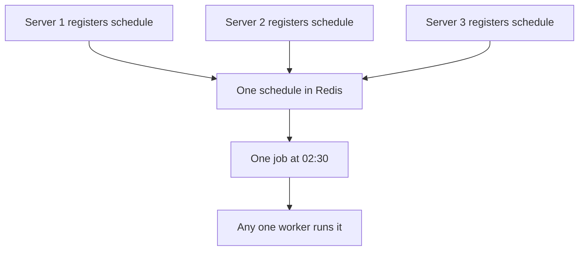

## In one line
A cron job is a command a server runs automatically on a timetable, like "every night at 02:30", described by a five-field schedule called a cron expression.

## The problem it solves
Some work isn't triggered by a user at all. It's triggered by the clock:

- Email the sales team yesterday's sales report every morning.
- Delete unfinished video uploads older than 24 hours, every hour.
- Back up the database every night. See [Backups and restore](#/topic/backups).
- Renew TLS certificates before they expire.

People forget to do these by hand. **Cron** is the standard Linux tool that runs commands on a schedule. It is a **daemon**, a program that runs in the background all the time, and once a minute it checks whether any scheduled job is due.

Cron is simple and works well on one server. The interview-worthy part is what goes wrong when you have more than one server, or when a job runs long.

## Everyday analogy
A recurring alarm on your phone: "every weekday at 7:00". You set it once and it fires on its own.

Where it breaks down: if your phone is switched off at 7:00, that alarm is simply missed, not delayed. Cron behaves the same way. And if you have three phones with the same alarm, you get woken three times, which is exactly the multi-server trap.

## How it works
**The cron expression.** Five fields, separated by spaces, then the command:

```text
┌───────────── minute        (0-59)
│ ┌─────────── hour          (0-23)
│ │ ┌───────── day of month  (1-31)
│ │ │ ┌─────── month         (1-12)
│ │ │ │ ┌───── day of week   (0-7, both 0 and 7 mean Sunday)
│ │ │ │ │
30 2 * * *   /srv/shop/scripts/sales-report.sh
```

Special characters:

| Symbol | Meaning | Example | Runs |
|---|---|---|---|
| `*` | every value | `* * * * *` | every minute |
| `,` | a list | `0 9,17 * * *` | 09:00 and 17:00 |
| `-` | a range | `0 9 * * 1-5` | 09:00, Monday to Friday |
| `/` | a step | `*/15 * * * *` | every 15 minutes |

There are also shortcuts: `@hourly`, `@daily`, `@weekly`, `@monthly`, and `@reboot` (once at startup).

**A classic trap:** if both day-of-month and day-of-week are restricted (neither is `*`), cron runs when **either** matches. `0 9 1 * 1` doesn't mean "the 1st, if it's a Monday". It means "the 1st of every month **and** every Monday".

**Where jobs live.** Each user has a **crontab** (cron table), edited with `crontab -e` and listed with `crontab -l`. System-wide jobs go in files under `/etc/cron.d/`, which have an extra field naming the user to run as.

**What surprises people:**

1. **A different environment.** Cron runs commands with `/bin/sh` and doesn't load your shell profile (`~/.bashrc`, `~/.profile`). Anything set there is missing: environment variables like `DATABASE_URL`, and additions to your `PATH` (the list of folders searched for commands), such as a Node.js installed with a version manager like nvm. Use full paths like `/usr/bin/node`, and load configuration explicitly. Also, `%` has a special meaning in a crontab line, so write `date +\%F`, not `date +%F`.
2. **Output disappears.** Cron tries to email a job's output to the user, and on most servers no mail system is installed, so it's thrown away. Redirect output to a log file.
3. **Server time zone.** Times use the server's time zone. Most servers run in UTC, so `30 2 * * *` means 02:30 UTC, which is 08:00 in India.
4. **Missed runs aren't caught up.** If the server is down at 02:30, that run is skipped.
5. **Overlaps.** If a job takes 20 minutes but is scheduled every 15, a second copy starts while the first is still running.

**The multi-server trap.** You run 3 copies of your app for reliability, each with the same crontab or the same in-app scheduler (like the `node-cron` package). At 02:30, all three run the sales report, and the sales team gets three copies. The fix is to make sure each run creates exactly one job:


*Notice: all three servers register the same named schedule, but each run produces a single job that only one worker takes.*

## Real example
**Setup:** an Ubuntu server with the `cron` service (installed by default on Ubuntu Server). Your Node script lives at `/srv/shop/scripts/sales-report.js`. Run `which node` to find Node's full path.

**1. A safe crontab line** (`crontab -e`):

```bash
# m  h  dom mon dow  command
30 2 * * * cd /srv/shop && /usr/bin/flock -n /tmp/sales-report.lock /usr/bin/node scripts/sales-report.js >> /var/log/shop/sales-report.log 2>&1
```

- `cd /srv/shop &&`: start in the app folder, so relative paths work.
- `flock -n <lock file>`: if the previous run still holds the lock, exit at once instead of overlapping.
- Full path to `node`, and `>> ... 2>&1` to append output and errors to a log file.

**2. Check that it ran:**

```bash
crontab -l                                  # what's scheduled for this user
grep CRON /var/log/syslog | tail -5         # cron's own log: which commands it started
journalctl -u cron --since today            # the same, via systemd's journal
tail -n 20 /var/log/shop/sales-report.log   # what your script printed
```

**3. Many servers: one schedule in BullMQ.** Instead of cron on each machine, register a named schedule in Redis. Every server can run this at startup; the same ID means one schedule, not three.

```js
import { Queue, Worker } from 'bullmq';
import { connection } from './queue.js'; // ioredis connection, as in "Why background jobs exist"

const reportsQueue = new Queue('reports', { connection });

await reportsQueue.upsertJobScheduler(
  'nightly-sales-report',                              // unique scheduler ID
  { pattern: '30 2 * * *', tz: 'UTC' },                // 02:30 UTC every day
  { name: 'sales-report', data: { kind: 'daily' } },   // the job each run creates
);

new Worker('reports', async (job) => {
  await sendDailySalesReport();                        // only one worker gets each run
}, { connection });
```

In a test with three processes registering the same scheduler, each run produced one job, picked up by just one of the three workers. BullMQ also accepts a six-field pattern whose first field is seconds, such as `0 30 2 * * *`, so check which format a tool expects.

## How to say it in an interview

> [!INTERVIEW]
> **30 seconds:** "Cron runs commands on a schedule, defined by five fields: minute, hour, day of month, month, and day of week. On a single server it's perfect for nightly reports or cleanup. The traps are that cron doesn't load my shell profile, so I use full paths and log output to a file; it doesn't catch up on missed runs; and jobs can overlap, so I use flock. With multiple servers, I make sure only one instance runs each job, for example with a BullMQ job scheduler instead of cron on every machine."

> [!INTERVIEW]
> **2 minutes:** Start with the 30-second answer, then add:
>
> "The multi-server problem bites in production: three replicas with the same scheduler send three emails. I can run the scheduler on one designated machine, which is simple but a single point of failure, use a distributed lock, or let a queue own the schedule. With BullMQ's upsertJobScheduler, every replica registers the same named schedule, Redis stores it once, and each run becomes one job with retries. Kubernetes has a built-in CronJob resource for the same purpose.
>
> I also make scheduled jobs safe to rerun. The daily report takes the date as input, so rerunning it for October 26 produces the same report. And I keep servers in UTC to avoid daylight-saving surprises."

## Follow-up questions interviewers ask

<details>
<summary>What does */10 * * * * mean, and what does 0 */2 * * * mean?</summary>

`*/10 * * * *` runs every 10 minutes (at :00, :10, :20...). `0 */2 * * *` runs at minute 0 of every second hour: 00:00, 02:00, 04:00, and so on. A common mistake is `* */2 * * *`, which runs every minute during those hours.

</details>

<details>
<summary>The server was down at 02:30. Does the job run when it comes back?</summary>

No. Plain cron skips missed runs. If catching up matters, use **anacron** (built for daily, weekly, and monthly jobs on machines that aren't always on), a systemd timer with `Persistent=true`, or make the job process "everything since the last successful run" instead of "yesterday".

</details>

<details>
<summary>How do you stop a cron job from overlapping with itself?</summary>

Wrap it with `flock -n` on a lock file, so a new copy exits if the old one still holds the lock. Across several servers, use a lock in a shared store such as Redis, or a queue-based scheduler.

</details>

<details>
<summary>Cron vs systemd timers?</summary>

Systemd timers need more setup (a `.service` and a `.timer` file), but they log to the journal, can catch up missed runs, and don't start a second copy while one is running. Cron is simpler and everywhere.

</details>

## Common mistakes and misconceptions

> [!MISTAKE]
> Running the same scheduler in every app replica. Every replica fires, so the job runs once per server.

> [!MISTAKE]
> Not capturing output. The job fails every night and nobody knows. Log to a file, and alert when a scheduled job hasn't succeeded on time.

> [!MISTAKE]
> Writing `0 9 1 * 1` expecting "the first Monday of the month". It runs on the 1st **and** on every Monday.

## Tradeoffs: when NOT to use it
- **Work triggered by an event.** "Send a receipt after an order" should be a background job enqueued at order time, not a cron job that scans for new orders every minute.
- **Very frequent tasks.** Cron's smallest unit is one minute. Anything more frequent belongs in a long-running worker.
- **Jobs that must never be missed.** Cron won't catch up after downtime. Use a scheduler that records successful runs, and alert on missed ones.

## Check yourself

<details>
<summary>1. Write a cron expression for 18:45 every weekday.</summary>

`45 18 * * 1-5`. Minute 45, hour 18, any day of month, any month, Monday (1) to Friday (5).

</details>

<details>
<summary>2. A script runs fine from your terminal but fails under cron with "node: command not found". Why?</summary>

Cron doesn't load your shell profile, so `PATH` additions made there are missing. This is common when Node is installed with a version manager like nvm, which adds itself to `PATH` in `~/.bashrc`. Use the full path from `which node`.

</details>

<details>
<summary>3. You deploy 4 replicas of your API, each using node-cron to send a daily digest at 09:00. What happens, and how do you fix it?</summary>

Each replica sends it, so users get 4 digests. Fix it by having one place own the schedule: a single scheduler process, a distributed lock, or a queue job scheduler (like BullMQ's `upsertJobScheduler`) so each run creates one job.

</details>

## Go deeper
- [Ubuntu manpage: crontab(5)](https://manpages.ubuntu.com/manpages/noble/en/man5/crontab.5.html)
- [BullMQ docs: job schedulers](https://docs.bullmq.io/guide/job-schedulers)
- [Kubernetes docs: CronJob](https://kubernetes.io/docs/concepts/workloads/controllers/cron-jobs/)
