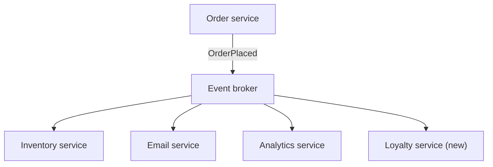

## In one line
In an event-driven architecture, services announce facts like "order 5001 was placed" instead of calling each other, and any service that cares reacts on its own, accepting that the system catches up a moment later.

## The problem it solves
When an order is placed in your shop, five things must follow: reserve stock, send a confirmation email, notify the warehouse, update analytics, and award loyalty points. The direct approach is for the order code to call each of them in turn:

```text
placeOrder → inventory.reserve() → email.send() → warehouse.notify() → analytics.track() → loyalty.award()
```

This hurts as the app grows:

- **Every new feature edits the order code.** The loyalty team must change checkout to add one call.
- **One slow or broken service breaks checkout.** If analytics is down, do you fail the order?
- **Checkout is as slow as the sum of all calls.**

This is called **tight coupling**: the order code must know about, and wait for, every other part. It gets worse with **microservices**, where each part is a separate application with its own database, owned by a different team, talking over the network.

## Everyday analogy
A school noticeboard. The office pins up "Sports day moved to Friday". It doesn't phone every parent, coach, and bus company. Each of them reads the board and does what they need to: parents rearrange, coaches reschedule, the bus company changes its route.

Where it breaks down: a noticeboard notice can be missed and nobody knows. In software, the board (the broker) must keep each notice until every interested service has confirmed it read it.

## How it works
Key ideas:

- An **event** is a record of something that **already happened**, named in the past tense: `OrderPlaced`, `VideoUploaded`, `PaymentFailed`. It is a fact, so nobody can refuse it.
- A **command** is a request to do something: `ReserveStock`. It can be refused. Event-driven systems mostly publish events, not commands.
- The **producer** publishes an event to a broker (Kafka, RabbitMQ, Redis Streams) without knowing who listens. Each interested service **subscribes** with its own consumer group and gets its own copy. See [Message queues](#/topic/message-queues).


*Notice: the order service publishes once. Adding the loyalty service needed no change to it.*

**Eventual consistency.** After `OrderPlaced`, there's a short window, often milliseconds, sometimes minutes during an outage, where the order exists but stock isn't reserved and the email isn't sent. The system is **eventually consistent**: if no new changes arrive, every service will reach the correct state, just not at the same instant. That's the price of decoupling, and the design must tolerate it. For example, the order page says "Confirmation email on its way".

**The dual-write problem.** The order service must do two things: save the order in its database and publish the event to the broker. These are two different systems, so they can't be saved in one transaction. If the database commit succeeds and the publish fails, the order exists but nobody hears about it. If you publish first and the commit fails, everyone reacts to an order that doesn't exist.

**The transactional outbox** fixes this:

1. In **one database transaction**, insert the order and insert the event into an `outbox` table. Both are saved, or neither is. See [Transactions and ACID](#/topic/transactions-acid).
2. A separate **relay** process reads unpublished outbox rows, publishes them to the broker, and marks them published.
3. If the relay crashes after publishing but before marking, it publishes again later. So events can arrive twice, and consumers must be **idempotent**.

**Making consumers safe:**

- **Duplicates:** each event carries a unique ID. The consumer records processed IDs and skips repeats.
- **Ordering:** events for the same order can arrive out of order across partitions. Use the order ID as the partition key so one order's events stay in sequence. See [BullMQ vs RabbitMQ vs Kafka](#/topic/bullmq-rabbitmq-kafka).
- **Changing event shapes:** other teams depend on your event's fields. Add new fields, but don't rename or remove existing ones without a new version.
- **Tracing:** put a **correlation ID** (one ID shared by everything caused by the same user action) in every event, so logs across services can be joined up.

**Multi-step workflows (sagas).** What if payment fails after stock was reserved? There's no single transaction across services. Instead, a **saga** undoes earlier steps with **compensating actions**: `PaymentFailed` leads inventory to release the stock. Sagas run in two styles. In **choreography**, each service reacts to events. In **orchestration**, a central coordinator tells each service what to do next. Choreography has less central code but is harder to follow.

## Real example
**Setup:** PostgreSQL with `orders`, `products` (with a `stock` column), and these two tables; Redis 7 as the event broker using Streams; the `db` (pg Pool) and `redis` (node-redis v5+) clients from [Redis caching](#/topic/redis-caching).

```sql
CREATE TABLE outbox (id bigserial PRIMARY KEY, event_type text NOT NULL, payload jsonb NOT NULL,
  created_at timestamptz NOT NULL DEFAULT now(), published_at timestamptz);
CREATE TABLE processed_events (consumer text, event_id text, PRIMARY KEY (consumer, event_id));
```

**1. Save the order and the event together** (order service):

```js
export async function placeOrder(userId, items, totalCents) {
  const client = await db.connect();
  try {
    await client.query('BEGIN');
    const { rows: [order] } = await client.query(
      'INSERT INTO orders (user_id, total_cents) VALUES ($1, $2) RETURNING id', [userId, totalCents]);
    await client.query(                                   // the event, in the SAME transaction
      'INSERT INTO outbox (event_type, payload) VALUES ($1, $2)',
      ['OrderPlaced', { orderId: order.id, userId, items }]);
    await client.query('COMMIT');                         // both rows are saved, or neither is
    return order.id;
  } catch (err) {
    await client.query('ROLLBACK');
    throw err;
  } finally {
    client.release();
  }
}
```

**2. The relay publishes outbox rows** (runs every second or so in its own process):

```js
export async function relayOutbox() {
  const client = await db.connect();
  try {
    await client.query('BEGIN');
    const { rows } = await client.query(
      `SELECT id, event_type, payload FROM outbox WHERE published_at IS NULL
       ORDER BY id LIMIT 100 FOR UPDATE SKIP LOCKED`);   // two relays never take the same rows
    for (const e of rows) {
      await redis.xAdd('events:orders', '*', {            // publish to the event stream
        type: e.event_type, eventId: String(e.id), payload: JSON.stringify(e.payload) });
    }
    await client.query('UPDATE outbox SET published_at = now() WHERE id = ANY($1)', [rows.map((e) => e.id)]);
    await client.query('COMMIT');
  } catch (err) {
    await client.query('ROLLBACK');                       // rows stay unpublished; next run retries
    throw err;
  } finally {
    client.release();
  }
}
```

**3. An idempotent consumer** (inventory service, in its own consumer group, created once with `redis-cli XGROUP CREATE events:orders inventory '$' MKSTREAM`):

```js
export async function consumeOnce() {
  const res = await redis.xReadGroup('inventory', 'inventory-1',
    { key: 'events:orders', id: '>' }, { COUNT: 10, BLOCK: 5000 });
  for (const msg of res?.[0]?.messages ?? []) {
    const { type, eventId, payload } = msg.message;
    const client = await db.connect();
    try {
      await client.query('BEGIN');
      const { rowCount } = await client.query(           // seen this event before? then skip it
        'INSERT INTO processed_events (consumer, event_id) VALUES ($1, $2) ON CONFLICT DO NOTHING',
        ['inventory', eventId]);
      if (rowCount === 1 && type === 'OrderPlaced') {
        for (const item of JSON.parse(payload).items) {
          await client.query('UPDATE products SET stock = stock - $1 WHERE id = $2', [item.qty, item.productId]);
        }
      }
      await client.query('COMMIT');                       // marker and stock change saved together
    } catch (err) {
      await client.query('ROLLBACK');
      throw err;                                          // no ack: the event will be redelivered
    } finally {
      client.release();
    }
    await redis.xAck('events:orders', 'inventory', msg.id); // ack only after the commit
  }
}
```

In a test, an order for 2 units of product 42 (stock 100) was published, then the same event was published a second time to simulate a relay crash. The stream held 2 messages, but stock ended at 98, not 96: the second copy was recognised and skipped.

## How to say it in an interview

> [!INTERVIEW]
> **30 seconds:** "In event-driven architecture, a service publishes events, facts like OrderPlaced, to a broker, and other services subscribe and react independently. The producer doesn't know who's listening, so I can add a new consumer without touching it, and a slow consumer doesn't slow down checkout. The cost is eventual consistency: other services catch up shortly after. To publish reliably I use the transactional outbox, and since events can arrive more than once, every consumer is idempotent."

> [!INTERVIEW]
> **2 minutes:** Start with the 30-second answer, then add:
>
> "The classic bug is the dual write: saving the order and publishing the event are two systems, so one can succeed while the other fails. The outbox pattern writes the event into an outbox table in the same transaction as the order, and a relay publishes it afterwards. That gives at-least-once publishing, so consumers record processed event IDs, ideally in the same transaction as their own changes.
>
> For workflows across services, like order, payment, and stock, there's no distributed transaction, so I'd use a saga with compensating actions: if payment fails, an event tells inventory to release the stock.
>
> The tradeoffs are real. Debugging is harder because there's no single call stack, so I use correlation IDs and tracing. The UI has to handle 'in progress' states. And some things shouldn't be eventual: if overselling is unacceptable, I'd reserve stock synchronously during checkout and use events for everything that can lag, like email and analytics."

## Follow-up questions interviewers ask

<details>
<summary>What's the difference between an event and a command?</summary>

An event states a fact that already happened (`OrderPlaced`) and is broadcast to anyone interested. The producer doesn't care who reacts. A command asks a specific service to do something (`ReserveStock`) and can be refused. Mixing them up leads to "events" that are really hidden function calls, recreating the coupling you tried to remove.

</details>

<details>
<summary>Why not just publish to the broker right after the database commit?</summary>

The process can crash, or the broker can be unreachable, between the commit and the publish. The order then exists, but no event is ever sent, and nothing notices. The outbox makes the event part of the same commit, so it can't be lost, only delayed.

</details>

<details>
<summary>How do you handle events arriving out of order?</summary>

Partition by the entity's ID so all events for one order go through one partition in sequence. Include a version or timestamp in each event, and have consumers ignore an event older than what they've already applied.

</details>

<details>
<summary>Is event sourcing the same thing?</summary>

No. **Event sourcing** means storing the full list of events as the source of truth for an entity, and computing current state by replaying them, like a bank ledger. Event-driven architecture is about services communicating through events. You can use either without the other.

</details>

<details>
<summary>Choreography or orchestration?</summary>

Choreography (services react to each other's events) suits short flows and keeps services independent. Orchestration (a coordinator sends commands and tracks progress) suits long, multi-step flows where you need to see and control the whole process in one place, such as a video pipeline of upload, transcode, thumbnail, and publish.

</details>

## Common mistakes and misconceptions

> [!MISTAKE]
> Publishing the event and writing the database as two separate steps. One can fail without the other. Use the outbox, or change data capture, which reads the database's change log.

> [!MISTAKE]
> Assuming each event is delivered once. Relays and brokers deliver at least once. Consumers must deduplicate.

> [!MISTAKE]
> Making everything asynchronous. If the user needs an immediate, correct answer, like "is this in stock?", a synchronous call is the right tool.

> [!MISTAKE]
> Breaking event formats. Renaming a field in `OrderPlaced` breaks every consumer you don't know about. Only add fields, or publish a new version.

## Tradeoffs: when NOT to use it
- **A small app or a single team.** A monolith calling functions directly is simpler to build, test, and debug. Events add a broker, relays, and idempotency work.
- **Flows that need immediate consistency.** Payments, stock at checkout, and permission changes often need a synchronous call or a single database transaction.
- **When you need to know the whole flow at a glance.** Choreographed events scatter logic across services. Use orchestration, or keep it in one service.
- **When the team can't yet operate it.** Event-driven systems need monitoring of lag, dead letters, and tracing from day one.

## Check yourself

<details>
<summary>1. The order is committed, then the server crashes before publishing OrderPlaced. With the outbox pattern, what happens?</summary>

The event row was committed with the order, so it's safely in the outbox. When the relay next runs, it publishes the event. Nothing is lost, only delayed.

</details>

<details>
<summary>2. Why does the consumer insert into processed_events in the same transaction as the stock update?</summary>

So both happen or neither does. If the marker were saved separately, a crash in between could either skip the stock update forever or apply it twice.

</details>

<details>
<summary>3. Payment fails after stock was reserved by another service. With no distributed transaction, how do you undo the reservation?</summary>

With a saga: the payment service publishes `PaymentFailed`, and the inventory service reacts with a compensating action that releases the reserved stock.

</details>

## Go deeper
- [Martin Fowler: What do you mean by "Event-Driven"?](https://martinfowler.com/articles/201701-event-driven.html)
- [microservices.io: transactional outbox pattern](https://microservices.io/patterns/data/transactional-outbox.html)
- [microservices.io: saga pattern](https://microservices.io/patterns/data/saga.html)
