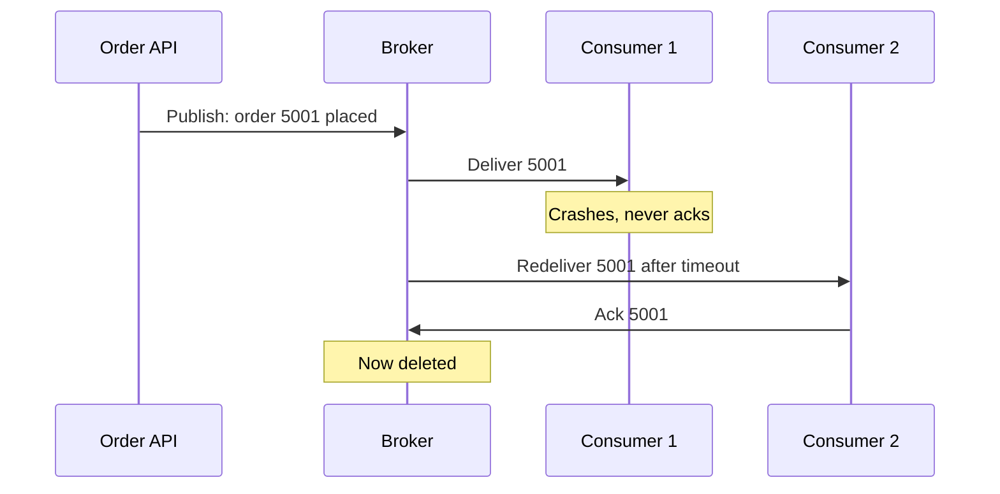

## In one line
A message queue is a durable to-do list between programs: producers add messages, consumers take them and confirm when they're done, and a message isn't removed until that confirmation arrives.

## The problem it solves
When an order is placed in your shop, three things must happen: send a confirmation email, reserve stock, and notify the warehouse. The order API could call the email service, the stock service, and the warehouse system directly, one after another. Then:

- If the email service is down for two minutes, order placement fails, or the email is silently skipped.
- If the warehouse system is slow, every checkout is slow.
- During a sale, 50 orders a second hit services built for 5.

The problem is that the sender and the receivers are **tightly coupled**: each one depends on the other being up and fast at that exact moment. A message queue puts a buffer between them. The order API drops a message, "order 5001 placed", into the queue and moves on. Receivers take messages when they're ready, at their own pace. If one is down, messages wait for it instead of being lost.

## Everyday analogy
A ticket rail in a restaurant kitchen. Waiters clip order tickets to the rail. Cooks take a ticket, cook the dish, and only throw the ticket away once the plate goes out. If a cook walks out mid-dish, the ticket is put back on the rail for another cook.

Where it breaks down: a kitchen ticket is never accidentally cooked twice. A message can be, because the queue can't always tell whether a consumer finished just before it crashed.

## How it works
The vocabulary:

- **Message:** a small piece of data describing something to do or something that happened, such as `{ "orderId": 5001 }`.
- **Producer:** the program that sends messages (the order API).
- **Consumer:** the program that receives and processes them (the email sender).
- **Broker:** the server that stores the messages and hands them out, such as RabbitMQ, Kafka, Amazon SQS, or Redis.
- **Acknowledgment (ack):** the consumer's message to the broker saying "done, you can delete this".

**The life of one message:**

1. The producer sends the message. The broker writes it to disk or a replica (it is **durable**) and confirms.
2. The broker delivers it to one consumer and marks it "in progress", not deleted.
3. The consumer does the work.
4. The consumer acks. Only now does the broker delete the message.
5. If no ack arrives, because the consumer crashed, disconnected, or took too long, the broker **redelivers** it, to the same or another consumer.

How "took too long" is detected depends on the broker. Amazon SQS hides an in-progress message for a **visibility timeout** (30 seconds by default) and then makes it visible again. RabbitMQ redelivers when the consumer's connection closes. Redis Streams keep a **pending list** that other consumers can claim from.


*Notice: the message survived the crash because it was only deleted after an ack.*

**Delivery guarantees.** Where you ack decides what can go wrong:

| Guarantee | How | Risk |
|---|---|---|
| **At-most-once** | Ack before processing (or never redeliver) | A crash loses the message |
| **At-least-once** | Ack after processing | A crash after the work but before the ack means the work runs twice |
| **Exactly-once** | Not achievable by the broker alone across your systems | Get the same *effect* with at-least-once plus an idempotent consumer |

At-least-once is the normal choice. So consumers must be **idempotent**: processing the same message twice has the same result as once. For example, record "email sent for order 5001" and skip if it's already there. See [Idempotency](#/topic/idempotency).

**Competing consumers.** Run 5 copies of the email consumer on one queue, and the broker spreads messages among them. Each message goes to only one. This is how you scale: if the queue grows, add consumers.

**Queue vs publish/subscribe.** In a plain queue, each message is processed by **one** consumer. In **publish/subscribe** (pub/sub), each message is delivered to **every** subscribing group: the email service, the stock service, and the warehouse service each get their own copy of "order 5001 placed". Most brokers support both. Inside each group, consumers still compete.

**Ordering.** With several consumers working in parallel, message 2 can finish before message 1. Most brokers keep order only within a single queue or partition consumed by one consumer at a time. If order matters per customer, route all of that customer's messages to the same partition.

**Backpressure.** If consumers are slower than producers, the queue grows. The queue protects the consumers from overload, but the backlog means delay. Watch **queue depth** (messages waiting) and **consumer lag**, and alert before the backlog becomes hours long.

## Real example
**Setup:** Redis 7 (`redis-cli`). Redis Streams are a simple, real broker you can try on a laptop. A **consumer group** is a named set of consumers that share one stream's messages.

```bash
# Create the stream "orders:placed" and a consumer group for the email service
redis-cli XGROUP CREATE orders:placed email-senders '$' MKSTREAM

# Producer: the order API publishes two messages (* = let Redis pick the ID)
redis-cli XADD orders:placed '*' orderId 5001 userId 981   # "1793040334184-0"
redis-cli XADD orders:placed '*' orderId 5002 userId 412   # "1793040334190-0"

# Two consumers in the same group each read one new message ('>' = never delivered yet)
redis-cli XREADGROUP GROUP email-senders worker-a COUNT 1 STREAMS orders:placed '>'  # gets 5001
redis-cli XREADGROUP GROUP email-senders worker-b COUNT 1 STREAMS orders:placed '>'  # gets 5002

# worker-b sends its email and acks. worker-a crashes and never acks.
redis-cli XACK orders:placed email-senders 1793040334190-0     # (integer) 1

# What is still unacknowledged, and by whom?
redis-cli XPENDING orders:placed email-senders
# 1 pending message: 1793040334184-0, held by worker-a

# worker-c claims anything pending for over 60 s (60000 ms) and processes it
redis-cli XAUTOCLAIM orders:placed email-senders worker-c 60000 0-0
# returns order 5001: it was not lost. Its delivery count is now 2.
```

The delivery count is useful: if a message has been delivered, say, 5 times and still fails, it is probably broken. Moving it aside is the job of a dead-letter queue. See [Retries, backoff, and dead-letter queues](#/topic/retries-backoff-dlq).

## How to say it in an interview

> [!INTERVIEW]
> **30 seconds:** "A message queue decouples a producer from consumers. The producer publishes a message to a broker, which stores it durably. Consumers pull messages and acknowledge each one after processing, and only then is it deleted. If a consumer crashes without acking, the message is redelivered. That gives at-least-once delivery, so consumers have to be idempotent. It also absorbs traffic spikes and lets me scale consumers independently."

> [!INTERVIEW]
> **2 minutes:** Start with the 30-second answer, then add:
>
> "In a shop, placing an order publishes 'order placed'. Email, stock, and the warehouse each consume it in their own group, so a slow or broken email service doesn't affect checkout. It just catches up later.
>
> The key choice is when to ack. Ack before processing and a crash loses the message: at-most-once. Ack after and a crash can cause a duplicate: at-least-once. Exactly-once isn't something the broker can guarantee across my database and an email provider, so I use at-least-once with idempotent consumers, for example by recording processed message IDs.
>
> The tradeoff is complexity and delay. There's a broker to run and monitor, the system becomes eventually consistent, and debugging a flow that crosses a queue is harder than following a function call. I'd watch queue depth and consumer lag, and send messages that keep failing to a dead-letter queue."

## Follow-up questions interviewers ask

<details>
<summary>Why can't you get exactly-once delivery?</summary>

A consumer can finish the work and then crash before its ack reaches the broker. The broker can't tell that apart from a crash before the work, so it must either redeliver (risking a duplicate) or not (risking a loss). Some systems, like Kafka, offer exactly-once processing **within** their own system using transactions, but once the work touches an outside system like an email provider, you need idempotency.

</details>

<details>
<summary>How would you make the email consumer idempotent?</summary>

Before sending, try to insert `(order_id, 'confirmation_email')` into a table with a unique constraint. If the insert fails because the row exists, the email was already handled, so ack and skip. Even better, many email and payment providers accept an **idempotency key** and ignore repeats.

</details>

<details>
<summary>The queue keeps growing. What do you check?</summary>

Whether consumers are running at all, then their error rate (are messages failing and being retried endlessly?), then their throughput versus the incoming rate. Fixes: add consumers, make each message faster to process, fix a slow dependency, or move poison messages to a dead-letter queue.

</details>

<details>
<summary>What does prefetch (or batch size) control?</summary>

How many unacked messages a broker sends a consumer at once. High prefetch keeps a fast consumer busy but lets one consumer hoard messages while others sit idle, and more messages are redelivered if it crashes. Low prefetch spreads work evenly. RabbitMQ calls this the prefetch count.

</details>

<details>
<summary>When would you use a queue instead of a direct HTTP call?</summary>

When the caller doesn't need the result right away, when the receiver may be slow or down, when traffic is spiky, or when several services need to react to the same event. Use a direct call when you need the answer now, like checking stock before confirming checkout.

</details>

## Common mistakes and misconceptions

> [!MISTAKE]
> "The queue guarantees each message is processed once." Almost all real setups are at-least-once. Duplicates will happen; design for them.

> [!MISTAKE]
> Acking before the work is done "to be safe". That is at-most-once: a crash mid-work loses the message silently.

> [!MISTAKE]
> Retrying a failing message forever. One broken message, a **poison message**, can block a queue or burn CPU endlessly. Cap the retries and move it to a dead-letter queue.

> [!MISTAKE]
> Assuming messages are processed in the order they were sent. With several consumers, they finish in any order.

## Tradeoffs: when NOT to use it
- **The caller needs the result to continue.** Checking a password or calculating a price should be a direct call.
- **A tiny app with one service.** A queue adds a broker to deploy, secure, back up, and monitor.
- **Strict global ordering.** Queues scale by processing in parallel. Forcing a single consumer for ordering removes most of the benefit.
- **When the delay itself is a problem.** If users expect to see the effect instantly, like their own comment appearing, eventual consistency needs careful UI handling, or a synchronous write.

## Check yourself

<details>
<summary>1. A consumer acks a message, then crashes before doing the work. Which delivery guarantee is that, and what's lost?</summary>

At-most-once. The broker already deleted the message, so the work never happens and nothing retries it.

</details>

<details>
<summary>2. You run 4 consumers in one group on a queue. A message arrives. How many of them process it?</summary>

One. Consumers in the same group compete for messages. To have several services each process every message, give each service its own group or subscription (publish/subscribe).

</details>

<details>
<summary>3. Why must at-least-once consumers be idempotent?</summary>

Because a message can be delivered more than once, for example after a crash between finishing the work and sending the ack. Idempotency makes the second run harmless.

</details>

## Go deeper
- [Redis docs: Streams (consumer groups, XACK, XAUTOCLAIM)](https://redis.io/docs/latest/develop/data-types/streams/)
- [RabbitMQ docs: consumer acknowledgements and publisher confirms](https://www.rabbitmq.com/docs/confirms)
- [AWS docs: Amazon SQS visibility timeout](https://docs.aws.amazon.com/AWSSimpleQueueService/latest/SQSDeveloperGuide/sqs-visibility-timeout.html)
