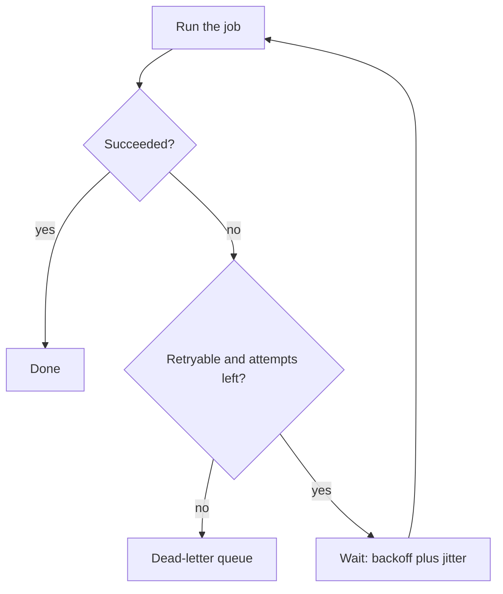

## In one line
Retries give failed work another chance, backoff spaces those chances further and further apart so a struggling service can recover, and a dead-letter queue parks work that keeps failing so a person can look at it.

## The problem it solves
Your email worker sends order confirmations through an email provider. Three things happen in a normal week:

1. **A blip.** The provider returns `503 Service Unavailable` for 20 seconds during their deploy. Every email in that window fails, even though trying again a minute later would have worked.
2. **A retry storm.** You add retries, but every failed job retries immediately, again and again. 2,000 queued emails now hit the provider in a tight loop the moment it starts recovering, and knock it over again.
3. **A poison message.** One job refers to order 9999, which was deleted. It fails every time. With unlimited retries it loops forever, wasting work and hiding real problems in the logs.

You need retries for the first case, a careful retry schedule for the second, and a place to put hopeless jobs for the third.

## Everyday analogy
Calling a busy shop. If nobody answers, you don't hang up and redial 50 times a second. You try again in a minute, then in five, then in fifteen. And if the number turns out to be disconnected, you stop calling and write it on a note to sort out later.

Where it breaks down: you're one caller. A server can have thousands of callers retrying at once, so they must also be spread out randomly, or they all call back at the same second.

## How it works
Key terms:

- A **transient error** is temporary: a timeout, a dropped connection, `503`, or `429 Too Many Requests`. A retry may succeed.
- A **permanent error** won't fix itself: `400 Bad Request`, `404 Not Found`, invalid data. Retrying wastes effort.
- **Backoff** means waiting before a retry. **Exponential backoff** doubles the wait each time: 1 s, 2 s, 4 s, 8 s, 16 s. A **cap** stops it growing forever, for example at 60 s.
- **Jitter** is randomness added to each wait. Without it, 2,000 jobs that failed together retry together, in synchronised waves. With "full jitter", each waits a random time between 0 and the backoff value, so retries spread out evenly.
- A **dead-letter queue** (DLQ) is a separate holding area for messages that failed too many times or failed permanently. Nothing processes it automatically. People inspect it, fix the cause, and replay or discard each message.

The decision for each failure:


*Notice: there are only two exits, success or the dead-letter queue. Nothing retries forever.*

**An example schedule** with a 1 s base, doubling, capped at 60 s:

| Attempt that failed | Backoff | With full jitter, actual wait is |
|---|---|---|
| 1 | 1 s | anywhere from 0 to 1 s |
| 2 | 2 s | 0 to 2 s |
| 3 | 4 s | 0 to 4 s |
| 6 | 32 s | 0 to 32 s |
| 8 | 60 s (capped) | 0 to 60 s |

**Retries need idempotency.** A request can succeed on the server, then the response is lost on the way back. Your side sees a timeout and retries, and the work happens twice. Retrying is only safe if doing the work twice has the same effect as once. See [Idempotency](#/topic/idempotency).

**Respect the server's hints.** A `429` or `503` response may include a `Retry-After` header saying how many seconds to wait. Use it instead of your own backoff when it's present.

## Real example
**Setup:** Node.js 18+ (built-in `fetch`). For part 2, BullMQ and ioredis as in [Why background jobs exist](#/topic/background-jobs). `getOrderById` and `sendOrderConfirmation` stand for your own functions.

**1. Retrying an HTTP call** (`fetch-with-retry.js`):

```js
const sleep = (ms) => new Promise((resolve) => setTimeout(resolve, ms));
const isRetryable = (status) => status === 429 || status >= 500; // rate-limited or server error

export async function fetchWithRetry(url, options = {}, { attempts = 5, baseMs = 500, capMs = 10_000 } = {}) {
  for (let attempt = 1; ; attempt++) {
    let res;
    try {
      res = await fetch(url, { ...options, signal: AbortSignal.timeout(5000) }); // never wait forever
      if (res.ok || !isRetryable(res.status)) return res;  // success, or a 4xx a retry won't fix
    } catch (err) {
      if (attempt >= attempts) throw err;                   // network error or timeout, no tries left
    }
    if (attempt >= attempts) return res;                    // no tries left: return the last response
    const backoff = Math.min(capMs, baseMs * 2 ** (attempt - 1)); // 500, 1000, 2000, 4000... capped
    const delay = Math.random() * backoff;                  // "full jitter": anywhere from 0 to backoff
    console.log(`attempt ${attempt} failed, retrying in ${Math.round(delay)} ms`);
    await sleep(delay);
  }
}
```

Against a test server that returns `503` twice and then `200`:

```text
attempt 1 failed, retrying in 310 ms
attempt 2 failed, retrying in 589 ms
200 ok
```

A `400` response returns at once, after one call.

**2. Retries and a dead-letter queue in BullMQ.** When adding the job:

```js
await emailQueue.add('order-confirmation', { orderId: 5001 }, {
  attempts: 5,                                               // 1 try + up to 4 retries
  backoff: { type: 'exponential', delay: 2000, jitter: 0.5 }, // ~2, 4, 8, 16 s, each up to 50% shorter
  removeOnFail: false,                                       // keep failed jobs for inspection
});
```

In the worker:

```js
import { Worker, UnrecoverableError } from 'bullmq';

const worker = new Worker('emails', async (job) => {
  const order = await getOrderById(job.data.orderId);
  if (!order) throw new UnrecoverableError(`order ${job.data.orderId} not found`); // permanent: no retries
  await sendOrderConfirmation(order);   // throws on a 503 from the provider, so BullMQ retries it
}, { connection });

// 'failed' fires after every failed attempt. Act only on the final one.
worker.on('failed', async (job, err) => {
  const final = err instanceof UnrecoverableError || job.attemptsMade >= (job.opts.attempts ?? 1);
  if (final) {
    await deadLetterQueue.add('dead-email', { jobId: job.id, data: job.data, error: err.message });
  }
});
```

`deadLetterQueue` is just another BullMQ `Queue` that no worker consumes. BullMQ itself has no separate DLQ: jobs that run out of attempts land in the queue's **failed** set, which you can also treat as one. `await emailQueue.getFailed()` lists them, and `await job.retry()` replays one after you've fixed the cause.

## How to say it in an interview

> [!INTERVIEW]
> **30 seconds:** "I retry only transient errors, like timeouts, 5xx, and 429, never 4xx validation errors. Retries use exponential backoff with a cap and jitter, so clients don't hammer a recovering service in synchronised waves. There's a maximum number of attempts, and after that, or on a permanent error, the message goes to a dead-letter queue for someone to inspect and replay. Because retries can run work twice, the operation has to be idempotent."

> [!INTERVIEW]
> **2 minutes:** Start with the 30-second answer, then add:
>
> "Jitter matters more than people expect. If 2,000 jobs fail together during a provider outage, plain exponential backoff makes all 2,000 retry at exactly 1 s, then 2 s, then 4 s. Random jitter spreads them across each window.
>
> I'm also careful about retries at several layers. If the browser retries 3 times, the API retries 3 times, and the worker retries 3 times, one user action can become 27 calls to the bottom service during an outage. So I retry at one layer, usually the one closest to the failing call, and give the whole operation a time budget.
>
> The dead-letter queue needs an owner. I alert when its size grows, because each message is a customer who didn't get an email or a video that didn't process. After a fix, I replay them. The tradeoff of all this is latency: a job that eventually succeeds on attempt 4 might take 30 seconds instead of 1. For background work that's fine. For a user waiting on a request, I'd use one quick retry at most."

## Follow-up questions interviewers ask

<details>
<summary>Why add jitter if backoff already spaces retries out?</summary>

Backoff spaces out the retries of **one** client. Without jitter, many clients that failed at the same moment follow the same schedule and retry at the same moments, creating spikes. Jitter randomises each wait so the load is spread evenly.

</details>

<details>
<summary>Which errors should you retry?</summary>

Timeouts, connection errors, `429`, `502`, `503`, `504`, and usually `500`. Don't retry `400`, `401`, `403`, `404`, or `422`, since the same request will fail the same way. For `POST` requests that create things, retry only if the operation is idempotent, for example with an idempotency key the server deduplicates on.

</details>

<details>
<summary>What do you do with messages in the dead-letter queue?</summary>

Alert when it grows. Look at the errors: a bug, bad data, or a dependency that was down too long? Fix the cause, then replay the messages back onto the main queue, or discard those that no longer make sense. Track how long messages sit there, since every one is work a user is waiting on.

</details>

<details>
<summary>What is a retry storm, and how else can you prevent one?</summary>

A retry storm is when retries add so much load that a struggling service can't recover. Beyond backoff and jitter, use a **retry budget** (allow retries for, say, at most 10% of requests) and a **circuit breaker**, which stops calling a failing service for a while after too many errors, then lets a few test requests through. See [Designing for failure](#/topic/designing-for-failure).

</details>

<details>
<summary>How many attempts should you allow?</summary>

Enough to ride out a typical blip of your dependency, not more. With exponential backoff, the total wait grows quickly: 5 attempts with a 2 s base waits about 30 s in total before the last try, and 10 attempts waits over 15 minutes. Choose based on how long a delay is acceptable for that job.

</details>

## Common mistakes and misconceptions

> [!MISTAKE]
> Retrying immediately in a loop. During an outage, this multiplies load on the failing service exactly when it is weakest.

> [!MISTAKE]
> Retrying permanent errors. A `400` or a missing record will fail every time. Mark it unrecoverable and send it straight to the DLQ.

> [!MISTAKE]
> Unlimited retries. A poison message then loops forever. Always have a maximum and a dead-letter destination.

> [!MISTAKE]
> Retrying non-idempotent operations, like "charge the card" without an idempotency key. A lost response plus a retry can charge the customer twice.

> [!MISTAKE]
> A dead-letter queue nobody watches. It quietly fills with failed orders and emails. Alert on its size.

## Tradeoffs: when NOT to use it
- **A user is waiting on the response.** Several backoff rounds turn a fast failure into a 30-second spinner. Fail fast, or retry once, then show an error.
- **The error is permanent.** Retrying validation, authorisation, or "not found" errors only adds load.
- **The operation isn't idempotent** and you can't make it so. Retrying risks duplicate side effects. Prefer failing and letting a person decide.
- **Every layer already retries.** Add retries at one layer only, or the counts multiply.

## Check yourself

<details>
<summary>1. With a base of 1 s, doubling, and a cap of 30 s, what are the backoff values after failures 1 through 6?</summary>

1 s, 2 s, 4 s, 8 s, 16 s, then 30 s (32 s capped to 30). With full jitter, each actual wait is a random value between 0 and that number.

</details>

<details>
<summary>2. A job fails because the order it refers to was deleted. What should happen?</summary>

Don't retry. It's a permanent error. Throw an unrecoverable error (in BullMQ, `UnrecoverableError`) so the job fails at once, and route it to the dead-letter queue or failed set for inspection.

</details>

<details>
<summary>3. Three layers each retry failed calls 3 times. In a full outage, how many calls can one user action cause at the bottom layer?</summary>

3 × 3 × 3 = 27. That's why you retry at one layer and give the whole operation a time budget.

</details>

## Go deeper
- [AWS Builders' Library: timeouts, retries, and backoff with jitter](https://aws.amazon.com/builders-library/timeouts-retries-and-backoff-with-jitter/)
- [BullMQ docs: retrying failing jobs](https://docs.bullmq.io/guide/retrying-failing-jobs)
- [MDN: Retry-After header](https://developer.mozilla.org/en-US/docs/Web/HTTP/Reference/Headers/Retry-After)
