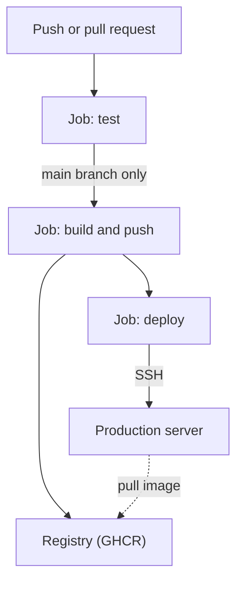

## In one line
CI/CD is an automated pipeline that tests every change as soon as it's pushed (CI) and then builds and releases it with the same steps every time (CD), so shipping becomes routine instead of risky.

## The problem it solves
Your team of four works on the shop app. Without automation:

- Someone merges code that breaks checkout. Nobody ran the tests, because "it was a small change".
- Deploys happen from one person's laptop with the [deploy script](#/topic/deploy-docker-ssh). When she's on holiday, nobody deploys. Her laptop has an uncommitted change that ends up in production.
- Releases pile up for two weeks, then ship as one big risky batch. When something breaks, nobody knows which of 40 changes caused it.

**Continuous integration** (**CI**) means every push and pull request is automatically built and tested, so problems are found within minutes, by the person who caused them. A **pull request** (PR) is a request to merge a branch into `main`, where teammates review the change.

**Continuous delivery** (**CD**) means every change that passes CI is automatically packaged and ready to release, usually with a one-click or approved deploy. **Continuous deployment** goes one step further: it releases to production automatically, with no human step. Both are called CD.

## Everyday analogy
A car factory's assembly line with inspection stations. Each car (each commit) goes through the same stations in the same order: welding check, paint check, test drive. A car that fails a station is pulled off the line immediately. Only cars that pass every station reach the showroom.

Where it breaks down: a factory line is built once and rarely changes. Your pipeline is code in your repository, and you change it as often as the app.

## How it works
**GitHub Actions** is GitHub's built-in CI/CD service. Its structure, from big to small:

1. **Workflow.** A YAML file in `.github/workflows/`. It says **when** to run (the **trigger**, or event, such as a push to `main` or a new pull request) and **what** to run.
2. **Jobs.** A workflow contains one or more jobs, such as `test`, `build`, and `deploy`. Jobs run **in parallel** by default. `needs: test` makes a job wait for another job and run only if it succeeded.
3. **Runner.** Each job runs on a **runner**: a fresh virtual machine, for example `ubuntu-latest`, that is created for the job and thrown away afterwards. Two jobs never share files unless you pass them along explicitly, for example through a registry or an artifact upload.
4. **Steps.** Inside a job, steps run **one after another** on the same runner, sharing its files. A step either runs a shell command (`run: npm test`) or uses a reusable **action** (`uses: actions/checkout@v7`), which is a packaged step someone published.
5. **Secrets.** Passwords and keys are stored encrypted in the repository settings and given to steps as `${{ secrets.NAME }}`. GitHub hides them in logs. Each run also gets a temporary `GITHUB_TOKEN`, with only the permissions the workflow asks for.
6. **Environments.** A named target like `production` can require a manual approval and hold its own secrets. That turns continuous deployment into continuous delivery.


*Notice: pull requests stop after the tests, and only code that passed them on main is built and deployed.*

## Real example
**Setup:** the shop API repository on GitHub, with `lint` and `test` scripts in `package.json`, the [Dockerfile](#/topic/dockerfile-node), and the server from [Deploying Docker over SSH](#/topic/deploy-docker-ssh). In **Settings → Secrets and variables → Actions**, add:

- `DEPLOY_SSH_KEY`: a private key made just for CI. Its public key is in the server's `authorized_keys` for `deploy`.
- `DEPLOY_KNOWN_HOSTS`: the output of `ssh-keyscan 203.0.113.10`, checked against the server's real fingerprint, so CI can detect an impostor server.

The file `.github/workflows/ci-cd.yml`, in three parts. **Trigger and test:**

```yaml
name: CI/CD

on:
  push:
    branches: [main]
  pull_request:                        # test every pull request too

jobs:
  test:
    runs-on: ubuntu-latest
    steps:
      - uses: actions/checkout@v7      # get the code onto the runner
      - uses: actions/setup-node@v7
        with:
          node-version: 24
          cache: npm                   # reuse downloaded packages between runs
      - run: npm ci
      - run: npm run lint
      - run: npm test
```

**Build and push the image** (same file, still under `jobs:`):

```yaml
  build:
    needs: test                            # only if tests passed
    if: github.event_name == 'push'        # pushes to main, not pull requests
    runs-on: ubuntu-latest
    permissions:
      contents: read
      packages: write                      # allow pushing to ghcr.io
    steps:
      - uses: actions/checkout@v7
      - uses: docker/login-action@v4
        with:
          registry: ghcr.io
          username: ${{ github.actor }}
          password: ${{ secrets.GITHUB_TOKEN }}
      - uses: docker/setup-buildx-action@v4
      - uses: docker/build-push-action@v7
        with:
          context: .
          push: true
          tags: ghcr.io/acme/shop-api:${{ github.sha }}   # tag = commit hash
          cache-from: type=gha             # reuse layers from earlier runs
          cache-to: type=gha,mode=max
```

**Deploy:**

```yaml
  deploy:
    needs: build
    runs-on: ubuntu-latest
    environment: production                # can require a manual approval
    concurrency: production                # never two deploys at once
    steps:
      - name: Deploy over SSH
        env:
          SSH_KEY: ${{ secrets.DEPLOY_SSH_KEY }}
          KNOWN_HOSTS: ${{ secrets.DEPLOY_KNOWN_HOSTS }}
          TAG: ${{ github.sha }}
        run: |
          install -m 700 -d ~/.ssh
          echo "$SSH_KEY" > ~/.ssh/id_ed25519 && chmod 600 ~/.ssh/id_ed25519
          echo "$KNOWN_HOSTS" > ~/.ssh/known_hosts
          ssh deploy@203.0.113.10 "cd /srv/shop \
            && sed -i 's/^TAG=.*/TAG=$TAG/' .env \
            && docker compose pull api && docker compose up -d --wait"
          curl -fsS https://shop.example.com/health
```

**What happens now:**

- Open a pull request: only `test` runs. GitHub shows a green tick or a red cross on the PR. With **branch protection** (Settings → Branches), a red cross blocks merging.
- Merge to `main`: `test`, then `build`, then `deploy` run in order. If `docker compose up --wait` or the final health check fails, the job fails and the team is notified.
- Roll back: re-run the `deploy` job of an earlier successful workflow run. It deploys that run's commit hash.

> [!NOTE]
> Image names on GHCR must be lowercase. Because `github.sha` is the full 40-character commit hash, tags are long but unique.

## How to say it in an interview

> [!INTERVIEW]
> **30 seconds:** "CI means every push and pull request is automatically built and tested, so broken code is caught before it's merged. CD means every change that passes is packaged and deployed the same way every time. In GitHub Actions I have a workflow with three jobs: test runs lint and tests on every PR; on main, build creates a Docker image tagged with the commit hash and pushes it to a registry; and deploy SSHes to the server and updates the running containers, then checks the health endpoint."

> [!INTERVIEW]
> **2 minutes:** Start with the 30-second answer, then add:
>
> "A workflow is made of jobs, and each job runs on a fresh runner VM. Steps inside a job share files, but jobs don't, which is why the build job pushes the image to a registry, and the deploy job just tells the server which tag to pull. Secrets like the deploy key live in GitHub's encrypted secrets, and the deploy job is tied to a production environment that can require approval and only runs one deploy at a time.
>
> The benefit is small, frequent, boring releases: if something breaks, it's one small change, and rolling back means redeploying the previous tag. The tradeoff is that the pipeline is only as good as the tests. A green pipeline with weak tests just ships bugs faster. Pipelines also need maintenance, and slow ones push people to skip them, so I cache dependencies and Docker layers to keep runs to a few minutes."

## Follow-up questions interviewers ask

<details>
<summary>Continuous delivery vs continuous deployment?</summary>

**Continuous delivery**: every passing change is built and ready to release, but a human decides when, for example by approving the `production` environment. **Continuous deployment**: every passing change on `main` goes to production automatically. Delivery suits teams that need a release gate, such as for compliance. Deployment suits teams with strong tests and quick rollbacks.

</details>

<details>
<summary>How do jobs share data if each one runs on a new machine?</summary>

They don't share a disk. You pass data explicitly: push an image to a registry, upload a file as a workflow **artifact** and download it in the next job, or use the cache action for things like dependencies. A job can also pass small values to later jobs through **outputs**.

</details>

<details>
<summary>How do you keep secrets safe in CI?</summary>

Store them as encrypted secrets, never in the YAML. Give the workflow minimal `permissions`. Use a dedicated deploy key that can only reach the deploy user, so you can revoke it without affecting anyone else. Don't pass secrets to workflows triggered by pull requests from forks: GitHub withholds them by default for that reason. Where possible, use **OIDC**, a way for the cloud provider to trust a short-lived token from GitHub instead of a stored long-lived key.

</details>

<details>
<summary>The pipeline takes 25 minutes. How do you speed it up?</summary>

Measure which step is slow first. Common fixes: cache npm downloads (`cache: npm`), cache Docker layers (`type=gha`), order the Dockerfile so dependencies are cached, run independent jobs like lint and tests in parallel, and split slow end-to-end tests to run on `main` only, or nightly.

</details>

<details>
<summary>Why pin action versions like @v7, and what's stricter?</summary>

An unpinned or branch reference could change under you at any time. A major-version tag like `@v7` gets fixes but no breaking changes. Strictest is pinning to a full commit SHA, which can never change. Security-sensitive teams prefer that, because a compromised tag could otherwise run malicious code with access to your secrets.

</details>

## Common mistakes and misconceptions

> [!MISTAKE]
> "CI means we have GitHub Actions." CI is the practice of merging small changes often and testing every one. A pipeline that nobody watches, or that's red for days, isn't CI.

> [!MISTAKE]
> Putting secrets in the workflow file, or printing them with `echo` "to debug". The file is in Git for everyone with access to see. Use `secrets.*`, which GitHub masks in logs.

> [!MISTAKE]
> Building a new image in the deploy step instead of deploying the one that was tested. Build once, tag by commit, and deploy that exact tag everywhere.

> [!MISTAKE]
> Skipping `StrictHostKeyChecking`, for example with `-o StrictHostKeyChecking=no`, to make SSH "just work" in CI. That disables protection against impostor servers. Store the server's known host key as a secret instead.

## Tradeoffs: when NOT to use it
- **Automatic production deploys without good tests or monitoring.** Continuous deployment needs trustworthy tests, health checks, and fast rollbacks. Without them, add a manual approval step.
- **A weekend prototype.** A full pipeline is overkill for something that may be thrown away. A test job on pull requests is cheap and almost always worth it, though.
- **Very slow pipelines.** If CI takes an hour, people batch changes and bypass it, losing the benefit. Fix the speed before adding more stages.

## Check yourself

<details>
<summary>1. A pull request is opened. Which jobs in the workflow above run?</summary>

Only `test`. `build` has `if: github.event_name == 'push'`, so it's skipped for pull requests, and `deploy` needs `build`, so it's skipped too.

</details>

<details>
<summary>2. Why can't the deploy job just use the image the build job built locally?</summary>

Each job runs on a separate, fresh runner. The image built in `build` exists only on that runner, which is deleted afterwards. That's why `build` pushes it to GHCR, and the server pulls it by tag.

</details>

<details>
<summary>3. What does concurrency: production protect against?</summary>

Two deploys running at the same time, for example after two quick merges, where an older commit could finish last and overwrite the newer one. With a concurrency group, only one deploy job runs at a time.

</details>

## Go deeper
- [GitHub docs: Understanding GitHub Actions](https://docs.github.com/en/actions/get-started/understand-github-actions)
- [Docker docs: GitHub Actions cache for builds](https://docs.docker.com/build/ci/github-actions/cache/)
- [GitHub docs: Security hardening for GitHub Actions](https://docs.github.com/en/actions/reference/security/secure-use)
