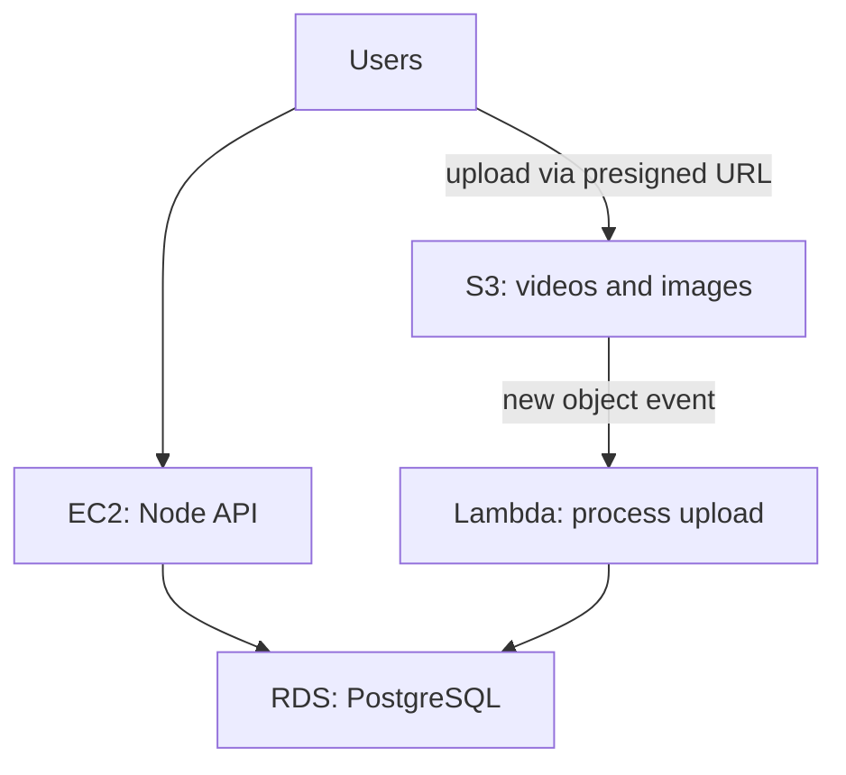

## In one line
Cloud providers rent you building blocks over the internet: EC2 gives you virtual servers, S3 stores files, RDS runs a managed database for you, and Lambda runs small pieces of code only when an event happens.

## The problem it solves
To launch the shop app the old way, you'd buy servers, rack them in a data centre, install the OS, set up a database with backups, and buy enough disk for every video anyone might ever upload. That takes weeks, costs money up front, and is sized for a guess.

The **cloud** means renting computing resources from a provider, such as AWS (Amazon Web Services), Google Cloud, or Microsoft Azure, on demand and paid for by usage. You create a server in about a minute and delete it when you're done.

The hard part for beginners is the vocabulary. AWS alone has hundreds of services. But four kinds cover most backend interview conversations, and each one replaces something you'd otherwise run yourself:

| You'd otherwise run... | AWS service | Kind of service |
|---|---|---|
| A server | EC2 | Compute (virtual machines) |
| A disk full of uploaded files | S3 | Object storage |
| PostgreSQL on your own server | RDS | Managed database |
| A small script triggered by events | Lambda | Serverless functions |

## Everyday analogy
Furnishing a new office:

- **EC2** is renting an **empty office**. Your space, your furniture, your cleaning.
- **S3** is a **self-storage warehouse**. Drop off boxes, label them, collect them anytime. Practically unlimited space, and you never see the shelves.
- **RDS** is a **serviced office**. Someone else handles cleaning, security, and repairs, and you just work there.
- **Lambda** is **hiring a taxi** instead of owning a car. It shows up when called, you pay per trip, and nothing sits idle in your garage.

Where it breaks down: in the cloud you can move between these in minutes, and mistakes, like leaving a large server running, show up on the monthly bill rather than as clutter.

## How it works
Two ideas first:

- A **region** is a geographic area where the provider has data centres, such as `eu-west-1` (Ireland). An **availability zone** (AZ) is one or more separate data centres inside a region, with their own power and networking. Spreading across AZs protects you from one building failing.
- **IAM** (Identity and Access Management) controls who and what may do which actions. A server gets an **IAM role**, a set of permissions, instead of a stored password.

**1. EC2 (Elastic Compute Cloud): virtual machines.** You choose an **instance type** (CPU and memory size), an OS image such as Ubuntu, and a disk (an **EBS volume**, a network disk that survives reboots). You get a VM you SSH into, just like a VPS. A **security group** is EC2's firewall: rules saying which ports are open, and to whom. You pay while it runs. You manage everything from the OS up. See [What a server actually is](#/topic/what-is-a-server).

**2. S3 (Simple Storage Service): object storage.** Files, called **objects**, are stored in **buckets** under a **key**, which is a path-like name such as `raw/981/v-5521.mp4`. You read and write them over HTTPS, not by mounting a disk. AWS designs S3 for 99.999999999% (eleven nines) durability by storing copies across several AZs. It's ideal for images, videos, backups, and static files, and pairs with a CDN for fast delivery. See [CDNs](#/topic/cdn).

**3. RDS (Relational Database Service): managed databases.** RDS runs PostgreSQL, MySQL, and others for you. AWS handles installation, OS patching, minor version upgrades (if you turn them on), automated backups with **point-in-time restore** (restore to any second within your retention period), and optional **Multi-AZ** failover: a standby copy in another AZ that takes over automatically, typically within a minute or two. You still design the schema, write queries, and add indexes.

**4. Lambda: serverless functions.** You upload a function, and AWS runs it when an **event** arrives: an HTTP request, a new file in S3, a message in a queue, or a schedule. **Serverless** doesn't mean no servers. It means you never see or manage them. You pay per request and per millisecond of run time, and nothing when idle. Limits: one run can last at most 15 minutes, and a function that hasn't run recently has a **cold start**, a delay while AWS prepares a fresh environment.


*Notice: each box is a service someone else keeps running; the arrows show where your own code connects them.*

Other clouds have the same four building blocks under different names: Google Cloud has Compute Engine, Cloud Storage, Cloud SQL, and Cloud Run functions. Azure has Virtual Machines, Blob Storage, Azure Database for PostgreSQL, and Azure Functions.

## Real example
**Scenario:** users of the video app upload large videos. Sending them through the Node API would tie up the server for minutes per upload. Instead, the API hands the browser a **presigned URL**: a temporary link, signed with the API's credentials, that allows exactly one upload to exactly one S3 key. See [File uploads](#/topic/file-uploads).

**Setup:** Node 22 or later with `"type": "module"`, `npm install @aws-sdk/client-s3 @aws-sdk/s3-request-presigner`, and an S3 bucket `shop-video-uploads`. On EC2, credentials come from the instance's IAM role. Locally, from `AWS_ACCESS_KEY_ID` and `AWS_SECRET_ACCESS_KEY` environment variables.

**1. The API creates the upload URL** (`uploads.js`):

```js
import { S3Client, PutObjectCommand } from '@aws-sdk/client-s3';
import { getSignedUrl } from '@aws-sdk/s3-request-presigner';

// Credentials come from the environment or the EC2 instance's IAM role
const s3 = new S3Client({ region: 'eu-west-1' });

export async function createVideoUploadUrl(userId, videoId) {
  const command = new PutObjectCommand({
    Bucket: 'shop-video-uploads',
    Key: `raw/${userId}/${videoId}.mp4`,     // where the file will be stored
    ContentType: 'video/mp4',
  });
  // The browser can PUT the file to this URL for the next 15 minutes
  return getSignedUrl(s3, command, { expiresIn: 900 });
}
```

For user 981 this returns a URL like `https://shop-video-uploads.s3.eu-west-1.amazonaws.com/raw/981/v-5521.mp4?X-Amz-Algorithm=...&X-Amz-Signature=...`. The browser uploads straight to S3, and the API server never touches the video bytes.

**2. A Lambda function reacts to the upload** (`index.mjs`, with the bucket's "object created" event configured to trigger it):

```js
// Runs automatically when a new file lands in the bucket
export const handler = async (event) => {
  for (const record of event.Records) {
    const bucket = record.s3.bucket.name;
    // Keys arrive URL-encoded, with spaces as "+"
    const key = decodeURIComponent(record.s3.object.key.replace(/\+/g, ' '));
    console.log(`New upload: s3://${bucket}/${key} (${record.s3.object.size} bytes)`);
    // Next: start transcoding, or mark the video as "uploaded" in the database
  }
};
```

Run locally with a sample event, it prints `New upload: s3://shop-video-uploads/raw/981/v-5521.mp4 (52428800 bytes)`. In AWS, you'd pay only for the moments it runs.

## How to say it in an interview

> [!INTERVIEW]
> **30 seconds:** "EC2 gives you virtual machines, so you manage the OS and everything on it. S3 is object storage for files like images, videos, and backups, accessed over HTTP and very durable. RDS is a managed relational database: AWS handles patching, backups, and failover, and I handle the schema and queries. Lambda runs functions in response to events and bills per invocation, with no servers to manage, but with time limits and cold starts. In our video app, the API runs on EC2, Postgres on RDS, uploads go straight to S3 via presigned URLs, and a Lambda reacts to each new upload."

> [!INTERVIEW]
> **2 minutes:** Start with the 30-second answer, then add:
>
> "The general idea is trading control for less operations work. EC2 gives full control but I patch the OS, handle backups, and plan capacity. RDS costs more than Postgres on my own VM, but automated backups, point-in-time restore, and Multi-AZ failover are a lot of work to build and test myself. Lambda is cheapest for spiky or low-volume work, like processing an upload, but for a steady, busy API, an always-on server is usually cheaper and avoids cold starts.
>
> Two habits matter in any cloud. Use IAM roles instead of access keys stored on servers, with least privilege, so the API can only write to its own bucket. And watch costs: things like data transfer out of AWS, idle instances, and forgotten resources show up on the bill."

## Follow-up questions interviewers ask

<details>
<summary>Why store uploads in S3 instead of on the server's disk?</summary>

A server disk is tied to one machine. If you run two API servers, each sees different files, and if the server dies, the files may go with it. S3 is shared by all servers, scales without you resizing anything, keeps copies across several data centres, and can serve files through a CDN. Your servers stay **stateless**, which makes scaling and redeploying easy.

</details>

<details>
<summary>When would you choose Lambda over EC2 (or containers)?</summary>

Lambda fits event-driven, short, or spiky work: reacting to uploads, webhooks, scheduled tasks, low-traffic APIs. EC2 or containers fit steady traffic, long-running work (over 15 minutes, like long video transcodes), WebSockets, and cases where cold starts would hurt. At constant high load, always-on servers usually cost less per request.

</details>

<details>
<summary>What does "managed" actually take off your plate with RDS, and what doesn't it?</summary>

AWS handles the hardware, OS, database installation, minor version patching, automated backups, point-in-time restore, and failover if you enable Multi-AZ. You still own the schema, indexes, slow queries, connection limits, major version upgrades (you schedule them), and security settings such as who can connect.

</details>

<details>
<summary>What is the shared responsibility model?</summary>

AWS secures the cloud itself: data centres, hardware, and the software that runs its services. You secure what you put in it: your OS patches on EC2, your IAM permissions, your security groups, and your bucket settings. Most cloud breaches come from the customer's side, such as a bucket accidentally made public.

</details>

## Common mistakes and misconceptions

> [!MISTAKE]
> "Serverless means there are no servers." There are servers. You just don't manage them, and you pay per use instead of per hour.

> [!MISTAKE]
> "The cloud is automatically highly available." A single EC2 instance in one AZ fails like any server. Availability comes from your design: multiple instances in multiple AZs, a load balancer, Multi-AZ databases.

> [!MISTAKE]
> Making an S3 bucket public so the browser can upload or download. Keep buckets private by default, and use presigned URLs or a CDN with restricted access instead.

> [!MISTAKE]
> Committing AWS access keys to Git, or putting them in a Docker image. Leaked keys are found and abused quickly, often for crypto mining on your bill. Attach an IAM role to the EC2 instance instead: the SDK picks up short-lived credentials automatically. In GitHub Actions, use OIDC.

## Tradeoffs: when NOT to use it
- **Small, steady apps on a budget.** A single VPS from a smaller provider can be far cheaper and simpler than a multi-service AWS setup. Many apps never need more.
- **Lambda for long or constant work.** The 15-minute limit, cold starts, and per-request pricing at high volume make always-on containers a better fit.
- **Managed services when you need deep control.** RDS limits some PostgreSQL extensions and superuser actions. If you need those, run the database yourself, and accept the operations work.

## Check yourself

<details>
<summary>1. Match each need to a service: storing product photos, running the Node API with full OS control, a Postgres database with automated backups, resizing an image whenever one is uploaded.</summary>

Photos: **S3**. Node API with OS control: **EC2**. Postgres with backups: **RDS**. Resize on upload: **Lambda**, triggered by an S3 event.

</details>

<details>
<summary>2. Why does the presigned-URL approach take load off the API server?</summary>

The browser uploads the file directly to S3. The API only signs a short URL, which takes milliseconds, and never receives or forwards the video's bytes.

</details>

<details>
<summary>3. What is a cold start, and why does it matter?</summary>

The extra delay when Lambda must create a fresh environment for a function that hasn't run recently, or when traffic needs more copies. It adds latency to that request, which matters for user-facing APIs and much less for background tasks like processing uploads.

</details>

## Go deeper
- [AWS docs: What is Amazon S3?](https://docs.aws.amazon.com/AmazonS3/latest/userguide/Welcome.html)
- [AWS docs: What is AWS Lambda?](https://docs.aws.amazon.com/lambda/latest/dg/welcome.html)
- [AWS docs: What is Amazon RDS?](https://docs.aws.amazon.com/AmazonRDS/latest/UserGuide/Welcome.html)
