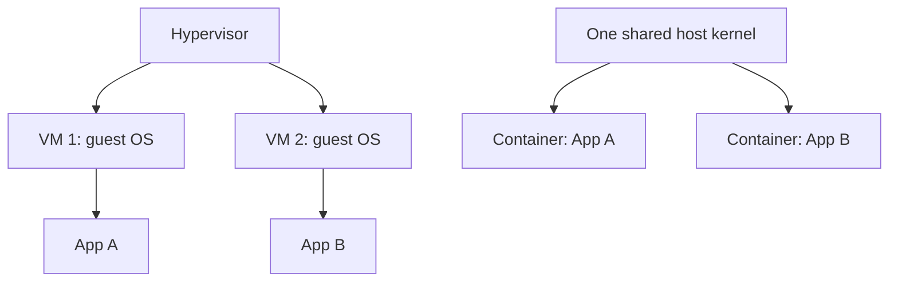

## In one line
A virtual machine imitates a whole computer with its own operating system, while a container is just an isolated process sharing the host's kernel, which is why it starts in a fraction of a second.

## The problem it solves
Your video app's API needs Node 24. The old admin tool on the same server needs Node 18. The video worker needs a specific version of `ffmpeg`, a video conversion tool. Install all three directly on one server and they fight over versions: one upgrade breaks another app. You want each app in its own box, with its own files and versions, without buying a computer for each.

Two words first:

- An **operating system** (OS) is the base software that runs a computer, such as Ubuntu or Windows.
- The **kernel** is the core of the OS. It is the only program allowed to touch the hardware directly. Every other program asks the kernel for memory, files, and network access.

## Everyday analogy
A virtual machine is a **detached house**. Each one has its own foundations, plumbing, and electricity. Very private, but slow and expensive to build.

A container is an **apartment** in one building. Each apartment has its own locked door, its own rooms, and its own meter, but they all share the building's foundations and water mains.

Where it breaks down: apartment walls are physical. A container's walls are rules enforced by the shared kernel, so a serious bug in the kernel can weaken every wall at once.

## How it works

**Virtual machines.** A **hypervisor** is software that splits one physical machine into several fake computers, called **virtual machines** (VMs). Examples are KVM on Linux, Hyper-V, and VMware ESXi. Each VM gets virtual CPUs, memory, and disks, and boots a complete **guest OS** with its own kernel. A cloud server, or VPS, is usually a VM.

**Containers.** A **container** is not a fake computer. It is one or more ordinary processes running on the host's own kernel. The kernel uses two Linux features to box them in:

1. **Namespaces** control what a process can **see**. Each container gets its own view of:
   - process IDs (`pid`): inside, your app is PID 1 and can't see other processes,
   - the network (`net`): its own IP address and ports,
   - the filesystem (`mnt`): its own root folder, `/`, built from an image,
   - the hostname (`uts`), shared memory (`ipc`), and user IDs (`user`).
2. **Control groups** (**cgroups**) control what a process can **use**: for example "at most 512 MB of memory and 1 CPU". If the container goes over its memory limit, the kernel kills it.
3. **An image** supplies the files: a small Linux userland (the basic programs and libraries, such as Alpine or Debian), Node, and your code. There is no second kernel in it. See [Images, containers, and layers](#/topic/images-containers-layers).


*Notice: every VM boots its own full OS, while containers are just processes on one shared kernel.*

**Why containers start fast.** Starting a VM means booting an operating system, which typically takes from several seconds to a minute or more. Starting a container means the kernel creates some namespaces and starts one process. That typically takes well under a second. Containers also use less memory, because there is no second OS sitting in RAM.

> [!NOTE]
> On a Mac or Windows laptop, Docker Desktop quietly runs a small Linux VM, and your containers run inside it. Linux containers need a Linux kernel. On an Ubuntu server, there is no extra VM: containers run directly on the host kernel.

## Real example
**Setup:** Docker installed on an Ubuntu server. `docker run` creates and starts a container from an image.

**1. Same kernel, different OS files.**

```bash
uname -r                                        # kernel version on the host
docker run --rm alpine:3.22 uname -r            # the SAME version: it is the host's kernel
docker run --rm alpine:3.22 head -2 /etc/os-release
# NAME="Alpine Linux"   <- the files are Alpine's, even though the host runs Ubuntu
```

**2. The container sees only itself** (the `pid` namespace):

```bash
docker run --rm alpine:3.22 ps
# PID   USER     TIME  COMMAND
#     1 root      0:00 ps      <- the only process it can see, and it is PID 1
```

On the host, `ps aux` shows that same process among all the others, with a larger PID.

**3. A cgroup memory limit** (the `--memory` flag):

```bash
docker run --rm --memory 256m alpine:3.22 cat /sys/fs/cgroup/memory.max
# 268435456   <- 256 MB in bytes, enforced by the kernel

docker run --name oom-demo --memory 64m --memory-swap 64m alpine:3.22 sh -c 'tail /dev/zero'
echo $?                                          # 137: killed by the kernel for using too much memory
docker inspect oom-demo --format '{{.State.OOMKilled}}'   # true
docker rm oom-demo
```

`tail /dev/zero` keeps reading an endless stream into memory, so it hits the limit quickly. **Exit code 137** means "killed by signal 9", and seeing it in production often means a container ran out of memory. "OOM" stands for out of memory.

**4. Start time.** `time docker run --rm alpine:3.22 true` (create, run, and delete a container) took about 0.2 seconds on one laptop.

## How to say it in an interview

> [!INTERVIEW]
> **30 seconds:** "A virtual machine emulates a whole computer. A hypervisor gives it virtual hardware, and it boots its own operating system with its own kernel. A container is just a process on the host's kernel. Linux namespaces give it its own view of processes, network, and files, and cgroups limit its CPU and memory. So containers start in well under a second and use less memory, but they share one kernel, which makes their isolation weaker than a VM's."

> [!INTERVIEW]
> **2 minutes:** Start with the 30-second answer, then add:
>
> "In practice we use both. Our video app runs in containers on cloud VMs. The VM gives strong isolation from other cloud customers, and containers give us fast, repeatable deployments inside it. The API, the video worker with its own ffmpeg version, and Redis each run in their own container with their own dependencies, so upgrading one can't break another.
>
> The tradeoff is the shared kernel. A kernel bug can let a process escape its container, so I wouldn't run untrusted customer code in plain containers. For that you'd use VMs or lightweight micro-VMs."

## Follow-up questions interviewers ask

<details>
<summary>Are containers secure?</summary>

Secure enough for your own trusted services, with good habits: run as a non-root user, set memory and CPU limits, and keep images updated. They are weaker than VMs against hostile code, because every container shares the host kernel. For running untrusted code, such as customer scripts, providers add VM-level isolation. AWS Lambda, for example, runs functions in Firecracker micro-VMs.

</details>

<details>
<summary>A container keeps restarting with exit code 137. What does that mean?</summary>

The process was killed with signal 9 (`SIGKILL`). The most common cause is the cgroup memory limit: the kernel's out-of-memory killer stopped it. Check with `docker inspect <name> --format '{{.State.OOMKilled}}'`. Then either fix the memory leak or raise the limit. A manual `docker kill` also produces 137, so check before you assume.

</details>

<details>
<summary>Can you run a Windows app in a Linux container?</summary>

Not natively. A container uses the host's kernel, so a Linux container needs a Linux kernel. Windows containers exist, but they need a Windows host. To run a different OS entirely, you need a VM.

</details>

<details>
<summary>When would you pick a VM over a container?</summary>

When you need a different kernel or OS, strong isolation between untrusted tenants, or kernel-level changes such as custom kernel modules. Also for old software that expects a full machine. Many teams use both: a few VMs as hosts, with many containers inside them.

</details>

## Common mistakes and misconceptions

> [!MISTAKE]
> "A container is a lightweight VM." It behaves a bit like one, but it isn't one. There's no hypervisor and no guest kernel. It is a normal process with restricted visibility and resources.

> [!MISTAKE]
> "Containers are fully isolated, so security doesn't matter inside them." A process running as root inside a container with a kernel bug, or with dangerous flags like `--privileged`, can affect the host. Run as a non-root user and avoid unnecessary privileges.

> [!MISTAKE]
> Running containers with no memory limits. One leaking container can then eat all the server's memory and take every other app down with it.

## Tradeoffs: when NOT to use it
- **Untrusted code.** If strangers can run code on your machine, plain containers are not enough isolation. Use VMs or micro-VMs.
- **A different OS or kernel.** Windows software on a Linux host, or apps that need a specific kernel version or kernel module, need a VM.
- **A single small app on one server.** A Node app managed by systemd works fine. Docker adds a tool to learn, images to store, and a new layer to debug. It usually pays off once you have several services or several environments. See [Process managers](#/topic/process-managers).

## Check yourself

<details>
<summary>1. Inside a container on Ubuntu, uname -r shows the same kernel version as the host. Why?</summary>

Because it **is** the host's kernel. A container has no kernel of its own, only its own view of processes, network, and files. The image provides the files, not a kernel.

</details>

<details>
<summary>2. Which Linux feature stops a container from seeing other processes, and which stops it from using all the memory?</summary>

The **pid namespace** hides other processes. A **cgroup** memory limit caps memory use.

</details>

<details>
<summary>3. Why does Docker Desktop on a Mac need a virtual machine?</summary>

Linux containers need a Linux kernel, and macOS has a different kernel. Docker Desktop runs a small Linux VM, and the containers run inside it.

</details>

## Go deeper
- [Docker docs: What is a container?](https://docs.docker.com/get-started/docker-concepts/the-basics/what-is-a-container/)
- [Linux man pages: namespaces(7)](https://man7.org/linux/man-pages/man7/namespaces.7.html)
- [Linux man pages: cgroups(7)](https://man7.org/linux/man-pages/man7/cgroups.7.html)
