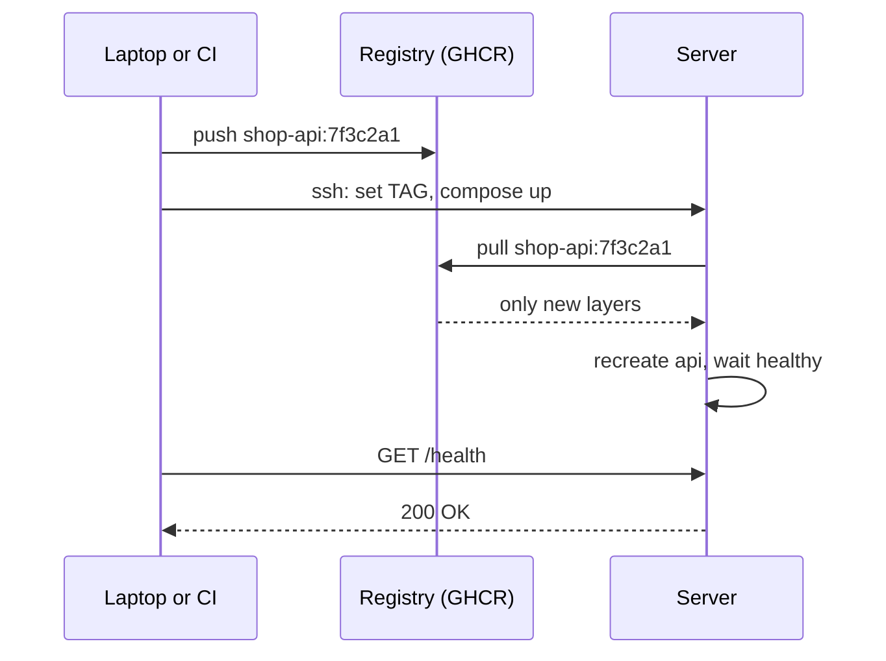

## In one line
To deploy with Docker over SSH, you build a versioned image, push it to a registry, then SSH into the server and tell Docker Compose to pull that version and replace the running containers.

## The problem it solves
The shop app runs perfectly on your laptop with `docker compose up`. Now customers need to reach it at `shop.example.com`, on a rented Ubuntu server at `203.0.113.10`.

Many people's first deploy is: SSH in, `git pull`, build on the server, and hope. That works once, then hurts:

- **The build runs on the production server.** It eats CPU and memory while customers are using the app, and a failed build leaves things half-updated.
- **Nobody knows what's running.** "Whatever was on `main` when someone last pulled" is not a version.
- **Rolling back is guesswork.** You have to find and rebuild an old commit, under pressure.
- **Each step is typed by hand**, so one day someone skips one.

You want a deploy that is the **same few commands every time**, where every release has a version number, and where going back takes seconds.

## Everyday analogy
A bakery chain. The central kitchen (your laptop or CI) bakes a batch and labels it with a date and batch number (the image tag). It goes into the chain's warehouse (the registry). The shop (the server) doesn't bake. It just fetches batch 7f3c2a1 from the warehouse and swaps it onto the shelves. If customers complain, it puts yesterday's batch back out.

Where it breaks down: bread is eaten. Images aren't used up, so old batches stay in the warehouse, ready for a rollback, until you delete them.

## How it works
Some terms first:

- A **registry** stores images. This example uses **GitHub Container Registry** (GHCR, at `ghcr.io`). Docker Hub and AWS ECR are common alternatives.
- An **image tag** names one version, for example `ghcr.io/acme/shop-api:7f3c2a1`, where `7f3c2a1` is the short **Git commit hash**, the unique ID of a commit.
- **Downtime** is time when users can't use the app.

**One-time server setup:**

1. Create a non-root user (`deploy`) with key-based SSH login and password login disabled. See [SSH](#/topic/ssh).
2. Allow only ports 22, 80, and 443 with ufw. Remember: Docker-published ports bypass ufw, so publish only Nginx. See [Docker networking](#/topic/docker-networking).
3. Install Docker Engine and the Compose plugin from Docker's official apt repository.
4. Turn on log rotation (below), or container logs can slowly fill the disk.
5. Create `/srv/shop` with `compose.yaml`, the Nginx config, and a `.env` file holding secrets and the current `TAG`.

**Every deploy:**

1. **Build** the image and tag it with the commit hash.
2. **Push** it to the registry.
3. **SSH** to the server and set `TAG` in `.env` to the new version.
4. **Pull and swap**: `docker compose pull api` downloads only the new layers. `docker compose up -d --wait` recreates only the `api` container and waits until its health check passes.
5. **Verify** with a request to `/health`. If it fails, roll back by setting `TAG` to the previous version and running `up -d` again.


*Notice: the server never builds anything; it only pulls a finished, versioned image.*

## Real example
**Setup:** the [Compose stack](#/topic/docker-compose) from the previous topic, an Ubuntu 24.04 server reachable as `shop-prod` through your `~/.ssh/config`, and a GitHub account (here `acme`).

**1. Server setup, once** (logged in as `deploy`, with Docker already installed):

```bash
sudo usermod -aG docker deploy      # let deploy run docker without sudo (log out and back in)

# Rotate container logs: the default json-file driver never deletes old logs.
# (This overwrites daemon.json; on a fresh server it doesn't exist yet.)
echo '{ "log-driver": "local" }' | sudo tee /etc/docker/daemon.json
sudo systemctl restart docker       # applies to containers created after this

sudo mkdir -p /srv/shop && sudo chown deploy:deploy /srv/shop
# Log in so the server can pull private images (token needs read:packages)
echo "$GHCR_READ_TOKEN" | docker login ghcr.io -u acme --password-stdin
```

> [!WARNING]
> Membership of the `docker` group is effectively root access, because anyone in it can start a container that mounts the host's whole filesystem. Give it only to the deploy user.

**2. On the server, `compose.yaml` uses an image instead of `build:`.** Only the `api` service changes from the local version:

```yaml
services:
  api:
    image: ghcr.io/acme/shop-api:${TAG:?TAG must be set in .env}
    # environment, depends_on, healthcheck, restart: same as before
```

`/srv/shop/.env` (`chmod 600`, so only `deploy` can read it) holds `POSTGRES_PASSWORD=...` and `TAG=...`.

**3. The deploy script on your laptop** (`deploy.sh`):

```bash
#!/usr/bin/env bash
set -euo pipefail                          # stop at the first error
IMAGE=ghcr.io/acme/shop-api
TAG=$(git rev-parse --short HEAD)          # version = current commit

# Servers are usually x86 (amd64); an Apple Silicon Mac builds arm64 by default
docker build --platform linux/amd64 -t "$IMAGE:$TAG" .
docker push "$IMAGE:$TAG"

ssh shop-prod "cd /srv/shop \
  && grep '^TAG=' .env >> deploy-history.log \
  && sed -i 's/^TAG=.*/TAG=$TAG/' .env \
  && docker compose pull api \
  && docker compose up -d --wait"

ssh shop-prod "curl -fsS http://localhost/health"   # -f: fail on HTTP errors
echo "Deployed $TAG"
```

The `grep` line saves the outgoing version to `deploy-history.log` before it's replaced, so you always know what to roll back to. `docker compose up -d --wait` exits with an error if the new container doesn't become healthy, and `set -e` then stops the script.

**4. Roll back** to the last good version:

```bash
ssh shop-prod "cd /srv/shop && tail -1 deploy-history.log"     # TAG=4be91d0
ssh shop-prod "cd /srv/shop && sed -i 's/^TAG=.*/TAG=4be91d0/' .env && docker compose up -d --wait"
```

The old image is usually still on the server, so a rollback takes seconds.

**5. Run Docker commands from your laptop (optional).** A **Docker context** points your local `docker` command at another machine's Docker over SSH:

```bash
docker context create shop-prod --docker "host=ssh://deploy@203.0.113.10"
docker --context shop-prod ps
docker --context shop-prod compose logs -f api   # run from a folder with the same compose files
```

**HTTPS.** Point `shop.example.com` at the server with a DNS A record. Then either add Certbot to the Nginx setup, or use a proxy that gets certificates automatically. See [Domains and SSL certificates](#/topic/domains-ssl).

## How to say it in an interview

> [!INTERVIEW]
> **30 seconds:** "I build the image once, tag it with the Git commit hash, and push it to a registry like GHCR. The server has a Compose file that references the image by a TAG variable. To deploy, I SSH in, update the tag, run docker compose pull and up -d with --wait, and then check the health endpoint. The server never builds code, every release has a version, and rolling back means setting the previous tag and running up again."

> [!INTERVIEW]
> **2 minutes:** Start with the 30-second answer, then add:
>
> "A few production details. The deploy user has key-only SSH, and only Nginx publishes ports, since Docker-published ports skip ufw. I switch Docker to the local log driver so container logs rotate instead of filling the disk. Every service has a restart policy, so a server reboot brings the stack back. And because I build on an M-series Mac, I build for linux/amd64, otherwise the server fails with 'exec format error'.
>
> The tradeoff: recreating the API container causes a few seconds where requests can fail, because Compose stops the old container before the new one is ready. For a small app that's often acceptable at a quiet hour. If not, you run two API containers behind Nginx and update them one by one, or move to a platform that does rolling updates. The next step after this is moving the same script into GitHub Actions, so deploys happen on every merge to main and nobody deploys from their laptop."

## Follow-up questions interviewers ask

<details>
<summary>Why push to a registry instead of building on the server?</summary>

The image you tested is exactly the image that runs, byte for byte. Building on the server uses production CPU and memory, needs build tools and source code there, and can produce a slightly different result. A registry also keeps old versions for instant rollbacks, and lets several servers pull the same image.

</details>

<details>
<summary>Why tag images with the commit hash and not latest?</summary>

A commit hash ties the running container to exact source code. You can see what's deployed (`docker compose images`), compare versions, and roll back to a known tag. `latest` moves with every push, so two servers or two restarts can silently run different code.

</details>

<details>
<summary>Does docker compose up -d cause downtime?</summary>

Briefly, for the services it recreates. Compose stops the old `api` container, then starts the new one. Requests in that gap fail, typically for a few seconds. The database and Redis keep running untouched. For zero downtime, run two or more API replicas behind a load balancer and replace them one at a time. See [Rolling, blue-green, and canary](#/topic/deployment-strategies).

</details>

<details>
<summary>How do you handle database migrations in this setup?</summary>

Run them as a step of the deploy, before switching traffic, for example `docker compose run --rm api npm run migrate`. Write migrations that the old and new versions both tolerate: add a column first, deploy code that uses it, and drop old columns only in a later release. Then a rollback of the code doesn't break against the new schema. See [Migrations](#/topic/migrations).

</details>

<details>
<summary>The container works on your Mac but crashes on the server with "exec format error". Why?</summary>

The image was built for a different CPU architecture. Apple Silicon builds `arm64` images by default, and most servers are `amd64`. Build with `--platform linux/amd64`, or build multi-architecture images with `docker buildx`, or build in CI on an amd64 runner.

</details>

## Common mistakes and misconceptions

> [!MISTAKE]
> Leaving the default `json-file` log driver with no limits. A chatty container writes logs forever, and months later the disk is full and Postgres stops accepting writes. Use the `local` driver or set `max-size` and `max-file`.

> [!MISTAKE]
> Copying the `.env` file into the image, or committing it to Git. The server's secrets live only on the server (or in a secrets manager), with permissions `600`. See [Environment variables and secrets](#/topic/env-secrets).

> [!MISTAKE]
> Running `docker compose down` as part of a deploy. It stops **everything**, including the database, and causes far more downtime than needed. `up -d` already replaces only what changed.

> [!MISTAKE]
> Deploying without a health check. The container "starts", the deploy reports success, and the app is crashing in a loop. `--wait` plus a real `/health` check catches this before you walk away.

## Tradeoffs: when NOT to use it
- **Many servers or frequent deploys.** SSH scripts across ten servers become fragile. Use CI/CD with an orchestrator or a managed container platform.
- **Zero downtime required.** Single-container recreation has a short gap. You need multiple replicas and a rolling or blue-green strategy.
- **No one to look after the server.** You own OS updates, security patches, backups, and monitoring. If nobody will do that, a managed platform (for example a PaaS, which runs your container for you) is safer. See [Cloud basics](#/topic/cloud-basics).
- **Deploying from laptops long term.** It works for one developer. For a team, run the same steps in CI so every deploy is logged and repeatable. See [CI/CD with GitHub Actions](#/topic/ci-cd).

## Check yourself

<details>
<summary>1. Why does docker compose pull api usually download only a few megabytes?</summary>

Images are made of layers identified by content hash. The server already has the base image and usually the `node_modules` layer, so it downloads only the layers that changed, typically your code.

</details>

<details>
<summary>2. The new version is broken in production. What are the exact rollback steps?</summary>

SSH to the server, set `TAG` in `/srv/shop/.env` back to the previous version (from `deploy-history.log`), and run `docker compose up -d --wait`. Compose recreates `api` from the old image, which is usually still cached locally. Then check `/health`.

</details>

<details>
<summary>3. Why is adding a user to the docker group a security decision?</summary>

Anyone who can talk to the Docker daemon can run a container that mounts `/` from the host and edit any file as root. So `docker` group membership is effectively root on that server.

</details>

## Go deeper
- [Docker docs: Install Docker Engine on Ubuntu](https://docs.docker.com/engine/install/ubuntu/)
- [Docker docs: Configure logging drivers](https://docs.docker.com/engine/logging/configure/)
- [GitHub docs: Working with the Container registry](https://docs.github.com/en/packages/working-with-a-github-packages-registry/working-with-the-container-registry)
