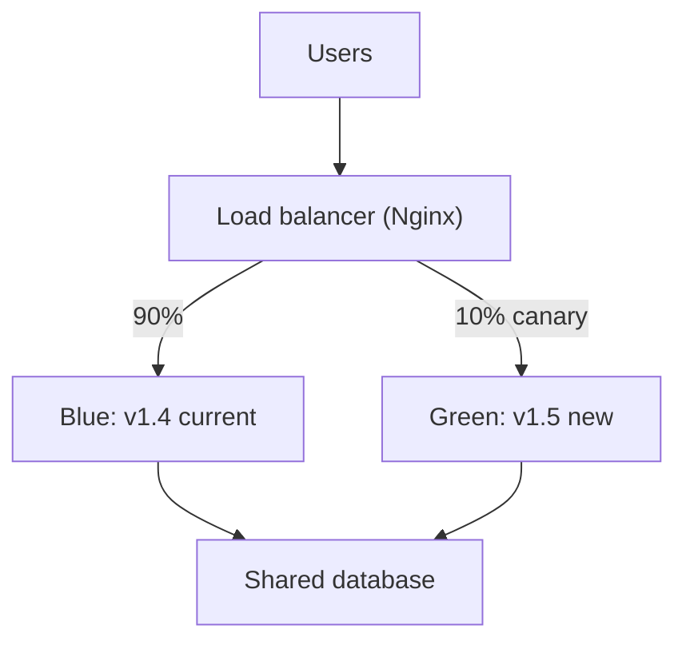

## In one line
Deployment strategies are ways to swap the old version of your app for the new one: rolling replaces servers a few at a time, blue-green switches all traffic at once to a fully prepared copy, and canary sends a small share of users to the new version first.

## The problem it solves
It's Black Friday, and the shop app needs a fix for a checkout bug. The simplest deploy, called **recreate**, stops the old version and then starts the new one. That means:

- **Downtime.** For a few seconds, or minutes if startup is slow, every request fails. Customers mid-checkout see errors.
- **All-or-nothing risk.** If the new version has a bug, 100% of users hit it immediately.
- **Slow rollback.** Going back means another full redeploy, while things are on fire.

**Zero-downtime deployment** means users never notice the switch. A **rollback** is returning to the previous version. Good strategies make both routine.

## Everyday analogy
Changing the menu in a busy restaurant:

- **Rolling**: retrain the chefs one at a time. The kitchen never closes, but for a while some chefs cook the old menu and some the new one.
- **Blue-green**: set up a complete second kitchen with the new menu, test it, then send all new orders to it at once. If it goes wrong, send orders back to the old kitchen, which is still ready.
- **Canary**: give the new dish to one table in ten, and watch their faces before offering it to everyone. (Named after the canaries miners carried to detect gas early.)

Where it breaks down: restaurants don't share one pantry between kitchens with different recipes. Your app versions share one database, and that's the hardest part.

## How it works
All three rely on a **load balancer** (or reverse proxy), which spreads requests across several app instances, and on **health checks** that tell it which instances are ready. See [Load balancers and stateless servers](#/topic/load-balancers).

**1. Rolling update.** You run several instances, say 4 API containers.

1. Start one new-version instance (or stop one old one first).
2. Wait for its health check to pass, then send it traffic.
3. **Drain** an old instance: stop sending it new requests, let in-flight requests finish, then stop it.
4. Repeat until all are new.

Kubernetes does this by default, controlled by `maxSurge` (how many extra instances may exist during the update) and `maxUnavailable` (how many may be missing). Cost: little extra capacity. Catch: old and new versions serve traffic **at the same time**.

**2. Blue-green.** Two complete environments. **Blue** runs the current version and takes all traffic. You deploy the new version to **green**, test it privately, then switch the load balancer so all traffic goes to green in one step. Blue stays running, untouched. Rollback is switching back, in seconds. Cost: double the app capacity during the release.

**3. Canary.** Deploy the new version to a small slice, then send it a small share of traffic, such as 5%. Watch **metrics**: error rate, latency, checkout success. If they look healthy, increase to 25%, 50%, then 100%. If not, send everything back to the old version. Only a few users ever see a bad release. Cost: you need good monitoring, and patience.


*Notice: both versions use the same database at the same time, so the schema must work for both.*

**The database rule: expand, then contract.** In every strategy above, old and new code run together for a while, and rollback means old code meets the new schema. So database changes must be backward compatible:

1. **Expand**: add the new column or table. Old code ignores it.
2. Deploy code that writes to both the old and new places, and reads the new one.
3. Backfill old rows.
4. **Contract**: in a **later** release, remove the old column.

Renaming a column in one step breaks whichever version doesn't expect it. See [Migrations](#/topic/migrations).

## Real example
**Setup:** one server with Docker. Two API containers named `api-blue` and `api-green`, and an Nginx container named `nginx`, all on one Docker network. See [Docker networking](#/topic/docker-networking). The host's `nginx/` folder is bind-mounted at `/etc/nginx/conf.d`. Mount the folder, not single files: editing a single bind-mounted file with `sed -i` replaces it, and the container keeps seeing the old one.

Nginx's main config includes a small file that names the live version (`nginx/default.conf`):

```nginx
include /etc/nginx/conf.d/upstream.inc;

server {
    listen 80;
    location / {
        proxy_pass http://shop_api;
    }
}
```

**`nginx/upstream.inc`, blue is live:**

```nginx
upstream shop_api {
    server api-blue:3000;
}
```

**Blue-green switch.** Start green with the new image, check it directly, then switch:

```bash
docker exec api-green wget -qO- http://127.0.0.1:3000/health   # test green privately first
sed -i 's/api-blue:3000/api-green:3000/' nginx/upstream.inc     # point at green
docker exec nginx nginx -t                   # check the config before applying it
docker exec nginx nginx -s reload            # apply: no dropped connections
```

`nginx -s reload` starts new worker processes with the new config, while old workers finish their current requests and then exit. Rollback is the same `sed` in reverse, plus another reload.

**Canary with weights.** Instead of switching everything, split it:

```nginx
upstream shop_api {
    server api-blue:3000  weight=9;   # current version: about 90% of requests
    server api-green:3000 weight=1;   # canary: about 10% of requests
}
```

In a test, 100 requests after a reload went 89 to blue and 11 to green. Weighted round-robin spreads requests, not users, so one user may see both versions. If that matters, for example for a changed checkout page, route by a cookie or user ID instead, so each user sticks to one version.

## How to say it in an interview

> [!INTERVIEW]
> **30 seconds:** "Rolling updates replace instances a few at a time behind a load balancer, so there's no downtime and little extra cost, but old and new versions run side by side. Blue-green runs a full copy of the new version next to the old one and switches all traffic at once, so rollback is instant, at the cost of double capacity during the release. Canary sends a small percentage of traffic to the new version, watches error rates and latency, and increases it gradually, so a bad release only hits a few users."

> [!INTERVIEW]
> **2 minutes:** Start with the 30-second answer, then add:
>
> "All three depend on health checks, connection draining, and backward-compatible database changes, because two versions share one database during the rollout and after a rollback. I use expand-and-contract migrations: add columns first, remove old ones a release later.
>
> Choosing depends on risk and cost. For a typical API, rolling is the default in Kubernetes and good enough. For something like a payment service, I'd use canary with automatic rollback if the error rate goes over a threshold, because seeing real traffic on 5% of users catches bugs tests miss. Blue-green fits when you want a clean, instant switch, like a big release for the video platform.
>
> I'd also separate deploying from releasing with feature flags: ship the code turned off, then turn it on for some users. That makes rollback a config change instead of a deploy."

## Follow-up questions interviewers ask

<details>
<summary>What is connection draining, and why does it matter?</summary>

Before stopping an old instance, the load balancer stops sending it **new** requests and waits for in-flight ones to finish, up to a timeout. Without draining, users whose requests were mid-way, such as a payment or an upload, get errors. In Node, handling SIGTERM with `server.close()` is the app's side of draining.

</details>

<details>
<summary>Blue-green vs canary: which would you pick?</summary>

Blue-green gives an instant, all-at-once switch and an instant rollback, but every user hits the new version at the same moment. Canary limits the blast radius and tests with real traffic, but needs good metrics and takes longer. Many teams combine them: deploy to green, send 5% there, then move the rest.

</details>

<details>
<summary>How do you roll back if the new version already changed the database?</summary>

You design so you don't need to undo it. With expand-and-contract, the new version only **added** things the old version ignores, so rolling back the code is safe. Destructive changes, like dropping a column, wait until a later release, when no running version needs the old shape. Restoring a backup to roll back loses every write since, so it's a last resort.

</details>

<details>
<summary>What is a feature flag, and how does it relate to these strategies?</summary>

A **feature flag** is a setting checked at runtime, like `if (flags.newCheckout)`, that turns a feature on or off without a deploy. It separates **deploying** code from **releasing** a feature. You can ship code dark, enable it for staff, then 5% of users, then everyone. It's like a canary at the feature level, and it rolls back with a config change.

</details>

<details>
<summary>What would make you abort a canary automatically?</summary>

Compare the canary against the current version on the same metrics: error rate (for example, 5xx responses), latency percentiles, and business signals like checkout success. If the canary is clearly worse beyond an agreed threshold for a few minutes, shift traffic back automatically. Tools like Argo Rollouts and Flagger do this in Kubernetes.

</details>

## Common mistakes and misconceptions

> [!MISTAKE]
> "Blue-green means zero risk." The switch is instant for everyone, so a bug hits all users at once. It makes rollback fast, not mistakes rare.

> [!MISTAKE]
> Renaming or dropping a column in the same release as the code change. During a rolling deploy, or after a rollback, the other version breaks. Expand first, contract later.

> [!MISTAKE]
> Running a canary without the metrics to judge it. If you can't compare error rates between versions, a canary is just a slow deploy.

> [!MISTAKE]
> Forgetting background workers and scheduled jobs. Updating the API carefully while a queue worker on the old version processes new-format messages causes subtle failures. Make messages compatible in both directions too.

## Tradeoffs: when NOT to use it
- **Small apps with a maintenance window.** A few seconds of recreate downtime at 3 AM may be fine. Building blue-green for a low-traffic internal tool wastes time.
- **Blue-green with tight budgets or huge infrastructure.** Doubling capacity, even briefly, costs money. Rolling needs only a little extra.
- **Canary with low traffic.** At 50 requests an hour, 5% is two or three requests. You can't tell good from bad with so few, so a canary adds delay without real information.

## Check yourself

<details>
<summary>1. Which strategy gives the fastest rollback, and why?</summary>

Blue-green. The old environment is still running and warm, so rollback is a single load balancer switch, back to blue.

</details>

<details>
<summary>2. During a rolling update, why must the new version tolerate the old database schema, and the old version tolerate the new one?</summary>

Both versions serve traffic at the same time during the rollout, and after a rollback the old code runs against whatever schema the new release left behind.

</details>

<details>
<summary>3. With Nginx weights 9 and 1, does each user consistently see one version?</summary>

No. Weighted round-robin distributes **requests**, so a single user can hit both versions on consecutive requests. For per-user consistency, route by a cookie or user ID, for example with Nginx's `hash` directive or a feature flag.

</details>

## Go deeper
- [Kubernetes docs: Performing a rolling update](https://kubernetes.io/docs/tutorials/kubernetes-basics/update/update-intro/)
- [Martin Fowler: Blue-green deployment](https://martinfowler.com/bliki/BlueGreenDeployment.html)
- [Martin Fowler: Canary release](https://martinfowler.com/bliki/CanaryRelease.html)
