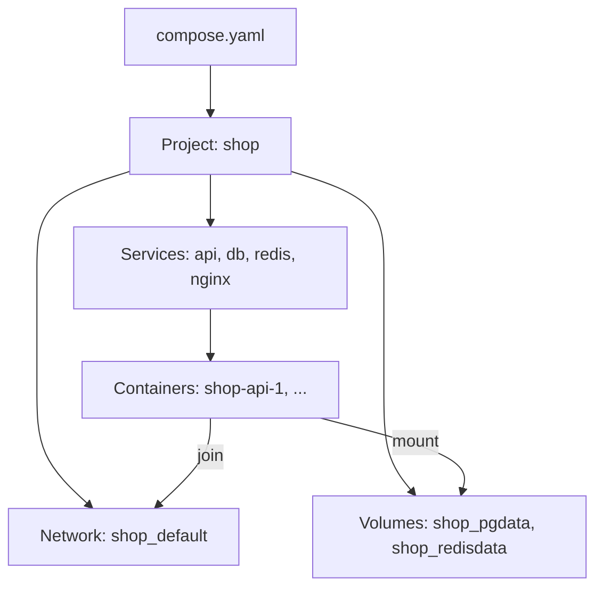

## In one line
Docker Compose describes your whole app, every container, network, and volume, in one YAML file, so `docker compose up` starts all of it in the right order with one command.

## The problem it solves
The shop app needs four containers: the Node API, PostgreSQL, Redis, and Nginx in front. By hand that is a network, two volumes, and four long `docker run` commands with a dozen flags each. They must start in the right order, with the right names and passwords.

Then a new teammate joins and asks "how do I run this?", and the answer is a page of commands that has already drifted from what's actually running on the server. Change one flag and you must remember to change it everywhere.

**Compose** turns that page of commands into one file that lives in Git. Anyone can run the whole app with `docker compose up -d`, and the file is the documentation.

## Everyday analogy
A Compose file is a **seating plan and running order for a wedding**. It lists every guest (container), which table they sit at (network), what they bring (volumes, settings), and who must arrive first (dependencies). The venue staff (Compose) read it and make the room match it.

Where it breaks down: a seating plan is followed once. Compose compares the file with what's running **every** time you run `up`, and changes only what differs.

## How it works
Some terms first:

- **YAML** is a text format for configuration that uses indentation to show structure. Indentation must be spaces, not tabs.
- A **service** is one component of your app, such as `api` or `db`. Compose creates one container per service by default.
- A **project** is the whole app described by one Compose file. Its name defaults to the folder name, or comes from `name:` in the file.
- A **health check** is a command Docker runs regularly inside a container to test whether the app actually works, not just whether the process is running.

**The model.** From one file, Compose creates resources and names them after the project:

1. **Containers** named `<project>-<service>-<number>`, such as `shop-api-1`.
2. **A default network**, `shop_default`, which every service joins. The service name becomes a DNS name on that network, so the API reaches Postgres at `db:5432`. See [Docker networking](#/topic/docker-networking).
3. **Named volumes** declared under `volumes:`, such as `shop_pgdata`. See [Volumes and persistent data](#/topic/docker-volumes).


*Notice: one file produces a project, and every container, network, and volume is named after it.*

**What `docker compose up -d` does:**

1. Reads `compose.yaml`, plus a `.env` file in the same folder, for `${VARIABLE}` substitution.
2. Creates the network and volumes if they don't exist.
3. Builds or pulls any images that are missing.
4. Starts services in dependency order. `depends_on` with `condition: service_healthy` waits until that service's health check passes. A plain `depends_on` only waits until the container has **started**, which is not the same as "ready to accept connections".
5. **Reconciles.** On later runs, a container is recreated only if its configuration or image changed. Everything else keeps running. In one test, changing only the API's health check recreated `api` and left `db`, `redis`, and `nginx` untouched.

`docker compose down` removes the containers and the network but **keeps** volumes. `docker compose down -v` also deletes the named volumes, and your data with them.

## Real example
**Setup:** a project folder with the Express `shop-api` code and the [Node Dockerfile](#/topic/dockerfile-node), plus the files below. The API reads `DATABASE_URL` and `REDIS_URL`, listens on 3000, and has a `/health` route that queries Postgres and pings Redis.

**`compose.yaml`:**

```yaml
name: shop

services:
  api:
    build: .                               # build from ./Dockerfile
    environment:
      DATABASE_URL: postgres://shop:${POSTGRES_PASSWORD}@db:5432/shop
      REDIS_URL: redis://redis:6379        # "redis" is the service name
    depends_on:
      db: { condition: service_healthy }   # wait until Postgres is ready
      redis: { condition: service_started }
    healthcheck:
      test: ["CMD", "wget", "-qO-", "http://127.0.0.1:3000/health"]
      interval: 10s
    restart: unless-stopped                # come back after crashes and reboots

  db:
    image: postgres:18-alpine
    environment:
      POSTGRES_USER: shop
      POSTGRES_DB: shop
      POSTGRES_PASSWORD: ${POSTGRES_PASSWORD:?set it in .env}  # fail if missing
    volumes:
      - pgdata:/var/lib/postgresql
      - ./db/init.sql:/docker-entrypoint-initdb.d/init.sql:ro  # runs on first start only
    healthcheck:
      test: ["CMD", "pg_isready", "-U", "shop", "-d", "shop"]
      interval: 5s
    restart: unless-stopped
```

The file continues with two more services and the volume list:

```yaml
  redis:
    image: redis:7-alpine
    command: ["redis-server", "--appendonly", "yes"]   # persist data to disk
    volumes: [redisdata:/data]
    restart: unless-stopped

  nginx:
    image: nginx:1.28-alpine
    ports: ["80:80"]                       # the ONLY port published to the host
    volumes:
      - ./nginx/default.conf:/etc/nginx/conf.d/default.conf:ro
    depends_on:
      api: { condition: service_healthy }
    restart: unless-stopped

volumes:
  pgdata:
  redisdata:
```

**`nginx/default.conf`** forwards every request to the API by its service name. See [Nginx as a reverse proxy](#/topic/nginx-reverse-proxy).

```nginx
server {
    listen 80;
    location / {
        proxy_pass http://api:3000;
        proxy_set_header Host $host;
        proxy_set_header X-Forwarded-For $proxy_add_x_forwarded_for;
    }
}
```

**`.env`** (in `.gitignore`, never committed): `POSTGRES_PASSWORD=change-me-locally`. **`db/init.sql`** creates a `products` table and inserts product 42.

**Run it:**

```bash
docker compose up -d --build --wait    # build, start, and wait until all are healthy
docker compose ps                      # only nginx shows a published port
curl http://localhost/products/42
# {"id":42,"name":"Wireless headphones","price_cents":7999}

docker compose logs -f api             # follow one service's logs
docker compose exec db psql -U shop -d shop   # open a SQL shell in the db container
docker compose down                    # stop and remove containers; volumes stay
```

## How to say it in an interview

> [!INTERVIEW]
> **30 seconds:** "Compose lets me define a multi-container app in one YAML file: services, networks, and volumes. For our shop app that's the Node API, Postgres, Redis, and Nginx. Compose puts them on a shared network where service names work as hostnames, creates named volumes for the data, and starts things in order, using health checks so the API waits until Postgres is actually ready. One command brings the whole stack up the same way on every laptop and on the server."

> [!INTERVIEW]
> **2 minutes:** Start with the 30-second answer, then add:
>
> "A few details I care about. Only Nginx publishes a port. The database and Redis are reachable only on the internal network. Secrets come from a .env file that isn't in Git, and I use the `:?` syntax so Compose fails loudly if one is missing. Every service has a restart policy, so the stack comes back after a crash or a server reboot.
>
> Running `up -d` again is safe: Compose only recreates the containers whose config or image changed, which makes it a simple deploy tool for a single server.
>
> The tradeoff is that Compose manages one machine. It doesn't spread containers across servers, replace a dead server, or do zero-downtime rolling updates on its own. For one or two servers that's fine. Beyond that, I'd look at Kubernetes or a managed container service."

## Follow-up questions interviewers ask

<details>
<summary>Why isn't depends_on enough to make the API wait for Postgres?</summary>

Plain `depends_on` waits only until the Postgres **container has started**. Postgres then takes a few seconds to initialise before it accepts connections, and an API that connects at startup fails in that gap. Add a health check (`pg_isready`) to `db`, and use `condition: service_healthy`. Even so, the app should retry connections, because the database can also restart later.

</details>

<details>
<summary>How do you run different settings in development and production?</summary>

Compose automatically merges `compose.override.yaml` on top of `compose.yaml` if it exists. Developers put a source-code bind mount and debug ports in the override. On the server, you can name files explicitly: `docker compose -f compose.yaml -f compose.prod.yaml up -d`. Values that differ, like passwords, come from each environment's `.env` file.

</details>

<details>
<summary>What does docker compose down -v do, and why be careful?</summary>

It removes containers, networks, **and** the named volumes declared in the file. On a server, that deletes the database. Use plain `down` unless you really mean to wipe the data, and keep backups either way.

</details>

<details>
<summary>Is Compose suitable for production?</summary>

For a single server, yes, and many small companies run this way. Restart policies, health checks, and named volumes cover the basics. What it lacks is multi-server scheduling, automatic failover to another machine, and built-in zero-downtime rolling deploys. When you need those, move to an orchestrator.

</details>

<details>
<summary>What is the difference between docker-compose and docker compose?</summary>

`docker-compose` (with a hyphen) was the original standalone tool, version 1, written in Python, and it's no longer supported. `docker compose` (with a space) is version 2, built into the Docker CLI as a plugin. Use the space version. The old `version: "3.8"` line at the top of Compose files is also obsolete and ignored.

</details>

## Common mistakes and misconceptions

> [!MISTAKE]
> Publishing every service's port "for convenience", including `5432:5432` for Postgres. On a server, that exposes the database to the internet, and on Linux ufw won't block it. Publish only the entry point.

> [!MISTAKE]
> Using `localhost` in connection strings. Inside the `api` container, localhost is the API itself. Use the service name: `db`, `redis`.

> [!MISTAKE]
> Writing real passwords directly in `compose.yaml` and committing it. Use `${VARIABLES}` with a `.env` file that is listed in `.gitignore`. See [Environment variables and secrets](#/topic/env-secrets).

> [!MISTAKE]
> Expecting `init.sql` to run again after you change it. Postgres runs scripts in `/docker-entrypoint-initdb.d/` only when the data folder is empty, on the very first start. Schema changes after that belong in migrations. See [Migrations](#/topic/migrations).

## Tradeoffs: when NOT to use it
- **Many servers.** Compose controls one Docker host. Spreading load and surviving the loss of a machine needs an orchestrator, such as Kubernetes, or a managed service. See [Kubernetes concepts](#/topic/kubernetes-concepts).
- **Zero-downtime deploys out of the box.** Recreating a container causes a short gap in service. You can build around this, but it isn't automatic. See [Rolling, blue-green, and canary](#/topic/deployment-strategies).
- **Production databases you can't afford to lose.** Running Postgres in Compose is fine for development and small apps, but a managed database adds backups, failover, and upgrades you'd otherwise build yourself.

## Check yourself

<details>
<summary>1. In the file above, what hostname and port does the API use to reach Postgres, and why?</summary>

`db:5432`. `db` is the service name, which Compose registers in Docker's DNS on the project network. 5432 is the port Postgres listens on inside its container. Nothing needs to be published for this.

</details>

<details>
<summary>2. You change only the nginx config mount and run docker compose up -d. What happens to the database container?</summary>

Nothing. Compose compares each service's configuration with what's running and recreates only the services that changed, here `nginx`. `db` keeps running.

</details>

<details>
<summary>3. A customer places order 1001. After docker compose down and up again, is it still there? What about after down -v?</summary>

After `down`, yes: the `pgdata` volume is kept. After `down -v`, no: the volume is deleted. Postgres starts empty and runs `init.sql` again, so product 42 comes back, but order 1001 is gone for good.

</details>

## Go deeper
- [Docker docs: Compose file reference (services)](https://docs.docker.com/reference/compose-file/services/)
- [Docker docs: Control startup order in Compose](https://docs.docker.com/compose/how-tos/startup-order/)
- [Docker docs: Networking in Compose](https://docs.docker.com/compose/how-tos/networking/)
