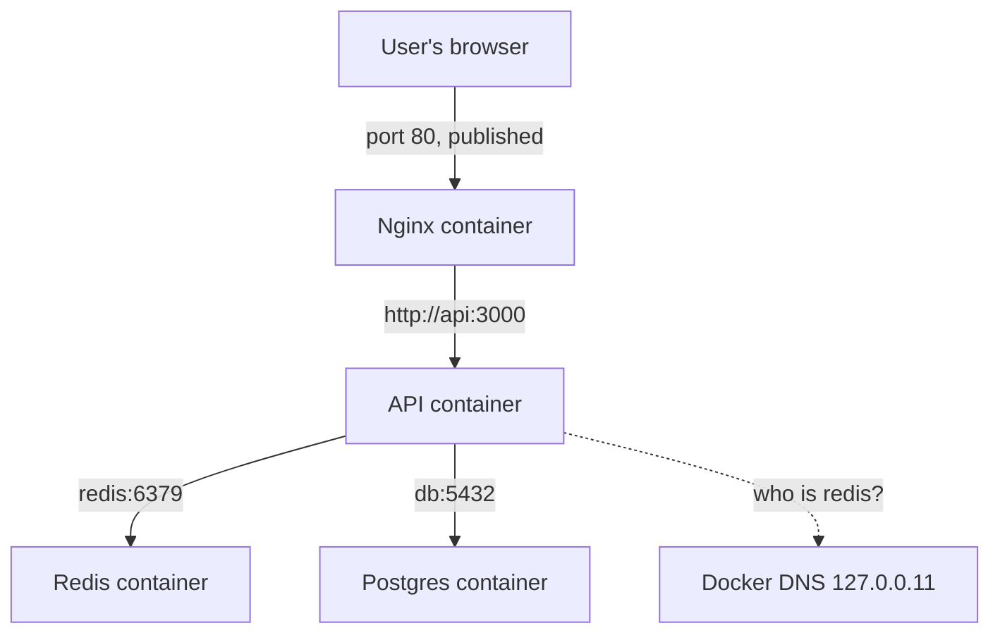

## In one line
Docker gives containers their own private network where they find each other by name, and you choose which container ports, if any, are reachable from outside by publishing them.

## The problem it solves
Your shop app runs as three containers: the Node API, PostgreSQL, and Redis. The API's config says `REDIS_URL=redis://localhost:6379`, just as it did on your laptop. In Docker it fails:

```text
Error: connect ECONNREFUSED 127.0.0.1:6379
```

Nothing is wrong with Redis. The problem is that each container has its own network, so **localhost** means "this container itself". Redis is in a different container, with a different address. See [IP addresses, ports, and localhost](#/topic/ip-ports-localhost).

So you need answers to three questions:

1. How does the API find Redis, when container IP addresses change on every restart?
2. How do users on the internet reach the app?
3. How do you keep the database **unreachable** from the internet?

## Everyday analogy
Containers on a Docker network are **offices in one building with an internal phone system**. Dial "redis" and the switchboard connects you to the Redis office, wherever it currently sits. Outside callers can't dial internal extensions. They can only reach the reception desk, the one published phone number, which forwards calls inside.

Where it breaks down: in a real building, everyone shares one switchboard. In Docker, each network has its own, and containers can only call others on a network they've joined.

## How it works
A few terms:

- A **network interface** is a connection point for networking, like a virtual network card. Each container gets its own.
- A **bridge network** is a private, virtual network on the host that containers plug into. Docker gives each container on it a private IP address, such as `172.21.0.2`.
- **Publishing a port** (`-p 8080:3000`) tells Docker to forward traffic arriving at the host's port 8080 to the container's port 3000.

**1. Each container gets its own network namespace.** It has its own interfaces, its own IP address, its own ports, and its own `localhost`. Two containers can both listen on port 3000 without conflict.

**2. Containers on the same user-defined network can talk.** You create a network with `docker network create shop-net` and attach containers to it. They can reach each other on any port the app listens on. Nothing needs publishing for that.

**3. Docker's built-in DNS turns names into IPs.** On a user-defined network, every container's `/etc/resolv.conf` points to `127.0.0.11`, Docker's embedded **DNS server**. It answers lookups for container names (and network aliases, such as Compose service names) with their current IP. So `redis://redis:6379` keeps working after a restart changes the IP. Names it doesn't know are passed on to normal DNS.

**4. The default `bridge` network is different.** Containers started without `--network` join the default network, called `bridge`. It has **no name resolution**. That's the most common reason "the container can't find redis". Always create your own network (Compose does this for you).

**5. Publishing exposes a port on the host.** `-p 8080:3000` listens on **all** of the host's addresses. `-p 127.0.0.1:8080:3000` listens only on the host's loopback, so only programs on the server itself can connect, such as an Nginx installed on the host.

**6. Other network drivers.** A **driver** is the type of network. `host` removes network isolation: the container uses the server's network directly. `none` gives no network at all. `overlay` spans several hosts (used by Docker Swarm). `bridge` is what you'll use almost always.


*Notice: only Nginx has a published port; everything else is reachable only by name, inside the private network.*

> [!WARNING]
> On Ubuntu, ports published with `-p` **bypass ufw**. Docker writes its own firewall rules that run before ufw's, so `ufw deny 5432` does not block a database you published with `-p 5432:5432`. Don't publish internal services at all, or bind them to `127.0.0.1`. See [Firewalls and open ports](#/topic/firewalls).

## Real example
**Setup:** Docker on Ubuntu. The `shop-api:1.0` image is an Express app that reads `DATABASE_URL` and `REDIS_URL`, listens on port 3000, and has a `/health` route.

```bash
docker network create shop-net

# No -p: these two are reachable only from inside shop-net
docker run -d --name redis --network shop-net redis:7-alpine
docker run -d --name db --network shop-net \
  -e POSTGRES_PASSWORD=devpassword postgres:18-alpine

# The API reaches them BY NAME. Published only on the host's loopback.
docker run -d --name api --network shop-net -p 127.0.0.1:3000:3000 \
  -e REDIS_URL=redis://redis:6379 \
  -e DATABASE_URL=postgres://postgres:devpassword@db:5432/postgres \
  shop-api:1.0

curl http://127.0.0.1:3000/health         # {"status":"ok"}
```

**Look inside the network:**

```bash
docker run --rm --network shop-net alpine:3.22 cat /etc/resolv.conf
# nameserver 127.0.0.11                    <- Docker's embedded DNS

docker run --rm --network shop-net alpine:3.22 getent hosts redis
# 172.21.0.2      redis                    <- name resolved to the container's IP

docker run --rm --network shop-net alpine:3.22 wget -qO- http://api:3000/health
# {"status":"ok"}                          <- container to container: use the CONTAINER port

docker run --rm alpine:3.22 getent hosts redis || echo "not found"
# not found                                <- default bridge network: no name resolution
```

Your IP addresses will differ.

**Reaching a service on the host from a container.** On Docker Desktop (Mac and Windows), use the name `host.docker.internal`. On Linux, add it yourself with `--add-host=host.docker.internal:host-gateway`.

## How to say it in an interview

> [!INTERVIEW]
> **30 seconds:** "Each container has its own network namespace, so localhost inside a container is the container itself. I put related containers on a user-defined bridge network, where Docker's built-in DNS resolves container or service names to their current IPs, so the API connects to redis://redis:6379. Containers on that network talk to each other directly. Only the entry point, usually Nginx, publishes a port to the host. The database and Redis are never published."

> [!INTERVIEW]
> **2 minutes:** Start with the 30-second answer, then add:
>
> "Two traps come up a lot. First, the default bridge network has no DNS, so name lookups only work on a network you create, which Compose does automatically. Second, published ports on Linux bypass ufw, because Docker inserts its own iptables rules. A classic incident is a Postgres container published on 5432 with a weak password, open to the internet even though ufw says the port is closed. So I never publish internal services, and when something must be reachable only from the host, I bind it to 127.0.0.1.
>
> The tradeoff of the bridge network is a little overhead, from address translation, compared with host networking. For almost every web app that cost doesn't matter, and the isolation is worth it."

## Follow-up questions interviewers ask

<details>
<summary>What is the difference between EXPOSE and -p?</summary>

`EXPOSE 3000` in a Dockerfile is documentation: it records which port the app listens on. It opens nothing. `-p 8080:3000` (or `ports:` in Compose) actually publishes the port on the host. Containers on the same network can reach each other's ports either way.

</details>

<details>
<summary>The API container uses the published port 8080 to reach another container, and it fails. Why?</summary>

Inside the network, containers talk to each other's **container** port, such as `api:3000`. The published port, 8080, exists on the host, not on the container network. In a test, `wget http://api:3000` worked and `http://api:47300` (the published port) was refused.

</details>

<details>
<summary>When would you use network_mode host?</summary>

When network performance or a huge number of ports matters more than isolation. Examples are some monitoring agents, or apps that need to see the host's real network interfaces. You lose port isolation: the container's port 3000 is the host's port 3000.

</details>

<details>
<summary>Can a container be on two networks?</summary>

Yes. A common pattern is a `frontend` network with Nginx and the API, and a `backend` network with the API, the database, and Redis. The API joins both. Nginx can then reach the API but has no network path to the database at all.

</details>

<details>
<summary>How do containers on different servers talk?</summary>

A bridge network exists on one host only. Across hosts, you either go through published ports and a load balancer, or use a multi-host network: Docker Swarm's `overlay` driver, or Kubernetes networking, where every pod gets a cluster-wide IP. See [Kubernetes concepts](#/topic/kubernetes-concepts).

</details>

## Common mistakes and misconceptions

> [!MISTAKE]
> Using `localhost` in a container to reach another container. Use the other container's name (or Compose service name) on a shared network.

> [!MISTAKE]
> Publishing the database "to debug it": `-p 5432:5432` on a server. It becomes reachable from the internet, and ufw won't stop it. Use an SSH tunnel to reach it instead. See [SSH tunnels, scp, and rsync](#/topic/ssh-tunnels).

> [!MISTAKE]
> Hardcoding container IP addresses like `172.17.0.3`. They change when containers restart. Use names.

> [!MISTAKE]
> An app listening on `127.0.0.1` inside its container. It can then only be reached from inside that same container, so publishing does nothing. Servers in containers must listen on `0.0.0.0` (all interfaces). `app.listen(3000)` with no host argument already does.

## Tradeoffs: when NOT to use it
- **Many hosts.** Single-host bridge networks don't stretch across servers. Past one machine, use an orchestrator or a load balancer in front of published ports.
- **Extreme network performance.** Address translation on published ports adds a little overhead. Specialised workloads may use `host` networking and accept the lost isolation.
- **Complex custom setups by hand.** Many `docker network` commands become hard to track. Declare networks in a Compose file. See [Docker Compose](#/topic/docker-compose).

## Check yourself

<details>
<summary>1. Inside the API container, what does localhost:6379 point to?</summary>

The API container itself. If Redis runs in another container, nothing is listening there, so the connection is refused. Use `redis:6379` on a shared network.

</details>

<details>
<summary>2. Why does redis resolve on shop-net but not on the default bridge network?</summary>

Docker's embedded DNS server (`127.0.0.11`) resolves container names only on user-defined networks. The default `bridge` network has no name resolution.

</details>

<details>
<summary>3. What is the difference between -p 5432:5432 and -p 127.0.0.1:5432:5432 on a server?</summary>

The first listens on all of the server's addresses, so the database is reachable from the internet (and ufw doesn't block it). The second listens only on the server's loopback, so only programs on the server itself, or you through an SSH tunnel, can connect.

</details>

## Go deeper
- [Docker docs: Networking overview](https://docs.docker.com/engine/network/)
- [Docker docs: Bridge network driver](https://docs.docker.com/engine/network/drivers/bridge/)
- [Docker docs: Packet filtering, firewalls, and ufw](https://docs.docker.com/engine/network/packet-filtering-firewalls/)
