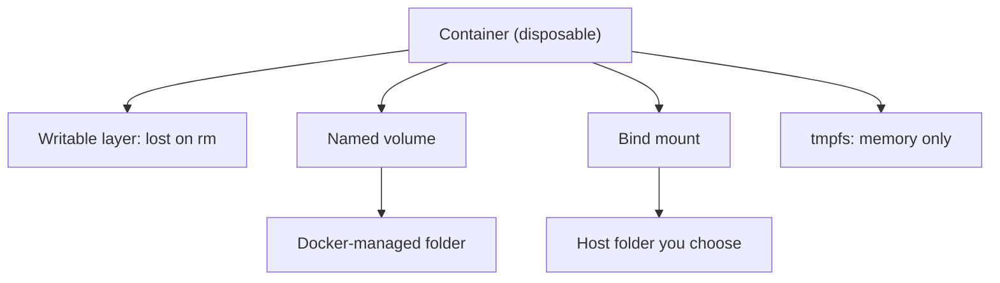

## In one line
A volume is storage that lives outside a container, so the data in it, such as your database files, survives when the container is stopped, deleted, or replaced by a new version.

## The problem it solves
You run PostgreSQL in a container for the shop app. Customers place orders for a week. Then you upgrade the image, which means deleting the old container and starting a new one. Every order is gone.

That's because a container writes into its own **writable layer**, and `docker rm` deletes that layer. See [Images, containers, and layers](#/topic/images-containers-layers). Containers are meant to be **disposable**: you replace them on every deploy. Your data must not be.

The same applies to uploaded product images, video files waiting to be processed, and Redis data you want to keep after a restart.

## Everyday analogy
A container is a **hotel room**. You check out, the room is cleaned, and the next guest gets a fresh one. A volume is a **safe-deposit box** in the hotel's vault. Whichever room you're staying in, you can open the same box, and it's still there after you check out.

Where it breaks down: a safe-deposit box is safe. A Docker volume is just a folder on one server's disk. If that disk dies, the volume dies with it. Volumes are not backups.

## How it works
To **mount** storage means to attach it at a folder path, so that reading and writing that folder actually uses the storage. Docker offers three kinds of mount:

1. **Named volume.** Storage created and managed by Docker, with a name you choose, like `pgdata`. On Linux, its files live under `/var/lib/docker/volumes/pgdata/_data`. This is the default choice for data that containers own, such as a database's files.
2. **Bind mount.** A specific folder on the host, like `/srv/shop/uploads` or your project folder, mapped into the container. Both sides see the same files instantly. It's great for development (edit code on your laptop, the container sees it), and for config files you manage yourself.
3. **tmpfs mount.** Stored in memory only and gone when the container stops. Useful for temporary secrets or scratch files that should never touch disk.


*Notice: only the writable layer is tied to the container's life; volumes and bind mounts outlive it.*

**Rules worth knowing** (interviewers like these):

- **A volume's life is separate from the container's.** `docker rm` keeps named volumes. You delete them with `docker volume rm`, `docker rm -v` (anonymous ones only), or `docker compose down -v`.
- **Empty named volumes get pre-filled.** If you mount an **empty** named volume onto a folder that already has files in the image, Docker copies those files into the volume first. A bind mount never does this: it **hides** whatever the image had at that path.
- **Anonymous volumes.** Images like `postgres` declare a `VOLUME` in their Dockerfile. If you don't mount anything there, Docker creates a volume with a random name. The data survives `docker rm`, but it's hard to find again, so name your volumes.
- **Mount at the right path.** Data written anywhere else still goes to the writable layer and is lost.

## Real example
**Setup:** Docker on Ubuntu. The `postgres:18-alpine` image stores its data under `/var/lib/postgresql`. (Images before version 18 used `/var/lib/postgresql/data`. Check the image's docs for the path.)

**1. Data survives replacing the container:**

```bash
docker volume create pgdata

docker run -d --name shop-db -e POSTGRES_PASSWORD=devpassword \
  -v pgdata:/var/lib/postgresql postgres:18-alpine
docker exec shop-db psql -U postgres -c \
  "CREATE TABLE orders (id serial PRIMARY KEY, total_cents int);
   INSERT INTO orders (total_cents) VALUES (4999);"

docker rm -f shop-db                     # container and its writable layer are gone

docker run -d --name shop-db -e POSTGRES_PASSWORD=devpassword \
  -v pgdata:/var/lib/postgresql postgres:18-alpine
docker exec shop-db psql -U postgres -c "SELECT * FROM orders;"
#  id | total_cents
# ----+-------------
#   1 |        4999       <- still here
```

Wait a few seconds after `docker run` before `docker exec`, while Postgres starts up.

**2. Where is it?**

```bash
docker volume inspect pgdata --format '{{.Mountpoint}}'
# /var/lib/docker/volumes/pgdata/_data
```

**3. A bind mount for uploads, and a read-only config file:**

```bash
docker run -d --name shop-api \
  -v /srv/shop/uploads:/app/uploads \
  -v /srv/shop/config.json:/app/config.json:ro \
  shop-api:1.0
```

`:ro` makes the mount read-only inside the container. The longer `--mount` flag does the same thing more explicitly:

```bash
--mount type=bind,src=/srv/shop/uploads,dst=/app/uploads
```

**4. Back up the database properly:**

```bash
docker exec shop-db pg_dump -U postgres postgres > shop-$(date +%F).sql
```

`pg_dump` produces a consistent copy while the database is running. Copying the raw volume files of a running database can capture a half-written state. See [Backups and restore](#/topic/backups).

## How to say it in an interview

> [!INTERVIEW]
> **30 seconds:** "Containers are disposable: anything written to a container's own layer is lost when it's removed. Volumes store data outside the container, so it survives restarts, upgrades, and redeploys. Docker has named volumes, which Docker manages and are the default for things like database files; bind mounts, which map a specific host folder and are great for local development; and tmpfs mounts, which live in memory only. Volumes are not backups, so I still back up the data separately."

> [!INTERVIEW]
> **2 minutes:** Start with the 30-second answer, then add:
>
> "In our shop app, Postgres and Redis data live in named volumes, and Compose declares them so every developer gets the same setup. In development I bind-mount the source folder into the API container so code changes show up without a rebuild.
>
> Two details catch people. An empty named volume gets pre-filled from the image's files at that path, but a bind mount hides them. And a volume lives on one host's disk. It survives the container, not the server. So for production databases I either run pg_dump backups off the server, or use a managed database, and for user uploads I use object storage like S3 rather than a local folder. That also lets me run the API on several servers, which a local volume would prevent."

## Follow-up questions interviewers ask

<details>
<summary>Named volume vs bind mount: when do you use each?</summary>

Use a **named volume** for data the container owns and you rarely touch by hand: database files, Redis data. Docker manages the location and permissions, and it works the same on every host.

Use a **bind mount** when you need a specific host path: mounting source code in development, providing a config file, or sharing a folder with tools outside Docker. The catch is that the files' owner and permissions come from the host, which can cause "permission denied" if the container's user ID differs.

</details>

<details>
<summary>Does docker rm delete my volumes?</summary>

Named volumes: no, never. `docker rm -v` also removes the container's **anonymous** volumes. `docker compose down` keeps volumes, but `docker compose down -v` deletes the named volumes declared in the Compose file. That flag is a common way to accidentally wipe a database.

</details>

<details>
<summary>You mount a host folder to /app, and node_modules disappears. Why?</summary>

A bind mount hides everything the image had at `/app`, including the `node_modules` installed during the build. A common development fix is an extra volume for `/app/node_modules` only, so the image's folder shows through at that path while the rest comes from the host.

</details>

<details>
<summary>How would two servers share uploaded files?</summary>

Not with a local volume, which exists on one server only. Use object storage like S3, where the app uploads files and both servers read them by URL. A network filesystem like NFS is possible but slower and harder to run. See [File uploads](#/topic/file-uploads).

</details>

## Common mistakes and misconceptions

> [!MISTAKE]
> "My data is in a volume, so it's backed up." A volume is a folder on one disk. Disk failure, `docker compose down -v`, or a bad `DELETE` query destroys it just the same. Take real backups and store them elsewhere.

> [!MISTAKE]
> Mounting the volume at the wrong path. The app keeps writing to its real data folder in the writable layer, and the data is silently lost on the next redeploy. The `postgres:18` image happens to refuse to start if you mount the old `/var/lib/postgresql/data` path, but most images don't check. Verify with `docker inspect <container> --format '{{json .Mounts}}'`.

> [!MISTAKE]
> Relying on anonymous volumes. They survive `docker rm` but have random names, so after a few redeploys you have several, and nobody knows which one holds the real data. Always name volumes.

## Tradeoffs: when NOT to use it
- **Production databases you must not lose.** A volume on a single server has no replication or automatic backups. A managed database (like AWS RDS) handles those for you. See [Cloud basics](#/topic/cloud-basics).
- **Data several servers need.** Local volumes don't scale out. Use object storage or a database.
- **Truly temporary files.** A video conversion's scratch output, deleted when the job ends, doesn't need a volume. tmpfs or the writable layer is simpler.

## Check yourself

<details>
<summary>1. You docker rm -f a Postgres container that used -v pgdata:/var/lib/postgresql. Is the data gone?</summary>

No. The named volume `pgdata` still exists. Start a new container with the same `-v` flag and the data is there.

</details>

<details>
<summary>2. What happens when you mount an empty named volume onto a folder that has files in the image?</summary>

Docker copies the image's files into the volume first, then mounts it. A bind mount would instead hide those files.

</details>

<details>
<summary>3. Why prefer pg_dump over copying the volume's folder for a backup?</summary>

Copying files while Postgres is writing can capture an inconsistent, half-written state. `pg_dump` takes a consistent snapshot through the database itself, and the result can be restored into any compatible Postgres.

</details>

## Go deeper
- [Docker docs: Volumes](https://docs.docker.com/engine/storage/volumes/)
- [Docker docs: Bind mounts](https://docs.docker.com/engine/storage/bind-mounts/)
