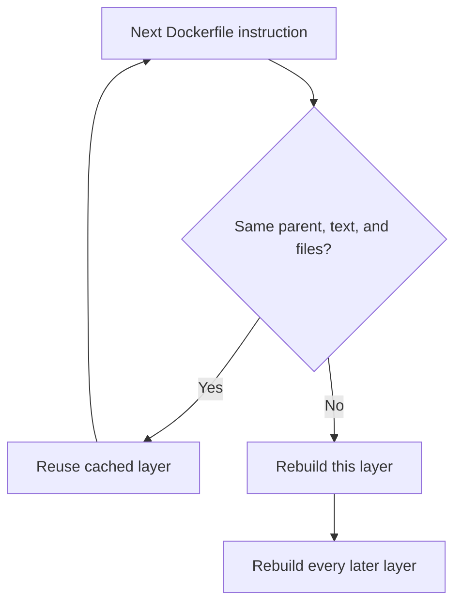

## In one line
A good Dockerfile for Node installs dependencies before copying the code so rebuilds are fast, keeps junk out with `.dockerignore`, runs as a non-root user, and starts `node` directly so it shuts down cleanly.

## The problem it solves
Here is the Dockerfile many people write first:

```dockerfile
FROM node:latest
COPY . .
RUN npm install
CMD npm start
```

It works, and it causes four problems:

1. **Every code change reinstalls every package.** `COPY . .` comes before `npm install`, so changing one line of `server.js` throws away the cached `node_modules` layer. Each build pays the full install again, which can take minutes on a big project.
2. **It copies your laptop into the image**: your local `node_modules` (built for macOS, maybe), your `.git` folder, and your `.env` file with real passwords.
3. **It runs as root.** **Root** is the all-powerful admin user. If an attacker breaks into your app, they are root inside the container, which makes escaping to the server easier.
4. **It's huge and unpredictable.** `latest` moves to a new Node major version without warning. The full Debian-based `node:24` image is roughly a 400 MB compressed download, versus roughly 60 MB for `node:24-alpine` (amd64, at the time of writing).

## Everyday analogy
A Dockerfile is a **recipe card**, and Docker is a cook who photographs the dish after every step. Next time, if a step and its ingredients are the same as last time, the cook uses the photo instead of cooking again. But once one step changes, every later step must be cooked fresh.

So you put the slow, rarely changing steps first (make the stock) and the quick, frequently changing ones last (add the garnish).

Where it breaks down: the cook only reads the step's wording, not what's in the shops today. `RUN npm install` with an unchanged lockfile reuses the old photo, even if new package versions exist.

## How it works
Some terms first:

- The **build context** is the folder you send to Docker when you run `docker build .`. `COPY` can only copy files from it.
- **`.dockerignore`** lists files to leave out of the build context, like `.gitignore` does for Git.
- **`npm ci`** installs exactly what `package-lock.json` says, and fails if the lockfile doesn't match `package.json`. It is made for automated builds. `--omit=dev` skips `devDependencies` such as test tools.
- A **signal** is a short message the OS sends to a process. **SIGTERM** means "please shut down". **SIGKILL** means "stop now", and it can't be caught.

**How the build cache decides, line by line.** Each instruction is checked in order:

1. Is there a cached layer built from the **same parent layer** with the **same instruction text**?
2. For `COPY` and `ADD`, Docker also computes a checksum over the files being copied: their contents and details such as permissions, but not their modification time. Any change is a miss.
3. For `RUN`, only the command text is compared. Docker doesn't know what the command downloads.
4. **The first miss rebuilds that layer and every layer after it**, because each later layer's parent has changed.


*Notice: one early miss forces everything below it to rebuild, so stable steps go first.*

**Why signals matter.** `docker stop` sends SIGTERM to the container's **PID 1**, its first process. It waits 10 seconds by default, then sends SIGKILL. The Linux kernel treats PID 1 specially: it does not apply a signal's default "exit" action. So a Node process running as PID 1 **ignores SIGTERM unless your code handles it**. It just sits there until it's killed 10 seconds later, cutting off any requests in flight.

## Real example
**Setup:** an Express app (`server.js`) that listens on `process.env.PORT` or 3000, with `package.json` and a committed `package-lock.json`.

**`.dockerignore`:**

```text
node_modules
npm-debug.log*
.git
.env
.env.*
coverage
Dockerfile*
.dockerignore
```

**`Dockerfile`:**

```dockerfile
# Pin the major version and the OS variant, never "latest"
FROM node:24-alpine

ENV NODE_ENV=production
WORKDIR /app

# 1. Dependencies first: this layer is reused until package files change
COPY package.json package-lock.json ./
RUN npm ci --omit=dev && npm cache clean --force

# 2. Then the source code, which changes on almost every commit
COPY . .

# 3. Drop root: the official Node image includes a user called "node"
USER node

EXPOSE 3000
# Exec form (JSON array): node itself is PID 1 and receives SIGTERM
CMD ["node", "server.js"]
```

The copied files stay owned by root, and are readable but not writable for `node`. That is deliberate: a compromised app can't rewrite its own code. If the app must write somewhere, create that one folder and `chown` it, or better, use a volume.

**Graceful shutdown in `server.js`:**

```js
const server = app.listen(process.env.PORT || 3000);

process.on('SIGTERM', () => {
  // Stop accepting new connections, let in-flight requests finish, then exit
  server.close(() => process.exit(0));
});
```

**Build, run, and check:**

```bash
docker build -t shop-api:1.0 .
docker run -d --name shop-api -p 3000:3000 \
  -e DATABASE_URL -e REDIS_URL shop-api:1.0   # pass secrets at runtime, not in the image

docker exec shop-api whoami                  # node
docker exec shop-api touch /app/hack.js      # touch: /app/hack.js: Permission denied
time docker stop shop-api                    # about 0.1 s with the SIGTERM handler
```

`-e DATABASE_URL` copies that variable from your shell into the container. In one test, a Node container with **no** SIGTERM handler took 10.2 seconds to stop and exited with code 137 (killed). With the handler, it stopped in about 0.1 seconds with exit code 0.

> [!TIP]
> If you can't change the app's code, `docker run --init` adds a tiny init process as PID 1. It forwards signals to Node, and Node's default SIGTERM behaviour (exit) works again. Compose has the same option: `init: true`.

## How to say it in an interview

> [!INTERVIEW]
> **30 seconds:** "I start from a pinned, small base like node:24-alpine. I copy package.json and the lockfile first and run npm ci with dev dependencies omitted, then copy the source, so code changes don't invalidate the dependency layer. A .dockerignore keeps node_modules, .git, and .env out. I switch to the non-root node user, and use the exec form of CMD so node gets SIGTERM directly and can shut down gracefully. Secrets are passed at runtime, never baked in."

> [!INTERVIEW]
> **2 minutes:** Start with the 30-second answer, then add:
>
> "The ordering matters because the build cache works top to bottom. COPY instructions are checked by file checksums, and the first miss rebuilds every layer after it. On our shop API, putting the code copy after npm ci took code-only rebuilds from a full reinstall down to a few seconds.
>
> Signals are the subtle part. Node as PID 1 ignores SIGTERM unless you handle it, so docker stop waits 10 seconds and then kills it mid-request. I handle SIGTERM with server.close, or use --init.
>
> One tradeoff is Alpine. It uses musl instead of the more common glibc C library, so some native npm packages need build tools or behave differently. If that bites, I switch to node:24-slim, which is Debian-based but still small. And for TypeScript or frontend builds I'd use a multi-stage build, so compilers never ship to production."

## Follow-up questions interviewers ask

<details>
<summary>Why COPY package.json separately before COPY . .?</summary>

So the slow `npm ci` layer depends only on the package files. When you change code but not dependencies, the checksums of `package.json` and `package-lock.json` match, the install layer comes from cache, and only the fast `COPY . .` layer is rebuilt.

</details>

<details>
<summary>npm ci vs npm install: which in a Dockerfile, and why?</summary>

`npm ci`. It installs exactly the versions in `package-lock.json`, deletes any existing `node_modules` first, and fails if the lockfile and `package.json` disagree. Builds become repeatable. `npm install` may resolve newer versions and rewrite the lockfile, so two builds of the same commit could differ.

</details>

<details>
<summary>CMD vs ENTRYPOINT?</summary>

`CMD` is the default command, and anything you put after the image name in `docker run` replaces it. `ENTRYPOINT` is the fixed executable, and `CMD` becomes its default arguments. For a Node service, `CMD ["node", "server.js"]` is usually enough. Use `ENTRYPOINT` when the image behaves like a single command-line tool.

</details>

<details>
<summary>Why does docker stop take 10 seconds on my container?</summary>

Docker sent SIGTERM, nothing stopped the process, and after the 10-second grace period Docker sent SIGKILL. With Node as PID 1, that happens when the app has no SIGTERM handler. Add a handler that closes the server, or run with `--init`. Exit code 137 confirms it was killed.

</details>

<details>
<summary>Should NODE_ENV=production be set in the image?</summary>

Usually yes. Express and many libraries use it to turn off development features, such as detailed error pages, and to enable caching. Also, `npm ci` skips `devDependencies` when `NODE_ENV` is `production`, though `--omit=dev` says so explicitly.

</details>

## Common mistakes and misconceptions

> [!MISTAKE]
> No `.dockerignore`. Your local `node_modules` (possibly compiled for macOS) overwrites the clean install, builds get slow because gigabytes are sent as context, and `.env` files with real secrets end up inside the image.

> [!MISTAKE]
> `ENV DB_PASSWORD=...` or `COPY .env .` in the Dockerfile. Anyone who can pull the image can read it with `docker history` or by extracting the layer. Pass secrets at runtime. See [Environment variables and secrets](#/topic/env-secrets).

> [!MISTAKE]
> "Running as root inside a container is fine, it's isolated." By default, container root is the same user ID 0 as root on the host, with some powers removed. A container escape bug is far more dangerous with it. Use `USER node`.

> [!MISTAKE]
> Running `npm run build` or tests in the final image and keeping all `devDependencies`. Use a multi-stage build to keep compilers and test tools out. See [Multi-stage builds](#/topic/multi-stage-builds).

## Tradeoffs: when NOT to use it
- **Local development.** Rebuilding an image on every file save is slow. Locally, many people run Node directly, or mount the source folder into a container with a file watcher.
- **Alpine with tricky native modules.** If a native package fails or misbehaves on musl, the time spent fighting it isn't worth a few saved megabytes. Use `-slim`.
- **Over-tuning.** Shaving 10 MB with obscure tricks rarely matters. Correct caching, no secrets, and non-root matter far more.

## Check yourself

<details>
<summary>1. You change only server.js. Which layers rebuild with the Dockerfile above?</summary>

Only `COPY . .` and the instructions after it (`USER`, `EXPOSE`, `CMD`, which are config-only and instant). `npm ci` is cached because the package files' checksums didn't change.

</details>

<details>
<summary>2. Why is RUN apt-get update on its own line a caching trap?</summary>

`RUN` is cached by its command text only. The cached package list can be months old, and a later `RUN apt-get install` on a separate line installs outdated or missing versions. Combine them in one `RUN`: `apt-get update && apt-get install -y ...`.

</details>

<details>
<summary>3. What two things does USER node protect against?</summary>

An attacker who exploits the app is not root inside the container, which limits what they can change and makes an escape to the host harder. And since the code files are owned by root, the compromised app can't rewrite its own code.

</details>

## Go deeper
- [Docker docs: Build cache invalidation](https://docs.docker.com/build/cache/invalidation/)
- [Docker docs: Dockerfile best practices](https://docs.docker.com/build/building/best-practices/)
- [Node.js Docker best practices (official docker-node repo)](https://github.com/nodejs/docker-node/blob/main/docs/BestPractices.md)
