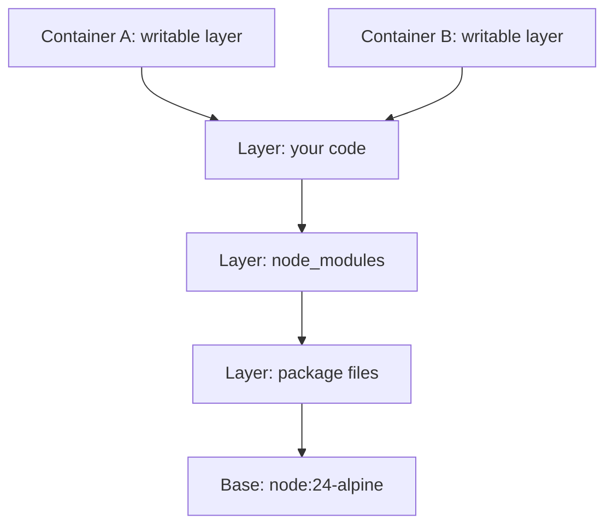

## In one line
An image is a read-only package of your app and everything it needs, a container is a running copy of that image with its own thin writable layer on top, and layers are the stacked slices that let images share files and rebuild quickly.

## The problem it solves
You want to ship the `shop-api` service to a server. Copying the code is not enough. The server also needs the right Node version, the right `node_modules`, and the right system libraries. Set these up by hand and every server ends up slightly different.

Docker packages **everything** into one bundle, called an image, and runs that bundle anywhere.

But the `shop-api` image, with Node, a small Linux userland, and `node_modules`, is about 200 MB. If every code change meant uploading 200 MB, deploys would crawl. If ten containers each needed their own copy, disks would fill up. **Layers** solve both.

## Everyday analogy
An image is a **stack of transparent sheets** on an overhead projector. The bottom sheet has the operating system. The next has Node. The next has your `node_modules`, and the top one has your code. Look down through the stack and you see one complete picture: the filesystem.

A container is a **blank sheet of tracing paper** laid on top. You can draw on it, and you can cover up things below, but the sheets underneath never change. Ten people can lay their own tracing paper over the same stack.

Where it breaks down: real sheets are visible at once. In Docker, the top-most version of a file wins, and lower versions are simply hidden.

## How it works
Key terms:

- A **Docker image** is a read-only template: a list of **layers** plus a small config saying how to start the app (the command, environment variables, working folder).
- A **layer** is a set of file changes: files added, changed, or deleted compared with the layer below.
- A **container** is a running (or stopped) instance of an image. See [Containers vs virtual machines](#/topic/containers-vs-vms).
- A **Dockerfile** is the recipe that builds an image, one instruction per line.
- A **registry** is a server that stores images, such as Docker Hub, GitHub Container Registry, or AWS ECR. You `push` images to it and `pull` them from it.

**1. Each instruction creates a layer.** In a Dockerfile, `RUN`, `COPY`, and `ADD` change files, so each creates a new filesystem layer. Instructions like `CMD`, `ENV`, and `EXPOSE` only change the config. They add no files.

**2. Layers are identified by their content.** Every layer gets a **digest**: a SHA-256 hash, a fingerprint calculated from its bytes. Identical content gives an identical digest. That is how Docker knows two images share a layer, and why it stores and downloads that layer only once.

**3. A union filesystem merges the stack.** When a container starts, Docker uses a **union filesystem**, usually **overlayfs** on Linux, to stack the image layers. The container sees one merged folder tree. Where two layers have the same file, the higher one wins.

**4. The container adds one writable layer on top.** All the image layers stay read-only. Anything the running app writes goes into a thin **container layer** that belongs only to that container.

**5. Copy-on-write.** If the app changes a file that lives in an image layer, overlayfs first copies that file up into the container layer, then changes the copy. Deleting a file adds a "whiteout" marker in the container layer that hides it. The image itself never changes. This is called **copy-on-write**.

**6. Deleting the container deletes its writable layer.** Anything written there is gone. Data that must survive belongs in a volume. See [Volumes and persistent data](#/topic/docker-volumes).


*Notice: both containers share every read-only layer, and each adds only its own thin writable layer.*

**Tags and digests.** `shop-api:1.4.0` is a **tag**: a human-friendly name pointing at an image. Tags can be moved to a different image later, especially `latest`. A digest like `shop-api@sha256:54da…` always means exactly the same bytes.

**Build cache.** When you rebuild, Docker reuses a layer if its instruction and inputs are unchanged. Once one layer changes, every layer after it is rebuilt. So the order of Dockerfile lines decides how fast rebuilds are. More in [A good Dockerfile for Node](#/topic/dockerfile-node).

## Real example
**Setup:** Docker installed. A folder with `server.js`, `package.json`, `package-lock.json`, and a `.dockerignore` file containing `node_modules`. This Dockerfile:

```dockerfile
FROM node:24-alpine
WORKDIR /app
COPY package*.json ./
RUN npm ci --omit=dev
COPY . .
CMD ["node", "server.js"]
```

**1. Build and list the layers.** `docker history` shows one row per instruction, newest first:

```bash
docker build -t shop-api:1.0 .
docker history shop-api:1.0
```

```text
CREATED BY                              SIZE
CMD ["node" "server.js"]                0B       <- config only, no files
COPY . . # buildkit                     16.4kB   <- your code
RUN /bin/sh -c npm ci --omit=dev        27.9MB   <- node_modules
COPY package*.json ./ # buildkit        65.5kB
WORKDIR /app                            8.19kB
...                                              <- node:24-alpine's own layers
```

Output trimmed. Your sizes will differ.

**2. Change one line of code and rebuild:**

```text
#6 [3/5] COPY package*.json ./   CACHED
#8 [4/5] RUN npm ci --omit=dev   CACHED   <- 27.9 MB not rebuilt
#9 [5/5] COPY . .                DONE 0.0s
```

Only the 16 kB code layer is new. When you push, the registry already has the other layers, so only that small layer is uploaded.

**3. Watch copy-on-write.** Start two containers from the same image, then change files in one of them:

```bash
docker run -d --name api-a shop-api:1.0 sleep 600
docker run -d --name api-b shop-api:1.0 sleep 600
docker exec api-a sh -c 'echo debug > /app/note.txt && rm /app/package.json'

docker diff api-a        # what changed in api-a's writable layer
# C /app                 <- C = changed
# A /app/note.txt        <- A = added
# D /app/package.json    <- D = deleted (a whiteout hides it)

docker exec api-b ls /app   # package.json is still there: api-b is untouched
docker ps -s --filter name=api-
# api-a   20.5kB (virtual 204MB)   <- only 20 kB is its own
# api-b   4.1kB (virtual 204MB)
docker rm -f api-a api-b    # both writable layers are deleted for good
```

"Virtual" is the shared image size. Two containers did not cost 400 MB of disk.

## How to say it in an interview

> [!INTERVIEW]
> **30 seconds:** "An image is a read-only template made of layers. Each Dockerfile instruction that changes files, like RUN or COPY, adds a layer, and layers are identified by a content hash, so images share them and registries only transfer the ones you don't have. A container is a running instance of an image. Docker stacks the image layers with a union filesystem like overlayfs and adds a thin writable layer on top. Changes use copy-on-write and disappear when the container is removed, so persistent data goes in volumes."

> [!INTERVIEW]
> **2 minutes:** Start with the 30-second answer, then add:
>
> "Layers matter for speed. In our shop API, the base image and node_modules are around 200 MB, but a typical code change only touches a few kilobytes. Because Docker caches layers in order, I copy package.json and run npm ci before copying the source. A code-only change then rebuilds one tiny layer, and a deploy pulls just that layer.
>
> The tradeoff is that layers are permanent history. If you copy a secret into one layer and delete it in a later layer, the secret is still in the image, readable by anyone who pulls it. Also, deleting files in a later layer doesn't shrink the image, which is one reason we use multi-stage builds. And for deploys I reference images by version tag or digest, never `latest`, so I know exactly what's running and can roll back."

## Follow-up questions interviewers ask

<details>
<summary>What is the difference between an image and a container?</summary>

An image is a read-only template, like a class in programming. A container is a running instance of it, like an object made from that class. One image can run as many containers. Each has its own writable layer, network address, and process, but they share the image's layers.

</details>

<details>
<summary>What happens to files a container writes when you delete the container?</summary>

They are deleted with its writable layer. Stopping the container keeps them (a stopped container still exists). `docker rm` removes them. That's why database files, uploads, and anything else that must survive go in a volume, which lives outside the container's layers.

</details>

<details>
<summary>Why is using the latest tag risky in production?</summary>

`latest` is just a default tag name, not "the newest version". It points at whatever was pushed last with that tag, and it can move at any time. Two servers pulling `latest` an hour apart may run different code, and you can't easily tell which version is live or roll back. Use explicit version tags, like `1.4.0` or a Git commit hash, or pin by digest.

</details>

<details>
<summary>You deleted a secret file in a later RUN line. Is the image safe?</summary>

No. The earlier layer still contains the file, and anyone with the image can extract that layer. Never copy secrets into an image. Pass them at runtime as environment variables or mounted files. For secrets needed only during the build, use BuildKit secret mounts (`RUN --mount=type=secret`), which are never saved in a layer.

</details>

## Common mistakes and misconceptions

> [!MISTAKE]
> "Removing files in a later layer makes the image smaller." No. The earlier layer still holds them. Clean up in the **same** `RUN` command that creates the files, or use a multi-stage build. See [Multi-stage builds](#/topic/multi-stage-builds).

> [!MISTAKE]
> Saving important data inside the container (uploads written to `/app/uploads`, for example). It's lost on `docker rm`, and every redeploy replaces the container. Use a volume or object storage.

> [!MISTAKE]
> Changing files inside a running container with `docker exec` to "fix" production. The next deploy creates a fresh container from the image, and the fix vanishes. Change the code, rebuild, redeploy.

> [!MISTAKE]
> "`docker stop` deletes the container." It only stops the process. The container and its writable layer stay until `docker rm`. Containers started with `--rm` are removed automatically when they stop.

## Tradeoffs: when NOT to use it
- **Writing lots of data in the container layer.** Copy-on-write adds overhead, and the data is temporary. Heavy write workloads, like a database, belong on a volume.
- **Huge single layers.** A 2 GB layer must be fully re-uploaded and re-pulled whenever anything in it changes. Split stable parts from changing parts.
- **Treating images as backups.** An image captures software, not your data. Back up databases separately. See [Backups and restore](#/topic/backups).

## Check yourself

<details>
<summary>1. Which of these Dockerfile lines add a filesystem layer: FROM, COPY, RUN, CMD, ENV?</summary>

`COPY` and `RUN` add filesystem layers. `FROM` brings in the base image's existing layers. `CMD` and `ENV` only change the image's config.

</details>

<details>
<summary>2. A container edits /etc/profile, which exists in the base image. Where does the change go?</summary>

Overlayfs copies the file up into the container's writable layer and changes the copy (copy-on-write). The base image layer is untouched, and other containers still see the original.

</details>

<details>
<summary>3. Why does a code-only change usually upload just a few kilobytes on docker push?</summary>

Layers are identified by content hash. The registry already has every unchanged layer, such as the base image and node_modules, so only the new code layer is uploaded.

</details>

## Go deeper
- [Docker docs: Understanding image layers](https://docs.docker.com/get-started/docker-concepts/building-images/understanding-image-layers/)
- [Docker docs: Storage drivers and copy-on-write](https://docs.docker.com/engine/storage/drivers/)
