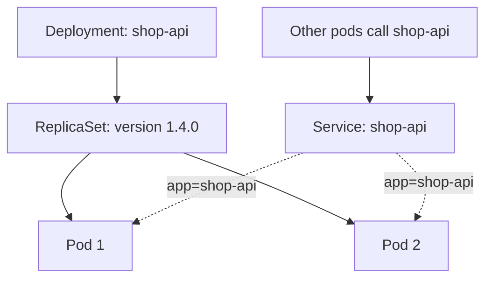

## In one line
Kubernetes is a system that runs your containers across a group of machines and keeps them in the state you declared, such as "always 3 copies of shop-api, reachable at one address", replacing anything that crashes or disappears.

## The problem it solves
The shop app has outgrown one server. It now runs on six. With [Docker Compose](#/topic/docker-compose) on each one, you face questions Compose can't answer:

- **Which server should the new container go on?** One server has spare memory, another is nearly full.
- **A server dies at 3 AM.** Who restarts its containers somewhere else?
- **How do other services find the API**, when its containers move between servers and change IP addresses?
- **How do you update 12 containers on 6 servers** without downtime, and roll back if needed?

Doing this with scripts gets fragile fast. An **orchestrator** is a system that places, connects, heals, and updates containers across many machines. **Kubernetes** (often written **K8s**) is the most widely used one.

## Everyday analogy
A **thermostat**. You don't turn the heater on and off yourself. You set the desired temperature, 21 °C, and the thermostat keeps checking the room and acting until reality matches.

With Kubernetes, you declare "3 copies of shop-api version 1.4.0". Kubernetes keeps checking, and if one copy crashes, it starts another.

Where it breaks down: a thermostat controls one heater. Kubernetes runs many of these control loops at once, each responsible for a different kind of object.

## How it works
**The cluster.** A **cluster** is a group of machines run by Kubernetes. Each machine is a **node**.

- The **control plane** is the brain. Its **API server** receives every command, and it stores the desired state in **etcd**, a small, reliable key-value database. The **scheduler** picks a node for each new container, and **controllers** keep comparing actual state with desired state and fixing differences.
- Each worker node runs a **kubelet**, an agent that starts and watches containers on that node using a container runtime such as containerd.

**The objects you'll talk about in interviews,** from smallest to largest:

1. **Pod.** The smallest unit Kubernetes runs: one container, or a few that must live together. Containers in a pod share one IP address and can share volumes. Pods are **disposable**: when one dies, it isn't repaired, it's replaced by a new pod with a new IP address.
2. **ReplicaSet.** Keeps a set number of identical pods running. If you want 3 and only 2 exist, it creates one more.
3. **Deployment.** Manages ReplicaSets for you, and is what you actually write. When you change the image, the Deployment creates a **new** ReplicaSet and scales it up while scaling the old one down: a rolling update. Rollback scales the old ReplicaSet back up.
4. **Service.** A stable name and virtual IP address in front of a changing set of pods. It finds its pods by **labels**, which are key-value tags such as `app: shop-api`, and spreads traffic across the ones that are ready. Inside the cluster, other pods simply call `http://shop-api`.
5. **Ingress** (or the newer **Gateway API**). Routes outside HTTP traffic, for example `api.example.com`, to the right Service.
6. **ConfigMap and Secret.** Configuration and sensitive values, given to pods as environment variables or files.


*Notice: the Service never names pods directly; it finds whichever pods carry the matching label (dotted lines), so pods can be replaced freely.*

**Probes** tell Kubernetes about health. A **readiness probe** decides whether a pod should receive traffic yet. A **liveness probe** decides whether a stuck pod should be restarted.

## Real example
**Setup:** access to a cluster with `kubectl`, the Kubernetes command-line tool. For practice, a local cluster from Docker Desktop, kind, minikube, or k3s works. The image `ghcr.io/acme/shop-api:1.4.0` serves `/health` on port 3000.

**`deployment.yaml`:**

```yaml
apiVersion: apps/v1
kind: Deployment
metadata:
  name: shop-api
spec:
  replicas: 3                          # desired state: always 3 pods
  selector:
    matchLabels: { app: shop-api }     # which pods this Deployment owns
  template:                            # the blueprint for each pod
    metadata:
      labels: { app: shop-api }
    spec:
      containers:
        - name: api
          image: ghcr.io/acme/shop-api:1.4.0
          ports: [{ containerPort: 3000 }]
          env:
            - name: DATABASE_URL
              valueFrom:
                secretKeyRef: { name: shop-secrets, key: database-url }
          readinessProbe:              # only send traffic once /health answers
            httpGet: { path: /health, port: 3000 }
          resources:
            requests: { cpu: 100m, memory: 128Mi }   # used by the scheduler
            limits: { memory: 256Mi }                # killed if it uses more
```

**`service.yaml`:**

```yaml
apiVersion: v1
kind: Service
metadata:
  name: shop-api                 # other pods reach it at http://shop-api
spec:
  selector: { app: shop-api }    # send traffic to pods with this label
  ports:
    - port: 80                   # the Service's port
      targetPort: 3000           # the container's port
```

**Apply and watch it heal:**

```bash
kubectl create secret generic shop-secrets \
  --from-literal=database-url='postgres://shop:secret@db:5432/shop'
kubectl apply -f deployment.yaml -f service.yaml

kubectl get pods                       # 3 pods named shop-api-<replicaset>-<random>
kubectl delete pod shop-api-f764698f8-77bq8
kubectl get pods                       # a new pod already replaces it, seconds old

kubectl set image deployment/shop-api api=ghcr.io/acme/shop-api:1.5.0
kubectl rollout status deployment/shop-api   # pods replaced one by one
kubectl get rs
# shop-api-56c46695bf   3   3   3      <- new ReplicaSet (1.5.0)
# shop-api-f764698f8    0   0   0      <- old one kept at 0, for rollback

kubectl rollout undo deployment/shop-api     # scale the old ReplicaSet back up
```

This was run on a local k3s cluster. Your pod and ReplicaSet names will differ.

## How to say it in an interview

> [!INTERVIEW]
> **30 seconds:** "Kubernetes is a container orchestrator. You declare the desired state in YAML, and controllers keep the cluster matching it. A pod is the smallest unit: one or more containers sharing an IP. A Deployment manages ReplicaSets, which keep the right number of pods running, and it does rolling updates by creating a new ReplicaSet and shifting pods over. A Service gives those changing pods one stable name and IP, selecting them by label. So if a pod or a whole node dies, Kubernetes replaces it and traffic keeps flowing."

> [!INTERVIEW]
> **2 minutes:** Start with the 30-second answer, then add:
>
> "Readiness probes matter a lot: they stop traffic going to a pod that's started but not ready yet, which is what makes rolling updates seamless. Resource requests let the scheduler place pods sensibly, and limits stop one pod from starving the node.
>
> The tradeoff is complexity. Running your own cluster means upgrades, networking, security, and monitoring, which is real work. Most teams use a managed service like EKS, GKE, or AKS. Even then, for a small team with a few services, Docker Compose on a server or a simpler platform is often the better choice. I'd move to Kubernetes when we have many services, several servers, and need automatic scaling and self-healing."

> [!TIP]
> **If you haven't used Kubernetes, say so honestly, then show you understand it.** For example: "I haven't run Kubernetes in production. I deploy with Docker Compose over SSH. But I understand the model: Deployments, ReplicaSets, pods, Services, and probes. Our Compose setup maps onto it fairly directly: each service would become a Deployment plus a Service, and our health checks would become readiness probes." That answer is honest, concrete, and shows you can learn it quickly.

## Follow-up questions interviewers ask

<details>
<summary>Why not just create pods directly?</summary>

A bare pod isn't recreated if it dies or its node fails. Nothing is watching it. A Deployment, through its ReplicaSet, keeps the desired number of pods alive, and handles rolling updates and rollbacks. You almost never create pods by hand.

</details>

<details>
<summary>What is the difference between a Deployment and a ReplicaSet?</summary>

A ReplicaSet keeps N identical pods running, for one pod template. A Deployment manages ReplicaSets over time: each change to the pod template, such as a new image, creates a new ReplicaSet. The Deployment scales the new one up and the old one down, and keeps old ReplicaSets at zero so it can roll back.

</details>

<details>
<summary>What are the Service types?</summary>

**ClusterIP** (the default): reachable only inside the cluster. **NodePort**: also opens the same port on every node. **LoadBalancer**: asks the cloud provider for an external load balancer pointing at the Service. Web traffic usually enters through an Ingress or Gateway in front of ClusterIP Services.

</details>

<details>
<summary>Readiness vs liveness probes?</summary>

**Readiness** answers "should this pod get traffic right now?". When it fails, the pod is removed from the Service's endpoints, but not restarted. **Liveness** answers "is this pod stuck?". When it fails repeatedly, the container is restarted. A common mistake is a liveness probe that checks the database: when the database blips, every pod restarts at once and makes things worse.

</details>

<details>
<summary>How does a pod get its configuration and secrets?</summary>

From ConfigMaps and Secrets, mounted as environment variables or files. By default, Secrets are only base64-encoded, which is not encryption, so clusters should enable encryption at rest and restrict who can read Secrets. Many teams sync secrets from an external manager, such as AWS Secrets Manager or Vault.

</details>

## Common mistakes and misconceptions

> [!MISTAKE]
> "Kubernetes replaces Docker." Kubernetes runs containers, and Docker is one way to build them. The images you build with a Dockerfile run unchanged on Kubernetes, through a runtime like containerd.

> [!MISTAKE]
> "Kubernetes makes my app scalable." It can run more copies, but only if the app is **stateless**, keeping sessions and files in Redis, the database, or object storage rather than in the pod. A pod's local files vanish when it's replaced.

> [!MISTAKE]
> Skipping resource requests and limits. The scheduler then can't place pods sensibly, and one leaking pod can starve every other pod on the node.

> [!MISTAKE]
> Rolling back with `kubectl rollout undo` and forgetting the YAML in Git still says the new version. The next `kubectl apply` deploys it again. Kubernetes even warns about this. Keep Git as the source of truth and roll back by reverting the change there.

## Tradeoffs: when NOT to use it
- **A small team with a few services.** The learning curve and operations work usually outweigh the benefits. Compose on one or two servers, or a managed platform, is simpler. See [Deploying Docker over SSH](#/topic/deploy-docker-ssh).
- **No one to own it.** Even a managed cluster needs upgrades, monitoring, cost control, and security policies.
- **Mostly databases and stateful systems.** Running databases on Kubernetes is possible but hard. Many teams keep databases on managed services and run only stateless apps in the cluster.
- **Spiky, event-driven workloads.** Serverless functions may fit better, with nothing to keep running between events. See [Cloud basics](#/topic/cloud-basics).

## Check yourself

<details>
<summary>1. You delete one of the 3 pods of a Deployment. What happens, and which object causes it?</summary>

The ReplicaSet sees only 2 pods instead of 3 and creates a new one. The new pod has a new name and a new IP address, but the Service finds it by label, so traffic keeps flowing.

</details>

<details>
<summary>2. How does a Service know which pods to send traffic to?</summary>

Through its label selector, such as `app: shop-api`. It sends traffic to every pod with that label that is passing its readiness probe.

</details>

<details>
<summary>3. After kubectl set image, kubectl get rs shows two ReplicaSets, one with 0 pods. Why keep it?</summary>

It's the previous version's ReplicaSet. The Deployment keeps it, scaled to zero, so `kubectl rollout undo` can scale it back up quickly.

</details>

## Go deeper
- [Kubernetes docs: Deployments](https://kubernetes.io/docs/concepts/workloads/controllers/deployment/)
- [Kubernetes docs: Service](https://kubernetes.io/docs/concepts/services-networking/service/)
- [Kubernetes docs: Liveness, readiness, and startup probes](https://kubernetes.io/docs/concepts/configuration/liveness-readiness-startup-probes/)
