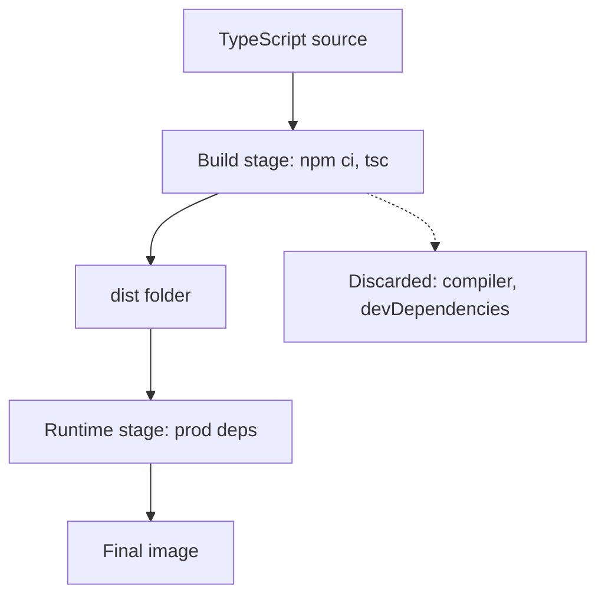

## In one line
A multi-stage build uses one image to compile your app and a second, clean image to run it, copying across only the finished output so build tools never reach production.

## The problem it solves
Your `shop-api` is written in **TypeScript**: JavaScript with type checks, which must be **compiled** (translated) into plain JavaScript before Node can run it. Compiling needs the `typescript` package, type definitions, and often test tools. These are **devDependencies**: packages needed to build and test, but not to run.

With one Dockerfile stage, the image must contain all of them, plus your `.ts` source files, because they were needed during the build. In one test with a tiny Express app:

- single-stage: `node_modules` was 36.8 MB and included TypeScript,
- multi-stage: `node_modules` was 4.3 MB, with no TypeScript and no `.ts` source.

The bigger the project, the bigger the gap. And everything in the image is something to download on every deploy, scan for vulnerabilities, and potentially exploit.

Deleting the tools at the end of the same Dockerfile doesn't help. They stay in the earlier layers. See [Images, containers, and layers](#/topic/images-containers-layers).

## Everyday analogy
A furniture workshop and a showroom. You build the table in the workshop, surrounded by saws, glue, and sawdust. Then you carry **only the finished table** into the showroom. Customers never see the mess.

Where it breaks down: a real table is carried by hand. In Docker you must name exactly which files to carry, and anything you forget, such as a config file, is simply missing from the final image.

## How it works
1. **Each `FROM` starts a new stage** with a fresh, empty filesystem based on that image. Nothing from the earlier stage is there unless you copy it.
2. **Name a stage with `AS`**, for example `FROM node:24-alpine AS build`.
3. **`COPY --from=build /app/dist ./dist`** copies files out of the `build` stage into the current one. This is the only bridge between stages.
4. **The final image contains only the last stage's layers.** Earlier stages are discarded, though they stay in the build cache, so the next build is fast.
5. **BuildKit**, Docker's build engine, only builds the stages your target actually needs, and it can run independent stages in parallel.
6. **`--target <stage>`** stops the build at a named stage. That is handy for a stage that runs tests in CI.


*Notice: only the compiled `dist` folder crosses into the runtime stage, and everything else stays behind.*

## Real example
**Setup:** a TypeScript Express app with `src/server.ts`, a `tsconfig.json` that compiles to `dist/`, a `"build": "tsc"` script in `package.json`, `typescript` in `devDependencies`, and a `.dockerignore` containing `node_modules`, `dist`, `.git`, and `.env`.

```dockerfile
# ---- Stage 1: build (has TypeScript and all devDependencies) ----
FROM node:24-alpine AS build
WORKDIR /app
COPY package.json package-lock.json ./
# All dependencies, including typescript
RUN npm ci
COPY tsconfig.json ./
COPY src ./src
# Compile src/*.ts into dist/*.js
RUN npm run build

# ---- Stage 2: runtime (only what production needs) ----
FROM node:24-alpine AS runtime
ENV NODE_ENV=production
WORKDIR /app
COPY package.json package-lock.json ./
RUN npm ci --omit=dev && npm cache clean --force
# Take only the compiled output from the build stage
COPY --from=build /app/dist ./dist
USER node
EXPOSE 3000
CMD ["node", "dist/server.js"]
```

> [!WARNING]
> Dockerfile comments must be on their own line. `COPY --from=build /app/dist ./dist  # comment` fails, because Docker reads `#` and `comment` as more file paths.

**Build and compare:**

```bash
docker build -t shop-api:multi .
docker run --rm shop-api:multi ls /app
# dist  node_modules  package-lock.json  package.json   <- no src, no tsconfig

docker run --rm shop-api:multi ls node_modules/typescript
# ls: node_modules/typescript: No such file or directory

docker history shop-api:multi     # the build stage's layers are not listed
```

In the same test, the whole single-stage image used 314 MB of disk and the multi-stage one 247 MB. Most of what's left is the Node base image itself.

**Run tests in CI against the build stage** (assuming a `test` script in `package.json`):

```bash
docker build --target build -t shop-api:build .
docker run --rm shop-api:build npm test
```

## How to say it in an interview

> [!INTERVIEW]
> **30 seconds:** "A multi-stage build has several FROM lines in one Dockerfile. The first stage has all the build tools: it installs every dependency and compiles, for example, TypeScript. The final stage starts from a clean base, installs only production dependencies, and uses COPY --from to take just the compiled output. Only the last stage ends up in the image, so it's smaller, faster to deploy, and has fewer packages that could have vulnerabilities."

> [!INTERVIEW]
> **2 minutes:** Start with the 30-second answer, then add:
>
> "The reason you can't just delete the tools at the end is layers: anything added in an earlier layer is still in the image. A new stage starts with a fresh filesystem, so it never had them.
>
> On our shop app, the API's runtime stage dropped TypeScript and the test tools, and node_modules went from tens of megabytes to a few. For the React storefront the win is bigger: we build with Node in the first stage and serve the static files from an Nginx image, so the final image has no Node at all.
>
> The tradeoff is debugging. The final image has no compiler and few tools, so I can't just exec in and rebuild something. I can build the earlier stage with --target to investigate. You also must remember to copy every runtime file, like migrations or templates, or the app fails at startup."

## Follow-up questions interviewers ask

<details>
<summary>Why not just remove devDependencies at the end of a single-stage build?</summary>

Removing files in a later layer doesn't remove them from earlier layers, so the image stays the same size. You could install, build, and prune in **one** `RUN` command, but that defeats layer caching. A multi-stage build gives both: cached build steps and a clean final image.

</details>

<details>
<summary>How would you containerise a React frontend with a multi-stage build?</summary>

Stage 1 uses a Node image to run `npm ci` and `npm run build`, which produces static HTML, CSS, and JavaScript files. Stage 2 uses an Nginx image and copies those files into Nginx's web folder, for example with `COPY --from=build /app/dist /usr/share/nginx/html`. The final image contains only Nginx and the static files.

</details>

<details>
<summary>Does a multi-stage build make the build slower?</summary>

Not usually. Each stage is cached layer by layer like any build, and BuildKit can run stages that don't depend on each other in parallel. The runtime stage runs `npm ci` a second time (production only), but that layer is cached until the package files change.

</details>

<details>
<summary>What is a distroless image, and how does it relate?</summary>

A **distroless** image contains your language runtime and libraries but no shell or package manager. Multi-stage builds make it practical: build in a full image, then copy the result into a distroless one. It's even smaller and harder to attack. The cost is that you can't open a shell inside it to debug.

</details>

## Common mistakes and misconceptions

> [!MISTAKE]
> Copying the whole build stage: `COPY --from=build /app /app`. That brings `node_modules` with every devDependency straight back, and undoes the point. Copy only the output folder.

> [!MISTAKE]
> Forgetting runtime files that aren't compiled: database migration files, email templates, or a `public` folder. The build succeeds and the container crashes at startup. List everything the app reads at runtime.

> [!MISTAKE]
> Passing a secret, such as a private npm token, as a build argument in the first stage and thinking it's safe "because that stage is thrown away". It persists in the build cache and can show up in build logs and build metadata. Use BuildKit secret mounts (`RUN --mount=type=secret`).

## Tradeoffs: when NOT to use it
- **Plain JavaScript with no build step.** If there's nothing to compile, the [single-stage Dockerfile](#/topic/dockerfile-node) with `npm ci --omit=dev` already gives a clean image. Extra stages add complexity for little gain.
- **When the base image dominates.** If the Node base is roughly 150 MB of a 160 MB image, trimming `node_modules` saves little. Measure before you optimise.
- **Teams new to Docker.** A readable single-stage file the whole team understands can beat a clever one that nobody wants to touch.

## Check yourself

<details>
<summary>1. With two FROM lines, which stage's files end up in the final image?</summary>

Only the last stage's, plus whatever it explicitly copied with `COPY --from`. Earlier stages are discarded from the image (they stay in the build cache).

</details>

<details>
<summary>2. What does docker build --target build do?</summary>

It builds up to and including the stage named `build`, and tags that as the image. Later stages are skipped. It is useful for running tests with the build tools present.

</details>

<details>
<summary>3. The multi-stage image starts and crashes with "Cannot find module './templates/order-email.html'". Why?</summary>

The template isn't TypeScript, so the compiler didn't put it in `dist`, and the runtime stage copied only `dist`. Copy the templates folder from the build stage too, or include it in the build output.

</details>

## Go deeper
- [Docker docs: Multi-stage builds](https://docs.docker.com/build/building/multi-stage/)
- [Docker docs: Build secrets](https://docs.docker.com/build/building/secrets/)
