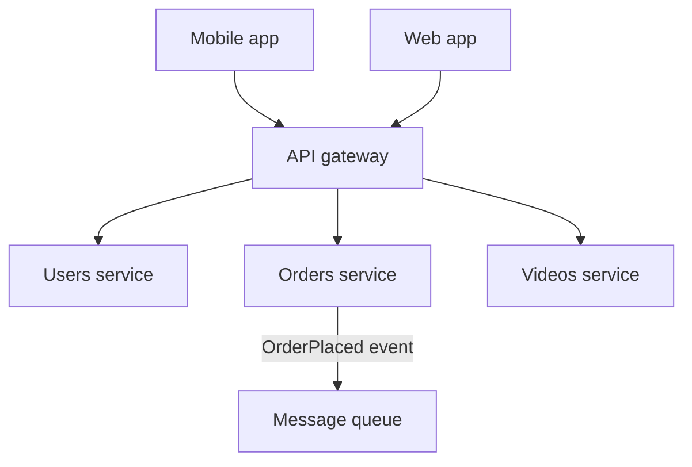

## In one line
An API gateway is the single front door to your backend services: it checks every request once (who are you, are you over your limit) and then routes it to the right service.

## The problem it solves
Your shop has been split into services: users, orders, catalog, and videos. See [Monolith vs microservices](#/topic/monolith-microservices). Without a gateway:

- The mobile app must know four addresses. Move one service, and every installed app breaks.
- Each service re-implements the same chores: checking the login token, **rate limiting** (capping how many requests a client may send), CORS, request logging. Four teams write four slightly different versions, and one of them has a security bug.
- Every service is exposed to the internet, so the attack surface is four times larger.

An **API gateway** sits in front of all services. Clients talk only to `api.example.com`. The gateway handles the shared concerns once, then forwards each request to the service that owns it.

## Everyday analogy
A hotel reception desk. Guests don't wander into housekeeping or the kitchen. Reception checks your key card once, then passes "room 412 wants towels" to housekeeping. Housekeeping trusts that reception already checked who you are.

Where it breaks down: if reception is closed, nobody gets anything. A gateway is a single point of failure unless you run several copies. And reception shouldn't start cooking: business logic belongs in the services.

## How it works
For a request like `GET /api/orders/` with a login token, the gateway typically:

1. **Terminates TLS:** decrypts HTTPS, so services behind it can speak plain HTTP on a private network.
2. **Authenticates:** verifies the token, for example a **JWT** (a signed token) or a session ID. If it is missing or invalid, it returns `401` and the request never reaches a service.
3. **Rate limits:** if this client has sent too many requests, it returns `429 Too Many Requests`.
4. **Routes:** matches the path. `/api/orders/*` goes to the orders service, `/api/videos/*` to the videos service.
5. **Adds context headers:** the verified user ID, and a **request ID**, a unique ID that every service logs so one request can be traced across all of them.
6. **Forwards and returns** the response, often adding logging and metrics on the way.


*Notice: clients only ever see the gateway. Behind it, services call each other directly or through a queue.*

**Gateway vs reverse proxy vs load balancer.** They overlap, and one tool (Nginx, an AWS Application Load Balancer, Kong) can do all three.
- A **reverse proxy** forwards requests to servers behind it.
- A **load balancer** forwards requests while spreading them across copies of the **same** service.
- An **API gateway** is a reverse proxy with API-specific policy: authentication, rate limits, routing to **different** services, sometimes response caching.

**Backend for frontend (BFF).** Sometimes each client gets its own gateway: one for the mobile app, one for the web app. The mobile BFF can combine three service calls into one response, which saves round trips on slow phone networks.

**Behind the gateway: how services talk.**
- **Synchronous calls** (HTTP, or gRPC for faster internal calls): the caller waits. Use them when you need the answer right now, like "is product 42 in stock?". See [gRPC](#/topic/grpc).
- **Asynchronous messages** through a queue: the sender publishes "OrderPlaced" and moves on. Email, analytics, and stock services react in their own time. Use them when the caller doesn't need to wait. See [Message queues](#/topic/message-queues).
- **Service discovery** is how a service finds another's current address. In Docker Compose and Kubernetes, built-in DNS does this: `http://orders:3000` resolves to whatever copies are running.
- A **service mesh** (for example Istio or Linkerd) adds a small proxy next to every service. The proxies handle retries, timeouts, metrics, and **mTLS** (mutual TLS, where both sides prove their identity with certificates) so application code doesn't have to.

## Real example
A small gateway built with Nginx, in front of an auth service and an orders service on a private Docker network. Two Nginx features do the work: `auth_request` (ask another service whether to allow each request; it is included in the official Nginx Docker image) and `limit_req` (rate limiting).

```nginx
limit_req_zone $binary_remote_addr zone=per_ip:10m rate=10r/s;

upstream auth_service   { server auth:3000; }
upstream orders_service { server orders:3000; }

server {
  listen 80;

  location = /_auth {                         # internal only: clients can't call it
    internal;
    proxy_pass http://auth_service/verify;
    proxy_pass_request_body off;              # the check needs headers only
    proxy_set_header Content-Length "";
  }

  location /api/orders/ {
    limit_req zone=per_ip burst=20 nodelay;   # rate limit per client IP
    limit_req_status 429;                     # the default would be 503
    auth_request /_auth;                      # 2xx: continue. 401/403: reject.
    auth_request_set $user_id $upstream_http_x_user_id;
    proxy_set_header X-User-Id $user_id;      # overwrites any value the client sent
    proxy_set_header X-Request-Id $request_id;
    proxy_pass http://orders_service/;        # /api/orders/ becomes /
  }
}
```

The auth service (`npm install express redis`) looks up the session token in Redis:

```js
import express from 'express';
import { createClient } from 'redis';

const redis = createClient({ url: process.env.REDIS_URL });
await redis.connect();
const app = express();

// Nginx calls this before every protected request.
app.get('/verify', async (req, res) => {
  const token = req.get('authorization')?.replace('Bearer ', '');
  const userId = token && await redis.get(`session:${token}`);
  if (!userId) return res.sendStatus(401);          // Nginx rejects the request
  res.set('X-User-Id', userId).sendStatus(204);      // Nginx lets it through
});

app.listen(3000);
```

What happens, with session `abc123` stored for user 981:

```bash
curl -i localhost/api/orders/                                   # 401: no token
curl -H 'Authorization: Bearer abc123' -H 'X-User-Id: 1' localhost/api/orders/
# orders service receives X-User-Id: 981. The client's fake "1" was overwritten.
curl -i localhost/_auth                                          # 404: internal only
```

Sending 40 requests at once returns a mix of `200` and `429`: roughly 21 pass (one at the base rate plus a burst allowance of 20), and the rest are rejected until the allowance recovers at 10 per second.

## How to say it in an interview

> [!INTERVIEW]
> **30 seconds:** "An API gateway is a single entry point in front of multiple backend services. It handles cross-cutting concerns once: TLS, authentication, rate limiting, logging, and request IDs. Then it routes each request to the right service by path. Clients get one stable address, and services can move or split without breaking them. Behind the gateway, services call each other with HTTP or gRPC when they need an answer now, or through a queue when they don't."

> [!INTERVIEW]
> **2 minutes:** Start with the 30-second answer, then add:
>
> "For example, Nginx works as a lightweight gateway: `auth_request` checks every request with an auth service, the verified user ID is passed downstream in a header that overwrites anything the client sent, and `limit_req` rate limits per IP. Managed options like AWS API Gateway do the same with less to run.
>
> The tradeoffs: the gateway is on every request's path, so it adds a hop of latency and must be redundant, or it becomes a single point of failure. It also tempts teams to put business logic in it, which turns it into a bottleneck everyone must change. I keep it thin: routing and policy only.
>
> For internal calls, I default to async events where the caller doesn't need an answer, because that removes coupling. When the services do need to call each other synchronously, every call gets a timeout."

## Follow-up questions interviewers ask

<details>
<summary>Isn't the gateway a single point of failure and a bottleneck?</summary>

It can be. Run several stateless gateway instances behind a load balancer or use a managed, redundant gateway. Keep its work cheap: token checks, routing, counters. Heavy work like aggregation with many calls belongs in a BFF or the services. Rate-limit counters must live in a shared store like Redis if there are several gateway instances.

</details>

<details>
<summary>If the gateway checks the token, can services trust every request?</summary>

Only if nothing else can reach them. Keep services on a private network, and make the gateway overwrite identity headers so clients can't forge them. For stronger guarantees, use mTLS between services or pass the signed JWT along so each service can verify it itself. "The network is private" alone is weak: one compromised service could then impersonate anyone.

</details>

<details>
<summary>When should one service call another synchronously, and when through a queue?</summary>

Synchronous when the caller needs the answer to continue: checkout needs to know the price and stock. Asynchronous when it doesn't: after an order is placed, sending the email, updating analytics, and notifying the warehouse can happen a moment later. Async also means the email service being down doesn't break checkout.

</details>

<details>
<summary>What is the backend-for-frontend pattern?</summary>

A separate gateway per client type. The mobile BFF can return a compact, combined response for the home screen in one round trip; the web BFF can return something different. Each frontend team owns its BFF, so one client's needs don't bloat the API for the others.

</details>

<details>
<summary>What's the difference between an API gateway and a service mesh?</summary>

The gateway handles **north-south** traffic: requests coming in from clients. A service mesh handles **east-west** traffic: calls between services inside the system, with retries, timeouts, metrics, and mTLS done by a proxy next to each service. Large systems often use both.

</details>

## Common mistakes and misconceptions

> [!MISTAKE]
> Putting business logic in the gateway, like calculating discounts. The gateway becomes a shared bottleneck that every team must change and deploy. Keep it to routing and cross-cutting policy.

> [!MISTAKE]
> Forwarding identity headers from the client. If the gateway passes along an `X-User-Id` the client sent, anyone can become any user. Always overwrite these headers with values the gateway verified.

> [!MISTAKE]
> Long synchronous chains: gateway → A → B → C → D. Latencies add up, and if any service is down the whole request fails. Flatten the chain, cache, or use events.

> [!MISTAKE]
> "With a gateway, services don't need their own authorisation." The gateway knows **who** the user is. Only the orders service knows whether user 981 may see order 5003. See [Authentication vs authorization](#/topic/authn-vs-authz).

## Tradeoffs: when NOT to use it
- **A single monolith.** One app behind Nginx already has one front door. A separate gateway product adds nothing.
- **Very latency-sensitive internal paths.** Don't route service-to-service calls back out through the public gateway. Call directly on the private network.
- **When it becomes a team bottleneck.** If every change needs the "gateway team", split into BFFs or let teams own their routes in config.

## Check yourself

<details>
<summary>1. Name four things an API gateway typically does before forwarding a request.</summary>

Any four of: terminate TLS, authenticate the token, rate limit, route by path to the right service, add a request ID and verified user ID headers, log and record metrics.

</details>

<details>
<summary>2. A client sends the header X-User-Id: 1 with a valid token for user 981. What must the gateway do?</summary>

Overwrite the header with the verified value, 981. Services trust that header, so passing the client's value through would let anyone impersonate any user.

</details>

<details>
<summary>3. After an order is placed, the app must send an email and update analytics. Sync calls or a queue?</summary>

A queue. The customer doesn't need to wait for either, and if the email service is down, checkout should still succeed. The email will be sent when the service recovers.

</details>

## Go deeper
- [Microsoft Azure Architecture Center: API gateways](https://learn.microsoft.com/en-us/azure/architecture/microservices/design/gateway)
- [Nginx docs: auth_request module](https://nginx.org/en/docs/http/ngx_http_auth_request_module.html)
- [Nginx docs: limit_req module](https://nginx.org/en/docs/http/ngx_http_limit_req_module.html)
