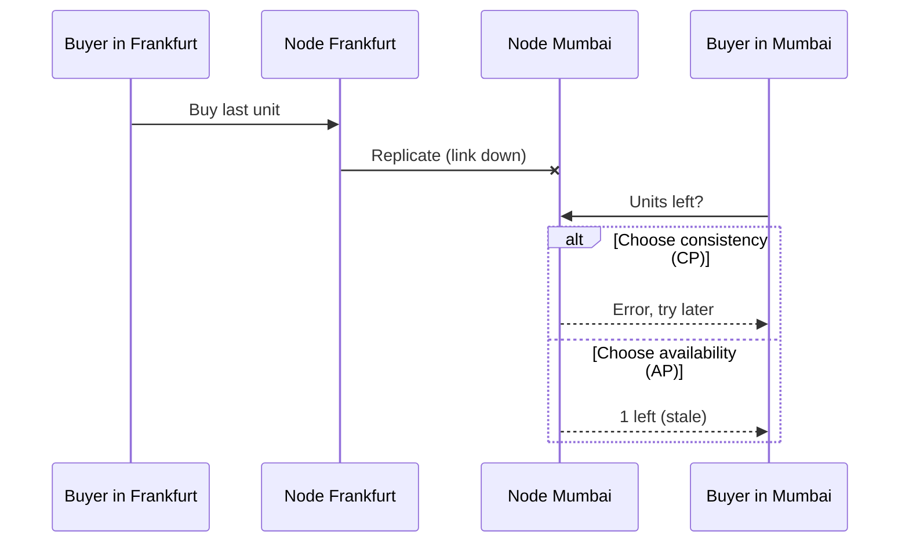

## In one line
The CAP theorem says that when the network between copies of your data breaks, the system must choose: refuse some requests to stay correct, or keep answering and risk giving out stale data.

## The problem it solves
Your shop keeps its database in two data centres, Frankfurt and Mumbai, so users everywhere get fast answers and one fire doesn't take the site down. Each copy of the data is called a **replica**, and each machine is a **node**. A system made of several nodes that talk over a network is a **distributed system**.

Normally, every write in Frankfurt is copied to Mumbai within milliseconds. Then the undersea link between them fails for two minutes. This is a **network partition**: both data centres are running, but they can't reach each other.

A customer in Frankfurt buys the last unit of product 42. A second later, a customer in Mumbai asks for the same product. Mumbai hasn't heard about the sale. What should it say?

- "Sorry, try again later": correct, but unhelpful.
- "1 left, buy it!": helpful, but now you've sold one item twice.

No option gives both. CAP names this choice so you make it deliberately, per feature, instead of discovering it during an outage.

## Everyday analogy
Two branches of a small bank share one ledger by phoning each other after every transaction. The phone line goes dead. A customer walks into branch B and wants to withdraw everything. Branch B can refuse until the line is back (correct but unavailable), or pay out and sort it out later (available but possibly wrong, if the customer just emptied the account at branch A).

Where it breaks down: software decides in milliseconds, often differently for different kinds of data.

## How it works
The three letters mean something narrower than everyday English:

- **C, consistency:** every read sees the most recent successful write, as if there were only one copy of the data. The formal name is **linearizability**.
- **A, availability:** every request to a node that is still running gets a real answer, not an error.
- **P, partition tolerance:** the system keeps operating even when messages between nodes are lost.

The theorem: during a partition, you can't have both C and A. Here is why, step by step:

1. The link between nodes breaks.
2. A write arrives at node 1. It can't copy it to node 2.
3. A read for the same data arrives at node 2.
4. If node 2 answers, it may return old data: you gave up **C**.
5. If node 2 refuses until the link is back, you gave up **A**.


*Notice: node Mumbai has only two moves, refuse or answer with old data. No design avoids that choice while the link is down.*

**Why "pick two of three" is misleading.** In any system that spans a network, partitions will happen. You can't choose to give up P. So the real choice is what happens **during** a partition:

- **CP** systems refuse some requests to stay consistent.
- **AP** systems keep answering and repair differences later.

"CA" only describes a single machine, where there is no network between copies to break.

**Consistency in CAP is not the C in ACID.** ACID's C means a transaction keeps the data valid by your rules: a foreign key points at a real row, stock never goes below zero. CAP's C means all replicas agree. Interviewers like to check that you know the difference. See [Transactions and ACID](#/topic/transactions-acid).

**Eventual consistency** is the usual AP promise: if writes stop, all replicas will agree eventually. Until then, different nodes may give different answers.

**PACELC: the part CAP leaves out.** Partitions are rare. Daniel Abadi's PACELC adds the everyday tradeoff: if there is a **P**artition, choose **A** or **C**; **E**lse, choose **L**atency or **C**onsistency. Even on a healthy network, waiting for a replica far away to confirm every write costs a round trip on every write. Many systems let you tune this per request.

## Real example
**PostgreSQL makes the choice explicit.** By default, replication is **asynchronous**: the primary confirms your write immediately and sends it to replicas afterwards. Reads from a replica can be a little behind. That lag is **replication lag**.

You can make one replica **synchronous** in `postgresql.conf` on the primary:

```ini
synchronous_standby_names = 'FIRST 1 (replica_eu)'
synchronous_commit = on
```

Now every commit waits until `replica_eu` confirms it has the write. If that replica is unreachable, commits don't fail; they hang. Try it on a primary with no standby connected: an `INSERT INTO orders` just waits, and `pg_stat_activity` shows its wait event as `SyncRep`. That is a CP choice: no write is confirmed unless it exists in two places. Cancelling the wait prints a telling warning:

```text
WARNING:  canceling wait for synchronous replication due to user request
DETAIL:  The transaction has already committed locally, but might not have been replicated to the standby.
```

To see how far behind each replica is, run on the primary:

```sql
SELECT application_name, state, sync_state, replay_lag
FROM pg_stat_replication;
```

**Choosing per feature in your app.** **Setup:** `npm install pg`, with `PRIMARY_URL` and `REPLICA_URL` pointing at an asynchronous primary and replica.

```js
import pg from 'pg';

const primary = new pg.Pool({ connectionString: process.env.PRIMARY_URL });
const replica = new pg.Pool({ connectionString: process.env.REPLICA_URL });

// Stock decides whether we can sell: it must be current, so read the primary.
export async function getStock(productId) {
  const { rows } = await primary.query('SELECT stock FROM products WHERE id = $1', [productId]);
  return rows[0]?.stock ?? 0;
}

// A review count that is a few seconds old harms nobody: read the replica.
export async function getReviewCount(productId) {
  const { rows } = await replica.query(
    'SELECT count(*)::int AS n FROM reviews WHERE product_id = $1', [productId]);
  return rows[0].n;
}
```

The same app makes a consistency choice for stock and an availability-and-speed choice for review counts.

## How to say it in an interview

> [!INTERVIEW]
> **30 seconds:** "CAP says that when there's a network partition between replicas, a distributed system has to choose between consistency, meaning every read sees the latest write, and availability, meaning every request gets an answer. Since partitions will happen in any networked system, the real question is CP or AP during a partition. I make that choice per feature: payments and stock need consistency; likes and view counts can be eventually consistent."

> [!INTERVIEW]
> **2 minutes:** Start with the 30-second answer, then add:
>
> "Two clarifications. First, CAP's consistency is not ACID's consistency. ACID's C is about a transaction keeping data valid; CAP's C is about replicas agreeing. Second, CAP only covers partitions. PACELC adds that even without a partition, you trade latency for consistency, because waiting for a far-away replica to confirm a write takes a round trip.
>
> For example, in Postgres, asynchronous replication is fast, but a replica can serve slightly stale reads. Synchronous replication means a commit waits for the standby, so if the standby is unreachable, writes hang. That's choosing consistency over availability.
>
> In practice, I'd read stock and order status from the primary, and send review counts and search to replicas or caches, where a few seconds of staleness is fine."

## Follow-up questions interviewers ask

<details>
<summary>Is PostgreSQL CP or AP?</summary>

A single PostgreSQL server isn't a distributed system, so CAP doesn't really apply. With replicas, it depends on configuration. Asynchronous replicas can return stale reads, and failing over to one can lose the last few confirmed writes. Synchronous replication favours consistency: writes wait when the synchronous standby is unreachable. Labels like "X is CP" are shortcuts. The honest answer names the setting.

</details>

<details>
<summary>What is a quorum?</summary>

A **quorum** is a majority vote among replicas. With N copies, a write waits for W of them to confirm, and a read asks R of them. If R + W > N, every read set overlaps every write set in at least one node, so a read can find the latest value. With N = 3, W = 2, R = 2, one node can be down and you still read your latest write. Some databases, such as Apache Cassandra, let you choose these levels per query.

</details>

<details>
<summary>Which features of our shop would you make CP, and which AP?</summary>

CP: payments, stock at checkout, order status, account balances, and permission changes. A wrong answer costs money or security. AP: product views, likes, review counts, "continue watching" positions, recommendations, and the activity feed. A slightly stale answer is better than an error page.

</details>

<details>
<summary>What does "read your own writes" mean?</summary>

A user who just changed something should see the change, even if other users see it a moment later. A user edits their profile name, refreshes, and the read goes to a lagging replica: the old name is back, and they think the save failed. Fixes: read from the primary for a few seconds after that user writes, or always read their own profile from the primary.

</details>

<details>
<summary>How do AP systems resolve conflicts after a partition?</summary>

Both sides may have accepted different writes to the same data. Common strategies: **last write wins** (keep the newest timestamp; simple, but it silently drops a write, and clocks drift), merging (a cart keeps items added on both sides), or letting the application decide.

</details>

## Common mistakes and misconceptions

> [!MISTAKE]
> "Pick any two of C, A, and P." You can't opt out of partitions in a networked system. The choice is between C and A **when** a partition happens. When the network is healthy, you can have both.

> [!MISTAKE]
> "My SQL database is ACID, so it's CAP-consistent." Different C. ACID is about one database's transactions. CAP is about agreement between replicas.

> [!MISTAKE]
> "NoSQL is AP, SQL is CP." Behaviour depends on configuration and even on each query. Many systems offer tunable consistency.

> [!MISTAKE]
> "AP means the data is wrong." AP data may be briefly stale. Once the partition heals and replicas sync, it converges. Whether brief staleness is acceptable is a product decision.

## Tradeoffs: the limits of CAP
- **It's a narrow theorem.** It covers one kind of failure, a partition, and one strict kind of consistency. It says nothing about latency, disk failures, or bugs. Don't use it as a complete database-selection tool.
- **Most systems aren't purely CP or AP.** One database can be strict for some operations and relaxed for others. Design at the feature level.
- **Strong consistency across regions is expensive.** Every write pays a cross-region round trip, often around 100 ms or more between continents. Only pay it for data that needs it.

## Check yourself

<details>
<summary>1. During a partition, a node returns an error instead of possibly stale data. CP or AP?</summary>

CP. It chose consistency: it refuses to answer rather than risk giving out data that may be out of date.

</details>

<details>
<summary>2. Why is "CA" not a real option for a distributed system?</summary>

Because a network between nodes can always fail. When it does, the system must either refuse requests (losing A) or answer with possibly stale data (losing C). Only a single machine, with no network between copies, avoids the choice.

</details>

<details>
<summary>3. Name the difference between consistency in ACID and in CAP.</summary>

ACID consistency: a transaction moves the database from one valid state to another, respecting rules and constraints. CAP consistency: every read, on any replica, sees the most recent write.

</details>

## Go deeper
- [Eric Brewer: CAP twelve years later (InfoQ)](https://www.infoq.com/articles/cap-twelve-years-later-how-the-rules-have-changed/)
- [PostgreSQL docs: synchronous replication](https://www.postgresql.org/docs/current/warm-standby.html#SYNCHRONOUS-REPLICATION)
- [Jepsen: consistency models](https://jepsen.io/consistency)
