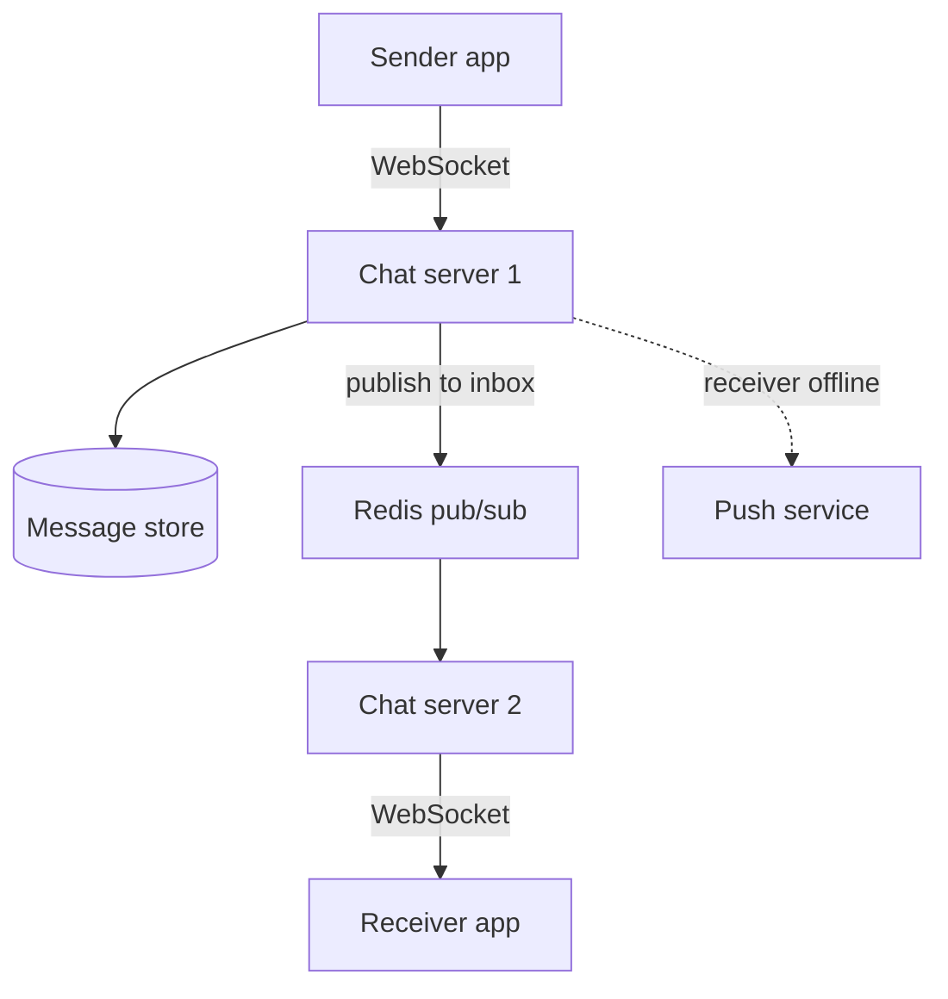
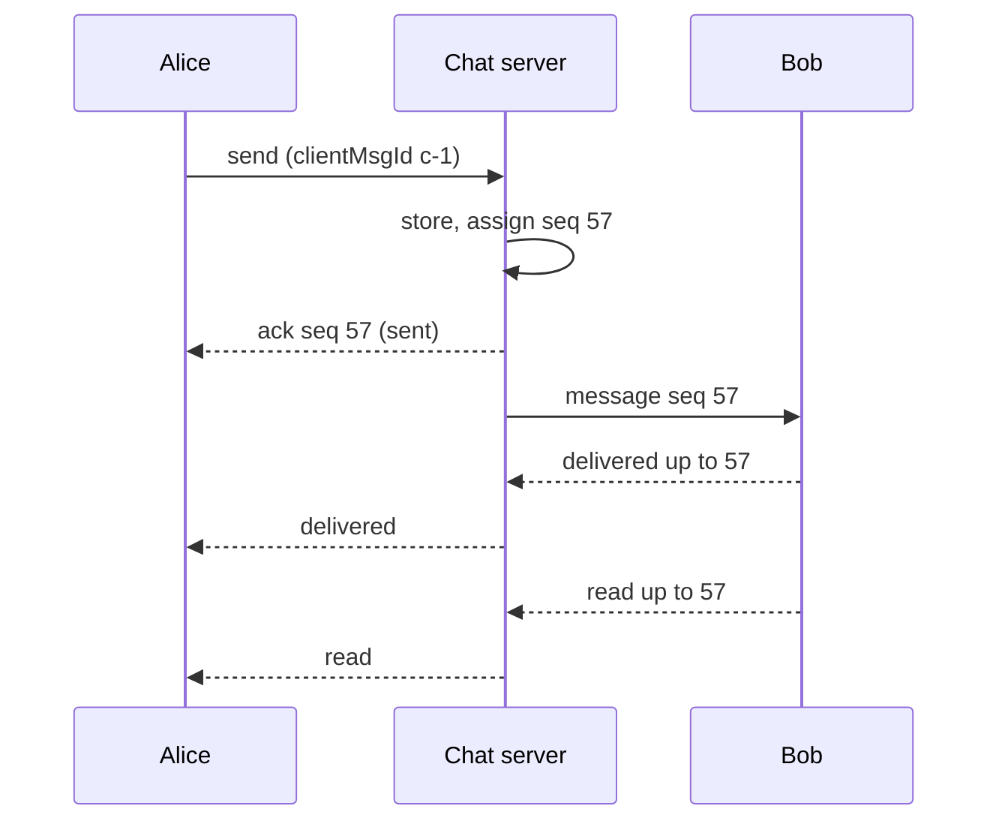

## In one line
A chat system keeps a live connection open to every online user, stores each message with an order number per conversation, and routes it to whichever server the recipient is connected to, with receipts confirming each step.

## The problem it solves
Your video app adds direct messages and small group chats: viewers message creators, friends plan watch parties. Users expect what every messaging app does: messages appear instantly, in the right order, never get lost, and show ticks for sent, delivered, and read.

Normal web requests can't do this. In HTTP, the client asks and the server answers. The server can't suddenly send "you have a new message" to a phone that didn't ask. And with 40 chat servers, the sender and the receiver are usually connected to **different** servers. This design is about those two problems, plus ordering and delivery guarantees.

## Everyday analogy
A postal sorting office with a post box for every resident. Letters get a stamped sequence number when they arrive. If the resident is home, a courier delivers right away and gets a signature (delivered). Later the resident opens it (read). If they're away, the letter waits in their box and a postcard tells them it's there (a push notification).

Where it breaks down: real post takes days. Chat must do all of this in a fraction of a second, for millions of residents at once.

## How it works

**1. Requirements.**
- Functional: one-to-one and group chats (up to 100 members, an assumption to state); message history; sent, delivered, and read receipts; online status; push notifications for offline users.
- Non-functional: low delivery delay (a few hundred milliseconds at most), messages never lost, messages appear in the same order for everyone in a conversation.

**2. Estimates** (assumptions):
- 10 million daily active users × 40 messages a day = 400 million messages a day. ÷ about 86,400 seconds ≈ **4,600 per second** on average; at 3 times for peak, about **14,000 per second**.
- Storage: 400 million × about 200 bytes = **80 GB a day**, roughly **29 TB a year**.
- Connections: if 20% of daily users are online at peak, that is **2 million** open connections. If one server holds around 50,000 (this depends heavily on memory and tuning, so measure), that is about **40 chat servers**.

**3. API.** Messages travel over a **WebSocket**: a connection that stays open after it is set up, so either side can send at any time. See [Real-time: WebSockets vs SSE vs polling](#/topic/realtime).

```text
client → server  { type: "send", clientMsgId, conversationId, text }
server → client  { type: "ack", clientMsgId, seq }                  (sent ✓)
server → client  { type: "message", conversationId, seq, from, text }
client → server  { type: "delivered" | "read", conversationId, seq }
HTTP: GET /conversations/:id/messages?beforeSeq=500&limit=50        (history)
```

**4. Data model.**
- `messages`: `conversation_id`, `seq`, `sender_id`, `body`, `created_at`. Primary key `(conversation_id, seq)`, so loading the latest 50 messages of one chat is a single range read.
- `conversation_members`: `conversation_id`, `user_id`, `last_delivered_seq`, `last_read_seq`.

At this volume teams often choose a store built for huge write rates and partitioned by `conversation_id`, such as a wide-column database. PostgreSQL works at smaller scale.

**5. High-level design.**


*Notice: chat server 1 doesn't need to know where the receiver is connected. It publishes to the receiver's inbox channel, and whichever server holds that connection delivers it.*

Chat servers are **stateful**: each holds open connections. The load balancer picks a server once, when the connection opens, and it stays there. See [Load balancers](#/topic/load-balancers).

**6. Deep dives.**

**Routing between servers.** Each server subscribes, in **pub/sub** (publish/subscribe messaging), to an `inbox:<userId>` channel for every user connected to it. To deliver, any server publishes to the recipient's channel. Redis pub/sub is fire-and-forget: if nobody is subscribed, the message is dropped. That is fine **only** because the message was already saved; an offline user syncs from the store when they reconnect.

**Fan-out** means copying one message to every recipient. For a 1-to-1 chat that is one publish. For a group of 100, it is up to 100 deliveries. Large broadcast channels (100,000 followers of a creator) flip the approach: members **pull** recent messages when they open the channel, instead of the server pushing to everyone.

**Ordering.** Clocks on phones are wrong and differ from each other, so never order by the client's timestamp. The server assigns each message a **sequence number** per conversation (1, 2, 3…), for example with Redis `INCR seq:<conversationId>` or within the database. Everyone sorts by `seq`.

**Delivery guarantees.** Networks drop connections mid-send. So:
1. The client gives each message a `clientMsgId` and resends until it gets an `ack`.
2. The server stores the message, deduplicating by `clientMsgId`, **before** acknowledging.
3. That combination is **at-least-once delivery with deduplication**, which behaves like exactly-once for the user. See [Idempotency](#/topic/idempotency).
4. On reconnect, the client says "my last `seq` in each conversation is X", and the server sends everything after X.

**Receipts.**


*Notice: receipts say "up to seq 57", not "message 57". One update covers every earlier message too, which saves a lot of writes.*

**Online status (presence).** Each app sends a heartbeat every 30 seconds; the server sets `presence:<userId>` in Redis with a 60-second expiry. No heartbeat, the key expires, the user shows offline. Pushing every status change to every contact is expensive, so many apps fetch presence only for chats currently on screen.

## Real example
**Setup:** Node 18+, `"type": "module"`, `npm install ws redis`, Redis running, `REDIS_URL` set. Start two copies with `PORT=4001` and `PORT=4002` to act as two chat servers. To stay short, this demo skips authentication and the database write; the comments mark where they go.

```js
import { WebSocketServer } from 'ws';
import { createClient } from 'redis';

const pub = createClient({ url: process.env.REDIS_URL });
const sub = pub.duplicate(); // a subscribed connection can't run other commands
await Promise.all([pub.connect(), sub.connect()]);

const wss = new WebSocketServer({ port: Number(process.env.PORT) });

wss.on('connection', async (ws, req) => {
  // Demo only: a real server authenticates a token here, never a query string.
  const userId = new URL(req.url, 'http://localhost').searchParams.get('user');
  const deliver = (raw) => ws.send(raw);
  await sub.subscribe(`inbox:${userId}`, deliver); // messages for this user, from any server

  ws.on('message', async (data) => {
    const { clientMsgId, conversationId, to, text } = JSON.parse(data);
    const seq = await pub.incr(`seq:${conversationId}`); // one order per conversation
    // Real system: INSERT the message into the store here, before acknowledging.
    ws.send(JSON.stringify({ type: 'ack', clientMsgId, seq })); // sender sees "sent"
    const msg = { type: 'message', conversationId, seq, from: userId, text };
    await pub.publish(`inbox:${to}`, JSON.stringify(msg)); // reaches the server holding "to"
  });

  ws.on('close', () => sub.unsubscribe(`inbox:${userId}`, deliver));
});
```

Connect user 981 to the server on 4001 and user 982 to the one on 4002, then have 981 send `{ "clientMsgId": "c-1", "conversationId": "dm:981:982", "to": "982", "text": "Is the live stream at 8?" }`:

```text
981 receives: {"type":"ack","clientMsgId":"c-1","seq":1}
982 receives: {"type":"message","conversationId":"dm:981:982","seq":1,"from":"981","text":"Is the live stream at 8?"}
```

The two users are on different servers, and Redis pub/sub carried the message between them.

## How to say it in an interview

> [!INTERVIEW]
> **30 seconds:** "Clients keep a WebSocket open to a chat server. When a message arrives, the server assigns it a sequence number for that conversation, stores it, and acks the sender. Then it routes it to the recipient's server, for example by publishing to the recipient's channel in Redis pub/sub. If the recipient is offline, they get a push notification and sync missed messages by sequence number when they reconnect. Delivered and read receipts are stored as 'up to sequence N' per member."

> [!INTERVIEW]
> **2 minutes:** Start with the 30-second answer, then add:
>
> "Assuming 10 million daily users sending 40 messages each, that's about 4,600 messages a second on average and around 80 GB a day, so the message store is partitioned by conversation ID. With 2 million concurrent connections and tens of thousands per server, we need dozens of stateful chat servers.
>
> For reliability, the client attaches its own message ID and retries until acked. The server stores before acking and deduplicates on that ID, so delivery is at-least-once but looks exactly-once to users. Ordering uses a server-assigned sequence per conversation, never device clocks.
>
> The tradeoff is with big groups. Pushing every message to every member works for small groups, but for a channel with 100,000 members I'd switch to members pulling recent messages when they open it."

## Follow-up questions interviewers ask

<details>
<summary>How does a message reach a user connected to a different server?</summary>

Through a shared routing layer. Option one: pub/sub, where each server subscribes to the inbox channels of its connected users, and any server publishes to the recipient's channel. Option two: a registry in Redis mapping `user → server`, and servers forward directly to each other. Pub/sub is simpler; the registry avoids sending traffic to servers that don't need it.

</details>

<details>
<summary>Why not order messages by timestamp?</summary>

Device clocks differ and can be wrong by minutes. Two people sending at nearly the same moment could see messages in different orders. A sequence number assigned by the server in one place per conversation gives everyone the same order.

</details>

<details>
<summary>What happens when a user's phone was offline for two days?</summary>

Messages were stored when sent, and a push notification went out. When the app reconnects, it sends the last `seq` it has for each conversation, and the server returns everything newer, in pages. Then the app sends "delivered up to" receipts, which flow back to the senders.

</details>

<details>
<summary>How do read receipts work in a group chat?</summary>

Each member's `last_read_seq` is stored per conversation. "Read by 12 of 30" means counting members whose `last_read_seq` is at least that message's seq. Updating one number per member per conversation is far cheaper than one row per message per reader.

</details>

<details>
<summary>How would you add end-to-end encryption?</summary>

Messages are encrypted on the sender's device with keys only the recipients' devices hold, so the server stores and routes ciphertext it can't read. That means the server can't search messages or scan content. Real protocols for this, such as the Signal Protocol, are complex; use a well-reviewed library and never design your own cryptography.

</details>

## Common mistakes and misconceptions

> [!MISTAKE]
> Acknowledging a message before storing it. If the server crashes in between, the sender saw "sent" but the message is gone. Store first, then ack.

> [!MISTAKE]
> Relying on Redis pub/sub for delivery. It doesn't store anything: a message published while the recipient's server is restarting is simply lost. Pub/sub is the fast path; the message store is the source of truth.

> [!MISTAKE]
> Polling `GET /messages` every second from every client. With millions of users, that is millions of mostly empty requests a second. Use WebSockets, with push notifications for apps in the background.

> [!MISTAKE]
> Treating chat servers like stateless web servers. Deploying or crashing one drops tens of thousands of connections at once. Clients must reconnect with backoff and resync by sequence number.

## Tradeoffs: what this design gives up
- **WebSockets cost resources.** Every online user holds a connection and memory, even when idle. For low-frequency updates, Server-Sent Events or polling may be simpler.
- **Strict per-conversation ordering limits throughput** for a single conversation, since one counter orders it. That is fine for chats, and a problem only for huge broadcast channels.
- **Group size changes everything.** Push-based fan-out is great for small groups and too costly for very large ones.
- **Don't build this for simple notifications.** "Your order shipped" doesn't need a chat system. See [Design: notification system](#/topic/design-notifications).

## Check yourself

<details>
<summary>1. Why must the client attach its own message ID?</summary>

If the connection drops before the ack arrives, the client resends. The server uses the client's ID to spot the duplicate and returns the original ack instead of storing the message twice.

</details>

<details>
<summary>2. The recipient is connected to chat server 7, the sender to chat server 2. How does the message cross over?</summary>

Server 2 stores it, then publishes it to the recipient's inbox channel, for example `inbox:982` in Redis pub/sub. Server 7 subscribed to that channel when the recipient connected, so it receives the message and sends it down the WebSocket.

</details>

<details>
<summary>3. What does a "read up to seq 57" receipt mean, and why use that form?</summary>

The reader has seen every message in that conversation up to and including number 57. One small update covers all earlier messages, instead of one receipt per message.

</details>

## Go deeper
- [MDN: The WebSocket API](https://developer.mozilla.org/en-US/docs/Web/API/WebSockets_API)
- [Redis docs: pub/sub](https://redis.io/docs/latest/develop/interact/pubsub/)
