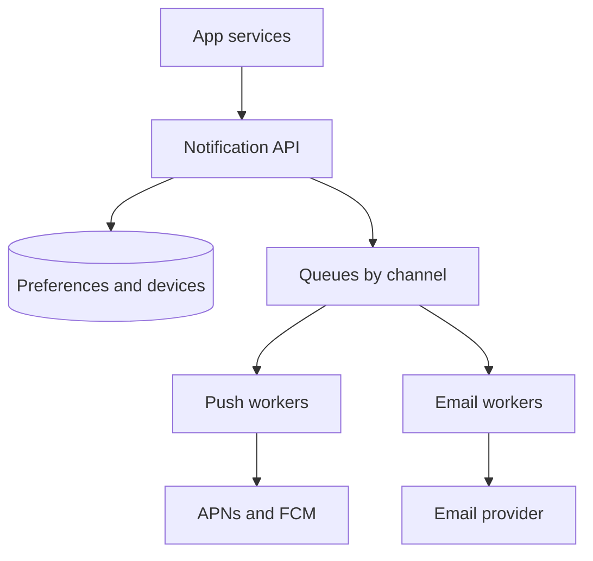
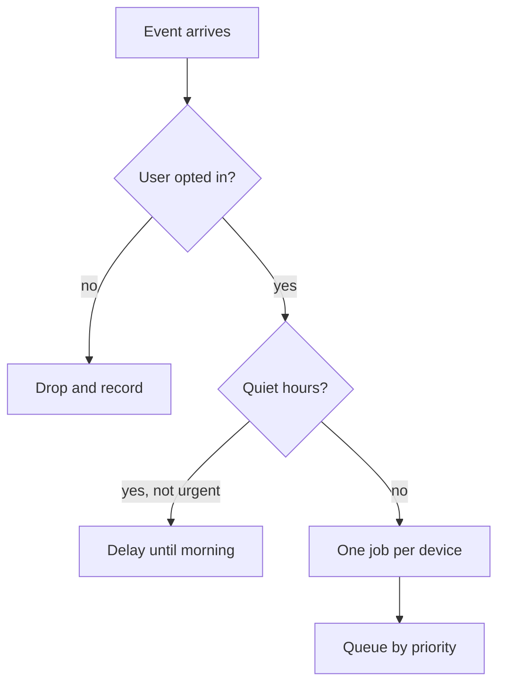

## In one line
A notification system takes events like "order shipped", checks what each user wants, and pushes the message through queues to push, email, and SMS providers, retrying failures without ever sending the same thing twice.

## The problem it solves
Your app needs to tell users things:

- "Your order 5003 has shipped" (push and email).
- "Your login code is 418204" (SMS, and it must arrive in seconds).
- "A creator you follow just went live" (push, to 1 million followers at once).

The naive version calls the email provider inside the checkout request. Then the provider is slow and checkout hangs. A retry sends the email twice. A user who turned off marketing emails gets one anyway. A creator going live tries to send a million pushes in one request and times out halfway.

A notification system is a separate part of the backend that every other service hands notifications to. It owns user preferences, delivery, retries, and deduplication, so the rest of the app just says "notify user 981 that order 5003 shipped".

## Everyday analogy
A post office. Shops drop letters at the counter and leave. Staff check the address book (is this resident still accepting post?), sort letters into trucks by type (express first), and couriers deliver. If nobody answers, they try again later. If the house no longer exists, they stop sending there.

Where it breaks down: a post office rarely receives a million letters for the same street in one minute. Notification systems face that whenever a big creator goes live.

## How it works

**1. Requirements.**
- Functional: channels are **push** notifications (messages shown on a phone even when the app is closed), email, SMS, and in-app; triggered by events from other services; per-user preferences and opt-outs per channel and type; templates.
- Non-functional: no duplicates, no lost notifications, urgent ones (login codes) never wait behind bulk ones (marketing), and provider outages don't break the services that send.

**2. Estimates** (assumptions):
- 10 million users, about 5 notifications each per day: 50 million a day ÷ 86,400 ≈ **580 per second** on average.
- The spike: a creator with 1 million followers goes live, and we want everyone notified within 2 minutes. 1,000,000 ÷ 120 s ≈ **8,300 per second**, about 14 times the average. The design must absorb bursts.
- SMS costs real money per message, so it should be reserved for codes and critical alerts.

**3. API.** Internal only. Services call it and get `202 Accepted` right away, meaning "received, will be sent":

```text
POST /internal/notifications
{ "userId": 981, "type": "order-shipped", "eventId": "order-5003-shipped",
  "data": { "orderId": 5003 } }
```

**4. Data model.**
- `notification_preferences`: `user_id`, `type`, `channel`, `enabled`.
- `devices`: `id`, `user_id`, `platform` (iOS or Android), `push_token`, `updated_at`. A **push token** is the address a phone gets from Apple's or Google's push service for one app on one device.
- `notifications`: `id`, `user_id`, `type`, `channel`, `status` (queued, sent, failed), `event_id`, `created_at`. Used for history, the in-app inbox, and debugging.

**5. High-level design.**


*Notice: app services stop at the Notification API. Everything slow or flaky (providers) sits behind queues, where retries can't hurt anyone.*

**APNs** (Apple Push Notification service) and **FCM** (Firebase Cloud Messaging, Google's) are the services that actually reach iPhones and Android phones. Email and SMS go through providers such as Amazon SES or Twilio.

**6. Deep dives.**

**The pipeline for one notification.**


*Notice: preference and timing checks happen once, before anything is queued, so workers only deliver.*

**Priorities.** Login codes and marketing must not share one line. Use separate queues, or job priorities, so a 1-million-push marketing burst can't delay a password reset.

**Deduplication.** Queues deliver **at least once**: a worker can crash after sending but before recording success, and the job runs again. And upstream services retry, so the same event can arrive twice. Defences:
- Every request carries an `eventId`. The job ID is built from it, so a repeated event creates no new job.
- Workers record what they sent and skip repeats.
A small chance of a duplicate push remains if a worker dies at exactly the wrong moment. That is usually accepted; a lost login code is not. See [Idempotency](#/topic/idempotency).

**Retries.** Retry only **temporary** failures: timeouts, `429 Too Many Requests`, `5xx` errors. Wait longer each time (**exponential backoff**). Don't retry permanent ones: if APNs answers `410` or FCM reports the token `UNREGISTERED`, the app was uninstalled, so delete the token. Jobs that keep failing go to a **dead-letter queue** for inspection. See [Retries, backoff, and dead-letter queues](#/topic/retries-backoff-dlq).

**Big fan-out.** "Creator went live" is one event that becomes a million jobs. A fan-out job reads followers in pages of, say, 1,000 and enqueues their jobs, so no single step holds a million rows. Workers scale out to drain the queue, limited by each provider's rate limits.

**Respect the user.** Cap marketing per user per day, batch noisy events into digests ("12 new comments"), and honour unsubscribe links. Many countries legally require working unsubscribe links in marketing email.

## Real example
**Setup:** Node 18+, `"type": "module"`, `npm install bullmq ioredis` (recent BullMQ versions need `ioredis` installed alongside), Redis running, `REDIS_HOST` and `REDIS_PORT` set. `wantsNotification`, `getDevices`, `removeDevice`, and `sendPush` are your own functions: database lookups, and a call to APNs or FCM through their SDK that returns `'ok'`, `'retry'`, or `'invalid-token'`.

**Enqueue one job per device** (`notify.js`):

```js
import { Queue } from 'bullmq';
import { wantsNotification, getDevices } from './store.js';

export const connection = { host: process.env.REDIS_HOST, port: Number(process.env.REDIS_PORT) };
export const pushQueue = new Queue('push', { connection });

// eventId identifies the business event, e.g. "order-5003-shipped".
export async function notify(userId, type, message, eventId) {
  if (!(await wantsNotification(userId, type, 'push'))) return; // user opted out
  for (const device of await getDevices(userId)) {
    await pushQueue.add(type, { deviceId: device.id, token: device.token, message }, {
      jobId: `${eventId}-device-${device.id}`,      // same event twice: one job, not two
      attempts: 5,                                    // first try + up to 4 retries
      backoff: { type: 'exponential', delay: 2000 },  // wait 2 s, 4 s, 8 s, 16 s
      priority: type === 'login-code' ? 1 : 10,       // lower number = sent first
      removeOnComplete: { age: 86400 },               // keep a day, so duplicates are caught
    });
  }
}
```

One job per device matters: if a user has a phone and a tablet and the tablet send fails, the retry doesn't re-send to the phone. And a job ID only blocks duplicates while the job is still stored, which is why completed jobs are kept for a day.

**The worker** (`worker.js`):

```js
import { Worker, UnrecoverableError } from 'bullmq';
import { connection } from './notify.js';
import { sendPush, removeDevice } from './store.js';

new Worker('push', async (job) => {
  const { deviceId, token, message } = job.data;
  if (!message?.title) throw new UnrecoverableError('Bad payload'); // retrying won't help

  const result = await sendPush(token, message); // your APNs / FCM call
  if (result === 'invalid-token') {
    await removeDevice(deviceId);                // app uninstalled: stop sending to it
    return 'device removed';
  }
  if (result === 'retry') throw new Error('Provider busy'); // BullMQ retries with backoff
  return 'sent';
}, { connection, concurrency: 20 }); // up to 20 sends at once per worker process
```

With a stub provider that fails twice and then succeeds, calling `notify` twice for `order-5003-shipped` created 2 jobs (one per device), not 4. The phone's job failed twice and succeeded on the third attempt; the uninstalled device's token was removed without retries.

## How to say it in an interview

> [!INTERVIEW]
> **30 seconds:** "Services send events to a notification service and get an immediate 202. It checks user preferences and quiet hours, then puts one job per device or address on queues per channel, with separate priorities so login codes never wait behind marketing. Workers call APNs, FCM, or the email and SMS providers, retrying temporary failures with exponential backoff and deleting dead tokens. Every event has an ID, so retries never create duplicate notifications."

> [!INTERVIEW]
> **2 minutes:** Start with the 30-second answer, then add:
>
> "The hard part is bursts. Average load might be a few hundred a second, but a creator with a million followers going live means about 8,000 a second for two minutes. So a fan-out job pages through followers and enqueues jobs in batches, and workers scale out, limited by provider rate limits.
>
> Delivery is at-least-once, because queues redeliver after crashes. I'd make jobs idempotent with an event ID as the job ID and a record of what was sent. A rare duplicate push is the accepted tradeoff; a lost password-reset code isn't.
>
> I'd also protect users: per-user caps on marketing, digests for noisy events, and quiet hours by the user's time zone. A notification system that spams people gets the app's notifications turned off entirely."

## Follow-up questions interviewers ask

<details>
<summary>How do you stop a marketing blast from delaying login codes?</summary>

Separate them. Use different queues, or priorities within one queue, and dedicated workers for urgent types. Then a million queued marketing pushes can't sit in front of a login code. Rate limits for bulk sends also leave provider capacity free for urgent ones.

</details>

<details>
<summary>How do you guarantee a notification is sent exactly once?</summary>

You can't fully, across a network: a worker can send and crash before recording it. You get close with at-least-once delivery plus deduplication: event IDs as job IDs, a unique constraint on `(event_id, channel, device)` in the database, and checking before sending. Be honest that a rare duplicate is the tradeoff for never losing one.

</details>

<details>
<summary>What happens when a provider like FCM is down for 10 minutes?</summary>

Sends fail with temporary errors, and jobs retry with exponential backoff. The queue grows, which is fine: it is a buffer. When the provider recovers, workers drain the backlog. Time-sensitive notifications ("live now") may deserve an expiry, so users don't get stale ones an hour late.

</details>

<details>
<summary>How do you handle time zones and quiet hours?</summary>

Store each user's time zone. Non-urgent notifications that fall in their quiet hours, say 22:00 to 08:00 local time, are scheduled for the morning with a delayed job. Urgent ones like security alerts and login codes skip the check.

</details>

<details>
<summary>How do you track whether notifications actually work?</summary>

Record status per notification: queued, sent, failed. Providers report more through webhooks: email bounces, spam complaints, and delivery receipts. Track open or click rates by type. Rising bounce or complaint rates are an early warning: email providers may throttle or block senders whose complaint rates stay high.

</details>

## Common mistakes and misconceptions

> [!MISTAKE]
> Sending notifications inside the user's request. If the email provider is slow, checkout is slow. Enqueue and return; workers send.

> [!MISTAKE]
> One job per user with all devices inside. A retry after a partial failure re-sends to devices that already got it. Use one job per device or address.

> [!MISTAKE]
> Retrying every error. Retrying "invalid token" or "bad request" can never succeed; it wastes capacity and can get you rate limited. Classify errors as temporary or permanent.

> [!MISTAKE]
> Ignoring preferences for "important" product messages. Users who get unwanted notifications turn off all of them at the OS level, and then even critical ones can't reach them.

## Tradeoffs: when NOT to use it
- **Small apps.** If you send a few hundred emails a day, a background job that calls the provider is enough. You don't need preference services, priority queues, and fan-out jobs yet. See [Why background jobs exist](#/topic/background-jobs).
- **Real-time conversation.** Notifications are one-way and can arrive seconds late. Chat needs live connections. See [Design: chat application](#/topic/design-chat).
- **Don't build your own push delivery.** Reaching phones requires APNs and FCM; a third-party notification platform may be cheaper than building all of this.

## Check yourself

<details>
<summary>1. Why does the Notification API return 202 instead of 200?</summary>

202 Accepted means the request was received and will be processed later. The notification is queued, not yet sent, so 200 would wrongly suggest it was delivered.

</details>

<details>
<summary>2. APNs says a token is no longer valid. What should the worker do?</summary>

Delete that token from the devices table and stop, without retrying. The app was uninstalled or the token changed; retrying can never succeed.

</details>

<details>
<summary>3. The same "order shipped" event arrives twice from the orders service. How does the design avoid two pushes?</summary>

The event carries an ID, and the job ID is built from it plus the device. Adding a job with an ID that already exists does nothing, so only one job, and one push, is created per device.

</details>

## Go deeper
- [BullMQ docs: retrying failing jobs](https://docs.bullmq.io/guide/retrying-failing-jobs)
- [Firebase docs: manage FCM registration tokens](https://firebase.google.com/docs/cloud-messaging/manage-tokens)
- [Apple docs: handling notification responses from APNs](https://developer.apple.com/documentation/usernotifications/handling-notification-responses-from-apns)
