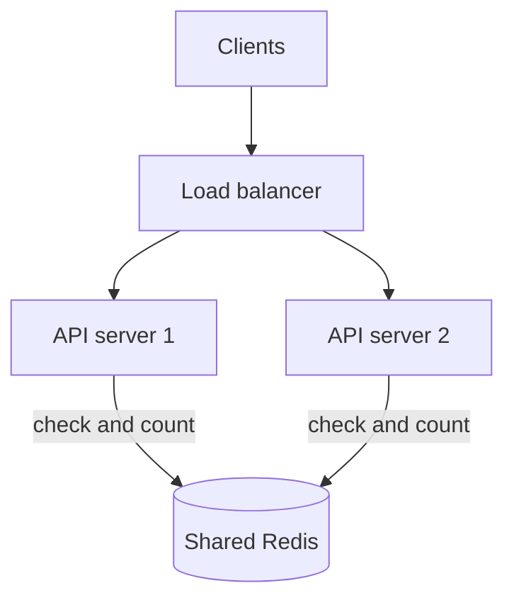
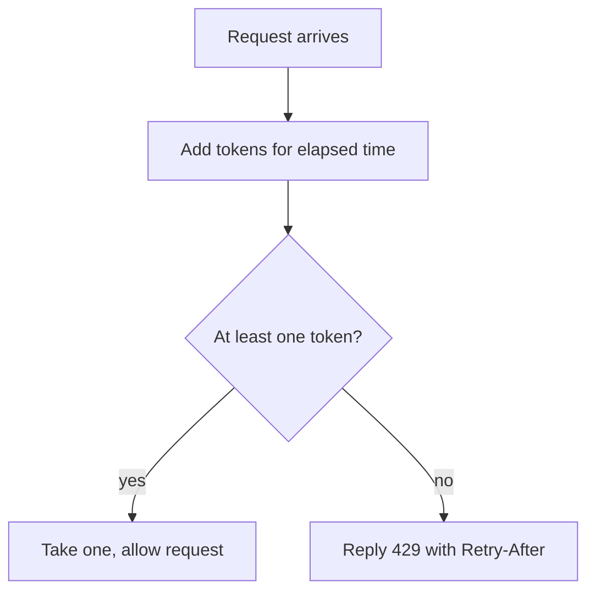

## In one line
A distributed rate limiter counts each client's requests in a shared store like Redis, so that all your servers together enforce one limit, using an algorithm that decides how strictly bursts are handled.

## The problem it solves
Your shop's API runs on 10 servers. One customer's buggy script calls `GET /api/products` 2,000 times a second. Another bot tries thousands of passwords on `/login`. Both slow the site for everyone and run up your database bill.

**Rate limiting** caps how many requests a client may make in a period, like "100 per minute". The basics, and simple single-server setups, are in [Rate limiting and brute-force protection](#/topic/rate-limiting). This topic is the system design version: how do 10 servers agree on one count, which algorithm do you choose, and what happens when the limiter itself breaks?

If each server counts on its own, a client allowed 100 a minute actually gets up to 1,000, because the load balancer spreads its requests over 10 servers that each allow 100.

## Everyday analogy
A ticket machine at a busy museum hands out entry tokens. It holds at most 20, and adds one new token every few seconds. A tour group can rush in using all 20 at once, but after that, people get in only as fast as tokens appear. That is the **token bucket** algorithm.

Where it breaks down: a museum has one machine. Your API has 10 doors (servers), so they must all share one machine: a central store.

## How it works

**1. Requirements.**
- Functional: limit by user ID for logged-in calls and by IP address for anonymous ones; different rules per endpoint (`/login`: 5 per minute; general API: bursts of 20, then 5 per second); reject with `429 Too Many Requests` and a `Retry-After` header saying how many seconds to wait.
- Non-functional: one limit across all servers; adds very little latency (around a millisecond); if the limiter breaks, the API keeps working.

**2. Estimates** (assumptions):
- Peak traffic 20,000 requests a second across all servers. Each makes one call to the limiter store, so **20,000 operations a second**. A single Redis instance typically handles this, but measure with `redis-benchmark` on your hardware.
- 1 million active clients × roughly 100–200 bytes per counter ≈ **100–200 MB** of memory. Small.

**3. API.** It is internal: `check(key, rule) → { allowed, remaining, retryAfter }`. Clients see only the HTTP response: `429`, `Retry-After`, and often an `X-RateLimit-Remaining` header. (A standard `RateLimit` header is being drafted at the IETF; many APIs still use their own `X-` headers.)

**4. Data model.** One small Redis entry per client per rule, for example `rl:user:981`. Each one expires on its own when the client goes quiet.

**5. High-level design.** The limiter runs as middleware inside each API server, or in the API gateway, and keeps all counts in one shared Redis.


*Notice: both servers ask the same Redis, so a client's requests are counted together no matter which server receives them.*

**6. Deep dive: choosing the algorithm.**

| Algorithm | How it works | Strength | Weakness |
|---|---|---|---|
| **Fixed window** | One counter per minute: `INCR rl:981:12:05`, expiring after 60 s | Simplest, tiny memory | Burst at the boundary: 100 requests at 12:05:59 and 100 more at 12:06:00 means 200 in two seconds |
| **Sliding window log** | Store every request's timestamp (a Redis sorted set); count those in the last 60 s | Exact | Memory grows with each request |
| **Sliding window counter** | Blend this window's and last window's counts by how far into the window you are | Close to exact, tiny memory | An approximation |
| **Token bucket** | A bucket holds up to B tokens and refills at r per second; each request takes one | Allows short bursts but caps the average rate | Two settings to tune |
| **Leaky bucket** | Requests join a queue that drains at a fixed rate | Perfectly smooth output | Queued requests wait; bursts are delayed, not served |

The sliding window counter in numbers: limit 100 a minute, last minute had 80 requests, this minute has 30 so far, and we are 15 seconds in. The estimate is 30 + 80 × (45 ÷ 60) = 30 + 60 = 90, so the request is allowed.

For APIs, **token bucket** is a common default: real clients are bursty (a page load fires 10 calls at once), and token bucket allows that while still capping the long-term rate.


*Notice: there is no background timer refilling buckets. Each request calculates how many tokens accumulated since the last one.*

**7. Deep dive: race conditions.** Two servers read "1 token left" at the same moment, both allow, and both write back 0: two requests passed on one token. The read-calculate-write must be **atomic**, meaning nothing else can run in the middle. Redis runs a **Lua script** (a small program sent to Redis) atomically: no other command runs until it finishes. For fixed windows, `INCR` is already atomic.

**8. Deep dive: when Redis is down.** Choose deliberately:
- **Fail open** (allow everything): the API stays up, unprotected for a while. Usual for general traffic.
- **Fail closed** (reject everything): safer for sensitive endpoints like login or sending SMS codes, where abuse costs money.

## Real example
**Setup:** Node 18+, `"type": "module"`, `npm install express redis`, Redis 7 running, and `clients.js` exporting a connected `redis` client created with `disableOfflineQueue: true` (so calls fail fast when Redis is down).

**The token bucket as a Lua script** (`token-bucket.lua`):

```lua
-- KEYS[1]: the bucket, e.g. rl:user:981
-- ARGV[1]: capacity (max burst)   ARGV[2]: refill rate, tokens per second
local capacity = tonumber(ARGV[1])
local rate     = tonumber(ARGV[2])
local t        = redis.call('TIME')                     -- Redis's clock: same for every server
local now      = t[1] * 1000 + math.floor(t[2] / 1000)  -- milliseconds

local bucket = redis.call('HMGET', KEYS[1], 'tokens', 'ts')
local tokens = tonumber(bucket[1]) or capacity          -- new client: full bucket
local ts     = tonumber(bucket[2]) or now

tokens = math.min(capacity, tokens + (now - ts) / 1000 * rate) -- refill for elapsed time
local allowed = 0
if tokens >= 1 then
  tokens = tokens - 1
  allowed = 1
end

redis.call('HSET', KEYS[1], 'tokens', tokens, 'ts', now)
redis.call('PEXPIRE', KEYS[1], math.ceil(capacity / rate * 1000)) -- idle buckets vanish
return { allowed, math.floor(tokens) }
```

Using Redis's own clock avoids a subtle bug: app servers' clocks differ slightly, which would make refills uneven.

**The Express middleware** (`rateLimit.js`):

```js
import { readFileSync } from 'node:fs';
import { redis } from './clients.js';

const SCRIPT = readFileSync(new URL('./token-bucket.lua', import.meta.url), 'utf8');

export function rateLimit({ capacity, perSecond, keyFn }) {
  return async (req, res, next) => {
    try {
      const [allowed, remaining] = await redis.eval(SCRIPT, {
        keys: [`rl:${keyFn(req)}`],
        arguments: [String(capacity), String(perSecond)],
      });
      res.set('X-RateLimit-Remaining', String(remaining));
      if (allowed === 1) return next();
      res.set('Retry-After', String(Math.ceil(1 / perSecond))); // seconds until a token
      return res.status(429).json({ error: 'Too many requests' });
    } catch (err) {
      console.error('Rate limiter unavailable, allowing request:', err.message);
      return next(); // fail open: a Redis outage shouldn't take the API down
    }
  };
}
```

**Using it:** bursts of 20, then 5 requests a second per user.

```js
app.set('trust proxy', 1); // req.ip is the real client behind one proxy
const perUser = rateLimit({ capacity: 20, perSecond: 5, keyFn: (req) => `user:${req.user?.id ?? req.ip}` });
app.get('/api/products', perUser, listProducts);
```

Sending 25 requests at once: the first 20 return `200`, the last 5 return `429`. One second later, about 5 tokens have refilled and requests pass again. Stopping Redis makes every request pass, with a logged error, because the middleware fails open.

## How to say it in an interview

> [!INTERVIEW]
> **30 seconds:** "I'd put the limiter in middleware or the API gateway, keyed by user ID or IP, with counters in a shared Redis so all servers enforce one limit. I'd use a token bucket, which allows short bursts but caps the average rate, implemented as a Lua script so the check and update are atomic. Over-limit requests get a 429 with Retry-After. If Redis is down, general endpoints fail open and sensitive ones like login fail closed."

> [!INTERVIEW]
> **2 minutes:** Start with the 30-second answer, then add:
>
> "On algorithms: fixed window is simplest, an INCR with an expiry, but allows double the limit across a window boundary. A sliding window log is exact but stores every timestamp. A sliding window counter approximates it cheaply. Token bucket suits APIs because a page load fires several calls at once.
>
> Atomicity matters. If two servers read the counter and write it back separately, both can let a request through on the last token. A Lua script runs atomically in Redis, and using Redis's TIME avoids clock differences between app servers.
>
> At 20,000 requests a second that's 20,000 Redis calls, which one instance typically handles, adding about a millisecond on the same network. For multiple regions, I'd keep a Redis per region and accept that a global limit becomes approximate, rather than pay a cross-region round trip on every request."

## Follow-up questions interviewers ask

<details>
<summary>Why not keep the counters in each server's memory?</summary>

Each server would count only the requests it saw. With 10 servers behind a round-robin load balancer, a client allowed 100 a minute could make about 1,000. Counters also reset on every deploy. In-memory limiting is acceptable only as a rough first defence, or with exactly one server.

</details>

<details>
<summary>What should the key be: IP address, user ID, or API key?</summary>

User ID or API key when the request is authenticated: it is precise and follows the user across networks. IP for anonymous endpoints like login and sign-up. IP limits need care: many users can share one IP (an office, a mobile carrier), so keep IP limits generous, and get the IP right behind a proxy with `trust proxy`. For login, also limit per target account to slow password guessing spread across many IPs.

</details>

<details>
<summary>How does this work across several regions?</summary>

A single global Redis means a cross-region round trip, often around 100 ms, on every request. Usual answer: a limiter per region, each enforcing a share of the limit, or local counting with periodic syncing. Both make the global limit approximate, which is usually acceptable.

</details>

<details>
<summary>How do you protect against a flood that never reaches your app?</summary>

Rate limiting in the app protects your database and business logic, but each rejected request still uses a connection and CPU. Large floods are stopped earlier: at the CDN or a DDoS-protection service, and at the load balancer or Nginx (`limit_req`). Layers work together.

</details>

<details>
<summary>What's the difference between rate limiting and load shedding?</summary>

Rate limiting is per client: "you've used your share". **Load shedding** is for the whole system: "we're overloaded, so we reject some requests now, regardless of who sent them." Both return quick errors to protect the system. See [Designing for failure](#/topic/designing-for-failure).

</details>

## Common mistakes and misconceptions

> [!MISTAKE]
> Read, check, then write the counter in separate commands. Under concurrency, several servers pass the check together. Use `INCR` or a Lua script so the whole step is atomic.

> [!MISTAKE]
> Rate limiting by `req.ip` behind a load balancer without configuring `trust proxy`. Every request appears to come from the load balancer, so all users share one limit and get blocked together.

> [!MISTAKE]
> Returning `500` or `403` for "too many requests". Use `429` with `Retry-After`, so well-behaved clients know to back off and when to retry.

> [!MISTAKE]
> Counters without an expiry. Keys for every client who ever called you pile up in Redis forever.

## Tradeoffs: when NOT to use it
- **A shared Redis limiter isn't free.** It adds a network call to every request and a dependency to run. For a single-server app, in-memory or Nginx's `limit_req` is enough.
- **Exact limits are expensive.** A sliding window log costs memory per request. Most APIs are fine with token bucket or sliding window counter.
- **It doesn't fix overload.** If legitimate traffic is simply too high, rate limiting rejects real customers. Scale, cache, or shed load instead.

## Check yourself

<details>
<summary>1. A fixed-window limit is 100 per minute. How can a client make 200 requests in about two seconds?</summary>

100 requests at 12:05:59, the end of one window, and 100 more at 12:06:00, the start of the next. Each window sees only 100, so all pass.

</details>

<details>
<summary>2. Token bucket with capacity 20 and 5 tokens per second. A client sends 25 requests at once. What happens?</summary>

The first 20 succeed, using up the full bucket. The last 5 get `429`. About one second later, 5 tokens have refilled, so 5 more requests can pass.

</details>

<details>
<summary>3. Why is the token bucket logic written as a Lua script?</summary>

Redis runs a script atomically, so reading the bucket, refilling, taking a token, and saving happen with nothing in between. Separate commands from several servers could interleave and let extra requests through.

</details>

## Go deeper
- [Redis docs: scripting with Lua](https://redis.io/docs/latest/develop/interact/programmability/eval-intro/)
- [RFC 6585: the 429 Too Many Requests status code](https://datatracker.ietf.org/doc/html/rfc6585)
- [Nginx docs: limit_req module](https://nginx.org/en/docs/http/ngx_http_limit_req_module.html)
