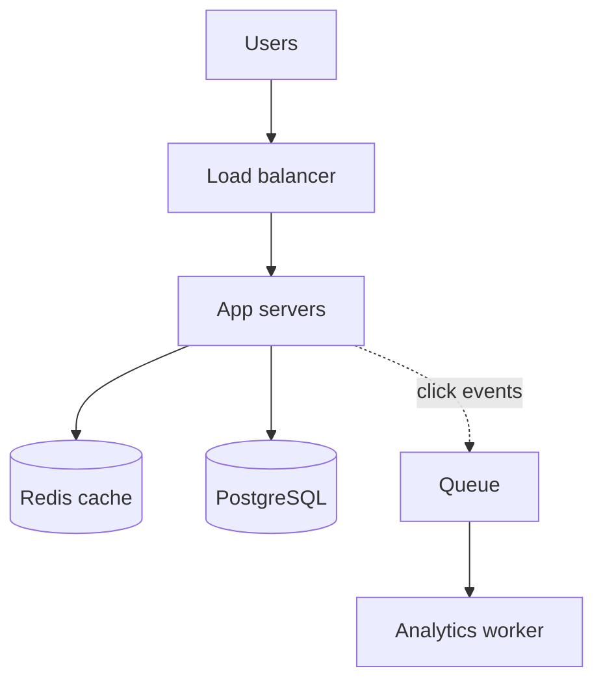
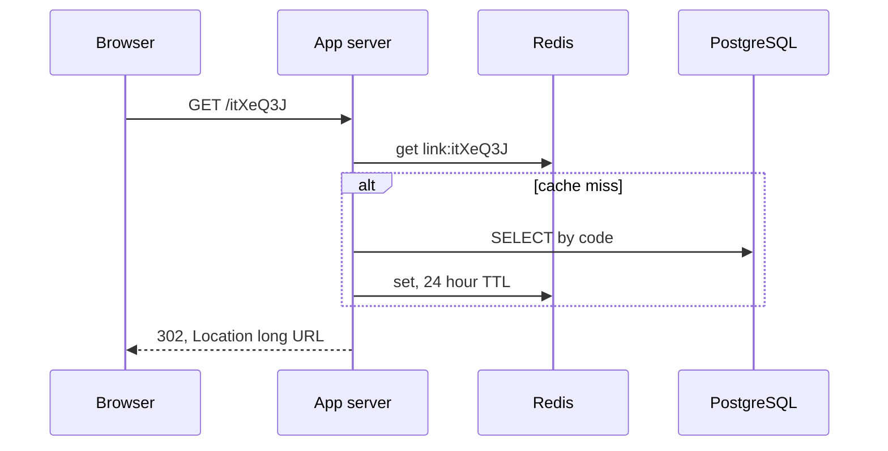

## In one line
A URL shortener stores a short code for each long link and redirects anyone who opens the code, so the design is about generating unique codes and serving a huge number of redirects fast.

## The problem it solves
Your marketing team wants to share `https://shop.example.com/products/42?utm_source=newsletter&utm_campaign=diwali` in a text message. It is ugly, gets cut off, and is hard to type. They want `https://sho.rt/itXeQ3J` instead, plus a count of how many people clicked.

This is a classic interview question because the feature is tiny but the scale is not. Reads (redirects) vastly outnumber writes (new links), every redirect must feel instant, and generating billions of unique short codes hides real tradeoffs. We'll walk through it with the framework from [How to approach system design](#/topic/system-design-approach).

## Everyday analogy
A coat check. You hand over a long coat and get a small numbered ticket. Later, anyone with the ticket gets the coat back. The ticket number must never be given to two coats.

Where it breaks down: a coat check hands each coat back once. A short link is "redeemed" millions of times, and people may try guessing ticket numbers to see other people's coats.

## How it works

**1. Requirements.**
- Functional: create a short link for a long URL; redirect a short code to its long URL; optional expiry date; click counts.
- Non-functional: redirects are fast (well under 100 ms at the server), the service is highly available (a dead shortener breaks every link ever shared), and codes never collide.

**2. Estimates.** These are assumptions to state out loud:
- 100 million new links a month. 100,000,000 ÷ (30 × 86,400 seconds ≈ 2.6 million) ≈ **40 writes per second**.
- 100 redirects per link created → about **4,000 redirects per second** on average. Peak at 3 times average: about **12,000 per second**.
- Keep links for 5 years: 100 million × 12 × 5 = **6 billion links**. At about 500 bytes each, 6 billion × 500 B = **3 TB**.

Conclusion: read-heavy (100 to 1), small writes, a few terabytes. Caching the redirects is the main lever.

**3. API.**

```text
POST /api/links   { "url": "https://...", "expiresAt": "2026-12-31" }  → 201 { "code": "itXeQ3J" }
GET  /:code                                                              → 302, Location: <long URL>
```

**4. Data model.** One main table, `links`, with `code` as the **primary key**, so looking up a code uses an index and stays fast even at billions of rows. See [Indexes](#/topic/indexes).

**5. High-level design.**


*Notice: the redirect path touches only Redis in most cases, and click counting happens off to the side so it never slows a redirect.*


*Notice: the browser then requests the long URL directly; the shortener is out of the picture.*

**6. Deep dive: generating the short code.** Codes use **base62**: the characters `0–9`, `a–z`, and `A–Z`, which are safe in URLs. With 7 characters there are 62⁷ ≈ **3.5 trillion** possible codes; with 6, about 56.8 billion.

| Option | How | Pros | Cons |
|---|---|---|---|
| **Counter + base62** | A database sequence gives 1, 2, 3…; encode in base62 (1,000,000,000 → `15FTGg`) | Never collides, shortest codes | Guessable: anyone can walk through codes and see others' links. The counter is a shared point all writers depend on |
| **Hash of the URL** | Hash the long URL (for example SHA-256), keep the first 7 base62 characters | The same URL always gets the same code | Truncated hashes collide, so you still need to check and retry |
| **Random** | 7 random base62 characters from a secure random generator | Unguessable, no coordination between servers | Collisions possible, so insert with a uniqueness check and retry |

**The collision math.** For random (or truncated-hash) codes:
- When n codes already exist out of N possible, a new code collides with probability about n ÷ N. With 6 billion links and 7 characters: 6 × 10⁹ ÷ 3.5 × 10¹² ≈ **0.17%** per insert. One retry almost always fixes it. With 6 characters it would be about 10.6%, which is why we use 7.
- But a first collision arrives much earlier than intuition says. This is the **birthday problem**: there is a 50% chance of at least one collision after about 1.18 × √N codes. For 7 characters that is only about **2.2 million** links. So "collisions are unlikely" is wrong; the database must enforce uniqueness and the code must retry.

We'll use random codes: unguessable, and any app server can generate them without coordination.

**7. Other deep dives.**
- **Caching:** link popularity is very uneven, so a modest Redis cache serves most redirects. Since a code's target never changes, cache it for a long time.
- **Analytics:** don't `UPDATE clicks = clicks + 1` on every redirect; that turns 12,000 reads a second into 12,000 writes. Push click events to a queue and count them in batches. See [Message queues](#/topic/message-queues).
- **Abuse:** rate limit link creation and check new URLs against a malicious-site list. Shorteners are popular with phishers.
- **Growing past one database:** 3 TB fits one PostgreSQL server with read replicas for a long time. If it doesn't, shard by `code`, which spreads evenly because codes are random. See [Replication and sharding](#/topic/replication-sharding).

## Real example
**Setup:** Node 18+, `"type": "module"`, `npm install express pg redis`, PostgreSQL and Redis running, `DATABASE_URL` and `REDIS_URL` set. `clients.js` exports `db` (a `pg.Pool`) and a connected `redis` client, as in [Redis caching](#/topic/redis-caching).

```sql
CREATE TABLE links (
  code       varchar(10) PRIMARY KEY,          -- the index that makes lookups fast
  long_url   text        NOT NULL,
  user_id    bigint,
  created_at timestamptz NOT NULL DEFAULT now(),
  expires_at timestamptz                       -- NULL means never expires
);
```

**Creating a link with a random code** (`links.js`):

```js
import { randomInt } from 'node:crypto';
import { db } from './clients.js';

const ALPHABET = '0123456789abcdefghijklmnopqrstuvwxyzABCDEFGHIJKLMNOPQRSTUVWXYZ';
const randomCode = (len = 7) =>
  Array.from({ length: len }, () => ALPHABET[randomInt(62)]).join(''); // secure, unbiased

export async function createLink(longUrl, userId) {
  const url = new URL(longUrl);                        // throws on invalid input
  if (!['http:', 'https:'].includes(url.protocol)) throw new Error('Only http(s) links');

  for (let attempt = 0; attempt < 5; attempt++) {
    const code = randomCode();
    try {
      await db.query('INSERT INTO links (code, long_url, user_id) VALUES ($1, $2, $3)',
        [code, url.href, userId]);
      return code;
    } catch (err) {
      if (err.code !== '23505') throw err; // 23505 = unique violation: code taken, retry
    }
  }
  throw new Error('Could not generate a unique code');
}
```

Checking `javascript:` and other schemes matters: otherwise your trusted domain could redirect people into a script.

**The redirect** (`server.js`):

```js
import express from 'express';
import { db, redis } from './clients.js';

const app = express();
const DAY = 86400;

app.get('/:code', async (req, res, next) => {
  try {
    const key = `link:${req.params.code}`;
    let longUrl = await redis.get(key);                      // most redirects end here
    if (!longUrl) {
      const { rows } = await db.query(`SELECT long_url, expires_at FROM links
        WHERE code = $1 AND (expires_at IS NULL OR expires_at > now())`, [req.params.code]);
      if (!rows[0]) return res.status(404).send('Link not found');
      longUrl = rows[0].long_url;
      const left = rows[0].expires_at ? Math.floor((rows[0].expires_at - Date.now()) / 1000) : DAY;
      await redis.set(key, longUrl, { EX: Math.max(1, Math.min(DAY, left)) }); // never outlive expiry
    }
    res.redirect(302, longUrl); // 302: browsers come back each time, so clicks can be counted
  } catch (err) {
    next(err);
  }
});

app.listen(3000);
```

```bash
curl -i localhost:3000/itXeQ3J
# HTTP/1.1 302 Found
# Location: https://shop.example.com/products/42?utm_source=newsletter
```

## How to say it in an interview

> [!INTERVIEW]
> **30 seconds:** "It's a read-heavy key-value lookup: short code to long URL. Creating a link generates a 7-character base62 code, which gives about 3.5 trillion combinations, and stores it with the code as primary key. Redirects check Redis first, fall back to the database, and return a 302. Click analytics go through a queue so they never slow the redirect. The main design choice is how to generate codes: a counter, a hash, or random with a uniqueness check."

> [!INTERVIEW]
> **2 minutes:** Start with the 30-second answer, then add:
>
> "Assuming 100 million links a month, that's about 40 writes a second but around 4,000 redirects a second, and about 3 TB over five years, so one Postgres primary with replicas and a Redis cache handles it.
>
> For codes, a counter in base62 never collides but makes links guessable and needs a shared counter. I'd pick random codes from a secure generator. Collisions do happen: by the birthday problem, the first one is likely after about two million links. So the primary key enforces uniqueness and the app retries, which at 6 billion links fails less than 0.2% of the time.
>
> 301 versus 302 is a real tradeoff: 301 lets browsers cache the redirect, which saves load but means we stop seeing repeat clicks. If analytics matter, I'd use 302."

## Follow-up questions interviewers ask

<details>
<summary>301 or 302: which redirect should you use?</summary>

A **301** (permanent) lets browsers and proxies cache the redirect, so repeat visits skip your servers entirely. That saves load, but you lose those clicks from your analytics, and you can't change or disable the link for people who cached it. A **302** (temporary) makes the browser ask every time. Choose 302 (or 307) when analytics or editable links matter.

</details>

<details>
<summary>The same long URL is shortened twice. Same code or different?</summary>

Usually different. Different users may want separate click counts and expiry dates. If you want reuse, add an index on `long_url` (or a hash of it) per user, and return the existing code. The hash-based scheme gives deduplication automatically, but across all users, which leaks that someone else shortened the same URL.

</details>

<details>
<summary>How would you support custom aliases like sho.rt/diwali-sale?</summary>

Store them in the same `code` column, so the primary key still guarantees uniqueness. Validate allowed characters and length, block reserved words (`api`, `admin`), and return `409 Conflict` if the alias is taken. Insert directly; don't check first and insert after, because two users could pass the check at the same moment.

</details>

<details>
<summary>How would you scale it to 10 times the traffic?</summary>

Redirects: more app servers behind the load balancer, a larger or clustered Redis, and possibly caching redirects at a CDN edge. Writes: still only about 400 a second, which one primary handles. Storage: shard by code if one database can't hold the data. Analytics: the queue absorbs bursts, and workers scale separately.

</details>

<details>
<summary>How do you stop people from guessing links?</summary>

Use random codes from a cryptographically secure generator, not a counter. 3.5 trillion combinations with only billions used means most guesses miss. Add rate limits per IP on 404s. For truly private links, require login; an unguessable link is obscurity, not access control.

</details>

## Common mistakes and misconceptions

> [!MISTAKE]
> "With trillions of possible codes, collisions won't happen." The birthday problem says the first collision is likely after only a few million random codes. Always enforce uniqueness in the database and retry.

> [!MISTAKE]
> Writing a click count to the database on every redirect. It turns a read-heavy system into a write-heavy one. Send click events to a queue and aggregate them.

> [!MISTAKE]
> Checking whether a code exists, then inserting it. Two servers can pass the check at the same instant. Let the database's unique constraint decide, and handle the error.

> [!MISTAKE]
> Using `Math.random()` for codes. It is not designed to be unpredictable. Use `crypto.randomInt` or `crypto.randomBytes`.

## Tradeoffs: what this design gives up
- **Random codes cost a retry loop** and give no deduplication. A counter would be simpler but guessable.
- **302 redirects cost load.** Every click reaches your servers. That is the price of accurate analytics.
- **Caching delays changes.** If users can edit or delete a link's target, you must delete the cache key too, or wait for the TTL. See [Cache invalidation](#/topic/cache-invalidation).
- **Don't over-build.** A company-internal shortener with a few thousand links needs one small app and one table, not queues and shards.

## Check yourself

<details>
<summary>1. How many codes does 7-character base62 give, and why not 6?</summary>

62⁷ ≈ 3.5 trillion. Six characters give about 56.8 billion. At 6 billion links, a new random 6-character code would collide about 10% of the time, versus about 0.17% with 7.

</details>

<details>
<summary>2. Why is click counting sent to a queue instead of written directly?</summary>

Redirects are the hot path, at thousands per second. Writing to the database on each one adds latency and turns the system write-heavy. A queue lets workers count clicks in batches without slowing redirects.

</details>

<details>
<summary>3. What is the main weakness of a counter-based code?</summary>

It is predictable. Codes are sequential, so anyone can enumerate them and discover other people's links. It also needs a single counter all writers depend on.

</details>

## Go deeper
- [MDN: HTTP redirections (301, 302, 307, 308)](https://developer.mozilla.org/en-US/docs/Web/HTTP/Guides/Redirections)
- [PostgreSQL docs: unique constraints](https://www.postgresql.org/docs/current/ddl-constraints.html#DDL-CONSTRAINTS-UNIQUE-CONSTRAINTS)
- [Node.js docs: crypto.randomInt](https://nodejs.org/api/crypto.html#cryptorandomintmin-max-callback)
