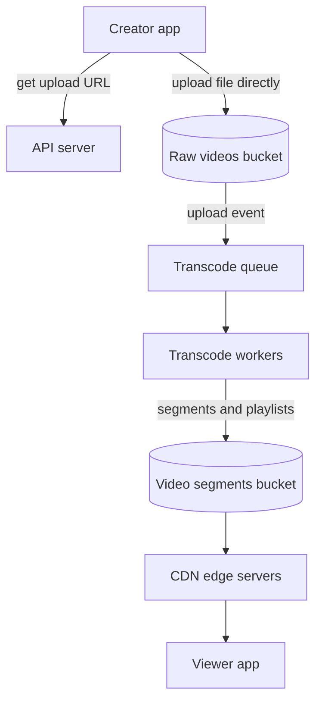
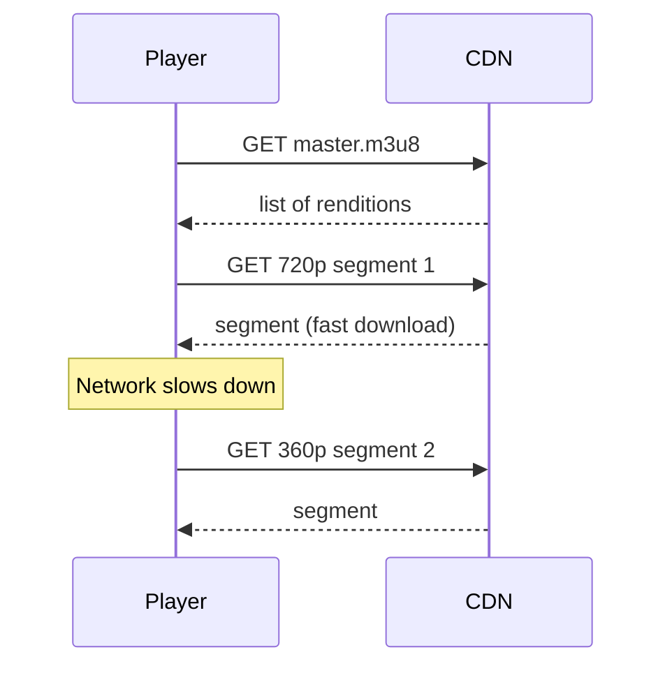

## In one line
A video platform has creators upload a file straight to storage, background workers convert it into several qualities cut into small segments, and a CDN delivers those segments so each viewer's player can switch quality as their connection changes.

## The problem it solves
Creators on your app upload 2 GB phone videos. Viewers watch on fibre at home, on trains with patchy 4G, and on TVs. The naive design fails at every step:

- Uploading 2 GB through your Node API ties up a server for minutes, and a dropped connection at 95% means starting over.
- Serving the original file means a phone on 4G must download a huge 4K file it can't even display, so it buffers forever.
- Serving every view from your own servers means paying for, and providing, enormous bandwidth from one place.

We follow the framework from [How to approach system design](#/topic/system-design-approach).

## Everyday analogy
A newspaper. The writer submits one article (the upload). The print shop produces several editions: broadsheet, tabloid, a large-print version (transcoding into qualities). Bundles go to local newsagents (the CDN), so readers buy from the shop on their street, not the printing press. Each reader picks the edition that suits them, and can switch tomorrow.

Where it breaks down: a video player switches "edition" every few seconds, mid-story, as the network changes.

## How it works

**1. Requirements.**
- Functional: upload videos (up to, say, 10 GB); process them into several qualities; play on phones, browsers, and TVs; show view counts; basic live streaming.
- Non-functional: uploads survive bad connections; playback starts within about 2 seconds and rarely buffers; viewers worldwide; bandwidth and storage costs under control.

**2. Estimates** (assumptions, arithmetic shown):
- Uploads: 50,000 videos a day, 10 minutes each, about 1 GB per original → **50 TB a day** of originals.
- Outputs: four qualities at roughly 5 + 3 + 1.5 + 0.8 ≈ 10 Mbps combined. 10 Mbps × 600 s = 6,000 megabits ≈ 750 MB per video. × 50,000 ≈ **38 TB a day** more.
- Viewing: 5 million daily viewers × 30 minutes at an average 3 Mbps. 1,800 s × 3 Mb = 5,400 megabits ≈ 675 MB per viewer. × 5 million ≈ **3.4 PB a day** delivered.
- Peak: if 10% watch at once, 500,000 × 3 Mbps = **1.5 Tbps**.

The numbers decide the design: storage grows by close to 100 TB a day, and delivery bandwidth dwarfs everything else. No single server room serves 1.5 Tbps, so a **CDN** (a worldwide network of caching servers) is mandatory. See [CDNs](#/topic/cdn).

**3. API.**

```text
POST /api/videos                  { title }   → 201 { videoId, uploadUrl }
POST /api/videos/:id/complete                → 202 (processing starts)
GET  /api/videos/:id              → { title, status, playbackUrl }
     status: uploading → processing → ready | failed
     playbackUrl: https://cdn.example.com/videos/<id>/master.m3u8
```

**4. Data model.**
- `videos`: `id`, `owner_id`, `title`, `status`, `source_key` (where the original sits in storage), `duration_seconds`, `created_at`.
- `renditions`: `video_id`, `height`, `bitrate_kbps`, `playlist_key`. A **rendition** is one quality version of the video.
- View counts live elsewhere (see the deep dive), not as a column updated on every view.

**5. High-level design.**


*Notice: the video file never passes through the API server. It goes straight to storage, and heavy work happens in workers behind a queue.*

**Object storage** (like Amazon S3) stores files ("objects") by name, cheaply and durably, at almost any size. A **presigned URL** is a temporary link, signed by your server, that lets one client upload one specific file directly to storage. See [File uploads](#/topic/file-uploads).

**6. Deep dive: transcoding.** **Transcoding** converts the original into the formats players need. Some terms:
- A **codec** compresses video. H.264 plays almost everywhere; newer codecs such as HEVC and AV1 produce smaller files at the same quality but need more encoding work and aren't supported by every device.
- **Bitrate** is how many bits each second of video uses. Higher bitrate means better quality and bigger files.
- A **bitrate ladder** is the set of renditions you produce. An illustrative H.264 ladder:

| Rendition | Roughly |
|---|---|
| 1080p | 5 Mbps |
| 720p | 3 Mbps |
| 480p | 1.5 Mbps |
| 360p | 0.8 Mbps |

Real ladders are tuned per platform, sometimes per video: a static lecture needs far fewer bits than a football match.

A 2-hour video transcodes slowly on one machine. Workers can split the original into chunks, transcode chunks in parallel on many machines, and join the results.

**7. Deep dive: segments and adaptive streaming.** Instead of one big file, each rendition is cut into **segments** a few seconds long (Apple's HLS guidance targets 6 seconds). Two standard formats describe them:
- **HLS** (HTTP Live Streaming): a **master playlist** (`.m3u8` file) lists each rendition with its bandwidth and resolution; each rendition has a **media playlist** listing its segments in order.
- **DASH** (Dynamic Adaptive Streaming over HTTP): the same idea, with an XML manifest (`.mpd`).

**Adaptive bitrate streaming (ABR)** is what the player does with them:


*Notice: the player chooses the quality for each segment, so switching happens between segments without stopping playback.*

Because segments are ordinary files over HTTP, any CDN can cache them. A segment never changes after it is written, so it can be cached for a very long time.

**8. Other deep dives.**
- **Resumable uploads:** S3 **multipart upload** splits a big file into parts (at least 5 MB each, except the last) that upload separately and can be retried individually. A dropped connection costs one part, not the whole file.
- **View counts:** 500,000 concurrent viewers must not each run `UPDATE videos SET views = views + 1`. Count in Redis (`INCR views:<videoId>`) or send view events to a queue, and write totals to the database every minute.
- **Storage costs:** move originals to cheaper, slower storage classes after processing.
- **Live streaming:** the streamer's app sends a continuous stream to an **ingest** server, commonly over **RTMP** (a streaming protocol many broadcasting tools support). The server transcodes in real time into a ladder, writes segments every few seconds, and keeps updating the playlist; the CDN serves it like any HLS stream. Standard HLS typically lags real life by several seconds or more. Low-Latency HLS cuts that to a few seconds, and WebRTC can go below a second, at higher cost and complexity.

## Real example
**1. Hand out a presigned upload URL.** **Setup:** `npm install @aws-sdk/client-s3 @aws-sdk/s3-request-presigner`, AWS credentials in the environment, `RAW_BUCKET` set, and a `videos` table. (Newer AWS SDK releases require Node 22 or later.)

```js
import { S3Client, PutObjectCommand } from '@aws-sdk/client-s3';
import { getSignedUrl } from '@aws-sdk/s3-request-presigner';
import { randomUUID } from 'node:crypto';

const s3 = new S3Client({ region: process.env.AWS_REGION });

// Step 1 of an upload: create the video row and hand back a one-time upload URL.
export async function startUpload(db, ownerId, title) {
  const videoId = randomUUID();
  const sourceKey = `raw/${videoId}.mp4`;
  await db.query(
    `INSERT INTO videos (id, owner_id, title, status, source_key)
     VALUES ($1, $2, $3, 'uploading', $4)`, [videoId, ownerId, title, sourceKey]);

  const uploadUrl = await getSignedUrl(s3, new PutObjectCommand({
    Bucket: process.env.RAW_BUCKET,
    Key: sourceKey,
    ContentType: 'video/mp4',
  }), { expiresIn: 900 }); // works for 15 minutes, for this one file only

  return { videoId, uploadUrl };
}
```

The app then sends the file with `PUT uploadUrl`. For multi-gigabyte files, use multipart upload instead.

**2. Transcode into HLS.** What a worker runs, using **ffmpeg** (the standard open-source video tool; `sudo apt install ffmpeg` on Ubuntu). It produces 720p and 360p renditions, 6-second segments, and a master playlist:

```bash
ffmpeg -i upload.mp4 \
  -filter_complex "[0:v]split=2[a][b];[a]scale=-2:720[v720];[b]scale=-2:360[v360]" \
  -map "[v720]" -map 0:a -map "[v360]" -map 0:a \
  -c:v libx264 -b:v:0 3000k -b:v:1 800k \
  -c:a aac -b:a 128k \
  -force_key_frames "expr:gte(t,n_forced*2)" \
  -f hls -hls_time 6 -hls_playlist_type vod \
  -hls_segment_filename "out/%v/seg_%03d.ts" \
  -master_pl_name master.m3u8 \
  -var_stream_map "v:0,a:0 v:1,a:1" out/%v/index.m3u8
```

`-force_key_frames` puts a **keyframe** (a complete picture that decoding can start from) every 2 seconds, so every segment can start cleanly. For a 20-second test video, the output is:

```text
out/master.m3u8          out/0/index.m3u8   out/0/seg_000.ts … seg_003.ts
                         out/1/index.m3u8   out/1/seg_000.ts … seg_003.ts
```

And `master.m3u8` is what the player reads first:

```text
#EXTM3U
#EXT-X-VERSION:3
#EXT-X-STREAM-INF:BANDWIDTH=3329855,AVERAGE-BANDWIDTH=3209911,RESOLUTION=1280x720,CODECS="avc1.64001f,mp4a.40.2"
0/index.m3u8
#EXT-X-STREAM-INF:BANDWIDTH=957546,AVERAGE-BANDWIDTH=942932,RESOLUTION=640x360,CODECS="avc1.64001e,mp4a.40.2"
1/index.m3u8
```

The worker uploads `out/` to the segments bucket, inserts the `renditions` rows, and sets the video's status to `ready`.

## How to say it in an interview

> [!INTERVIEW]
> **30 seconds:** "The creator gets a presigned URL and uploads directly to object storage, using multipart upload so large files can resume. The upload event puts a job on a queue, and transcoding workers produce a bitrate ladder, say 1080p down to 360p, cut into a few seconds per segment with HLS or DASH playlists. Segments go to storage behind a CDN. The player reads the master playlist and picks a quality per segment based on its bandwidth, which is adaptive bitrate streaming."

> [!INTERVIEW]
> **2 minutes:** Start with the 30-second answer, then add:
>
> "The estimates drive it. With 5 million daily viewers watching 30 minutes at about 3 Mbps, that's petabytes a day and over a terabit per second at peak, so the CDN is essential, and segments, which never change, cache very well there.
>
> Transcoding is the heavy compute, so it's async: status goes from uploading to processing to ready, and workers scale with the queue length. Long videos can be split into chunks and transcoded in parallel.
>
> Tradeoffs: more renditions means smoother playback for everyone but more storage and encoding cost. Newer codecs like AV1 save bandwidth but cost more to encode and aren't supported everywhere. For live streaming, the same pipeline runs in real time from an RTMP ingest; standard HLS adds several seconds of delay, and getting near real time means Low-Latency HLS or WebRTC."

## Follow-up questions interviewers ask

<details>
<summary>Why upload directly to object storage instead of through the API?</summary>

A multi-gigabyte upload through Node ties up a server and its bandwidth for minutes and gives no resume support. Object storage is built for large, parallel, resumable uploads. Your API only signs a URL, which takes milliseconds, and stays free for other requests.

</details>

<details>
<summary>How does the player decide which quality to play?</summary>

It measures how fast recent segments downloaded and how many seconds of video are already buffered. If downloads are fast and the buffer is full, it steps up; if the buffer drains, it steps down before playback stalls. It reads the options and their bitrates from the master playlist.

</details>

<details>
<summary>How do you know when transcoding is finished, and what if a worker crashes?</summary>

The worker updates the video's status to `ready` (or `failed`) when it finishes, and the app polls or receives a notification. Jobs are acknowledged only on completion, so if a worker crashes, the queue hands the job to another worker. Transcoding must be safe to repeat: rerunning overwrites the same output files. See [Retries, backoff, and dead-letter queues](#/topic/retries-backoff-dlq).

</details>

<details>
<summary>How does live streaming differ from video on demand?</summary>

Everything happens in real time: the stream arrives continuously, is transcoded as it arrives, and new segments appear every few seconds. The media playlist keeps growing, so the CDN must cache it only briefly while still caching segments for long. Latency becomes a requirement: interaction with chat needs a few seconds at most, which pushes you toward low-latency HLS or WebRTC.

</details>

## Common mistakes and misconceptions

> [!MISTAKE]
> Serving the original upload to viewers. It's huge, in whatever format the phone recorded, and has one quality. Viewers on slow networks buffer endlessly. Always transcode into a ladder.

> [!MISTAKE]
> Transcoding inside the upload request. It takes minutes, the request times out, and the API server's CPU is pinned. Queue it and process it in workers.

> [!MISTAKE]
> "A CDN is optional." At video scale, bandwidth from one origin is both too expensive and too slow for distant viewers. The CDN is the core of delivery.

> [!MISTAKE]
> Updating a view counter row on every play. Popular videos turn that row into a hot spot that blocks itself. Count in memory or events, and write in batches.

## Tradeoffs: when NOT to build this
- **Use a managed video service when you can.** Several cloud providers sell upload, transcoding, and streaming as a service. Building this pipeline only pays off at large scale or with special needs.
- **Short clips may not need a ladder.** A few-second preview can be one small MP4 on the CDN.
- **Every extra rendition costs storage forever.** Produce what your audience's devices and networks actually need.

## Check yourself

<details>
<summary>1. What is in an HLS master playlist, and what is in a media playlist?</summary>

The master playlist lists every rendition with its bandwidth, resolution, and codecs, and points to each one's media playlist. A media playlist lists that rendition's segments in order, with their durations.

</details>

<details>
<summary>2. Why are videos cut into segments of a few seconds?</summary>

So the player can switch quality between segments, start playing after downloading just the first one, and so CDNs can cache small, unchanging files over plain HTTP.

</details>

<details>
<summary>3. 500,000 people watch at 3 Mbps. What bandwidth is that, and what does it tell you?</summary>

500,000 × 3 Mbps = 1,500,000 Mbps = 1.5 Tbps. It tells you delivery must be spread across a CDN close to viewers; no single origin can serve it.

</details>

## Go deeper
- [Apple: HLS authoring specification for Apple devices](https://developer.apple.com/documentation/http-live-streaming/hls-authoring-specification-for-apple-devices)
- [RFC 8216: HTTP Live Streaming](https://datatracker.ietf.org/doc/html/rfc8216)
- [AWS docs: uploading objects using multipart upload](https://docs.aws.amazon.com/AmazonS3/latest/userguide/mpuoverview.html)
