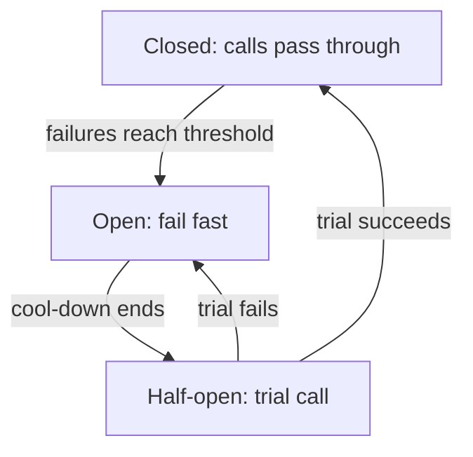

## In one line
Designing for failure means assuming every dependency will sometimes be slow or down, and adding timeouts, careful retries, circuit breakers, and fallbacks so one broken part doesn't take the whole app down with it.

## The problem it solves
Your shop's home page calls a **recommendations service**: a separate service that suggests products. It is a **dependency**: something your code needs in order to finish its work.

One evening the recommendations service gets slow. Requests that took 50 ms now take 30 seconds. Your home page calls it with no timeout, so each home page request waits. Within a minute:

1. Thousands of requests are stuck waiting, each holding memory and a database connection.
2. The database connection pool runs out, so checkout, which never touches recommendations, starts failing too.
3. Your app runs out of memory and restarts, and the waiting requests are lost.

A "nice-to-have" feature took down checkout. This is a **cascading failure**: one failure spreads through the system and causes others. In a system with many parts, something is always slightly broken, so the design must expect it.

## Everyday analogy
The electrical circuit breakers in a house. When one appliance shorts, its breaker trips and cuts power to that circuit only. The fridge and lights stay on. After a while, you flip the breaker back to test whether the fault is gone.

Where it breaks down: a house breaker needs a person to reset it. A software circuit breaker tests and resets itself automatically.

## How it works
Five tools, usually used together:

1. **Timeouts.** Every network call gets a maximum wait. When it passes, give up and handle the error. A good timeout is based on how long the dependency normally takes: if 99% of calls finish within 120 ms (the **p99 latency**), a timeout of a few hundred milliseconds is reasonable. The default in many HTTP clients is to wait a very long time, or forever.
2. **Retries, carefully.** Many failures are brief: a dropped connection, a server restarting. Retrying once often succeeds. But:
   - Retry only **temporary** errors (timeouts, `429`, `5xx`), never `400` or `404`.
   - Retry only operations that are safe to repeat. Retrying a payment can charge twice unless it is **idempotent**. See [Idempotency](#/topic/idempotency).
   - Wait longer each time (**exponential backoff**: 100 ms, 200 ms, 400 ms), and add **jitter**, a random part of the wait, so thousands of clients don't all retry at the same instant.
   - Retry at one layer only. If the browser, gateway, and service each retry 3 times, one failing request becomes 3 × 3 × 3 = 27 calls to an already struggling service.
3. **Circuit breaker.** Wraps calls to one dependency and watches its failures. When failures cross a threshold, it stops calling for a while and **fails fast**: it returns an error immediately instead of waiting for a timeout. That protects your app's resources and gives the dependency room to recover.
4. **Bulkheads.** Named after the walls that divide a ship into watertight sections. Give each dependency its own limited resources, such as a separate connection pool or a cap on concurrent calls, so one slow dependency can't use up everything.
5. **Graceful degradation.** Decide in advance what to show when a dependency fails. No recommendations? Show best-sellers from a cache. Reviews service down? Hide the reviews section. The page works, just with less.

**Inside the circuit breaker: three states.**


*Notice: the breaker never needs a human. The half-open state is how it tests, safely, whether the dependency has recovered.*

- **Closed** (normal): calls go through. Failures are counted.
- **Open**: calls fail immediately, for a cool-down period such as 10 seconds.
- **Half-open**: after the cool-down, a trial call goes through. Success closes the breaker; failure opens it again.

Two related ideas complete the picture. **Load shedding** means an overloaded service rejects some requests quickly (with `503`) so it can serve the rest well, instead of serving everyone slowly. **Health checks** let load balancers stop sending traffic to broken instances. See [Health checks](#/topic/health-checks).

## Real example
**Setup:** Node 18+ (for built-in `fetch` and `AbortSignal.timeout`), `"type": "module"`, `npm install express`, and `RECS_URL` pointing at the recommendations service.

**Retry with backoff and jitter, and a small circuit breaker** (`resilience.js`):

```js
const sleep = (ms) => new Promise((resolve) => setTimeout(resolve, ms));
const isRetryable = (err) =>
  err.name === 'TimeoutError' || err.status === 429 || err.status >= 500;

export async function withRetry(fn, { attempts = 3, baseMs = 100, maxMs = 2000 } = {}) {
  for (let attempt = 1; ; attempt++) {
    try {
      return await fn();
    } catch (err) {
      if (attempt >= attempts || !isRetryable(err)) throw err;    // give up
      const cap = Math.min(maxMs, baseMs * 2 ** (attempt - 1));   // 100, 200, 400 ms...
      await sleep(Math.random() * cap); // "full jitter": a random wait up to the cap
    }
  }
}
```

```js
export class CircuitBreaker {
  constructor({ failureThreshold = 5, cooldownMs = 10_000 } = {}) {
    Object.assign(this, { failureThreshold, cooldownMs, failures: 0, state: 'closed', openedAt: 0 });
  }

  async call(fn) {
    if (this.state === 'open') {
      if (Date.now() - this.openedAt < this.cooldownMs) throw new Error('Circuit open: failing fast');
      this.state = 'half-open';               // cool-down over: allow a trial request
    }
    try {
      const result = await fn();
      this.failures = 0;
      this.state = 'closed';                  // success: back to normal
      return result;
    } catch (err) {
      this.failures++;
      if (this.state === 'half-open' || this.failures >= this.failureThreshold) {
        this.state = 'open';                  // stop calling the struggling service
        this.openedAt = Date.now();
      }
      throw err;
    }
  }
}
```

This breaker is for learning: in half-open, it lets every concurrent request through as a "trial". Production libraries, such as `opossum` for Node, add failure-rate windows, events for monitoring, and more careful half-open handling.

**Putting it together** (`home.js`):

```js
import express from 'express';
import { withRetry, CircuitBreaker } from './resilience.js';

const recsBreaker = new CircuitBreaker({ failureThreshold: 5, cooldownMs: 10_000 });

async function getRecommendations(userId) {
  const res = await fetch(`${process.env.RECS_URL}/users/${userId}/recommendations`, {
    signal: AbortSignal.timeout(300), // a nice-to-have: don't wait long
  });
  if (!res.ok) throw Object.assign(new Error(`recs returned ${res.status}`), { status: res.status });
  return res.json();
}

const getBestSellers = async () => [{ id: 42, name: 'Ceramic mug' }]; // e.g. from Redis

const app = express();
app.get('/api/home/:userId', async (req, res) => {
  try {
    const items = await recsBreaker.call(() =>
      withRetry(() => getRecommendations(req.params.userId), { attempts: 2 }));
    res.json({ items, personalised: true });
  } catch (err) {
    console.warn('Recommendations unavailable:', err.message);
    res.json({ items: await getBestSellers(), personalised: false }); // graceful degradation
  }
});

app.listen(3000);
```

**What happens** when the recommendations service hangs for 5 seconds on every call:
- Requests 1 to 5: two attempts of 300 ms each plus a short jittered wait. Each returns best-sellers after about 0.65 seconds, instead of hanging.
- Request 6 onwards: the breaker is open. Each returns best-sellers in about 10 ms, and the struggling service gets no traffic at all.
- After the service recovers and the 10-second cool-down passes, the next request is a trial. It succeeds, the breaker closes, and personalised results return.

## How to say it in an interview

> [!INTERVIEW]
> **30 seconds:** "I assume every dependency will fail or get slow. Every network call gets a timeout. I retry only temporary errors on idempotent operations, with exponential backoff and jitter, at one layer. A circuit breaker stops calling a failing dependency and fails fast, then tests it again after a cool-down. And I decide fallbacks in advance, like showing best-sellers when recommendations are down, so the core flow, checkout, keeps working."

> [!INTERVIEW]
> **2 minutes:** Start with the 30-second answer, then add:
>
> "The danger is cascading failure. If a slow dependency has no timeout, requests pile up, use up memory and database connections, and unrelated features like checkout start failing too. Bulkheads help: separate connection pools or concurrency limits per dependency.
>
> Retries are a double-edged sword. They fix brief blips, but without backoff and jitter they create synchronized waves, and retrying at every layer multiplies traffic: three layers of three retries is 27 calls per user request. That's why I retry in one place and pair it with a breaker.
>
> The breaker has three states. Closed passes calls and counts failures. Open fails immediately for a cool-down. Half-open lets a trial call through to decide whether to close again. The tradeoff is tuning: a breaker that trips too easily turns small blips into degraded pages; too slowly, and it doesn't protect anything."

## Follow-up questions interviewers ask

<details>
<summary>How do you choose a timeout value?</summary>

From measurements. Look at the dependency's normal latency, especially the p99, and set the timeout a bit above it. Then check the budget: if your endpoint must answer in 1 second, the timeouts and retries of everything it calls must fit inside that. A timeout far above the p99 protects little; one below it fails healthy requests.

</details>

<details>
<summary>Why add jitter to backoff?</summary>

When a service blips, many clients fail at the same moment. With plain exponential backoff, they all retry at exactly 100 ms, then 200 ms, hitting the recovering service in synchronized waves. Random jitter spreads the retries out, so the load arrives smoothly.

</details>

<details>
<summary>What's the difference between a retry and a circuit breaker?</summary>

A retry is optimistic about one request: "try again, it might work." A circuit breaker is about the dependency as a whole: "it has been failing, stop sending it anything for a while." They complement each other: retries handle short blips, and the breaker stops retries from hammering a service that is truly down.

</details>

<details>
<summary>Which operations are safe to retry?</summary>

Reads (`GET`), and writes that are idempotent: `PUT` setting a value, `DELETE`, or a `POST` that carries an idempotency key the server uses to detect repeats. A plain `POST /payments` without such a key is not safe; a timeout doesn't tell you whether the first attempt was charged.

</details>

<details>
<summary>How do you know your failure handling actually works?</summary>

Test it on purpose. In staging, add delays or errors to a dependency and watch what happens. This is the idea behind **chaos engineering**: deliberately injecting failures to find weaknesses before real outages do. Then monitor breaker state changes and fallback rates in production. See [Metrics and alerts](#/topic/metrics-alerts).

</details>

## Common mistakes and misconceptions

> [!MISTAKE]
> No timeout on network calls. Many HTTP clients wait a very long time by default. One slow dependency can then hold every request in your app.

> [!MISTAKE]
> Retrying immediately, forever, at every layer. That turns a small blip into a self-inflicted overload, sometimes called a **retry storm**. Cap attempts, back off with jitter, and retry in one place.

> [!MISTAKE]
> Retrying non-idempotent operations. A timeout on a payment doesn't mean it failed. Retrying without an idempotency key can charge the customer twice.

> [!MISTAKE]
> A fallback that depends on the thing that failed, such as "if the database is down, read the backup from the same database". Fallbacks must use something independent, like a cache or a static default.

## Tradeoffs: when NOT to use it
- **Don't wrap everything in breakers.** In-process code and very reliable local calls don't need them. Each breaker adds tuning and states to reason about.
- **Not every feature can degrade.** Checkout can't "skip payment". For the core path, fail clearly with a helpful error instead of faking success.
- **Retries can hide problems.** If most calls only succeed on the second try, the dependency is sick. Track retry rates, not just final success.
- **Complexity costs.** For a small app with one database and no external services, timeouts and a health check may be all you need.

## Check yourself

<details>
<summary>1. Name the three circuit breaker states and what each does.</summary>

Closed: calls pass through and failures are counted. Open: calls fail immediately for a cool-down period. Half-open: after the cool-down, a trial call passes; success closes the breaker, failure opens it again.

</details>

<details>
<summary>2. The browser, the gateway, and the service each retry a failing call 3 times. How many calls reach the failing dependency?</summary>

Up to 3 × 3 × 3 = 27 for one user action. That is why retries should happen at one layer only.

</details>

<details>
<summary>3. Recommendations are down. What should the home page do?</summary>

Degrade gracefully: show a fallback such as cached best-sellers, mark the result as not personalised, and keep the rest of the page and checkout working. With a circuit breaker open, the fallback is returned immediately.

</details>

## Go deeper
- [AWS Builders' Library: timeouts, retries, and backoff with jitter](https://aws.amazon.com/builders-library/timeouts-retries-and-backoff-with-jitter/)
- [Martin Fowler: Circuit breaker](https://martinfowler.com/bliki/CircuitBreaker.html)
- [Google SRE book: Addressing cascading failures](https://sre.google/sre-book/addressing-cascading-failures/)
