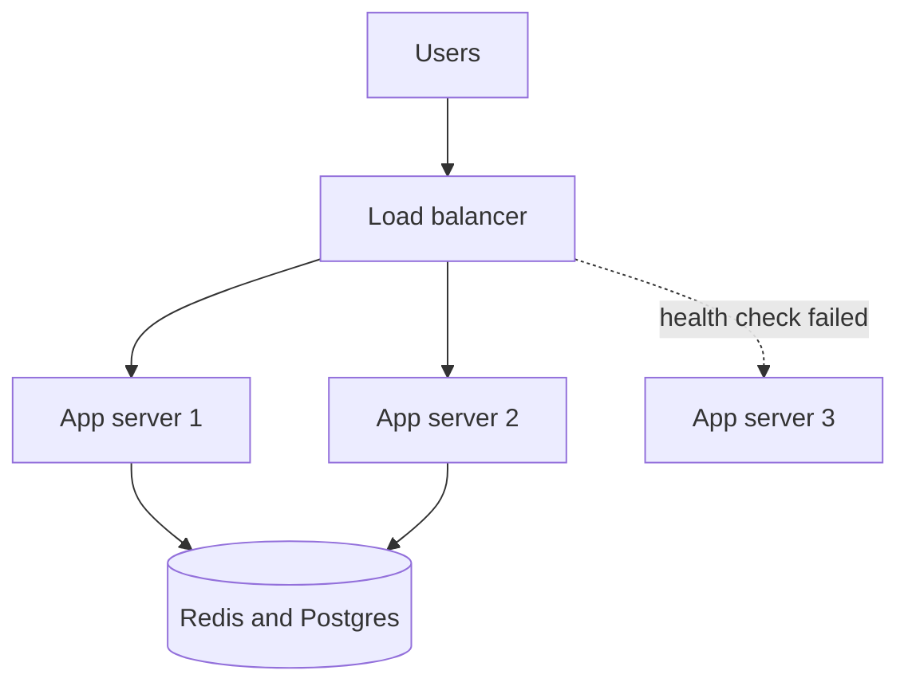

## In one line
A load balancer receives every request and hands each one to one of several identical app servers, and that only works smoothly when those servers keep no user data in their own memory.

## The problem it solves
You now run three copies of your shop's API at `10.0.0.11`, `10.0.0.12`, and `10.0.0.13` (private addresses inside your network). Three questions appear at once:

1. Which address do users connect to? You want one public address, not three.
2. What happens when `10.0.0.12` crashes? Users sent there get errors until someone notices.
3. A user logs in on server 1. Their next request lands on server 2, which has never heard of them. They are suddenly logged out, and their cart is empty.

A **load balancer** fixes the first two: it is a single entry point that spreads requests across healthy servers. The third needs **stateless servers**: servers that store nothing about a user between requests, so any server can handle any request.

## Everyday analogy
The host at a busy restaurant greets every guest and seats them with whichever waiter has the fewest tables. If a waiter goes home sick, the host stops seating guests in their section. The order is written on a shared ticket system, not in a waiter's head, so any waiter can bring the food.

Where it breaks down: a host decides once per visit, but a load balancer decides for every single request, sometimes many per second for one user.

## How it works
1. DNS points `api.example.com` at the load balancer's public IP, for example `203.0.113.10`.
2. A request arrives. The load balancer picks one backend server using its **algorithm**.
3. It forwards the request, waits for the response, and sends it back to the user.
4. In the background, it runs **health checks**: it keeps testing each server and stops sending traffic to any server that fails.
5. Every server reads and writes shared data (sessions, carts, files) in shared stores, so it doesn't matter which one answers.


*Notice: server 3 failed its health check, so it gets no traffic, and no user data is lost because all of it lives in the shared stores.*

**Choosing a server: the common algorithms.**

| Algorithm | How it picks | Good for | Weak spot |
|---|---|---|---|
| **Round robin** | Each server in turn: 1, 2, 3, 1, 2, 3 | Identical servers, similar requests | Ignores that one server may be stuck on slow requests |
| **Weighted round robin** | Like round robin, but a server with weight 2 gets twice the share | Servers of different sizes | Weights are set by hand |
| **Least connections** | The server with the fewest requests in progress | Requests with very different durations, like uploads mixed with quick reads | Needs connection tracking |
| **Hash-based** | Hashes something about the request (client IP, user ID, URL) so the same input always goes to the same server | Keeping a user on one server, or the same URL on one cache server | Uneven load if a few keys are very hot |

A **hash** turns an input into a fixed-looking number. Plain hashing (`hash % number_of_servers`) reshuffles almost every user when you add a server. **Consistent hashing** is a variant where adding or removing a server moves only a small share of keys. That matters for caches, where moving a key means a miss.

**Layer 4 vs Layer 7.** These names come from the OSI model, a standard way of describing network layers.

- A **Layer 4** load balancer works at the TCP/UDP level. It sees only IP addresses and ports, and forwards whole connections without reading the HTTP inside. It is very fast and works for any protocol, including databases. It cannot route by URL.
- A **Layer 7** load balancer reads the HTTP request. It can route `/api/videos` to one group and `/api/orders` to another, add headers, and handle TLS so the app servers don't have to. That is called **TLS termination**. It does more work per request.

Nginx can act as either. In AWS, the Network Load Balancer is Layer 4 and the Application Load Balancer is Layer 7.

**Health checks.** An **active** check calls something like `GET /health` every few seconds. A **passive** check watches real traffic and marks a server down after several failed requests. Open-source Nginx does passive checks. Managed load balancers usually do active ones. See [Health checks](#/topic/health-checks).

## Real example
**Setup:** an Ubuntu server with Nginx installed, and three app servers on a private network, each running the Express app below on port 3000.

`/etc/nginx/conf.d/api.conf`:

```nginx
upstream api_servers {
  least_conn;                                       # fewest active requests wins
  server 10.0.0.11:3000 max_fails=3 fail_timeout=10s; # 3 failures: skip for 10 s
  server 10.0.0.12:3000 max_fails=3 fail_timeout=10s;
  server 10.0.0.13:3000 max_fails=3 fail_timeout=10s;
}

server {
  listen 80;
  server_name api.example.com;
  location / {
    proxy_pass http://api_servers;
    proxy_connect_timeout 2s;                       # give up on a dead server fast
    proxy_set_header Host $host;
    proxy_set_header X-Forwarded-For $proxy_add_x_forwarded_for;
    proxy_set_header X-Forwarded-Proto $scheme;
  }
}
```

If a server refuses the connection, Nginx retries the request on the next server. By default it does **not** retry a `POST` that already reached a server, because sending a payment twice is worse than one error.

Behind a proxy, every request appears to come from the load balancer's IP. The real client IP travels in the `X-Forwarded-For` header. Express reads it only if you tell it to trust the proxy:

```js
import express from 'express';
import os from 'node:os';

const app = express();
app.set('trust proxy', 1); // trust exactly one hop: our Nginx

app.get('/whoami', (req, res) => {
  res.json({
    servedBy: os.hostname(), // which server answered
    clientIp: req.ip,        // real client IP, taken from X-Forwarded-For
  });
});

app.listen(3000);
```

Set `trust proxy` to the exact number of proxies in front. If you trust every hop, a client can send a fake `X-Forwarded-For` and pretend to be any IP, which breaks rate limiting and logs.

Run `sudo nginx -t && sudo systemctl reload nginx`, then stop one app server. Requests keep returning `200`: Nginx skips the dead server and tries again after 10 seconds.

**Making servers stateless:**
- Sessions: store them in Redis, or use signed tokens. See [Sessions vs JWT](#/topic/sessions-vs-jwt).
- Uploads: send them to object storage like S3, not the server's disk.
- Caches: use a shared Redis, not an in-process `Map`.

## How to say it in an interview

> [!INTERVIEW]
> **30 seconds:** "A load balancer is the single entry point in front of several app servers. It picks a server for each request with an algorithm like round robin or least connections, and health checks stop traffic to servers that fail. For that to work, the servers must be stateless: sessions go in Redis or a token, files in object storage, so any server can handle any request."

> [!INTERVIEW]
> **2 minutes:** Start with the 30-second answer, then add:
>
> "The main choice is Layer 4 versus Layer 7. Layer 4 forwards TCP connections without reading them, so it's fast and protocol-agnostic. Layer 7 understands HTTP, so it can route by path, terminate TLS, and add headers like X-Forwarded-For. For a typical web API I'd use Layer 7, like Nginx or an AWS Application Load Balancer.
>
> For the algorithm, least connections usually beats round robin when request times vary a lot, say video uploads mixed with fast reads.
>
> Sticky sessions are a shortcut for stateful apps, but they cause uneven load and users lose their session when their server dies. I'd rather move the state out. Finally, the load balancer itself must not be a single point of failure, so I'd use a managed one or run two with a shared floating IP."

## Follow-up questions interviewers ask

<details>
<summary>What are sticky sessions, and why avoid them?</summary>

**Sticky sessions** (session affinity) make the load balancer send a user to the same server every time, usually with a cookie. They let a stateful app work behind a load balancer. The costs: load becomes uneven, a server's users all lose their sessions when it dies, and draining a server for deployment is slower. They are fine as a temporary step, or for long-lived connections like WebSockets.

</details>

<details>
<summary>What if the load balancer itself fails?</summary>

It is a single point of failure, so run two. A common self-hosted setup uses keepalived: two Nginx machines share a **floating IP**, an address that moves to the standby if the active one stops responding. Managed load balancers from cloud providers are redundant across machines already.

</details>

<details>
<summary>How does a deploy work without dropping requests?</summary>

Take servers out one at a time. Mark a server as draining, so it gets no new requests but finishes the ones in progress. Then deploy, wait for its health check to pass, and put it back. See [Deployment strategies](#/topic/deployment-strategies).

</details>

<details>
<summary>How do WebSockets work behind a load balancer?</summary>

A WebSocket is a long-lived connection, so the load balancer picks a server once and keeps the connection there. That makes load spread by connection count, not requests. Least connections helps. The app must still share state across servers, for example with Redis pub/sub, because two users in one chat may be connected to different servers. See [Design: chat application](#/topic/design-chat).

</details>

<details>
<summary>What should a health check endpoint check?</summary>

At minimum, that the process can answer HTTP. Be careful about checking the database: if the database blips, every server fails its check at once and the load balancer removes all of them, turning a small problem into a full outage. Many teams keep the health check shallow and alert on dependencies separately.

</details>

## Common mistakes and misconceptions

> [!MISTAKE]
> "A load balancer makes each request faster." It spreads load. A slow query is just as slow on any server. It helps only when servers were overloaded.

> [!MISTAKE]
> Keeping sessions in server memory, then adding a load balancer. Users are logged out at random. Move sessions to Redis or use tokens before scaling out.

> [!MISTAKE]
> Logging or rate limiting by `req.socket.remoteAddress` behind a proxy. Every request then has the load balancer's IP, so one abusive client can get everyone blocked. Configure `trust proxy` and use `req.ip`.

> [!MISTAKE]
> "DNS with three IP addresses is load balancing enough." It is crude. Clients cache DNS answers, there are no health checks, and a dead server keeps receiving traffic until the records change and caches expire.

## Tradeoffs: when NOT to use it
- **One server is enough.** A load balancer in front of a single server adds a hop and a component to maintain. You still may want Nginx as a reverse proxy for TLS. See [Nginx as a reverse proxy](#/topic/nginx-reverse-proxy).
- **The bottleneck is elsewhere.** If the database is at 100%, more app servers behind a load balancer send it even more queries.
- **Stateful systems.** Databases and some real-time servers can't be load-balanced naively. Writes usually must go to one primary.

## Check yourself

<details>
<summary>1. Requests take between 5 ms and 30 seconds (video uploads). Round robin or least connections?</summary>

Least connections. Round robin would keep sending new requests to a server busy with several long uploads. Least connections sends them to the server with the fewest requests in progress.

</details>

<details>
<summary>2. What can a Layer 7 load balancer do that a Layer 4 one cannot?</summary>

Read the HTTP request. That lets it route by path or host, terminate TLS, add headers like `X-Forwarded-For`, and set cookies. Layer 4 only sees IP addresses and ports.

</details>

<details>
<summary>3. Your app logs show every request coming from 10.0.0.5. What is wrong?</summary>

That is the load balancer's address. The app is reading the connection's IP instead of the forwarded one. Make the proxy send `X-Forwarded-For`, and set Express's `trust proxy` to the number of proxies in front, so `req.ip` shows the real client.

</details>

## Go deeper
- [Nginx docs: upstream module (algorithms, max_fails)](https://nginx.org/en/docs/http/ngx_http_upstream_module.html)
- [AWS docs: how Elastic Load Balancing works](https://docs.aws.amazon.com/elasticloadbalancing/latest/userguide/how-elastic-load-balancing-works.html)
- [Express docs: behind proxies](https://expressjs.com/en/guide/behind-proxies.html)
