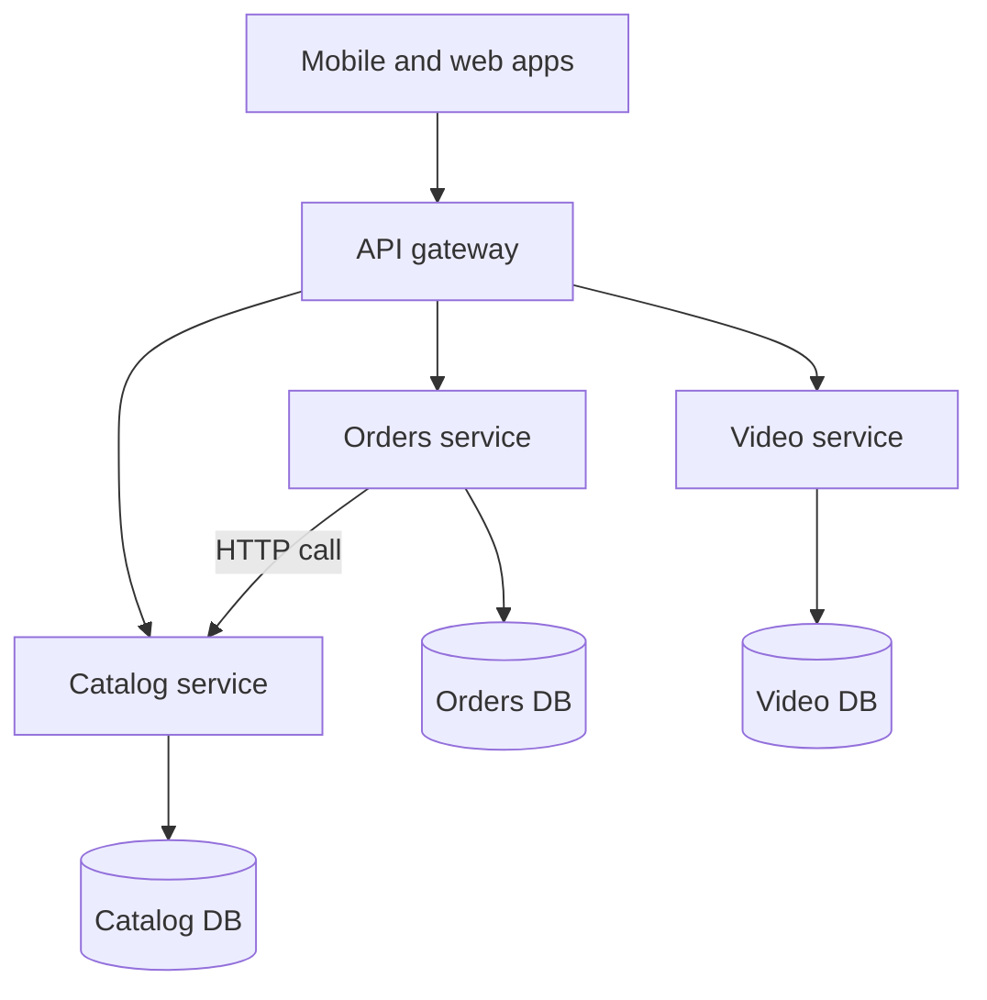

## In one line
A monolith is one application deployed as one unit; microservices split it into many small applications that each own their data and talk over the network, which helps large teams but adds a lot of complexity.

## The problem it solves
Your shop started as one Express app: users, products, orders, and video uploads in one codebase, one database, one deploy. That is a **monolith**. For three developers, it is perfect.

Two years later, 40 developers work in that codebase. Problems appear:

- A small fix to the product page waits for the next shared release, because every change ships together.
- Video transcoding (converting uploads into other formats) eats the CPU and slows down checkout, because they run in the same process.
- One bad deploy in the reviews code takes down payments too.

**Microservices** answer this by splitting the app into separate services, each deployed on its own. A **service** here is a small application that does one business job, like "orders" or "catalog", with its own code, its own database, and an API that others call.

The catch, and the reason interviewers ask: microservices trade code problems for network problems. Most teams should start with a monolith.

## Everyday analogy
A monolith is one restaurant with one big kitchen. A microservices system is a food court: separate stalls, each with its own staff, menu, and opening hours. One stall can renovate without closing the others.

Where it breaks down: in a food court, a meal from two stalls means two queues and two payments. In software, one checkout that touches orders, stock, and payments now needs several network calls that can each fail.

## How it works
**The monolith.**
1. One codebase, built and deployed as one unit.
2. Parts of the app call each other with plain function calls inside the same **process** (a running program). These calls take nanoseconds to microseconds and can't get lost.
3. One database. A checkout can update `orders` and `stock` in one **transaction**: all of it happens, or none of it does.

A **modular monolith** keeps the single deploy but draws hard boundaries inside: the orders module may call the catalog module only through its public functions, never by reading its tables. This gets most of the code-organisation benefits without the network.

**Microservices.**
1. Each service has its own codebase, deploy pipeline, and **database**. No other service reads its tables. This is called **database per service**.
2. Services talk over the network in two ways:
   - **Synchronous:** HTTP/REST or [gRPC](#/topic/grpc) calls. The caller waits for the answer.
   - **Asynchronous:** events through a queue or log, like "OrderPlaced". The sender doesn't wait. See [Message queues](#/topic/message-queues).
3. A single front door, the **API gateway**, routes client requests to the right service. See [API gateways](#/topic/api-gateway).
4. Work that used to be one transaction now spans services. Keeping them in agreement needs patterns like the **saga**: a sequence of local steps, each with an "undo" step if a later one fails. See [Event-driven architecture](#/topic/event-driven).


*Notice: each service owns its database. When orders needs product data, it asks the catalog service over the network instead of reading the catalog's tables.*

**What you gain:** teams deploy independently, each service scales separately (ten transcoding workers, two catalog servers), a crash in one service can be contained, and each service can use the tools that suit it.

**What you pay:** network calls that are slow or fail, data spread across databases, **eventual consistency** (services agree after a short delay, not instantly), many pipelines to run, and debugging that needs [distributed tracing](#/topic/distributed-tracing) to follow one request across services.

**Conway's law** is the observation that a system's structure tends to mirror the communication structure of the team that builds it. That is why microservices are often an organisational decision more than a technical one: they let separate teams own separate services.

## Real example
**A modular monolith first.** One Express app, split by business area:

```text
src/
  catalog/   index.js (public functions), routes.js, db.js
  orders/    index.js, routes.js, db.js
  videos/    index.js, routes.js, transcode-worker.js
  app.js     mounts each module's routes
```

The rule: a module imports only another module's `index.js`, never its `db.js` and never its tables. Pricing an order looks like this:

```js
// src/orders/pricing.js
import { getProductById } from '../catalog/index.js'; // the public API only

export async function priceOrder(items) {
  let totalCents = 0;
  for (const { productId, qty } of items) {
    const product = await getProductById(productId); // in-process: fast, can't time out
    totalCents += product.priceCents * qty;
  }
  return totalCents;
}
```

**The first split.** Video transcoding is CPU-heavy, slow, and has different scaling needs, so it is usually the first thing to pull out, as a separate worker reading jobs from a queue. See [Why background jobs exist](#/topic/background-jobs).

**If catalog later becomes its own service**, the same function becomes a network call (Node 18+ has `fetch` built in):

```js
const CATALOG_URL = process.env.CATALOG_URL; // e.g. http://catalog:3000

export async function getProductById(id) {
  const res = await fetch(`${CATALOG_URL}/products/${id}`, {
    signal: AbortSignal.timeout(2000), // networks hang: always set a timeout
  });
  if (!res.ok) throw new Error(`catalog returned ${res.status}`);
  return res.json();
}
```

Look at what changed. An order with 10 items now makes 10 network calls, each of which can be slow or fail. You would add a batch endpoint (`GET /products?ids=42,43,44`), retries, and a plan for "catalog is down". Because the module boundary was clean, the swap touched one function.

## How to say it in an interview

> [!INTERVIEW]
> **30 seconds:** "A monolith is one deployable application; microservices split it into independently deployed services that each own their data and talk over the network. Microservices let large teams ship independently and scale parts separately, but they add network failures, distributed data, and operational overhead. I'd start with a well-structured modular monolith and extract a service only when there's a clear reason, like a team boundary or very different scaling needs."

> [!INTERVIEW]
> **2 minutes:** Start with the 30-second answer, then add:
>
> "For example, in a video and e-commerce app, I'd keep users, catalog, and orders in one modular monolith with strict module boundaries. Video transcoding is the obvious first extraction, because it's CPU-heavy and runs for minutes. It becomes a worker pulling jobs from a queue, scaled on its own.
>
> The big tradeoff is data. In a monolith, checkout is one database transaction. Across services it becomes a saga with compensating steps, and the system is only eventually consistent. Every in-process call becomes a network call that needs a timeout and error handling.
>
> The failure mode to avoid is a distributed monolith: services that share a database or must deploy together. You pay all the costs of microservices and get none of the independence. If I were migrating, I'd use the strangler fig approach: route one feature at a time to a new service, behind the gateway, until the old code can be removed."

## Follow-up questions interviewers ask

<details>
<summary>Can two microservices share a database?</summary>

They can, but then they are coupled: a schema change for one can break the other, and neither can be deployed or scaled independently. That defeats the purpose. If two services need the same data, one owns it and exposes it through an API or publishes events the other consumes.

</details>

<details>
<summary>What is a distributed monolith?</summary>

A system split into services that still can't change independently: they share a database, must be deployed in a fixed order, or call each other in long synchronous chains. You get network latency and failure modes without the independence. It usually comes from splitting along technical layers instead of business boundaries.

</details>

<details>
<summary>How do you handle a checkout that spans orders, payments, and stock services?</summary>

With a **saga**. Each service does its local transaction and publishes an event that triggers the next step. If a later step fails (payment declined), earlier steps run **compensating actions** (release the reserved stock, mark the order cancelled). The system is briefly inconsistent, so the UI shows states like "processing". Each step must be safe to retry. See [Idempotency](#/topic/idempotency).

</details>

<details>
<summary>How would you break up an existing monolith?</summary>

Gradually, with the **strangler fig** pattern. Put a gateway or proxy in front. Build one feature as a new service, route its traffic there, and delete the old code. Repeat. Start with a part that has clear boundaries and a reason to be separate. Never do a big-bang rewrite.

</details>

<details>
<summary>When are microservices actually the right choice?</summary>

When several teams step on each other in one codebase, when parts of the system need very different scaling or technology, or when a failure in one area must not take down another. You also need the operational maturity first: automated deploys, monitoring, centralised logs, and tracing.

</details>

## Common mistakes and misconceptions

> [!MISTAKE]
> "Microservices are more modern, so they're better." They solve team and scaling problems that most small and medium apps don't have. A small team running ten services spends its time on infrastructure instead of features.

> [!MISTAKE]
> "A monolith can't scale." You can run many copies of a monolith behind a load balancer. Many large products have scaled a well-built monolith a very long way.

> [!MISTAKE]
> Splitting by technical layer (a "database service", a "validation service") instead of by business capability (orders, catalog, payments). Every feature then touches every service.

> [!MISTAKE]
> Treating a network call like a function call. Calls between services need timeouts, retries for safe operations, and a plan for when the other service is down. See [Designing for failure](#/topic/designing-for-failure).

## Tradeoffs: when NOT to use microservices
- **Small teams.** If one team can understand the whole codebase, a monolith is faster to build, test, deploy, and debug.
- **Unclear boundaries.** Early in a product, you don't yet know where the right seams are. Splitting too early creates services you'll have to merge back.
- **Strong consistency everywhere.** If most operations must update several kinds of data atomically, splitting them across databases makes everything harder.
- **No operational tooling.** Without automated deploys, centralised logs, metrics, and tracing, many services become impossible to debug.

## Check yourself

<details>
<summary>1. What is a modular monolith, and why is it a good starting point?</summary>

A single deployable app with strict internal boundaries between modules, which talk only through public functions, not each other's tables. You get clean code organisation and an easy path to extract a service later, without network calls or distributed data.

</details>

<details>
<summary>2. Why does "database per service" matter?</summary>

It makes each service independent. If services share tables, a change in one can break another, and they can no longer be deployed or scaled separately. Owning its data behind an API lets each service change freely.

</details>

<details>
<summary>3. A checkout in a monolith was one database transaction. What replaces it across microservices?</summary>

A saga: a sequence of local transactions in each service, connected by events or calls, with compensating actions to undo earlier steps if a later one fails. The result is eventual, not immediate, consistency.

</details>

## Go deeper
- [Martin Fowler: MonolithFirst](https://martinfowler.com/bliki/MonolithFirst.html)
- [James Lewis and Martin Fowler: Microservices](https://martinfowler.com/articles/microservices.html)
- [Martin Fowler: Strangler fig application](https://martinfowler.com/bliki/StranglerFigApplication.html)
