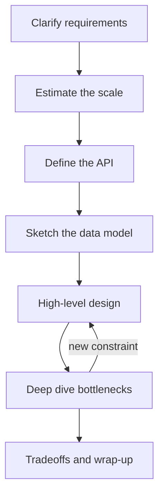

## In one line
A system design interview asks you to turn a vague prompt into a workable architecture, and the safest way through is a fixed sequence: requirements, estimates, API, data model, high-level design, deep dives, and tradeoffs.

## The problem it solves
The interviewer says: "Design a video streaming platform." You have 45 minutes and an empty whiteboard.

A few words first:

- **System design** is deciding which parts a software system needs (servers, databases, caches, queues) and how they connect, so it works at the size and speed it must.
- **Scale** means how much the system must handle: how many users, how many requests per second, how much data.

Without a plan, people freeze, or draw Kafka and Kubernetes in the first minute, or spend 30 minutes on the database schema and never reach the interesting part.

There is no single "correct" diagram. The interviewer watches **how you think**: do you ask good questions, reason with numbers, start simple, spot the bottleneck, and explain tradeoffs? A framework makes that thinking visible and keeps you moving when you are nervous.

## Everyday analogy
An architect designing a house. Before drawing anything, they ask: how many people live here, what is the budget, does anyone work from home? Then they sketch the floor plan. Only after the family agrees on the plan do they discuss plumbing details in the kitchen.

Where it breaks down: the interviewer often changes the brief halfway through on purpose, to see how you adapt.

## How it works
Seven steps, with a rough time budget for a 45-minute interview. Name each step out loud as you start it.

1. **Clarify requirements (about 5 minutes).** Ask questions until the problem is small and specific. Split them into two kinds:
   - **Functional requirements** are what the system does: "users upload videos", "users watch videos".
   - **Non-functional requirements** are how well it must do it: speed, reliability, scale, cost. For example, "playback starts in under 2 seconds" or "uploads must never be lost".
   Then state your scope: "I'll focus on upload and playback, not comments or recommendations."
2. **Estimate the scale (3–5 minutes).** These are **back-of-the-envelope estimates**: rough sums with round numbers, done in your head or on the board. They tell you whether one database is enough or whether you need many machines. More below.
3. **Define the API (about 5 minutes).** List the main endpoints, like `POST /videos`. Fuzzy features become concrete inputs and outputs.
4. **Sketch the data model (about 5 minutes).** Name the main tables and key fields, and which database you'd use and why.
5. **Draw the high-level design (about 10 minutes).** Start with the simplest version that works: client, server, database. Then add only the parts your requirements and numbers demand: a **load balancer** to spread traffic, a cache, a queue for slow work, a CDN.
6. **Deep dive (10–15 minutes).** Go deep on the hardest or most loaded part. The interviewer often picks it: "How would you make the redirects faster?" Most of the signal is here.
7. **Tradeoffs and wrap-up (about 5 minutes).** Name what could fail, what you'd change at 10 times the traffic, and what you chose not to build.


*Notice: the deep dive can loop back to the high-level design when the interviewer adds a constraint. That loop is normal, not failure.*

**The estimation toolkit.** A few facts make the sums easy:

- A day has 86,400 seconds. Round it to 100,000 so you can divide in your head. 1 million requests a day is then about 10 per second.
- **Peak traffic** (the busiest moment) is often a few times the daily average. Say "I'll assume peak is 3 times average" and move on.
- **Availability** is the share of time a system works. 99.9% ("three nines") allows about 8.8 hours of downtime a year. 99.99% allows about 53 minutes. Each extra nine costs a lot more effort.
- Orders of magnitude for **latency** (the time one operation takes): reading memory is around 100 nanoseconds, a network round trip inside one data centre is roughly half a millisecond, and a round trip between continents is roughly 100–150 milliseconds. You only need the scale, not the exact figure.

## Real example
Let's run the framework on a small, realistic prompt: **"Design the 'Continue watching' row for our video app."** It shows the videos you started, and resumes where you stopped.

**1. Requirements.**
- Functional: save the playback position while watching. Show the 20 most recent unfinished videos on the home screen.
- Non-functional: the home screen loads fast. Losing the last few seconds of progress is acceptable. Losing everything is not.

**2. Estimates.** All numbers here are assumptions; say so out loud.
- 10 million daily active users, watching about 60 minutes a day each.
- If the player saves progress every 10 seconds: 360 saves per user per day. 360 × 10 million = 3.6 billion writes a day. Divided by about 100,000 seconds, that's roughly **36,000 writes per second** on average.
- Reads: about 5 home screen loads per user per day = 50 million a day, roughly **500 reads per second**.
- Storage: 20 rows per user × about 50 bytes = 1 KB per user. 1 KB × 10 million users = **about 10 GB**.

The numbers tell the story: this feature is **write-heavy**, and its data is small. Writing every 10 seconds straight to PostgreSQL would strain the database; storage is no problem.

**3. API.**

```text
PUT /me/progress/:videoId     body: { "positionSeconds": 754 }
GET /me/continue-watching?limit=20
```

**4. Data model.** One table, `watch_progress`, with `user_id`, `video_id`, `position_seconds`, and `updated_at`. The primary key is `(user_id, video_id)`, so each user has one row per video.

**5. High-level design.** Player → load balancer → API servers → database. Reads use an **index** on `(user_id, updated_at)` so the "20 most recent" query is fast.

**6. Deep dive: the write load.** Two levers:
- Save less often: every 30 seconds, plus on pause and close. That cuts the average to about 12,000 writes a second.
- Buffer writes in Redis, a fast in-memory store, and copy them to PostgreSQL in batches every minute. Many updates to the same row collapse into one database write.

**7. Tradeoff.** If Redis loses data before a batch is saved, users lose up to a minute of progress. The requirements said that is acceptable. For a payment, it would not be.

## How to say it in an interview

> [!INTERVIEW]
> **30 seconds:** "I follow a fixed structure. First I clarify requirements, both what the system does and how fast, reliable, and big it must be. Then I do quick estimates to find the scale and the read-to-write ratio. Next I define the main API calls and the data model, draw the simplest high-level design that works, and then deep-dive into the bottleneck. I finish by naming tradeoffs and what I'd change at ten times the traffic."

> [!INTERVIEW]
> **2 minutes:** Start with the 30-second answer, then add:
>
> "The estimates matter because they change the design. For example, for a 'continue watching' feature, the math showed tens of thousands of progress writes a second but only about 10 GB of data. So the problem isn't storage, it's write volume. I'd save progress less often and buffer writes in Redis, flushing to Postgres in batches.
>
> That's a tradeoff: if Redis fails before a flush, users lose up to a minute of progress. For watch position that's fine; for orders or payments it wouldn't be.
>
> I also start simple, one app server and one database, and add a load balancer, cache, or queue only when a requirement or a number justifies it."

## Follow-up questions interviewers ask

<details>
<summary>How accurate do your estimates need to be?</summary>

Only within a factor of a few. You need the **order of magnitude**: 10, 1,000, or 100,000 requests per second each lead to a different design. Round hard, state every assumption, and show the arithmetic so the interviewer can correct one input instead of doubting the result.

</details>

<details>
<summary>What's the difference between functional and non-functional requirements?</summary>

Functional requirements are **features**: "a user can send a message." Non-functional requirements are **qualities**: latency, availability, durability (data is never lost), consistency, cost, security. The qualities drive the architecture. "Send a message" is easy; "deliver it in under 200 ms and never lose it" is the real design problem.

</details>

<details>
<summary>The interviewer adds a new requirement halfway through. What do you do?</summary>

Restate it and check what it breaks: "So now we need 10 times the traffic. The database writes become the bottleneck, so let's revisit that part." Don't restart from scratch, and don't defend your first design. Adapting calmly is often exactly what they are testing.

</details>

<details>
<summary>How do you choose a database during the interview?</summary>

Start from the **access patterns**: what you read and write, and how. Related data that needs transactions (orders, payments) fits PostgreSQL. Huge write volume with simple lookups by one key can fit a key-value or wide-column store. Give the reason in one sentence: "PostgreSQL, because orders need transactions and our volume fits one primary." See [SQL vs NoSQL](#/topic/sql-vs-nosql).

</details>

## Common mistakes and misconceptions

> [!MISTAKE]
> Jumping straight to the solution. Drawing boxes before asking a single question means you may solve the wrong problem. Spend the first minutes on requirements, even if the prompt seems obvious.

> [!MISTAKE]
> Over-engineering. Microservices, Kafka, and five databases for an app with 1,000 users signal poor judgment, not skill. Every box should exist because a requirement or a number needs it.

> [!MISTAKE]
> Designing in silence. The interviewer can only grade reasoning they hear: "I'm adding a queue because transcoding takes minutes and the upload shouldn't wait."

> [!MISTAKE]
> Ignoring failure. "What happens when this server dies?" is a standard follow-up. Know the answer for every important box.

## Tradeoffs: when the framework doesn't fit
A framework is a guide, not a script. Know when to bend it:

- **Follow the interviewer's lead.** If they say "skip estimates, assume huge scale", skip them. If they want to go deep early, go deep.
- **Not every prompt needs all seven steps.** "Design the API for X" is mostly steps 3 and 4. "How would you scale this system?" starts at step 5.
- **Seniority changes the expectations.** Juniors should produce a sensible working design. Seniors should drive the conversation, find the hard parts themselves, and discuss monitoring, deployment, and cost.
- **Don't recite it.** Saying "Now the data model" is fine. Spending two minutes explaining your framework is not.

## Check yourself

<details>
<summary>1. Your estimate says 2 million requests per day. Roughly how many per second is that?</summary>

About 20 per second on average. 2,000,000 ÷ 100,000 (a day is roughly 100,000 seconds) = 20. Peak might be 3 times that, about 60 per second, which one modest server can usually handle.

</details>

<details>
<summary>2. Why should you start with the simplest design instead of the most scalable one?</summary>

Every extra component adds cost and failure points. Starting simple gives you a complete working design early, and shows you add complexity only for a reason.

</details>

<details>
<summary>3. Is "the system should be fast" a good non-functional requirement?</summary>

No, it's too vague to design for. Make it measurable: "the home screen API responds in under 200 ms for 99% of requests" or "playback starts within 2 seconds." Numbers let you check whether a design meets the goal.

</details>

## Go deeper
- [Google SRE book: Embracing risk (availability targets)](https://sre.google/sre-book/embracing-risk/)
- [AWS Well-Architected Framework](https://docs.aws.amazon.com/wellarchitected/latest/framework/welcome.html)
