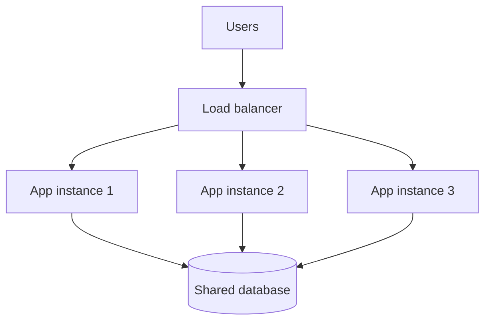

## In one line
Vertical scaling means moving your app to a bigger machine; horizontal scaling means running it on more machines and sharing the traffic between them.

## The problem it solves
Your shop runs on one small **VPS** (a rented virtual server) with 2 **vCPUs** and 4 GB of **RAM**.

- A vCPU is one share of a processor core: roughly, one thing the machine can compute at a time.
- RAM is the machine's fast working memory.

On a normal day the CPU sits at 30%. Then a flash sale starts: CPU hits 100%, requests queue up, and the product page goes from 150 ms to 3 seconds. You need more capacity, today.

**Scaling** means increasing how much work a system can handle. There are two directions, and interviewers expect you to know when to pick each.

## Everyday analogy
A busy restaurant kitchen. Vertical scaling is buying a bigger stove and hiring one faster chef. Horizontal scaling is hiring three more chefs and having a head waiter hand out the orders.

Where it breaks down: chefs can glance at each other's tickets. Separate servers cannot see each other's memory, so anything they must share has to live somewhere they can all reach.

## How it works
**Vertical scaling ("scale up").**
1. You resize the server: 2 vCPUs and 4 GB become 8 vCPUs and 32 GB.
2. The app runs unchanged. No code changes.
3. Most cloud providers need a reboot to resize, so expect a short outage.

The limits: there is a biggest machine you can buy, and at the top end prices typically rise faster than capacity. It is also still **one** machine, a **single point of failure**: one part whose failure takes the whole system down.

**Horizontal scaling ("scale out").**
1. You run several identical copies of the app, often called **instances**.
2. A **load balancer** sits in front. It receives every request and passes each one to an instance. See [Load balancers](#/topic/load-balancers).
3. To add capacity, add instances. If one dies, the others keep serving.

The catch: any instance must be able to handle any request. Instances must be **stateless**: they keep nothing about a user in their own memory between requests. Sessions, carts, and uploads move to shared places like Redis, the database, or object storage.


*Notice: the app instances multiply, but they all still share one database. That is usually the next bottleneck.*

**Two details interviewers probe:**

- **Node.js and CPU cores.** One Node process runs your JavaScript on a single main thread, so it uses roughly one core for your code. On an 8-core machine, one Node process leaves most of the CPU idle. Run one process per core: with the `cluster` module, PM2's cluster mode, or several containers. That is horizontal scaling inside one machine. See [The event loop](#/topic/event-loop).
- **Databases are harder to scale out.** App servers are easy to copy because they hold no data. A database *is* the data. Common steps, in order: scale it vertically, add **read replicas** (copies that serve reads), then **shard** (split the data across machines). See [Replication and sharding](#/topic/replication-sharding).

**Autoscaling** is horizontal scaling done automatically: the platform adds instances when, say, average CPU stays above 70%, and removes them when traffic drops. New instances take time to boot, so it helps with gradual growth more than sudden spikes.

## Real example
**Setup:** Docker with Compose, and a Node app with a `Dockerfile` that listens on port 3000. It has a route that reports which container answered:

```js
import express from 'express';
import os from 'node:os';

const app = express();

// Each container has its own hostname, so we can see who answered.
app.get('/whoami', (req, res) => {
  res.json({ servedBy: os.hostname() });
});

app.listen(3000);
```

`compose.yaml` runs the app behind Nginx, a web server used here as the load balancer:

```yaml
services:
  api:
    build: .
    # No "ports:" here. Three copies can't all claim the same host port.
  nginx:
    image: nginx:1.28-alpine
    ports: ["80:80"]
    volumes: ["./nginx.conf:/etc/nginx/conf.d/default.conf:ro"]
    depends_on: [api]
```

`nginx.conf`:

```nginx
server {
  listen 80;
  location / {
    # Docker's DNS returns one address per api container.
    # Nginx uses all of them in turn.
    proxy_pass http://api:3000;
  }
}
```

Start three instances and send 30 requests:

```bash
docker compose up -d --scale api=3
for i in $(seq 1 30); do curl -s localhost/whoami; echo; done | sort | uniq -c
```

```text
      6 {"servedBy":"0295f2b08a22"}
      7 {"servedBy":"6c38944f742b"}
     17 {"servedBy":"8fa0df09ecd9"}
```

Three containers share the traffic (your hostnames will differ). The split is uneven because each Nginx worker process keeps its own rotation; over thousands of requests it evens out.

One trap: Nginx looks up `api` only when it starts. After `--scale api=4`, the new container gets no traffic until you reload Nginx with `docker compose exec nginx nginx -s reload`.

## How to say it in an interview

> [!INTERVIEW]
> **30 seconds:** "Vertical scaling means a bigger machine: more CPU and RAM. It's simple and needs no code changes, but it has a ceiling and it's still a single point of failure. Horizontal scaling means more machines behind a load balancer. It scales much further and survives a server dying, but the app must be stateless, so sessions and files live in shared stores like Redis or object storage."

> [!INTERVIEW]
> **2 minutes:** Start with the 30-second answer, then add:
>
> "I'd usually scale vertically first because it's cheap in engineering time: moving a struggling 2-CPU server to 8 CPUs can take ten minutes. For Node there's a catch: one process mostly uses one core, so I'd also run one process per core with PM2 cluster mode or several containers.
>
> When I need redundancy, or more than one machine can give, I go horizontal: identical instances behind a load balancer, sessions in Redis, uploads in S3. The tradeoff is more moving parts, and the bottleneck usually moves to the database, which is harder to scale out. So I'd add caching and read replicas before considering sharding."

## Follow-up questions interviewers ask

<details>
<summary>When would you choose vertical scaling?</summary>

When the load fits one machine and you want the simplest fix: early-stage products, and databases, which are much harder to split than app servers. Choose horizontal when you must survive a machine failing, or traffic outgrows the biggest sensible machine.

</details>

<details>
<summary>Why must servers be stateless to scale horizontally?</summary>

The load balancer may send a user's next request to a different instance. If instance 1 kept the login session in its memory, instance 2 doesn't know the user, and they appear logged out. Moving state to a shared store means every instance sees the same data. See [Load balancers and stateless servers](#/topic/load-balancers).

</details>

<details>
<summary>Does adding servers always make the app faster?</summary>

No. It adds **capacity** (more requests at once), not speed for one request. A request that takes 2 seconds because of a slow query still takes 2 seconds on 10 servers. More servers can even hurt, by opening more connections to an overloaded database. See [Finding performance bottlenecks](#/topic/performance-bottlenecks).

</details>

<details>
<summary>Why is the database harder to scale horizontally than the app servers?</summary>

App servers hold no data, so copies are interchangeable. A database holds the data, and every copy must agree on it. Read replicas help with reads, but writes still go to one primary. Splitting writes across machines (sharding) means choosing a shard key and losing easy joins and transactions across shards. See [Replication and sharding](#/topic/replication-sharding).

</details>

## Common mistakes and misconceptions

> [!MISTAKE]
> "Horizontal is always better." It brings load balancers, shared state, and harder debugging. For many apps, one well-sized server plus a database is the right answer.

> [!MISTAKE]
> "My Node app on a 16-core server uses all 16 cores." A single Node process runs your JavaScript on one main thread. Without clustering or multiple processes, most cores sit idle.

> [!MISTAKE]
> Scaling out app servers while keeping sessions or uploads on local disk. Users get logged out at random, and files exist on one instance but not the others.

> [!MISTAKE]
> Forgetting the database. Ten app instances, each with a pool of 20 connections, means 200 database connections. That can exceed PostgreSQL's default limit of 100. See [Connection pooling](#/topic/connection-pooling).

## Tradeoffs: when NOT to use it
- **Don't scale out before you need to.** If one server runs at 20% CPU, more servers add cost, not value, unless you need two to survive a failure.
- **Don't scale up forever.** Big machines are costly, resizing often means downtime, and one machine is one failure from an outage.
- **Don't scale to hide a bug.** A missing index, an N+1 query, or a memory leak will eat any hardware you add. Fix the cause first.

## Check yourself

<details>
<summary>1. You move from a 2-CPU to an 8-CPU server. Which kind of scaling is that, and what is its main risk?</summary>

Vertical scaling. Its risks: a hard ceiling on machine size, and it is still a single point of failure.

</details>

<details>
<summary>2. After going from one to three instances, users report being logged out randomly. Why?</summary>

Sessions live in each instance's memory, so an instance that didn't create the session doesn't recognise it. Move sessions to a shared store like Redis, or use tokens any instance can verify.

</details>

<details>
<summary>3. You scaled from 3 to 4 containers with Docker Compose, but the new one gets no traffic. Why?</summary>

Nginx resolved the `api` name only when it started, so it still knows only the original three addresses. Reload Nginx so it resolves the name again and includes the fourth container.

</details>

## Go deeper
- [Node.js docs: cluster](https://nodejs.org/api/cluster.html)
- [Nginx docs: upstream module (load balancing)](https://nginx.org/en/docs/http/ngx_http_upstream_module.html)
- [Docker docs: docker compose up (the --scale flag)](https://docs.docker.com/reference/cli/docker/compose/up/)
