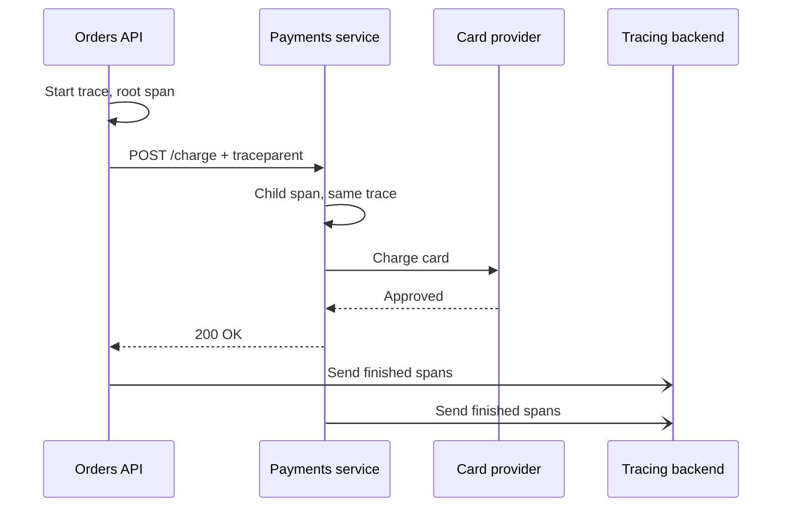

## In one line
Distributed tracing follows one request as it hops between services, recording when each step started and how long it took, so you can see exactly where the time went or where it failed.

## The problem it solves
Your app has grown into several **services**: separate programs that each own one job and talk to each other over the network. Checkout now goes through an orders API, a payments service, an inventory service, PostgreSQL, and Redis. See [Monolith vs microservices](#/topic/monolith-microservices).

Users report that checkout takes 4 seconds. The orders API logged "checkout completed in 4.1 s", and payments and inventory logged a few lines each. Which one was slow? Each service's logs only describe its own part, and matching lines across five services by timestamp is guesswork at hundreds of checkouts per minute. [Metrics](#/topic/metrics-alerts) tell you checkout's p95 went up, but not which hop caused it.

Tracing draws the whole journey of one request as a single timeline.

## Everyday analogy
A parcel tracking number. Every depot scans the parcel with the same number and records when it arrived and left. Online you see one timeline: "London depot, 2 hours. Customs, 3 days." You know at once where it got stuck.

Where it breaks down: a parcel is in one place at a time. A request can call several services **at the same time**, so a trace is a tree, not a line. And only "depots" that scan the number appear. A service that is not instrumented is a blank gap.

## How it works
### Trace, span, and parent-child
- A **trace** is the whole journey of one request. It has a **trace ID**: a random 32-character hex string, shared by everything that request touches.
- A **span** is one timed piece of work inside a trace: "handle POST /checkout", "call payments", "run SELECT on orders". Each span records:
  - its own **span ID**,
  - the trace ID,
  - its **parent span ID** (the span that caused it),
  - a name, start time, and duration,
  - **attributes**: key-value details such as `http.status_code=200` or the SQL statement,
  - a status: OK or error.
- The first span, with no parent, is the **root span**. Parent links turn the spans into a tree, which tools draw as a waterfall.

### Context propagation: how the ID crosses the network
**Context propagation** means passing the trace ID and current span ID along with every outgoing call, so the next service joins the same trace. Over HTTP, the standard is the W3C **`traceparent`** header:

```text
traceparent: 00-63456dd6bd60e3ca7ecd4341569f452a-d26276fa2d5d73ce-01
             │  │                                │                └ flags: 01 = sampled (recorded)
             │  │                                └ parent span ID (16 hex characters)
             │  └ trace ID (32 hex characters)
             └ version
```

That is a real header, captured from the example below.

### Step by step
1. A checkout request reaches the orders API with no `traceparent`. The tracing library starts a new trace and a root span.
2. Database queries and outgoing HTTP calls each get a child span automatically.
3. When the orders API calls payments, the library adds a `traceparent` header containing the trace ID and the ID of the "call payments" span.
4. The payments service reads the header and creates its spans as children of that span, in the same trace.
5. Each service sends its finished spans in the background to a **tracing backend**, such as Jaeger, Grafana Tempo, or a commercial tool.
6. The backend groups spans by trace ID and draws the tree.


*Notice: the services never send the trace to each other. Each one reports its own spans, and the trace ID ties them together.*

The usual standard for all of this is **OpenTelemetry** (often "OTel"): a vendor-neutral set of libraries and protocols for traces, metrics, and logs. You instrument once and can switch backends later.

## Real example
**Setup:** two Express services, `orders-api` and `payments`, written as CommonJS (`require`). `npm install @opentelemetry/sdk-node @opentelemetry/auto-instrumentations-node @opentelemetry/exporter-trace-otlp-http`. A local Jaeger backend: `docker run -d --name jaeger -p 16686:16686 -p 4318:4318 jaegertracing/all-in-one:1.62.0`.

```js
// tracing.cjs: load this BEFORE the app, so libraries are patched before use.
const { NodeSDK } = require('@opentelemetry/sdk-node');
const { getNodeAutoInstrumentations } = require('@opentelemetry/auto-instrumentations-node');
const { OTLPTraceExporter } = require('@opentelemetry/exporter-trace-otlp-http');

const sdk = new NodeSDK({
  // Sends finished spans to http://localhost:4318/v1/traces unless
  // OTEL_EXPORTER_OTLP_ENDPOINT says otherwise.
  traceExporter: new OTLPTraceExporter(),
  // Creates spans for http, express, pg, redis and more, without code changes.
  instrumentations: [getNodeAutoInstrumentations()],
});
sdk.start();

process.on('SIGTERM', () => sdk.shutdown().finally(() => process.exit(0))); // flush spans on stop
```

Start each service with the tracing file loaded first, and give it a name:

```bash
OTEL_SERVICE_NAME=payments   node --require ./tracing.cjs payments.js
OTEL_SERVICE_NAME=orders-api node --require ./tracing.cjs orders.js
```

The application code does not change. When `orders.js` calls payments with `fetch`, the header is added for you. Open Jaeger at `http://localhost:16686`, pick `orders-api`, and a checkout trace looks like this (simplified):

```text
orders-api  POST /checkout         [==============================] 4.10 s
orders-api    SELECT cart            [=]                              0.03 s
orders-api    POST payments          [==========================]     3.85 s
payments        POST /charge          [=========================]     3.83 s
payments          call card provider   [========================]     3.79 s
orders-api    INSERT order                                     [=]    0.05 s
```

The answer jumps out: the card provider call takes 3.8 of the 4.1 seconds. Your code and your database are fine. You'd now check that call's timeout, and whether the provider has an incident.

## How to say it in an interview

> [!INTERVIEW]
> **30 seconds:** "Distributed tracing follows one request across services. A trace is the whole journey, and it's made of spans, which are timed steps like an HTTP call or a database query, linked by parent IDs. The trace ID travels between services in the W3C traceparent header, so each service's spans join the same trace. A backend like Jaeger then draws a waterfall, and you can see which hop was slow. I'd use OpenTelemetry, because auto-instrumentation covers HTTP, Express, and Postgres without code changes."

> [!INTERVIEW]
> **2 minutes:** Start with the 30-second answer, then add:
>
> "Metrics say checkout p95 went up. A trace shows that 3.8 of 4 seconds were spent waiting for the card provider. Logs explain what happened inside that step, and I put the trace ID in every log line to jump between them.
>
> The main tradeoff is volume. Recording every span of every request is expensive at high traffic, so teams sample, for example keeping 10% of traces. The simple way decides at the start of the request, which means you might drop the one slow trace you needed. Tail sampling decides after the trace finishes and keeps all errors and slow ones, but it needs a collector that buffers spans.
>
> Also, tracing only sees what's instrumented. If one service doesn't pass the header on, or a message goes through a queue without the trace context, the trace breaks into pieces."

## Follow-up questions interviewers ask

<details>
<summary>What is the difference between a trace and a span?</summary>

A trace is the whole request journey, identified by one trace ID. A span is one timed operation within it, with its own span ID and a pointer to its parent span. A trace is a tree of spans.

</details>

<details>
<summary>How does the trace continue through a message queue?</summary>

The producer puts the trace context into the message's headers or metadata, just as it would into an HTTP header. The consumer reads it and starts its spans with that context. OpenTelemetry instrumentations exist for common queue libraries, but check that yours does this, because a missing link splits the trace in two. See [Message queues](#/topic/message-queues).

</details>

<details>
<summary>What is sampling, and what are its risks?</summary>

**Sampling** means recording only some traces, to control cost. **Head sampling** decides at the start, for example "keep 10%", and passes the decision on in the `traceparent` flags so every service agrees. It is cheap, but it may drop the rare failing request. **Tail sampling** waits until the trace is complete, then keeps errors and slow traces. It is smarter, but needs a collector that holds spans in memory first.

</details>

<details>
<summary>Do you need tracing for a single Node app with one database?</summary>

Usually not at first. Structured logs with a request ID, plus metrics, cover most problems in a monolith. Tracing pays off once a request crosses several services. That said, OpenTelemetry is cheap to add, and its database spans can still show which queries a slow request ran.

</details>

## Common mistakes and misconceptions

> [!MISTAKE]
> "Tracing replaces logs." No. A span says a step took 3.8 seconds and failed. The log lines from that step say why. Link them by writing the trace ID into your logs.

> [!MISTAKE]
> Loading the tracing setup after the app. Auto-instrumentation patches libraries like `http` and `pg` as they load, so the SDK must start first, for example with `node --require ./tracing.cjs`. Otherwise you get few or no spans.

> [!MISTAKE]
> Putting secrets or personal data in span attributes. Traces are stored and widely viewed, just like logs. Database spans can record SQL text, so prefer parameterised queries, which keep user values out of it.

## Tradeoffs: when NOT to use it
- **Cost at scale:** spans add network traffic, storage, and some CPU. Sampling reduces it but can hide rare problems.
- **Partial coverage misleads:** a gap in instrumentation shows up as unexplained time inside a parent span. Every service and queue in the path needs to propagate context.
- **It shows where, not why:** a slow database span tells you which query. You still need `EXPLAIN` to find out why it is slow. See [Reading a slow query with EXPLAIN](#/topic/explain-analyze).

## Check yourself

<details>
<summary>1. What does the traceparent header carry from one service to the next?</summary>

A version, the trace ID, the ID of the calling (parent) span, and flags such as "sampled". That lets the next service create its spans as children in the same trace.

</details>

<details>
<summary>2. A trace shows POST /checkout took 4.1 s, and its child span "call card provider" took 3.8 s. Where do you look first?</summary>

At the card provider call: its timeout settings, the provider's status page, and whether the slowness started at a particular time. Your own code and database account for only about 0.3 seconds.

</details>

<details>
<summary>3. Why might a slow request be missing from your tracing backend?</summary>

It may not have been sampled. With head sampling at 10%, nine in ten traces are never recorded. Another cause is a broken chain: a service that did not pass the context on starts a separate trace.

</details>

## Go deeper
- [OpenTelemetry: Traces (concepts)](https://opentelemetry.io/docs/concepts/signals/traces/)
- [OpenTelemetry: Getting started with Node.js](https://opentelemetry.io/docs/languages/js/getting-started/nodejs/)
- [W3C Trace Context (the traceparent standard)](https://www.w3.org/TR/trace-context/)
