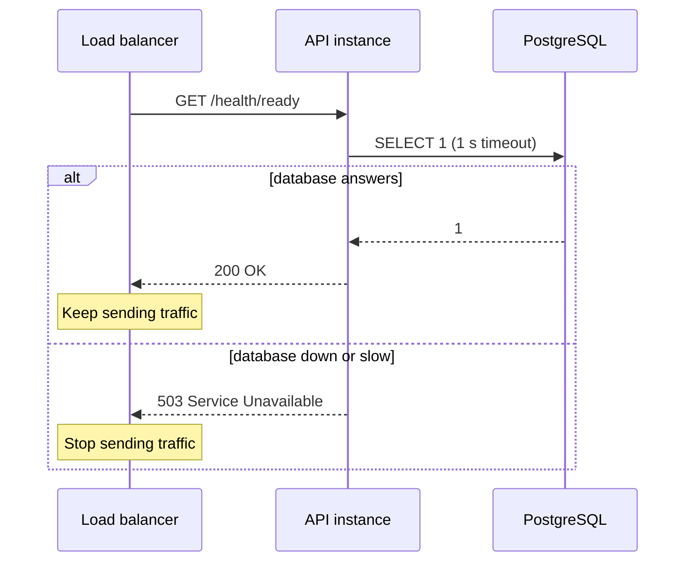

## In one line
A health check is a small URL, like `/health`, that load balancers and monitors call every few seconds to ask your app "are you working?", so traffic avoids broken copies of the app and someone is alerted when the site is down.

## The problem it solves
You run two copies of your Node.js API behind a **load balancer**: a server that receives every request and spreads them across the copies. Each running copy is called an **instance**.

One night, instance 2 loses its database connections. The process is still running and the port is still open, but every request on it hangs for 30 seconds, then fails. The load balancer doesn't know. It keeps sending half of all users to the broken instance.

Or the whole site goes down at 3 AM, and you find out at 9 AM from customer emails. Health checks fix both: the load balancer stops sending traffic to instances that say "not OK", and an outside monitor wakes someone when the whole site fails.

## Everyday analogy
A supermarket manager walks along the tills asking each cashier: "Are you open?" If a cashier doesn't answer, or says the card machine is down, the manager sends customers to other tills until it is fixed.

Where it breaks down: the cashier can only report what they notice. A health check is the same. It checks only what you programmed it to check, so a "healthy" app can still have a broken feature.

## How it works
### Two different questions: liveness and readiness
Interviewers often ask about this split, because mixing the two causes real outages.

| | Liveness | Readiness |
|---|---|---|
| Question | Is the process alive, or is it stuck? | Can it serve real traffic right now? |
| Checks | Only that the app can answer at all | The dependencies it truly needs, such as the database |
| If it fails | Restart the instance | Stop sending it traffic, but don't restart it |
| Example URL | `/health/live` | `/health/ready` |

Why separate them? If liveness checked the database, a database outage would restart every instance, again and again. That fixes nothing and adds load at the worst moment. With readiness, instances stay up, leave rotation, and return by themselves once the database is back.

Kubernetes adds a third, the **startup probe**, which gives a slow-starting app time to boot before liveness checks begin.

### The steps
1. The app exposes `/health/live` and `/health/ready`.
2. A **probe** (a checker such as a load balancer, Docker, or Kubernetes) calls one of them on a schedule, for example every 10 seconds, with a short **timeout** such as 2 seconds.
3. A `200` status means healthy. Anything else, such as `503 Service Unavailable` or no answer before the timeout, counts as a failure.
4. Thresholds stop flapping: for example, mark an instance unhealthy only after 3 failures in a row, and healthy again after 2 passes.
5. The load balancer stops routing to unhealthy instances, and adds them back when they pass.
6. Separately, an **uptime monitor**, a service outside your network, requests `https://shop.example.com/health` every minute from several regions, and alerts the on-call person if it fails.


*Notice: a failing readiness check removes the instance from rotation. It does not kill it.*

## Real example
**Setup:** Node.js 18 or later, `"type": "module"` in `package.json`, `npm install express pg redis`, and `DATABASE_URL` and `REDIS_URL` set.

```js
import express from 'express';
import pg from 'pg';
import { createClient } from 'redis';

const db = new pg.Pool({ connectionString: process.env.DATABASE_URL, connectionTimeoutMillis: 2000 });
db.on('error', (err) => console.error('Postgres error:', err.message)); // don't crash if the DB drops
const redis = createClient({ url: process.env.REDIS_URL, disableOfflineQueue: true });
redis.on('error', (err) => console.error('Redis error:', err.message));
await redis.connect();

// Reject if a check takes longer than ms, so a hung dependency can't hang the check.
const withTimeout = (promise, ms) => Promise.race([promise,
  new Promise((_, reject) => setTimeout(() => reject(new Error('timeout')), ms))]);
const app = express();

// Liveness: can this process answer at all? No dependency checks here.
app.get('/health/live', (req, res) => res.json({ status: 'ok' }));

// Readiness: can this instance serve real traffic right now?
app.get('/health/ready', async (req, res) => {
  const result = { db: 'ok', redis: 'ok' };
  try { await withTimeout(db.query('SELECT 1'), 1000); } catch { result.db = 'fail'; }
  try { await withTimeout(redis.ping(), 1000); } catch { result.redis = 'fail'; }
  // Only the database is required. Without Redis the app still works, just slower.
  const ready = result.db === 'ok';
  res.status(ready ? 200 : 503).json({ status: ready ? 'ok' : 'unavailable', ...result });
});
app.listen(3000);
```

What it returns as things break:

```text
All fine:        200  {"status":"ok","db":"ok","redis":"ok"}
Redis stopped:   200  {"status":"ok","db":"ok","redis":"fail"}
Postgres down:   503  {"status":"unavailable","db":"fail","redis":"fail"}
/health/live:    200  {"status":"ok"}   (even with Postgres down)
```

Redis is only a cache here (see [Redis caching](#/topic/redis-caching)), so losing it is reported but doesn't take the instance out of service.

**Docker health check.** Add this to the app's Dockerfile. It uses Node's built-in `fetch`, so it works even in slim images without `curl`:

```dockerfile
HEALTHCHECK --interval=10s --timeout=3s --start-period=15s --retries=3 \
  CMD node -e "fetch('http://localhost:3000/health/live').then(r => process.exit(r.ok ? 0 : 1)).catch(() => process.exit(1))"
```

```bash
docker ps --format '{{.Names}}  {{.Status}}'
# shop-api  Up 23 seconds (healthy)
```

Docker shows `(health: starting)` during the start period, then `(healthy)` or `(unhealthy)`. Docker Compose can use it to wait for a service with `depends_on: condition: service_healthy`.

> [!WARNING]
> Plain Docker only **reports** `unhealthy`. It does not restart the container, because restart policies react only when the process exits. Docker Swarm and Kubernetes do act on failed checks.

## How to say it in an interview

> [!INTERVIEW]
> **30 seconds:** "A health check is an endpoint that load balancers, orchestrators, and monitors call regularly to see if an instance is OK. I split it into liveness and readiness. Liveness just says the process can respond, and failing it means restart. Readiness checks critical dependencies, like a quick SELECT 1 against the database with a short timeout, and failing it means stop sending traffic but don't restart. On top of that, I use an external uptime monitor that hits the public URL and alerts us if the site is down."

> [!INTERVIEW]
> **2 minutes:** Start with the 30-second answer, then add:
>
> "I only include hard dependencies in readiness. In our app Redis is a cache, so if it's down we serve from Postgres and readiness still passes. If I included it, a Redis blip would take the whole API offline.
>
> Readiness also helps deploys. On SIGTERM, the app starts failing readiness, the load balancer stops sending new requests, and in-flight requests finish before the process exits, so users don't see errors during a rolling deploy.
>
> The tradeoff is that a health check is only as good as what it checks. A green check doesn't prove checkout works. For that, some teams add a synthetic check that runs a real user journey from outside every few minutes."

## Follow-up questions interviewers ask

<details>
<summary>What status code should a failing health check return?</summary>

`503 Service Unavailable`. Load balancers and probes treat 2xx (and often 3xx) as healthy, and anything else, or a timeout, as unhealthy. Return a small JSON body saying which check failed, to help humans debugging, but don't rely on the body for the decision.

</details>

<details>
<summary>Why do you need an external uptime monitor if the load balancer already checks health?</summary>

The load balancer checks from inside your network. It can't see problems in front of it: DNS pointing to the wrong place, an expired TLS certificate, a firewall rule blocking port 443, or the load balancer itself being down. An external monitor sees the site the way a customer does. Many also warn you before your certificate expires.

</details>

<details>
<summary>How do health checks help with zero-downtime deploys?</summary>

New instances receive traffic only after readiness passes, so users never hit an app that is still booting. On shutdown, the app fails readiness first, waits for the load balancer to notice, and finishes in-flight requests before exiting. See [Rolling, blue-green, and canary](#/topic/deployment-strategies).

</details>

<details>
<summary>Does Nginx check the health of the apps behind it?</summary>

Open-source Nginx does **passive** checks only. If requests to an upstream server fail (`max_fails` times within `fail_timeout`), it stops using that server for a while. It does not call a `/health` URL on its own. **Active** checks, where the proxy polls an endpoint, are part of the paid NGINX Plus, or come from other tools such as HAProxy, cloud load balancers, and Kubernetes.

</details>

## Common mistakes and misconceptions

> [!MISTAKE]
> Checking the database in the liveness check. A database outage then causes restart loops across every instance. Dependencies belong in readiness.

> [!MISTAKE]
> A health check that always returns 200 without checking anything that matters. The load balancer keeps routing to an instance that can't reach its database.

> [!MISTAKE]
> "Docker restarts unhealthy containers." Not on its own. Standalone Docker only marks them `unhealthy`. Restarts on failed health checks come from Swarm, Kubernetes, or your own tooling.

## Tradeoffs: when NOT to use it
- **Don't include soft dependencies** such as a cache, an email provider, or a recommendations service in readiness. Their failure should degrade one feature, not remove the instance.
- **A green check is not proof that features work.** It checks plumbing, not checkout. Combine it with error-rate [metrics and alerts](#/topic/metrics-alerts).
- **Keep checks cheap.** `SELECT 1` and `PING` with short timeouts, not real report queries run every few seconds by every probe.
- **Very short intervals and thresholds cause flapping.** An instance that fails one check during a garbage-collection pause shouldn't be pulled. Require a few failures in a row.
- **On a single server with no load balancer**, readiness has nobody to act on it. An external uptime monitor gives you most of the value.

## Check yourself

<details>
<summary>1. The database is down. Should the liveness check fail?</summary>

No. Restarting the app won't fix the database. The readiness check should fail, so the instance stops receiving traffic until the database is back.

</details>

<details>
<summary>2. Name one problem an external uptime monitor catches that an internal check misses.</summary>

Any one of: an expired TLS certificate, a wrong DNS record, a firewall blocking port 443, or the load balancer itself being down.

</details>

<details>
<summary>3. Docker shows a container as (unhealthy). What happens next if you use plain Docker?</summary>

Nothing automatic. The container keeps running and keeps getting traffic. You need monitoring that alerts on it, or an orchestrator such as Swarm or Kubernetes that replaces it.

</details>

## Go deeper
- [Kubernetes docs: Liveness, readiness, and startup probes](https://kubernetes.io/docs/tasks/configure-pod-container/configure-liveness-readiness-startup-probes/)
- [Docker docs: the HEALTHCHECK instruction](https://docs.docker.com/reference/dockerfile/#healthcheck)
