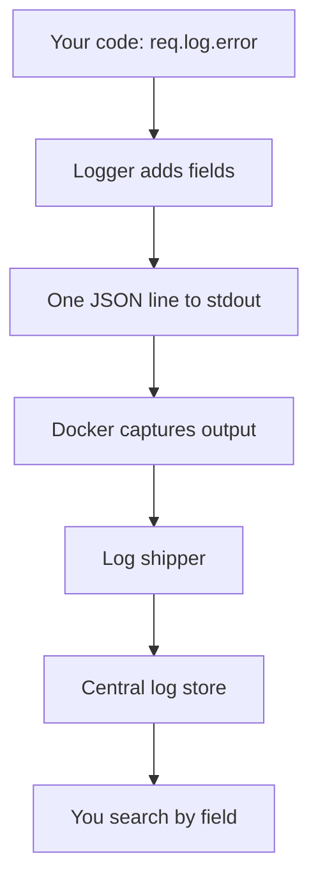

## In one line
Logging well means your app writes one searchable record per important event, with a severity level and enough context to debug it later, and never writes passwords, tokens, or other secrets.

## The problem it solves
A **log** is a line of text a program writes to record that something happened: "server started", "order 5512 created", "payment failed".

It is 2 AM. Customers say checkout is failing. You SSH into the server, run `docker logs`, and see this, 4,000 times:

```text
Error: something went wrong
```

There is no user, no order, no time, and no way to tell which lines belong to the same request. You cannot answer the basic questions: who is affected, since when, and why?

Two other things go wrong without care. **Secrets leak**: one `console.log(req.body)` while debugging login puts every customer's password in plain text in your logs. And **logs cost money and disk**: debug output left on can fill a server's disk in days, and log services usually charge by the gigabyte.

## Everyday analogy
A ship's logbook. Every entry follows the same format: the time, the position, what happened, and who recorded it. Anyone who joins the crew later can read it and reconstruct the voyage.

Where it breaks down: a logbook is read by a person, page by page. Production logs can run to millions of lines a day, so they are searched by machines, and that only works if every line has the same machine-readable shape.

## How it works
### The parts of a log line
A **structured log** writes each event as **JSON**, a text format of named fields, instead of a free-form sentence. Here is one line from the example below, trimmed and spread over several lines for reading:

```json
{
  "level": 50,
  "time": 1793037318686,
  "service": "shop-api",
  "req": { "id": "1ebd5c5c-5f79-457c-8240-455241df4c7e", "method": "POST", "url": "/orders" },
  "userId": 981,
  "productId": 42,
  "err": { "type": "Error", "message": "card declined by provider", "stack": "Error: card declined..." },
  "msg": "payment failed"
}
```

Each field answers one question:

- **`time`**: when. Here in milliseconds since 1970, which tools convert to a date.
- **`level`**: how serious (see below). The `pino` library uses numbers: 50 means error.
- **`service`**: which program wrote it. Vital when several apps log to one place.
- **`req.id`**: the **request ID**, a unique ID given to each incoming request. Every line written while handling that request carries it, so you can pull out the full story of one request.
- **Context fields** (`userId`, `productId`): the business facts that make the line useful.
- **`err`**: the error's type, message, and **stack trace**: the list of function calls that led to the error, with file names and line numbers.
- **`msg`**: a short, fixed message. Keep variable data out of it. `"payment failed"` stays identical on every line, so you can search and count it, while the details live in fields.

### Log levels
A **log level** marks how serious an event is. The usual ladder, from least to most severe:

| Level | Use it for | Example |
|---|---|---|
| `debug` | Details useful only while investigating | "cache miss for product:42" |
| `info` | Normal, notable events | "order 5512 created" |
| `warn` | Something odd, but the app coped | "Redis down, reading from DB" |
| `error` | An operation failed | "payment failed for order 5512" |
| `fatal` | The app cannot continue | "cannot connect to DB at startup" |

You set a minimum level per environment, for example with `LOG_LEVEL=info` in production. Anything below it is dropped before it is written. On your laptop you use `debug` and see everything.

### Where the line goes
1. Your code calls `req.log.error({ err, userId }, 'payment failed')`.
2. The logger adds `time`, `level`, `service`, and the request ID.
3. It drops the line if the level is below the minimum.
4. It writes one JSON line to **stdout** (standard output), the default text stream every program writes to. The app does not manage log files itself.
5. Docker captures stdout. `docker logs` reads it back from a file on the host.
6. On real systems, a **log shipper** (a small agent such as Fluent Bit or Promtail) copies the lines to a central log store, such as Grafana Loki, Elasticsearch, or AWS CloudWatch.
7. You search there: `level >= 50 AND service = "shop-api"`, or one request ID.


*Notice: the app only writes to stdout. Storing, shipping, and searching logs is someone else's job.*

## Real example
**Setup:** Node.js 18 or later, `"type": "module"` in `package.json`, and `npm install express pino pino-http`. `pino` is a fast JSON logger. `pino-http` logs every request and attaches a logger to each one as `req.log`.

```js
import express from 'express';
import pino from 'pino';
import pinoHttp from 'pino-http';
import { randomUUID } from 'node:crypto';

const logger = pino({
  level: process.env.LOG_LEVEL || 'info',      // debug lines are dropped in production
  base: { service: 'shop-api' },               // added to every line
  redact: ['req.headers.authorization', 'req.headers.cookie', '*.password', '*.cardNumber'],
});

const app = express();
app.use(express.json());
app.use(pinoHttp({
  logger,
  // Reuse the caller's request ID if there is one, otherwise create one.
  genReqId: (req, res) => {
    const id = req.headers['x-request-id'] || randomUUID();
    res.setHeader('X-Request-Id', id);           // the client can quote it in a bug report
    return id;
  },
}));

app.post('/orders', async (req, res) => {
  const { productId } = req.body;
  req.log.info({ userId: 981, productId }, 'creating order');  // req.log includes the request ID
  try {
    throw new Error('card declined by provider');               // stand-in for a real payment call
  } catch (err) {
    req.log.error({ err, userId: 981, productId }, 'payment failed'); // err adds type, message, stack
    res.status(402).json({ error: 'Payment failed', requestId: req.id });
  }
});

app.listen(3000);
```

Send a request with a secret in the headers:

```bash
curl -s -X POST localhost:3000/orders \
  -H 'Content-Type: application/json' \
  -H 'Authorization: Bearer secret123' \
  -d '{"productId":42}'
```

The app writes three lines to stdout: `creating order` (level 30, info), `payment failed` (level 50, with the stack trace), and `request completed` (with the status code and `responseTime` in milliseconds). All three carry the same `req.id`. The authorization header appears as `"authorization":"[Redacted]"`.

`redact` replaces the value at those paths before the line is written. It is a safety net, not a licence to log whole objects. The error response includes the `requestId`, so support can ask a customer for it and you find the exact lines in seconds.

## How to say it in an interview

> [!INTERVIEW]
> **30 seconds:** "I log in structured JSON, one line per event, to stdout, and let Docker or a log shipper send it to a central store. Every line has a timestamp, a level, the service name, and a request ID, so I can follow one request from start to finish. I use info for normal events, warn when something degraded, and error when an operation failed. I never log passwords, tokens, or card numbers, and I redact sensitive headers in the logger config."

> [!INTERVIEW]
> **2 minutes:** Start with the 30-second answer, then add:
>
> "The request ID is the most useful field. In Express I generate one in middleware, or reuse an incoming `X-Request-Id`, put it on every log line, and return it in the response. If a customer says checkout failed, they give support that ID and I find the exact error and stack trace straight away. If the request calls other services, I pass the ID along in a header so their logs line up too.
>
> The tradeoff is volume versus cost. Debug logs on every request help when investigating, but they cost money to store and can fill a disk. So production runs at info, I can lower the level temporarily when debugging, and I set log rotation in Docker so files can't grow forever.
>
> Logs answer 'what happened to this request'. For 'how many requests failed in the last hour', I'd use metrics instead. They're much cheaper to count and alert on."

## Follow-up questions interviewers ask

<details>
<summary>Why JSON logs instead of plain text?</summary>

Plain text needs fragile patterns to pull out values, and every developer formats lines differently. With JSON, every field has a name, so a log store can index it. You can filter by `userId = 981`, count errors per route, or group by `err.type`, without guessing at text formats. For reading on your laptop, a tool like `pino-pretty` turns JSON back into readable coloured lines.

</details>

<details>
<summary>What should never be logged?</summary>

- **Secrets:** passwords, session tokens, JWTs, API keys, `Authorization` and `Cookie` headers.
- **Payment data:** full card numbers and security codes.
- **Personal data beyond need:** full addresses, ID numbers, health data. Prefer IDs like `userId: 981` over emails and names.

Logs get copied to many systems and kept for months, and many people can read them, so treat them as semi-public. Privacy laws such as the GDPR also apply to personal data in logs.

</details>

<details>
<summary>Why log to stdout instead of a file?</summary>

In containers, the platform owns the logs. Docker, Kubernetes, and systemd all capture stdout and handle storage, rotation, and shipping. If the app writes its own files inside a container, they vanish when the container is replaced, nobody rotates them, and they can fill the disk. The Twelve-Factor App guidelines describe this: treat logs as a stream of events, not files.

</details>

<details>
<summary>How do you follow one request across several services?</summary>

Pass the request ID to every downstream call in a header, such as `X-Request-Id`. Each service logs it, so searching the central store for one ID shows the whole path. The standardised version of this idea is the W3C `traceparent` header used by tracing tools. See [Distributed tracing](#/topic/distributed-tracing).

</details>

<details>
<summary>Where should an error be logged: where it happens, or where it's handled?</summary>

Once, where it is handled. If every layer catches, logs, and rethrows, one failure produces five error lines and looks like five problems. Lower layers add context to the error and throw it. A single error handler, for example Express error middleware, logs it once with the full stack.

</details>

## Common mistakes and misconceptions

> [!MISTAKE]
> `console.log(req.body)` or `console.log(user)` "just to debug". That is how passwords and tokens end up in logs. Log the specific fields you need, and configure redaction as a backup.

> [!MISTAKE]
> Logging only `err.message`. "Cannot read properties of undefined" without a stack trace doesn't tell you where. Pass the whole error object to the logger.

> [!MISTAKE]
> Putting variable data in the message: `"payment failed for user 981 order 5512"`. Every line is now unique, so you can't count or group them. Keep `msg` fixed and put values in fields.

> [!MISTAKE]
> Running at `debug` level in production without log rotation. Docker's default `json-file` driver keeps logs forever unless you set `max-size`. A full disk can take down the database too. See [Scenario: server down at 2 AM](#/topic/scenario-server-down).

## Tradeoffs: when NOT to use it
- **Don't count with logs.** "How many orders per minute?" or "what's the error rate?" can be computed from logs, but it is slow and expensive at scale. Use [metrics](#/topic/metrics-alerts).
- **Don't log every request in very hot paths.** At thousands of requests per second, full request logs can cost more than the servers. Teams sample (keep, say, 1 in 100 successful requests) and always keep errors.
- **Don't keep logs forever.** Long retention costs money and holds personal data longer than needed. Pick a period, such as 30 or 90 days, that matches how far back you actually investigate.

## Check yourself

<details>
<summary>1. A customer reports "checkout failed at about 14:05". What makes it quick to find their exact error?</summary>

A request ID returned in the error response and present on every log line, plus structured fields like `userId`. You search the central log store for that ID, or for `userId` around 14:05 with `level >= error`, and get the full story, including the stack trace.

</details>

<details>
<summary>2. Production runs with LOG_LEVEL=info. Which of these lines are written: debug, info, warn, error?</summary>

Info, warn, and error. Debug is below the minimum level, so it is dropped before being written.

</details>

<details>
<summary>3. Why is "payment failed" a better log message than "payment failed for order 5512"?</summary>

A fixed message can be searched and counted: "how many payment failures in the last hour?" The order ID belongs in its own field (`orderId: 5512`), where it can be filtered too.

</details>

## Go deeper
- [The Twelve-Factor App: Logs](https://12factor.net/logs)
- [OWASP Logging Cheat Sheet](https://cheatsheetseries.owasp.org/cheatsheets/Logging_Cheat_Sheet.html)
- [Pino documentation](https://getpino.io/)
