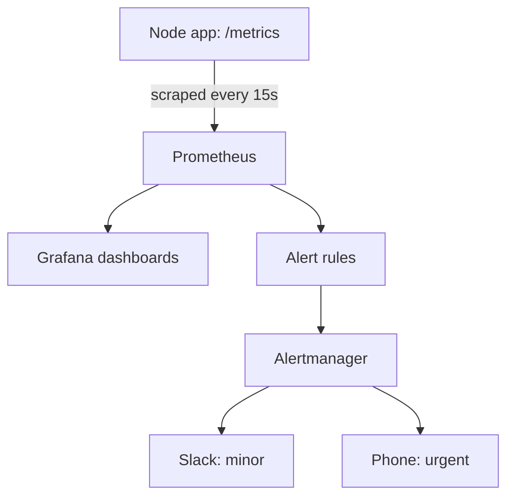

## In one line
Metrics are numbers your system records over time, such as requests per second or error rate, and alerts watch those numbers so a person is notified only when users are actually being hurt.

## The problem it solves
[Logs](#/topic/logging) tell you what happened to one request. They are bad at answering questions about **all** requests:

- Are more requests failing now than an hour ago?
- How slow is the product page for the slowest 5% of users?
- Is the server running out of memory, and how fast?

Without those numbers, you hear about an outage from angry customers, often hours late. The opposite failure is just as real: your phone buzzes 40 times a night for "CPU above 80%", and nothing is ever wrong. After a week you mute it. This is **alert fatigue**: so many useless alerts that people ignore all of them, including the real one.

Good monitoring gives you both: numbers you can look at any time, and a few alerts you trust.

## Everyday analogy
A car dashboard. The speedometer, fuel gauge, and temperature gauge show numbers that change over time. Those are metrics. The warning lights are alerts. A good car turns on the oil light only when you need to stop, not every time you accelerate.

Where it breaks down: a car comes with its gauges chosen for you. In software you decide what to measure, and a gauge tells you **that** something is wrong, not **why**. For the why, you go back to logs and traces.

## How it works
### What a metric is
A **metric** is a named number measured over time, for example `http_requests_total`. Each value is stored with a timestamp. The series of values over time is a **time series**, which is what a graph draws.

Metrics carry **labels**: extra name-value pairs that split one metric into several series. `method="GET"`, `route="/products/:id"`, and `status_code="500"` let you graph errors per route.

### The three metric types
Interviewers often ask for these by name:

- **Counter**: a number that only goes up, like an odometer. Examples: total requests, total errors, total orders. You rarely look at the raw value. You look at how fast it grows: requests **per second**.
- **Gauge**: a number that goes up and down, like a fuel gauge. Examples: memory in use, open database connections, jobs waiting in a queue.
- **Histogram**: counts how many values fell into each range, called a **bucket**. Example: how many requests took under 0.1 s, under 0.25 s, under 1 s. From the buckets you can estimate **percentiles**.

### Why percentiles, not averages
A **percentile** answers "how slow is it for the slowest X% of users?" The **p95** is the value that 95% of requests are faster than.

Say 90 requests take 50 ms and 10 take 3 seconds. The average is 345 ms, which looks fine. But the p95 is 3 seconds: one user in ten waits 3 seconds. Averages hide the pain; percentiles show it. **p50** (the median) shows the typical request, **p99** the worst 1%.

### What to measure: RED and USE
Two well-known checklists stop you measuring random things:

- **RED**, for anything that serves requests (your API, each endpoint):
  - **Rate**: requests per second.
  - **Errors**: failed requests per second, or as a share of all requests.
  - **Duration**: how long requests take, as percentiles.
- **USE**, for resources (CPU, memory, disk, the database connection pool):
  - **Utilization**: how busy it is, such as 70% CPU.
  - **Saturation**: how much work is waiting, such as queued requests or swap use.
  - **Errors**: such as disk write errors.

Google's SRE book calls a similar set the **four golden signals**: latency, traffic, errors, and saturation.

### The pipeline
Using **Prometheus**, a popular open-source metrics system, and **Grafana**, a dashboard tool:

1. The app updates counters, gauges, and histograms in memory as requests happen. This costs almost nothing.
2. It exposes the current values as text at `GET /metrics`.
3. Prometheus **scrapes** (fetches) that URL on a fixed schedule, for example every 15 seconds, and stores each value as a time series.
4. Grafana queries Prometheus and draws dashboards.
5. Prometheus evaluates **alert rules**, such as "error rate above 5% for 5 minutes".
6. When a rule fires, **Alertmanager** groups related alerts and notifies the right place: Slack for minor issues, the **on-call** person's phone for urgent ones. On-call means the engineer whose turn it is to respond outside working hours.


*Notice: Prometheus pulls numbers from the app. The app never sends alerts itself.*

## Real example
**Setup:** Node.js 18 or later, `"type": "module"` in `package.json`, and `npm install express prom-client`.

```js
import express from 'express';
import client from 'prom-client';

client.collectDefaultMetrics();                 // CPU, memory, event loop lag of this process

const httpDuration = new client.Histogram({
  name: 'http_request_duration_seconds',
  help: 'How long HTTP requests take',
  labelNames: ['method', 'route', 'status_code'],
  buckets: [0.05, 0.1, 0.25, 0.5, 1, 2.5, 5],   // upper edges, in seconds
});

const app = express();

app.use((req, res, next) => {
  const stopTimer = httpDuration.startTimer();
  res.on('finish', () => {
    // Use the route pattern, not the real URL: '/products/:id', never '/products/42'.
    const route = req.route ? req.baseUrl + req.route.path : 'unmatched';
    stopTimer({ method: req.method, route, status_code: res.statusCode });
  });
  next();
});

app.get('/products/:id', (req, res) => res.json({ id: req.params.id, name: 'Desk lamp' }));

app.get('/metrics', async (req, res) => {        // Prometheus scrapes this
  res.set('Content-Type', client.register.contentType);
  res.send(await client.register.metrics());
});

app.listen(3000);
```

After three requests to `/products/42`, `curl localhost:3000/metrics` shows (trimmed):

```text
# TYPE http_request_duration_seconds histogram
http_request_duration_seconds_bucket{le="0.05",method="GET",route="/products/:id",status_code="200"} 3
http_request_duration_seconds_bucket{le="0.1",method="GET",route="/products/:id",status_code="200"} 3
http_request_duration_seconds_sum{method="GET",route="/products/:id",status_code="200"} 0.0028
http_request_duration_seconds_count{method="GET",route="/products/:id",status_code="200"} 3
```

One histogram gives you all of RED: `_count` is the rate (and, filtered by `status_code`, the errors), and the buckets give the duration percentiles.

**Alert rules** (`alerts.yml`, loaded by Prometheus):

```yaml
groups:
  - name: shop-api
    rules:
      - alert: HighErrorRate
        # Share of requests that returned a 5xx status, over the last 5 minutes
        expr: |
          sum(rate(http_request_duration_seconds_count{status_code=~"5.."}[5m]))
            / sum(rate(http_request_duration_seconds_count[5m])) > 0.05
        for: 5m                    # must stay true for 5 minutes before anyone is paged
        labels:
          severity: page
        annotations:
          summary: "More than 5% of shop-api requests are failing"

      - alert: SlowRequests
        expr: |
          histogram_quantile(0.95,
            sum by (le) (rate(http_request_duration_seconds_bucket[5m]))) > 1
        for: 10m
        labels:
          severity: ticket         # look at it during working hours
        annotations:
          summary: "p95 latency above 1 second"
```

`rate(...[5m])` turns an ever-growing counter into "per second, averaged over the last 5 minutes". `for: 5m` stops one bad scrape from waking anyone. The two severities route differently in Alertmanager: one pages, one only creates a ticket.

## How to say it in an interview

> [!INTERVIEW]
> **30 seconds:** "Metrics are numbers tracked over time, like request rate, error rate, and latency. For an API I follow the RED method: rate, errors, and duration, with latency as p95 or p99, because averages hide slow requests. The app exposes them, Prometheus scrapes them, and Grafana graphs them. I alert on symptoms users feel, like error rate above 5% for five minutes, not on causes like high CPU, so every page is something that needs action."

> [!INTERVIEW]
> **2 minutes:** Start with the 30-second answer, then add:
>
> "There are three main metric types. Counters only go up, like total requests, and you graph their rate. Gauges go up and down, like memory or queue length. Histograms put durations into buckets so you can compute percentiles. For resources like CPU, memory, and the DB connection pool, I use the USE method: utilization, saturation, and errors.
>
> For alerts, I split urgent from non-urgent. Errors spiking or the site being down pages the on-call person. Disk at 80% or p95 latency creeping up becomes a ticket for the morning. Every paging alert should link to a dashboard or a short runbook.
>
> One tradeoff is cardinality. Each unique combination of labels is a separate time series. If I label by product ID or user ID, a store with a million products creates millions of series, and Prometheus slows down or runs out of memory. So I label by route pattern, like `/products/:id`, and leave per-user detail to logs."

## Follow-up questions interviewers ask

<details>
<summary>Counter, gauge, or histogram: which would you use for each of these? Orders placed, jobs waiting in the queue, video upload time.</summary>

- Orders placed: a **counter**. It only goes up, and you graph orders per minute.
- Jobs waiting: a **gauge**. It rises and falls.
- Upload time: a **histogram**. You want the p95, not just an average.

</details>

<details>
<summary>What makes a good alert?</summary>

- **Actionable:** someone has to do something now. If the answer is "wait and see", it should not page.
- **About symptoms:** users getting errors or slow pages. High CPU with happy users is not an emergency.
- **Not flappy:** it uses a duration such as `for: 5m`, so a single spike doesn't fire it.
- **Has a next step:** a link to a dashboard or runbook, a short document listing what to check and do.

</details>

<details>
<summary>What is cardinality, and why does it matter?</summary>

**Cardinality** is the number of distinct time series a metric creates: every unique combination of label values is one series. `route` with 30 values times `status_code` with 10 is about 300 series, which is fine. Add `userId` with a million values, and you have hundreds of millions. Storage and memory explode. Keep labels to small, fixed sets of values.

</details>

<details>
<summary>What are SLIs and SLOs?</summary>

An **SLI** (service level indicator) is a measured number, such as "share of checkout requests that succeed in under 1 second". An **SLO** (service level objective) is the target for it, such as "99.9% over 30 days". The gap between 100% and the target is the **error budget**: how much failure you can afford. Teams alert when the budget is being used up too fast, instead of on every small blip.

</details>

## Common mistakes and misconceptions

> [!MISTAKE]
> Alerting on causes instead of symptoms. "CPU above 80%" fires during every busy hour while users are fine. Alert on what users feel, such as errors and latency, and keep CPU on a dashboard.

> [!MISTAKE]
> Watching only average latency. A 345 ms average can hide one user in ten waiting 3 seconds. Track p95 and p99.

> [!MISTAKE]
> Using the real URL as a label: `route="/products/42"`. Every product becomes its own series. Use the route pattern `/products/:id`.

> [!MISTAKE]
> "We have dashboards, so we have monitoring." Nobody watches a dashboard at 2 AM. Without alerts, a dashboard only helps once someone already knows there is a problem.

## Tradeoffs: when NOT to use it
- **Metrics can't explain one request.** They say "5% of checkouts fail", not which user or why. Keep [logs](#/topic/logging) and, for many services, [tracing](#/topic/distributed-tracing).
- **A small side project doesn't need Prometheus and Grafana.** An external [uptime check](#/topic/health-checks) and your provider's built-in CPU and disk graphs may be enough at first.
- **More alerts are not more safety.** Each paging alert has a cost in sleep and attention. If an alert fires and nobody acts on it, delete it or make it a ticket.
- **Too many labels cost real money.** Hosted metrics services typically charge per time series, so careless labels show up on the bill.

## Check yourself

<details>
<summary>1. Name the three parts of the RED method.</summary>

Rate (requests per second), Errors (failed requests), and Duration (how long requests take, as percentiles). It is for anything that serves requests, such as an API.

</details>

<details>
<summary>2. Why is "error rate above 5% for 5 minutes" a better page than "one 500 error happened"?</summary>

A single error happens all the time for harmless reasons, such as a client disconnecting. A sustained error rate means many users are affected, so a person needs to act. The `for` duration also stops one bad moment from waking someone.

</details>

<details>
<summary>3. Memory in use by the Node process: counter or gauge?</summary>

A gauge, because it goes up and down. Counters only ever increase, apart from resetting to zero when the process restarts.

</details>

## Go deeper
- [Google SRE book: Monitoring distributed systems](https://sre.google/sre-book/monitoring-distributed-systems/)
- [Prometheus docs: Metric types](https://prometheus.io/docs/concepts/metric_types/)
- [Prometheus docs: Alerting practices](https://prometheus.io/docs/practices/alerting/)
