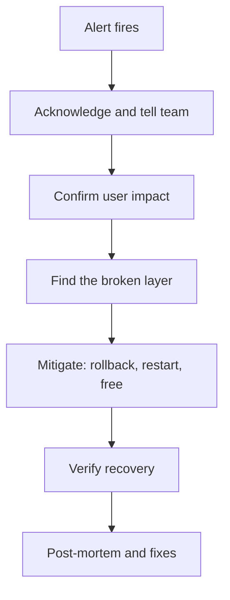

## In one line
When production goes down, you acknowledge the alert, tell people, restore service as fast as safely possible (often by rolling back, restarting, or freeing a resource), and only then find the root cause and write it up without blame.

## The problem it solves
"The server is down at 2 AM. Walk me through what you do." Interviewers ask this to test your **priorities** under pressure, more than your knowledge of any one tool.

An **incident** is an unplanned event that hurts users, such as an outage or broken checkout. During one, every minute costs orders and trust, and panic causes new damage: someone deletes the wrong files, restarts things at random, or spends an hour hunting the root cause while the site stays down.

A good answer shows a calm order of work:

1. Restore service first.
2. Keep people informed.
3. Understand the cause after.
4. Make sure it can't happen the same way again.

Here's the scenario we will walk through. At 2:07 AM, your phone rings: the uptime monitor says `https://shop.example.com` has failed three checks in a row. Your stack is the running example: Nginx, a Node.js API, PostgreSQL, and Redis, in Docker Compose on one Ubuntu server.

## Everyday analogy
Firefighters. When they arrive, they don't start by asking how the fire began. They get people out and put the fire out. The investigation happens the next day, and its report leads to new rules, such as smoke alarms, so the same fire doesn't happen again.

Where it breaks down: firefighters can't un-start a fire. You often can: rolling back a deploy is an "undo" button. That's why "what changed?" is one of your first questions.

## How it works
The incident flow, in order:

1. **Acknowledge.** Accept the alert in your paging tool, so nobody else is woken for the same thing and the team knows someone is on it.
2. **Confirm the impact from outside.** Is the whole site down, or one feature? All users, or one region? Check it the way a customer would.
3. **Communicate.** Post in the team's incident channel, and on the public status page if you have one: what's broken, that you're on it, and when the next update is. Short and regular beats detailed and late.
4. **Find the broken layer, fast.** Walk the request path from outside in: DNS, the server, Nginx, the app containers, the database, then disk and memory. Look for what changed.
5. **Mitigate.** Pick the fastest safe action that restores service: roll back the last deploy, restart a crashed service, free up disk, or fail over. **Mitigation** means reducing the damage now, even if the real fix comes later.
6. **Verify recovery.** The monitor is green, a real request works end to end, and error rates are back to normal. Keep watching for a while.
7. **Follow up.** Write a **post-mortem**: a short document with the timeline, the root cause, and action items. It should be **blameless**, focused on how the system allowed the mistake, not on who made it.


*Notice: root-cause analysis comes after recovery. Restoring service is the first job.*

### The usual suspects at 2 AM
| Cause | First command or check |
|---|---|
| Bad deploy | Deploy history: did anything ship today? Roll back. |
| Disk full | `df -h` |
| Out of memory | `sudo dmesg -T \| grep -i "killed process"` or `docker inspect --format '{{.State.OOMKilled}}' <container>` |
| Crashed or crash-looping app | `docker compose ps`, then `docker compose logs --tail=100 api` |
| Database down or out of connections | `docker compose logs db`, and `pg_stat_activity` |
| Expired TLS certificate | Browser warning, or `curl -v` shows a certificate error |
| DNS or domain problem | `dig +short shop.example.com` |
| Cloud provider incident | The provider's status page |

The **OOM killer** in that table is the Linux kernel feature that kills a process when the machine runs out of memory. It logs every kill, which is why `dmesg`, the kernel's message log, is the place to look.

## Real example
Here's the 2:07 AM story, with the commands. The outputs are illustrative and trimmed.

**1. Acknowledge and confirm.** You accept the page and post in the team channel: "Investigating: shop.example.com is down. Next update 2:25." Then check from your laptop:

```bash
curl -sI https://shop.example.com | head -1
# HTTP/2 502
```

A `502 Bad Gateway` means DNS, TLS, and Nginx all work. Nginx is up, but the app behind it isn't answering. The problem is behind Nginx.

**2. Look at the containers.** SSH in (see [SSH](#/topic/ssh)):

```bash
cd /srv/shop && docker compose ps --format 'table {{.Service}}\t{{.Status}}'
# SERVICE   STATUS
# nginx     Up 9 days
# api       Restarting (1) 12 seconds ago
# db        Restarting (1) 4 seconds ago
# redis     Up 9 days
```

Both the API and the database are crash-looping. The API probably fails because it can't reach the database, so look at the database first:

```bash
docker compose logs --tail=5 db
# PANIC:  could not write to file "pg_wal/xlogtemp.31": No space left on device
```

**3. Find what filled the disk.**

```bash
df -h /
# Filesystem  Size  Used Avail Use% Mounted on
# /dev/vda1    49G   49G     0 100% /

sudo du -xh --max-depth=1 /var/lib/docker | sort -h | tail -3
# 2.1G  /var/lib/docker/volumes
# 3.4G  /var/lib/docker/overlay2
# 41G   /var/lib/docker/containers
```

`/var/lib/docker/containers` holds each container's captured stdout. Which container's log is huge?

```bash
sudo sh -c 'du -h /var/lib/docker/containers/*/*-json.log' | sort -h | tail -1
# 40G  /var/lib/docker/containers/9f3c.../9f3c...-json.log

docker inspect --format '{{.Name}} {{.LogPath}}' $(docker ps -aq) | grep 9f3c
# /shop-api-1  /var/lib/docker/containers/9f3c.../9f3c...-json.log
```

The API's log file is 40 GB. The `sudo sh -c` is needed because the `*` wildcard must be expanded by root: a normal user can't list that folder.

**4. Mitigate.** Empty the file in place, then start the stack:

```bash
sudo truncate -s 0 "$(docker inspect --format '{{.LogPath}}' shop-api-1)"
df -h /                 # Use% back down to about 18%
docker compose up -d    # starts anything that is stopped
```

Why `truncate` and not `rm`? Docker still has the file open. Deleting an open file removes its name, but Linux keeps the disk space allocated until the program closes it, so `df` would still show 100%. Truncating empties it in place.

Don't reach for `docker system prune -a --volumes` in a panic. It removes stopped containers, unused images, and anonymous volumes no container is using (named volumes are kept on current Docker, but anonymous ones can still hold data). In the middle of an incident, with containers crashing and being recreated, it's easy to lose something you needed, and a deleted volume can be your data. Free space with targeted commands you understand. See [Volumes](#/topic/docker-volumes).

**5. Verify.**

```bash
docker compose ps                                   # all services "Up"
curl -s -o /dev/null -w '%{http_code}\n' https://shop.example.com/health/ready
# 200
```

The uptime monitor turns green. You place a test order. PostgreSQL recovers by replaying its **write-ahead log** (WAL), the record of committed changes it writes before changing the data files, so committed orders are not lost. You post: "Resolved at 2:31. Cause: disk full. Details tomorrow."

**6. The next day: root cause and action items.** The logs show why the file grew: on Friday, someone set `LOG_LEVEL=debug` in `.env` to investigate a bug, and never set it back. Docker's default `json-file` log driver does no rotation, so the file grew until the disk was full. The fixes:

```yaml
# docker-compose.yml: cap each container's logs at 3 files of 10 MB
services:
  api:
    logging:
      driver: json-file
      options:
        max-size: "10m"
        max-file: "3"
```

Plus: an alert when disk use passes 80% (see [Metrics and alerts](#/topic/metrics-alerts)), and a rule that debug logging is switched on with a reminder to switch it off. The logging options take effect when containers are recreated, for example with `docker compose up -d`.

## How to say it in an interview

> [!INTERVIEW]
> **30 seconds:** "First, I acknowledge the alert and tell the team I'm on it. Then I confirm the impact from outside, with curl or the browser, to see what's actually broken. My priority is restoring service, not finding the root cause. I check what changed recently, because rolling back a bad deploy is the fastest fix. Otherwise I walk the layers: Nginx, the containers, the logs, the database, disk and memory. Once it's back, I verify it properly, and the next day we write a blameless post-mortem with action items."

> [!INTERVIEW]
> **2 minutes:** Start with the 30-second answer, then tell a concrete story:
>
> "For example: the uptime monitor paged at 2 AM, and curl showed a 502, so Nginx was fine and the app behind it wasn't. `docker compose ps` showed the API and Postgres crash-looping, and the Postgres logs said 'No space left on device'. `df` showed the disk at 100%, and `du` found a 40 GB container log, because debug logging had been left on and Docker doesn't rotate logs by default. I truncated the file rather than deleting it, since Docker still had it open, brought the stack up, and checked the health endpoint and a test order.
>
> The tradeoff I keep in mind is speed versus evidence. Restarting or rolling back destroys clues, so I spend a minute saving logs first, but I don't let investigation delay recovery. The action items were log rotation in Compose, a disk alert at 80%, and a check that debug logging gets switched off. The post-mortem was about why the system allowed it, not about who forgot."

## Follow-up questions interviewers ask

<details>
<summary>Do you roll back or fix forward?</summary>

Roll back by default when a recent deploy is the likely cause: it's fast, tested, and reversible. **Fix forward**, meaning deploy a new fix, only when rolling back is impossible or riskier. The classic case is a database migration that the old code can't work with. This is why migrations should stay backward-compatible for at least one release. See [Migrations](#/topic/migrations).

</details>

<details>
<summary>What if you can't SSH into the server?</summary>

Use the cloud provider's web console or serial console, which work even when SSH or the network is broken. Common reasons for being locked out: memory exhaustion makes the server too slow to respond, a full disk prevents login, or a firewall change blocked port 22. As a last resort, reboot from the provider's dashboard. Accept that you may lose in-memory evidence, and make sure services start on boot.

</details>

<details>
<summary>What goes into a post-mortem?</summary>

A summary, the impact (who was affected and for how long), a timeline with times, the root cause and contributing factors, what went well, what went badly, and action items, each with an owner and a due date. It's blameless: "the deploy process allowed debug logging to stay on" rather than "Sam forgot". People hide mistakes when they're blamed, and hidden mistakes come back.

</details>

<details>
<summary>The database itself is corrupted or the data is gone. What then?</summary>

Stop writes first, so the damage doesn't spread. Then restore from the most recent good backup, ideally with point-in-time recovery to just before the problem. Communicate clearly what data may be lost. This is the moment you find out whether your backups were ever tested. See [Backups and restore](#/topic/backups).

</details>

<details>
<summary>How do you communicate during an incident?</summary>

One channel for the incident, and updates at a promised rhythm, such as every 15 to 30 minutes, even when the update is "still investigating". In larger incidents, one person coordinates and communicates while others debug, so the people fixing things aren't interrupted. Customers get plain language: what's affected, not internal details.

</details>

## Common mistakes and misconceptions

> [!MISTAKE]
> Hunting for the root cause while the site stays down. Restore first. A rollback or restart that brings the site back in two minutes beats a perfect diagnosis after an hour.

> [!MISTAKE]
> Working silently. Your teammates and support staff don't know if anyone is on it, and two people may start changing the same server at once.

> [!MISTAKE]
> Deleting a huge log file that a process still has open. `rm` doesn't free the space until the process closes it. Use `truncate -s 0`, or restart the process afterwards.

> [!MISTAKE]
> Destructive commands in a panic, such as `docker system prune -a --volumes` or `rm -rf` on a data folder, run alone at 2 AM. If a command can delete data, slow down, or wake a second person to check it.

> [!MISTAKE]
> Ending the incident at "it's back up". Without a post-mortem and action items, the same thing happens again next month.

## Judgment calls: when NOT to just restart
- **Restarting destroys evidence.** Spend a minute saving logs (`docker compose logs api > /tmp/api-incident.log`) and noting memory and disk use. But only a minute.
- **Rollback isn't always safe.** If the new release ran a migration that the old code can't handle, rolling back the code breaks things further. Check before you roll back.
- **Don't fail over the database casually.** Promoting a replica can lose the last few seconds of writes if replication was behind, and you must avoid two databases both accepting writes. See [Replication and sharding](#/topic/replication-sharding).
- **Know when to escalate.** If you're out of ideas after about 15 to 20 minutes, or the problem involves data loss or security, wake the next person. That's what on-call rotations are for.

## Check yourself

<details>
<summary>1. The site returns 502 Bad Gateway. Which layers can you rule out?</summary>

DNS, the network path, TLS, and Nginx itself are working, since Nginx answered. The problem is the app behind Nginx: it has crashed, is restarting, isn't listening on the expected port, or is failing to respond.

</details>

<details>
<summary>2. You deleted a 40 GB log file, but df still shows the disk as 100% full. Why?</summary>

A running process still has the file open. Linux frees the space only when the last open handle is closed. Restart the process that holds it, or next time use `truncate -s 0` instead of `rm`.

</details>

<details>
<summary>3. In what order should these happen: post-mortem, mitigation, acknowledging the alert, verifying recovery?</summary>

Acknowledge the alert, mitigate, verify recovery, then write the post-mortem.

</details>

## Go deeper
- [Google SRE book: Managing incidents](https://sre.google/sre-book/managing-incidents/)
- [Google SRE book: Postmortem culture](https://sre.google/sre-book/postmortem-culture/)
- [Docker docs: JSON File logging driver (rotation options)](https://docs.docker.com/engine/logging/drivers/json-file/)
