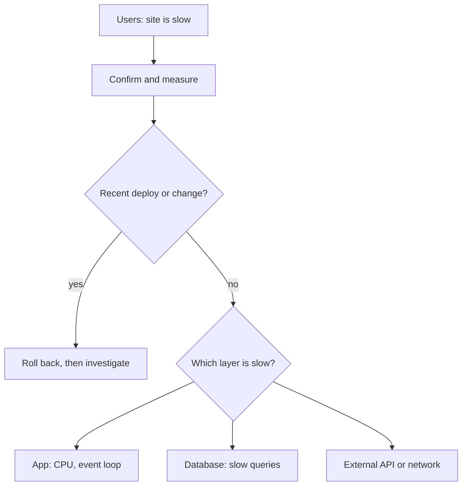

## In one line
When production is slow, you confirm and measure the slowness, find out what changed, narrow it down layer by layer to the one slow part, fix that with the smallest safe change, and prove the fix with the same measurement.

## The problem it solves
"The site is slow in production. What do you do?" is one of the most common backend interview questions. There is no single right answer. The interviewer wants to see a **method**.

Weak answers jump straight to a solution: "I'd add Redis" or "I'd add more servers". Those might help, or might make it worse. If the database is the bottleneck, more app servers open more database connections and slow it down further.

Here is the scenario we will walk through. It is Monday, 10:00. Support says: "Customers say product pages take 6 to 8 seconds to load." Your app is the running example: a Node.js API in Docker, with PostgreSQL and Redis, behind Nginx, on one Ubuntu server.

## Everyday analogy
A doctor with a patient who says "I feel tired". A good doctor doesn't prescribe anything yet. They ask questions (since when? anything new?), check vital signs, and order tests that rule things out one by one. Only then do they treat, and they check later that the treatment worked.

Where it breaks down: a doctor can't safely experiment on the patient. You often can: roll back a deploy in a minute, or reproduce the problem on a copy of the system.

## How it works
The method, as seven steps:

1. **Clarify and confirm.** Which pages? All users or some? Since when? Then measure it yourself, so you are not relying on "it feels slow".
2. **Ask what changed.** A deploy, a traffic spike, a data import, a config change, a provider incident? Most production problems follow a change.
3. **Check the overview metrics.** p95 latency, error rate, and traffic over time (see [Metrics](#/topic/metrics-alerts)). Did slowness start at a specific minute? Is it every route or one?
4. **Find the slow layer, outside in.** Network and CDN, then Nginx, then the Node app, then its dependencies: PostgreSQL, Redis, and external APIs. At each layer, ask "is the time spent here, or further in?"
5. **Check resources** on the server: CPU, memory, disk, and the database's active queries.
6. **Fix with the smallest safe change.** If a deploy caused it, roll back first and investigate after. Change one thing at a time.
7. **Verify and follow up.** Re-run the same measurement, watch p95 return to normal, then add an alert or test so it can't silently return.


*Notice: "what changed?" comes before deep debugging, because undoing a change is often the fastest fix.*

### Common causes, and the clue for each
| Cause | The clue |
|---|---|
| Missing index or slow query | Database CPU high; one query appears again and again in active queries |
| N+1 queries | Hundreds of tiny queries per request (see [The N+1 query problem](#/topic/n-plus-one)) |
| Connection pool exhausted | App CPU low, database not busy, but requests wait to get a connection |
| Slow external API | Your code is idle, waiting; traces show one long outgoing call |
| Blocked event loop | Node at 100% of one CPU core; even `/health/live` is slow (see [The event loop](#/topic/event-loop)) |
| Memory pressure | Memory near the limit, swap in use, or the app restarting |
| Traffic spike or cache down | Request rate jumped, or Redis is unreachable so every read hits the database |

## Real example
Here is the Monday story, step by step, with the commands. The `curl`, `docker stats`, and `pg_stat_activity` outputs are illustrative. The `EXPLAIN ANALYZE` outputs are real, from a test table of 3 million videos.

**1. Confirm and measure.** From your laptop, time the slow page and a cheap endpoint:

```bash
curl -o /dev/null -s -w 'connect: %{time_connect}s  first byte: %{time_starttransfer}s\n' \
  https://api.example.com/products/42
# connect: 0.048s  first byte: 6.912s

curl -o /dev/null -s -w 'first byte: %{time_starttransfer}s\n' https://api.example.com/health/live
# first byte: 0.061s
```

Connecting is fast, so the network is fine. The health endpoint is fast, so Node's event loop is not blocked. The time is spent **inside** the product request. The **time to first byte** (TTFB), how long until the first byte of the response arrives, is the server doing work.

**2. What changed?** The deploy log shows a release on Sunday evening: "Show related videos on product pages."

**3. Check resources.** SSH into the server:

```bash
docker stats --no-stream --format 'table {{.Name}}\t{{.CPUPerc}}\t{{.MemUsage}}'
# NAME          CPU %     MEM USAGE / LIMIT
# shop-api-1    6.2%      182MiB / 3.8GiB
# shop-db-1     391.5%    1.1GiB / 3.8GiB
```

The API is nearly idle, waiting. PostgreSQL is using almost four CPU cores (100% per core). The database is the bottleneck.

**4. What is the database doing?** `pg_stat_activity` lists every connection and its current query:

```bash
docker compose exec db psql -U shop -d shop -c "
  SELECT pid, now() - query_start AS running_for, state, left(query, 50) AS query
  FROM pg_stat_activity
  WHERE state <> 'idle' AND pid <> pg_backend_pid()
  ORDER BY running_for DESC;"
```

The output (trimmed) shows the same query 18 times, each running for seconds:

```text
 pid  |   running_for   | state  |                       query
------+-----------------+--------+---------------------------------------------------
 4120 | 00:00:03.912    | active | SELECT id, title, duration_s FROM videos WHERE pro
 4133 | 00:00:03.770    | active | SELECT id, title, duration_s FROM videos WHERE pro
 ...
```

**5. Why is that query slow?** Run it with `EXPLAIN ANALYZE`, which executes the query and shows the plan the database chose, with real timings (see [Reading a slow query with EXPLAIN](#/topic/explain-analyze)):

```bash
docker compose exec db psql -U shop -d shop -c "EXPLAIN ANALYZE
  SELECT id, title, duration_s FROM videos
  WHERE product_id = 42 ORDER BY created_at DESC LIMIT 10;"
```

```text
 Limit  (actual time=39.287..41.377 rows=10 loops=1)
   ->  Gather Merge  (actual time=39.286..41.375 rows=10 loops=1)
         ->  Sort  (actual time=34.671..34.671 rows=10 loops=3)
               ->  Parallel Seq Scan on videos  (actual time=1.772..34.590 rows=20 loops=3)
                     Filter: (product_id = 42)
                     Rows Removed by Filter: 999980
 Execution Time: 41.493 ms
```

`Seq Scan` means a **sequential scan**: PostgreSQL reads every row of the `videos` table, 3 million of them, to find 60. Here three parallel workers split the table, so each one discarded about a million rows: "Rows Removed by Filter" is that wasted work, per worker. Each run takes about 41 ms on an idle test machine. With dozens running at once on every product page view, they compete for CPU, and each one takes seconds.

**6. Fix: add an index on the column being filtered** (see [Indexes](#/topic/indexes)):

```bash
docker compose exec db psql -U shop -d shop -c \
  "CREATE INDEX CONCURRENTLY idx_videos_product_id ON videos (product_id);"
```

`CONCURRENTLY` builds the index without blocking writes to the table. It takes longer, but the shop keeps taking orders. The plan now uses the index:

```text
 ->  Bitmap Index Scan on idx_videos_product_id  (actual time=0.010..0.010 rows=60 loops=1)
 Execution Time: 0.384 ms
```

From about 41 ms to under half a millisecond, roughly 100 times faster, on the same data. These timings come from a test machine; yours will differ, but the shape won't.

**7. Verify and follow up.** Run the same `curl`: first byte is back to about 0.2 s. The p95 graph drops within minutes, and database CPU falls. Then:

- Add the index as a proper migration in the repo, so it exists in every environment. See [Migrations](#/topic/migrations).
- Turn on PostgreSQL's slow query log (`log_min_duration_statement`, for example 500 ms) so the next slow query shows up in logs.
- Add a p95 latency alert, and review new queries with `EXPLAIN` before merging.

## How to say it in an interview

> [!INTERVIEW]
> **30 seconds:** "First I'd confirm it and measure: which pages, which users, since when, and I'd time it myself with curl. Then I'd ask what changed, because a recent deploy is the most common cause, and rolling back is the fastest fix. If nothing changed, I'd use the metrics to narrow it down layer by layer: network, Nginx, the app, then the database and external calls, checking CPU, memory, and active queries. Once I find the bottleneck, I'd make one small fix and confirm with the same measurement that it worked."

> [!INTERVIEW]
> **2 minutes:** Start with the 30-second answer, then tell a concrete story:
>
> "For example, product pages got slow after we added related videos. curl showed connect was fast but time to first byte was about 7 seconds, and the health endpoint was fast, so it wasn't the network or a blocked event loop. docker stats showed the API idle and Postgres using four cores. In pg_stat_activity, the same videos query was running many times at once, and EXPLAIN ANALYZE showed a sequential scan over three million rows, because product_id had no index. I created the index with CONCURRENTLY so writes weren't blocked, and the query went from about 40 milliseconds to under one. Then I added it as a migration and set up the slow query log and a p95 alert.
>
> The tradeoff I'd mention: when users are suffering, I mitigate first and investigate after. If the deploy was the obvious trigger, I'd roll back and find the missing index calmly afterwards. And I'd avoid guesses like 'add more servers', because here the database was the bottleneck, and more app servers would have made it worse."

## Follow-up questions interviewers ask

<details>
<summary>The app server is at 100% CPU, but the database is quiet. What now?</summary>

The work is inside Node. Because JavaScript runs on one main thread, one CPU-heavy task blocks every request (see [The event loop](#/topic/event-loop)). Look for synchronous work: huge `JSON.parse` or `JSON.stringify` calls, `bcrypt.hashSync`, image processing, or big loops. Capture a CPU profile with `node --cpu-prof` and look for the function that takes most of the time. Fixes: make the work async, move it to a background job or worker thread, or do less of it.

</details>

<details>
<summary>The app CPU is low, the database is quiet, and requests are still slow. Where is the time going?</summary>

Something is **waiting**. Common suspects:

- **The connection pool is full**, so requests queue for a free connection. Check the pool's waiting count, and look for long transactions holding connections. See [Connection pooling](#/topic/connection-pooling).
- **An external API is slow**, such as a payment provider. A trace shows one long outgoing span. Make sure every outgoing call has a timeout.
- **Locks.** In `pg_stat_activity`, `wait_event_type = 'Lock'` means queries are waiting for another transaction to finish.

</details>

<details>
<summary>Only some users say it's slow. How does that change your approach?</summary>

Find what they share. One region suggests the CDN or network path. One big customer suggests data size: an account with 50,000 orders may hit a slow, unpaginated query that small accounts never do. Look at p99 rather than p50, and filter logs by those user IDs to see which endpoints are slow for them.

</details>

<details>
<summary>Would you just scale up the server?</summary>

Only as a temporary measure while finding the real cause, and only if the bottleneck is something more hardware actually helps. Scaling hides a missing index for a while, then the table grows and the problem returns, now on a more expensive server. And adding app servers when the database is the bottleneck increases load on the database.

</details>

<details>
<summary>How do you know if it's the frontend or the backend?</summary>

Look at time to first byte. If the API answers quickly but the page still feels slow, the time is in the browser: large JavaScript bundles, unoptimised images, or many requests in sequence. The browser DevTools Network tab shows this as a waterfall. See [How the browser renders a page](#/topic/critical-rendering-path).

</details>

## Common mistakes and misconceptions

> [!MISTAKE]
> Jumping to a fix before measuring. "Add caching" may hide a slow query for a while, but the cache misses are still slow, and you now have stale data to manage.

> [!MISTAKE]
> Changing several things at once. If you add an index, raise the pool size, and restart everything together, you don't know which one helped, or which one will hurt later.

> [!MISTAKE]
> Restarting and calling it fixed. A restart may clear the symptom for an hour. Save the evidence first (logs, `docker stats`, active queries), then restart if you must.

> [!MISTAKE]
> Running `EXPLAIN ANALYZE` carelessly on writes. It **actually executes** the statement, so `EXPLAIN ANALYZE DELETE ...` deletes rows. Wrap it in `BEGIN; ... ROLLBACK;` or use plain `EXPLAIN`.

> [!MISTAKE]
> `CREATE INDEX` without `CONCURRENTLY` on a busy production table. A normal index build blocks inserts and updates on that table until it finishes, which can take minutes on large tables.

## Judgment calls: when NOT to keep digging
- **Mitigate first when users are hurting.** If rolling back the last deploy fixes it in two minutes, do that. Root-cause analysis can wait until the site is healthy.
- **Don't add load to a struggling database.** Heavy diagnostic queries can tip it over. Prefer cheap views like `pg_stat_activity`, and run experiments on a copy when you can.
- **Time-box the investigation.** If you are 30 minutes in without a lead, bring in a teammate. A fresh pair of eyes is cheaper than a longer outage.
- **Not every slowness is worth fixing now.** A report page used once a week by one admin that takes 4 seconds may be acceptable. Fix what users feel most.

## Check yourself

<details>
<summary>1. curl shows connect takes 0.05 s and first byte takes 7 s. What does that tell you?</summary>

The network and the connection are fine. The 7 seconds are spent on the server side, producing the response: the app, the database, or something the app is waiting on.

</details>

<details>
<summary>2. EXPLAIN ANALYZE shows a Seq Scan with "Rows Removed by Filter: 2999940". What does it mean, and what's the usual fix?</summary>

PostgreSQL read the whole table and threw away almost every row, because there is no useful index for the filter. The usual fix is an index on the filtered column, built with `CREATE INDEX CONCURRENTLY` in production.

</details>

<details>
<summary>3. Why ask "what changed?" so early?</summary>

Most production problems follow a change: a deploy, a config edit, a data import, or a traffic jump. Knowing it narrows the search instantly, and undoing the change is often the quickest way to restore service.

</details>

## Go deeper
- [PostgreSQL docs: Using EXPLAIN](https://www.postgresql.org/docs/current/using-explain.html)
- [PostgreSQL docs: pg_stat_activity and other statistics views](https://www.postgresql.org/docs/current/monitoring-stats.html)
- [Google SRE book: Effective troubleshooting](https://sre.google/sre-book/effective-troubleshooting/)
