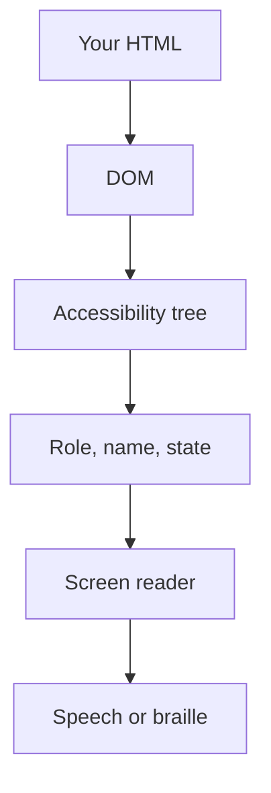

## In one line
Accessibility means building pages that everyone can use, including people who navigate with only a keyboard, listen through a screen reader, zoom in, or cannot hear a video's sound.

## The problem it solves
A shopper who is blind opens your product page with a **screen reader**: software that reads the page aloud, or shows it on a braille display. They reach the Buy button, and the screen reader says only "clickable". It was a `<div>` with a click handler. They cannot tell what it does, and pressing Enter does nothing.

Another shopper uses only the keyboard. They press Tab, but no outline shows where they are. Neither can buy anything.

**Accessibility** (often shortened to **a11y**: "a", 11 letters, "y") is about removing these barriers. It matters because:

- Many people have a disability affecting vision, hearing, movement, or cognition, and others have temporary limits, like a broken arm.
- In many places it is a legal requirement, for example under the Americans with Disabilities Act (US) and the European Accessibility Act (EU).

## Everyday analogy
A building with a ramp next to its stairs. The ramp helps wheelchair users, but also parents with strollers and couriers with carts. Semantic HTML is the ramp that comes built in. ARIA is a sign you add when you built something custom.

Where it breaks down: a ramp is visible. Most web accessibility lives in the page's structure, and you only notice it is missing when you use a keyboard or a screen reader.

## How it works

**1. The browser builds an accessibility tree.**
From the **DOM** (the browser's tree of page elements), the browser builds a second tree: the **accessibility tree**. Screen readers and other assistive tools read this tree, not the pixels. Each node has:

- A **role**: what it is (button, link, heading, checkbox).
- A **name**: what it is called ("Add to cart").
- A **state**: its current condition (checked, expanded, disabled).


*Notice: assistive technology sees only what reaches the accessibility tree, not how the page looks.*

**2. Semantic HTML fills the tree for free.**
**Semantic HTML** means using elements for their meaning: `<button>` for actions, `<a href>` for navigation, `<h1>`-`<h6>` for headings, `<nav>`, `<main>`, `<label>` for form fields. A `<button>` comes with a role, keyboard focus, and Enter and Space handling built in. A `<div>` has none of those.

**3. ARIA patches the tree when HTML is not enough.**
**ARIA** (Accessible Rich Internet Applications) is a set of HTML attributes, like `aria-label`, `aria-expanded`, and `role`, that change what the accessibility tree says. It changes **only** the tree. `role="button"` on a `<div>` does not make it focusable or respond to Enter. Hence the first rule of ARIA: if a native element does the job, use it.

**4. Everything works with a keyboard.**
**Focus** is which element receives keyboard input. Tab moves focus forward, Shift+Tab backward. Every interactive element must be reachable, show a visible focus outline, and work with Enter or Space. When a dialog opens, focus moves into it; when it closes, focus returns to the button that opened it.

**5. WCAG is the checklist.**
The **WCAG** (Web Content Accessibility Guidelines) from the W3C is the standard most laws point to. The current version is 2.2. It has three levels, A, AA, and AAA; **AA** is the usual target. Examples from AA: normal text needs a **contrast ratio** (how different the text and background colours are) of at least 4.5:1, and large text 3:1. Prerecorded video needs **captions** at level A, which matters for a video platform.

## Real example
**1. A Buy button.** The first version is what the blind shopper met.

```html
<!-- Bad: no role, no name for assistive tech, not focusable, ignores Enter -->
<div class="btn" onclick="addToCart(42)"><svg>...</svg></div>

<!-- Good: role, focus, and keyboard support come free; the name is the text -->
<button type="button" onclick="addToCart(42)">Add to cart</button>

<!-- Icon-only button: give it a name explicitly -->
<button type="button" aria-label="Add Ceramic mug to wishlist"><svg aria-hidden="true">...</svg></button>
```

**2. A form field and an image.**

```html
<!-- The label's "for" matches the input's "id", so the field is announced by name -->
<label for="email">Email address</label>
<input id="email" type="email" autocomplete="email" required>

<!-- alt describes the image's purpose; decorative images get alt="" -->

```

**3. Announcing a change that has no focus.** After "Add to cart", only the cart badge changes. A sighted user sees it; a screen reader user hears nothing. A **live region** is an element whose changes are read aloud automatically.

```jsx
function CartStatus({ count }) {
  // role="status" is a polite live region: read out when its text changes
  return <p role="status">{count > 0 ? `${count} items in cart` : ''}</p>;
}
```

**How to test in five minutes:**

1. Put the mouse away. Tab through the page. Can you reach and use everything? Can you always see where focus is?
2. Run an automated checker: Lighthouse in Chrome DevTools or the axe browser extension. It catches missing labels, low contrast, and missing alt text.
3. Try a screen reader: VoiceOver on macOS (Cmd+F5) or NVDA (free) on Windows. Listen to your product page.

Automated tools catch only part of the issues, such as missing labels and low contrast. They cannot judge whether alt text is meaningful or focus order makes sense; the keyboard and screen reader checks do.

## How to say it in an interview

> [!INTERVIEW]
> **30 seconds:** "Accessibility means people using keyboards, screen readers, or zoom can use the site. Screen readers read the accessibility tree, which the browser builds from the DOM, with a role, a name, and a state for each element. So I start with semantic HTML: real buttons, links, labels, and headings, which give you keyboard support and the right roles for free. I use ARIA only when native HTML can't express something, and I test with the keyboard and an automated checker like axe."

> [!INTERVIEW]
> **2 minutes:** Start with the 30-second answer, then add:
>
> "A common real bug is a clickable `div`. It has no role and no focus, so a keyboard or screen reader user can't use it. Switching to a `button` fixes all of that at once.
>
> In React apps, the extra work is dynamic content: when a cart updates or a route changes, I announce it with a live region or move focus to the new heading.
>
> The tradeoff is that ARIA is easy to misuse: a wrong role or a stale `aria-expanded` is worse than none, because it lies to the user. So I prefer native elements, use a well-tested library for complex widgets like comboboxes, and aim for WCAG 2.2 level AA, which most legal requirements reference."

## Follow-up questions interviewers ask

<details>
<summary>What is the difference between alt="" and no alt attribute?</summary>

`alt=""` says "this image is decorative, skip it", and screen readers ignore it. With no `alt` at all, many screen readers fall back to reading the file name, like "product-42-final-v2.webp". Every image needs an `alt`: a description if it carries meaning, empty if it is decoration.

</details>

<details>
<summary>Why is a div with an onClick not enough, even with role="button"?</summary>

`role="button"` only tells assistive tech it is a button. You would still need `tabindex="0"` to make it focusable, key handlers for Enter and Space, and disabled-state handling. A native `<button>` does all of that already, with less code and fewer bugs.

</details>

<details>
<summary>How do you make a single-page app accessible on route changes?</summary>

In a normal website, loading a new page resets focus and screen readers announce the new title. In a single-page app, nothing reloads, so nothing is announced. After navigation, update `document.title` and move focus to the new page's main heading, or announce the change in a live region. Some frameworks, including Next.js, have built-in route announcers.

</details>

<details>
<summary>What does aria-hidden="true" do, and when is it dangerous?</summary>

It removes the element **and everything inside it** from the accessibility tree, while it stays visible on screen. It is right for decorative icons next to text. It is dangerous on a container that holds buttons or links: keyboard users can still tab to them, but screen readers announce nothing.

</details>

## Common mistakes and misconceptions

> [!MISTAKE]
> Removing focus outlines with `outline: none` because they "look ugly". Keyboard users then cannot see where they are. Style them with `:focus-visible` instead, which shows the outline for keyboard use but not mouse clicks.

> [!MISTAKE]
> "More ARIA makes a page more accessible." Incorrect ARIA overrides what the native element would say, and can make a working page worse.

> [!MISTAKE]
> Using colour alone to show meaning, like a red border as the only sign of an invalid field. Add text ("Enter a valid email") or an icon.

## Tradeoffs: when NOT to use it
Accessibility itself is not optional. The tradeoffs are about **how**:

- **Don't build custom widgets when native ones exist.** A styled `<select>` or `<dialog>` is less work and more accessible than a hand-made one. Build custom only when the design truly needs it, and then follow the ARIA Authoring Practices patterns.
- **Don't bolt it on at the end.** Fixing a finished app costs far more than using the right elements from the start, especially for design-system components reused everywhere.

## Check yourself

<details>
<summary>1. What three things does the accessibility tree record for each element?</summary>

Its role (what it is), its name (what it is called), and its state (such as checked, expanded, or disabled).

</details>

<details>
<summary>2. An icon-only "Delete order" button has no text. How do you give it a name?</summary>

Add `aria-label="Delete order 1042"` to the `<button>`, and `aria-hidden="true"` on the icon so it is not read separately. Alternatively, include visually hidden text inside the button.

</details>

<details>
<summary>3. What is the minimum contrast ratio for normal body text under WCAG level AA?</summary>

4.5:1. Large text (roughly 24px, or about 19px bold) needs at least 3:1.

</details>

## Go deeper
- [MDN: Accessibility](https://developer.mozilla.org/en-US/docs/Web/Accessibility)
- [W3C: How to Meet WCAG 2.2 (quick reference)](https://www.w3.org/WAI/WCAG22/quickref/)
- [W3C: ARIA Authoring Practices Guide](https://www.w3.org/WAI/ARIA/apg/)
